# Verification-Maximal Capability OS: Specification

*This document explains the design. The [requirements register](requirements-register.md) defines the obligations and acceptance criteria, and takes precedence if the two disagree (R-05-152). After changing either document, re-read each affected requirement with its explanation; rule K-61 reports the affected pairs and `tools/run.py coread` records the review.*

**Goal:** a formally verified capability OS with strong security, transactional updates, stateless operation and fault recovery.
Compatibility retains the greatest open-standard surface consistent with the guarantees below, and performance is subordinate to security. <a id="r-01-006-2"></a>
Engineering effort is treated as free; **trust is the scarce resource**.

Minimize the trust base and verify it as deeply as possible. The final system and its construction path have different rules:

- **End state:** the shipped trust base is Coq-native wherever the system depends on the proof.
  The final trust base admits no independently trusted second proof logic: inheriting seL4's Isabelle proof, or accepting EverParse's F\*/Z3 checker, would widen it.
  That is why the kernel authored from seL4's design, VeriBetrFS's design, and the crypto reductions are proved or re-homed in Coq ([§5](#5-languages--verification)).
- **Delivery path:** temporary foreign-prover or analysis scaffolds may speed construction only when they are explicitly retirable.
  F\*/Z3 via libcrux/HACL\* and EasyCrypt's Why3/SMT are admissible as interim anchors only with named Coq-native destinations and booked [§17](#17-residual-risks-the-honest-ceiling) retirement debt; aiT, Binsec/Rel and Cranelift/Crocus's SMT are bring-up gates, cross-checks and reference material that carry no claim, so they owe neither.
  Claims supported by these interim tools remain conditional until their Coq-native replacements discharge them ([§5](#5-languages--verification), [§17](#17-residual-risks-the-honest-ceiling)).

> **Inspirations & prior art.**
> The systems and research artifacts this design descends from are cataloged in [inspirations.md](background/inspirations.md); the architectural *alternatives* it evaluated and rejected live in [architectural-alternatives.md](background/architectural-alternatives.md).

## 1. Goals

- **G1** Minimal attack surface. <a id="r-01-001"></a><a id="r-01-006"></a>
- **G2** Defense in depth: compromising any non-TCB component yields only its explicitly granted authority. <a id="r-01-002"></a>
- **G3** End-to-end formal verification: abstract spec → source → binary → ISA → modeled hardware (Sail) → RTL. <a id="r-01-003"></a>
  The final refinement, **RTL ⊑ Sail**, means that the RTL implements the Sail model. Establishing it is an in-scope workstream, with a separate result for each block ([§15](#15-hardware-platform), [§18](#18-realization)).
  For blocks **authored in** Kami/Kôika, including the new DMA fabric, TDM NoC and fixed-function sequencers, source refinement is a Coq theorem; claiming that theorem of emitted RTL also requires the checked output correspondence in the hardware refinement contract ([§15](#15-hardware-platform)). For imported CHERI-CVA6, Ara or Gemmini SystemVerilog, it is commercial formal-equivalence-verification (FEV) evidence against Sail-generated SystemVerilog. The imported-core path uses riscv-formal/rvfi as its bring-up gate and Isla to bridge proof obligations.
  Whether fabricated silicon implements the verified RTL remains an irreducible fabrication residual ([§17](#17-residual-risks-the-honest-ceiling)).
- **G4** Stateless, atomic, transactional, rollback-friendly. <a id="r-01-004"></a>
- **G5** Reliability: fault isolation, crash-only components, health-gated recovery. <a id="r-01-005"></a>

**G2 depends on separate software and hardware premises.** <a id="r-01-002a"></a>

The **software** premise applies from the first unit: nothing executes without certification ([§13](#13-packaging--supply-chain), [§17](#17-residual-risks-the-honest-ceiling)). A missing certificate blocks delivery. The TAL producer and on-device checker must exist before delivery; there is no trusted-toolchain fallback ([§18](#18-realization)). Every certificate comes from that pipeline, whether it runs locally or elsewhere. The resident toolchain's output is checked for admission ([§2](#2-non-goals-deliberate), [§13](#13-packaging--supply-chain)). No unit may ship with reduced software checks while the pipeline is being built.

The **hardware** premise permits an interim evidence tier. Every isolation boundary relies solely on CHERI ([§17](#17-residual-risks-the-honest-ceiling)), but RTL refinement beneath CHERI is the least-developed verification layer ([§18](#18-realization)). **Evidence tier** uses riscv-formal/rvfi conformance, commercial FEV against Sail-generated SystemVerilog, and the structural netlist audit for imported-core absences. **Theorem tier** requires the Kami/Kôika Coq unbounded refinement.

**Until unbounded refinement is admitted, each unit asserts G2 at evidence tier. This includes FPGA and early-silicon units, and every [§3](#3-threat-model) defended entry that relies on CHERI containment inherits that tier.** <a id="r-01-002b"></a>
The tier rises separately for each core when its unbounded refinement is admitted; intermediate rungs of the [§18](#18-realization) ladder do not raise it. As with interim non-Coq anchors ([§5](#5-languages--verification)), review compares two explicit lists: the verification rungs admitted for the core and the claims supported by them.
An attestation, datasheet, or conformance claim that asserts G2 without the tier it stands at is a review-gate finding.

### Reader Map

The diagrams show composition policy, runtime containment, the verification chain and boot/key states. They are navigation aids; the register defines the obligations.

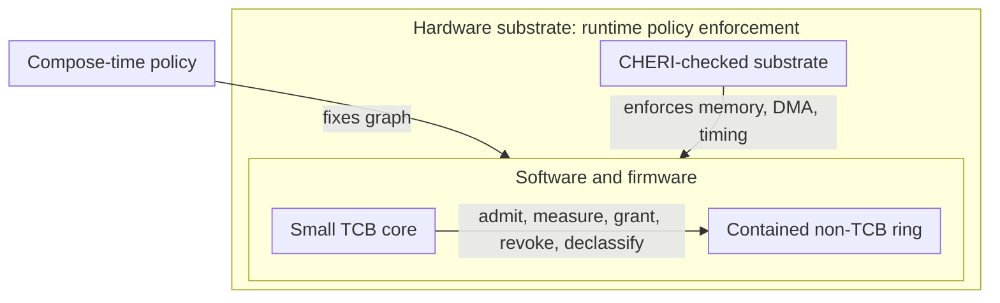

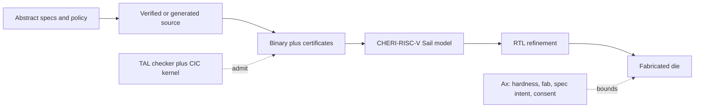

```mermaid
stateDiagram-v2
  [*] --> BFU: measured boot; BFU --> AFU: primary credential; AFU --> BFU: lock or idle timeout
  AFU --> Erased: duress credential; BFU --> Recovery: signed recovery generation; Recovery --> BFU: rollback committed
```

---

## 2. Non-Goals (deliberate)

- No POSIX/Linux compatibility in any form: no `fork()`, no uid/gid, no ambient authority, **no Linux-personality shim, and no legacy VM**. <a id="r-02-001"></a>
  Platform compartments run natively against the capability substrate ([§14](#14-userland)); interpreted Wasm application guests are data inside those compartments, with no environment that supplies ambient authority.
  Static composition separately rules out `fork()`: even a child restricted to manifest-declared capabilities would require creating a compartment at runtime. See [POSIX `fork()` on a statically composed machine](background/architectural-alternatives.md#posix-fork-on-a-statically-composed-machine-newly-tractable-on-cheri-declined-anyway-and-buying-no-performance-even-if-it-were-admitted).
- No broad hardware support: curated allowlist only. <a id="r-02-002"></a>
- Laptop, phone, IoT, workstation and server designs share the same principles. All except the server are single machines; a server is an ensemble (below). <a id="r-02-003"></a>

  The reference design and first release target a **general-purpose laptop** with an immutable signed base generation. Native components install in successor generations; application guests can be built, admitted, launched, replaced and closed within a session in precomposed elastic hosts ([§14](#14-userland)). Its only network ports are 802.11 and the wired link. Lid-close is its away-gesture. It has no cellular radio, eUICC or Bluetooth.

  A later **mobile handset** adds those peripherals, page-reachable standby ([§9](#9-boot--root-of-trust), [§15](#15-hardware-platform)) and a face-down away-gesture. Its own capacity and area comparison determines whether it shares the laptop's mask set or uses a separate cellular datapath. The first release's product floor ([§18](#18-realization)) specifies capabilities and capacity; pre-silicon gates do not qualify its physical envelope.

  Each form factor omits unneeded peripherals. Lockout drives its privacy cutoffs ([§15](#15-hardware-platform)), as does an away-gesture where present. A workstation or server without a camera, microphone or radio has cutoffs only for USB data lanes, if present.

- **A server is an ensemble of independent machines.** <a id="r-02-003a"></a>

  Each machine is one die with its own 36-bit address space, both memory classes, root of trust, measured chain, kernel instances, admission checkers, clock spine and signed generation ([§9](#9-boot--root-of-trust), [§13](#13-packaging--supply-chain), [§15](#15-hardware-platform)). Members share no memory, capabilities, authority or clock. Each independently meets this specification, including the 64 GB ceiling, population wall and one-die commitments.

  Point-to-point ensemble links carry ring descriptors in mutually attested sessions ([§12](#12-system-servers-contained-outside-the-tcb)). They carry no loads, stores, capabilities or coherence messages and expand no member's address space or local roster capacity. Outside a session, only scheduled establishment traffic or fixed public padding is allowed; neither authorizes application delivery or a frame-origin leap. Members never forward frames. Relaying data requires new ring traffic under the relaying member's schedule, so no member is a switch and links need no addresses.

  One composition produces each member's image and local schedule, plus the ensemble schedule ([§11](#11-updates), [§13](#13-packaging--supply-chain)). Every member's attested devicetree records all ensemble constants, including membership, link endpoints and leader ends, and expected peer unit and ensemble identities ([§9](#9-boot--root-of-trust)). Workloads that exceed one member's capacity must be sharded at composition ([§15](#15-hardware-platform)); capacity claims must state the member count. Members add capacity and aggregate throughput, but cannot raise one session's rate above its member's grants.

  The ensemble is deferred beyond the first release, whose floor needs no second machine ([§18](#18-realization)). Admission requires all five artifacts: the link contract; the link session reference model ([§12](#12-system-servers-contained-outside-the-tcb)); the admission artifact's ensemble output ([§11](#11-updates)); the composed non-interference statement ([§17](#17-residual-risks-the-honest-ceiling)); and the endpoint block with its absence predicate and two-member measurements of the skew bound and link latency constants ([§15](#15-hardware-platform)). Composing without any of them is a review-gate finding. The [implementation plan](../PLAN.md) prices them. Ensemble links have no privacy cutoff; a server's cutoffs reach only its USB data lanes, where present ([§15](#15-hardware-platform)).

- **The handset's obligations bind the handset.** <a id="r-02-003b"></a>

  Requirements for the cellular radio (including its 5G/6G floor), eUICC, emergency calling, page-reachable standby with a ringable away-gesture, carrier certification and Bluetooth apply only to designs carrying those peripherals. Their full requirements remain in [§3](#3-threat-model), [§4](#4-organizing-principle), [§5](#5-languages--verification), [§8](#8-authority-model), [§9](#9-boot--root-of-trust), [§11](#11-updates), [§12](#12-system-servers-contained-outside-the-tcb), [§15](#15-hardware-platform) and [§17](#17-residual-risks-the-honest-ceiling). They are outside the first release's floor and critical path; the later handset must meet them unchanged.

  Laptop lid-close locks the device and enters deep sleep; waking repeats the measured chain ([§9](#9-boot--root-of-trust)). With no paging task, it needs no live standby island. The laptop carries **no foreign computer**: the design's only permitted exception is the handset's eUICC ([§4](#4-organizing-principle)). Its sole radio stack is 802.11.
- No performance parity: in-order cores, no SMT, no JIT, no dynamic speculation, **no dynamic branch prediction ([§15](#15-hardware-platform))**. <a id="r-02-004"></a>
  **Rendering, software AI, and radio signal processing run on general-purpose vector/matrix cores under the same ISA and proofs ([§15](#15-hardware-platform))**. There is no fixed-function GPU or opaque coprocessor; an optional immutable inference module needs its own complete device qualification ([§4](#4-organizing-principle), [§12](#12-system-servers-contained-outside-the-tcb)).
  The design targets throughput in 2010s-iGPU / early-NPU / LTE-class-modem territory. The product floor ([§18](#18-realization)) turns that description into absolute quantities the first release must reach.
  **Instruction-level parallelism is bought only from static, exposed mechanisms (the shared scalar front end's in-order single or dual issue, decoder-stage macro-op fusion, and the vector or matrix datapath a class carries), never from mechanisms that create hidden speculative microarchitectural state ([§15](#15-hardware-platform) profile).** <a id="r-02-005"></a> The scalar front end is one microarchitecture on every class ([§15](#15-hardware-platform)) and is not wide: it issues one or two instructions in order, and the parameter selection ([§15](#15-hardware-platform)) weighs that bound against core count on one area axis, so what the vector and matrix classes add is datapath width rather than issue width.
- No legacy: no BIOS/MBR, UEFI, ACPI, IPv4, 32-bit modes, or compressed-instruction ambiguity (no C extension, [§15](#15-hardware-platform)). <a id="r-02-006"></a>
- No proprietary firmware black boxes: the platform excludes those listed in the [§12](#12-system-servers-contained-outside-the-tcb) topology table. <a id="r-02-007"></a>
- No self-modifying generation: a native build becomes machine code only in a successor generation; a new Wasm application runs in the current one as interpreted data. <a id="r-02-008"></a>
  The resident toolchain ([§13](#13-packaging--supply-chain)) can compile, prove and compose native packages on the device, but their emitted bytes stay store data until checked for a successor generation and loaded with its capability wiring at the next boot. It can also build an application bundle for the precomposed Wasm host ([§14](#14-userland)), which validates and interprets that bundle during the same session. The guest's bytes are never fetched as machine instructions.
  Neither path trusts a local producer. Native code still needs its CHERI-TAL derivation and source-correspondence theorem, while the guest must pass the host's pinned Wasm validation and import and resource checks. The toolchain holds no execute authority over what it writes; the host runs only its own already admitted interpreter image. Both paths stay inside their composed memory and time envelopes.

---

## 3. Threat Model

**Defended threats and their mechanisms:** <a id="r-03-001"></a>

| Threat | Defense mechanism | Primary sections |
| --- | --- | --- |
| **Remote network & radio attackers** (rogue APs and base stations) | The Wi-Fi stack confines rogue access points ([§12](#12-system-servers-contained-outside-the-tcb)) and is the first-release laptop's only radio ([§2](#2-non-goals-deliberate)). On the handset, the cellular stack confines rogue base stations. The silicon omits 2G/3G/4G, preventing legacy downgrade ([§15](#15-hardware-platform)). Normal service never falls back to unauthenticated attach; emergency calling uses a separate, locally invoked zero-authority 5G/6G mode whose bearer is explicitly unauthenticated ([§12](#12-system-servers-contained-outside-the-tcb)). | [§2](#2-non-goals-deliberate), [§12](#12-system-servers-contained-outside-the-tcb), [§15](#15-hardware-platform) |
| **Hostile web content & compromised apps, servers, or drivers** | CHERI compartments confine each component to its manifest-granted authority. | [§4](#4-organizing-principle), [§12](#12-system-servers-contained-outside-the-tcb), [§14](#14-userland) |
| **Malicious DMA peripherals & spoofed wired devices/cables** | Fabric capability-checks all DMA; device and cable authentication enforces a post-quantum floor; USB tunneling (PCIe/DMA over USB4/Thunderbolt) is excluded. | [§12](#12-system-servers-contained-outside-the-tcb), [§15](#15-hardware-platform) |
| **Ensemble link interposition, peer substitution, or replay** | Off-die server links carry frames only inside an authenticated encrypted session between mutually attested machines with composition-fixed unit and ensemble identities, using the schedule's slot count for anti-replay. Mismatched peers or invalid tags stop the link; wire exposure is booked as a residual. | [§12](#12-system-servers-contained-outside-the-tcb), [§15](#15-hardware-platform), [§17](#17-residual-risks-the-honest-ceiling) |
| **Evil-maid physical access** | Measured boot, attestation, and full-disk encryption ([§9](#9-boot--root-of-trust), [§10](#10-storage--state)). First-class SRAM is volatile across power-down. Second-class gain-cell memory retains charge for minutes to hours: exit-path discharge invalidates residual authority, while power-off plaintext remanence is booked as a residual ([§15](#15-hardware-platform), [§17](#17-residual-risks-the-honest-ceiling)). On-die main memory needs no bus encryption; probing it requires an out-of-scope invasive physical attack. | [§9](#9-boot--root-of-trust), [§10](#10-storage--state), [§15](#15-hardware-platform), [§17](#17-residual-risks-the-honest-ceiling) |
| **Post-unlock forensic extraction** | Lock or idle timeout evicts per-profile volume keys, returning the device from *After First Unlock* (AFU) to *Before First Unlock* (BFU) via an attested transition and closing the USB data path to charging-only. | [§9](#9-boot--root-of-trust), [§10](#10-storage--state), [§12](#12-system-servers-contained-outside-the-tcb), [§15](#15-hardware-platform) |
| **Coerced unlock (duress)** | Entering the duress credential crypto-erases user-data key material and discharges second-class memory before resetting. | [§9](#9-boot--root-of-trust), [§12](#12-system-servers-contained-outside-the-tcb) |
| **Software supply-chain tampering** | Every installed binary is checked against its exact content-addressed source closure, rejecting corrupted artifacts and compiler-injected behavior absent from that source. | [§13](#13-packaging--supply-chain) |
| **Software supply-chain subversion** | Malicious but memory-safe third-party dependencies are confined by intra-app library compartments. | [§13](#13-packaging--supply-chain), [§14](#14-userland) |

**User-controlled cutoffs** also counter covert microphone, camera or radio activation and wired-port use in hostile environments. <a id="r-03-002"></a>
The microphone, radios and USB data lanes have sealed, gasketed Hall-effect kill switches independent of software and firmware. Users can actuate them individually; lockout and the form-factor away-gesture also drive them together ([§15](#15-hardware-platform)). The camera has a mechanical shutter over its lens.
These physical controls supplement capability-gated per-app access, which keeps a device off without a live grant. The away-gesture preserves the mobile phone's page-reachable mode while its other radios go dark ([§8](#8-authority-model), [§15](#15-hardware-platform)).

**Electromagnetic environment:** <a id="r-03-003"></a>
- **EMI and EM fault injection (glitching):** countered by the **shielded (Faraday) enclosure** ([§15](#15-hardware-platform)); any fault that still lands is caught by fixed-latency ECC and the fail-stop reliability path ([§15](#15-hardware-platform), [§16](#16-reliability)).
- **Single-event upsets (SEUs / cosmic-ray bit flips):** *not* shielded (mass shielding is ineffective and counterproductive against them), but detected and corrected or contained by the same ECC and fail-stop logic, with upset rates reduced at the source by a radiation-hardened silicon realization where the deployment environment warrants it ([§15](#15-hardware-platform), [§16](#16-reliability)).

**Residual risks ([§17](#17-residual-risks-the-honest-ceiling)):** <a id="r-03-004"></a><a id="r-03-005"></a>

- Timing channels beyond the transient-execution and DVFS classes, specification errors, and the proof-tool trust base.
- **Protocol-level security above the scheme level.** The [§5](#5-languages--verification) assurance covers IND-CCA/EUF-CMA properties of cryptographic primitives; it does not prove the composed session security of TLS 1.3 or WireGuard. For the four radio protocols, upstream machine-checked session-security results cover the analyzed models from which the reference machines are curated ([§12](#12-system-servers-contained-outside-the-tcb)). Their remaining risks are model faithfulness, symbolic abstraction and the upstream proof tools. Those analyses supply supporting evidence, not platform theorems.
- **Invasive physical attack.** Main memory is on-die, so access requires entering the package and probing it. This exclusion defines the [§15](#15-hardware-platform) memory-path threat boundary; there is no additional memory-path defense beneath the package boundary.
- Malicious silicon fabrication and carrier or certification-body acceptance of an open cellular stack.

**Denial of service splits into two cases:**

| Case | Disposition | Governing mechanisms |
| --- | --- | --- |
| **Attempted *through* a boundary** | **Defended** <a id="r-03-007"></a> | The [coverage matrix](assurance/coverage-matrix.md) requires availability and progress (`P-5`) at every boundary: fixed worst-case latencies and `fence.t` ([§15](#15-hardware-platform)); admission schedulability proofs ([§11](#11-updates)); server work charged to the caller's slot including switch-duty ratios ([§12](#12-system-servers-contained-outside-the-tcb)); bounded sequencer turnaround and polling cadence ([§15](#15-hardware-platform)); deadlock/livelock-free crash-refining storage journal ([§10](#10-storage--state)); admitted hard radio deadlines ([§11](#11-updates), [§16](#16-reliability)); forced-sweep costs charged to the aggressor ([§8](#8-authority-model)); and boot-counted recovery bounding reset loops ([§16](#16-reliability)). |
| **Achieved by *provoking platform refusals*** | **Residual** <a id="r-03-008"></a> | Thermal trips, watchdog resets, containment teardowns, admission refusals, sealed cutoffs, fault-detector trips, and emergency-path coverage limits protect the system by stopping or restricting service. The **fail-closed seam register** ([§17](#17-residual-risks-the-honest-ceiling)) records their combined availability and life-safety impact. |

**Neither case provides a device-level availability guarantee.** <a id="r-03-009"></a>
Every fail-closed path must preserve confidentiality, integrity and authority, even when doing so stops the device. Section 17 enumerates those availability costs.

**Tier:** each defended entry inherits the assurance tier of its supporting mechanism ([§1](#1-goals)). <a id="r-03-006"></a>
CHERI containment, which supports most entries, remains at **evidence tier** until the [§18](#18-realization) RTL ⊑ Sail ladder reaches unbounded refinement. Every claim about an earlier unit must state that tier.

---

## 4. Organizing Principle

Minimize and fully verify the TCB; run everything else as unprivileged, capability-confined, restartable components. <a id="r-04-001"></a>
Every element of this spec must shrink the TCB, deepen its proof, or contain the non-TCB.

**Reuse open standards wherever the guarantees permit it.** <a id="r-04-001a"></a>
Prefer established source interfaces, formats and semantics over project-specific replacements. A compatibility decision names its standard and revision and justifies each omission by an exact requirement conflict that bounded adaptation or ahead-of-time translation cannot resolve, a measured resource limit, or an owned implementation/proof gap. Missing ports and difficult proofs remain work to do. Preserve the greatest admissible standard surface and record tradeoffs between surfaces. The security guarantees, hardware absences, assurance tiers and residuals summarized in the root README still apply. Reassess existing decisions when their surface changes; amend an existing prohibition explicitly at its owner. Distinguish open source, open standards, source compatibility and full conformance.

**Two orthogonal security properties, both required.** <a id="r-04-002"></a>
Capabilities control *access*: who may invoke a resource. Information-flow control (IFC) controls *propagation*: where accessed data may travel. Neither governs the other's property: an authorized channel can leak a high-confidentiality value, while a flow policy alone cannot constrain authority.
Static composition ([§7](#7-kernel)) fixes both the capability topology and flow policy, allowing one non-interference theorem over the component graph.

**Compartments: the universal unit of isolation and least authority (CHERIoT-lineage).** <a id="r-04-003"></a>
A **compartment** is a bounded set of code and data holding exactly its manifest-granted capabilities, with no ambient authority. CHERI alone isolates peers in one physical address space: no rings, MMU, separate address spaces, page tables or mode switches ([§7](#7-kernel), [§15](#15-hardware-platform)).
The only path between compartments is a **sealed entry point through the CHERIoT-lineage switcher** ([§7](#7-kernel)). It saves and restores the caller; the local/global capability discipline ([§15](#15-hardware-platform)) confines delegated buffers to the call, preventing authority capture beyond it. <a id="r-04-004"></a>
**The structure is universal and layered.** <a id="r-04-005"></a>
The kernel alone holds system-register privilege ([§7](#7-kernel)). Everything else is a pre-composed compartment: every server, driver, filesystem, network or radio stack, app and browser origin ([§12](#12-system-servers-contained-outside-the-tcb), [§14](#14-userland)). This includes the userland TCB's powerbox and trusted-path agent and the non-TCB verified HAL ([§6](#6-trusted-computing-base-exhaustive)).
**Apps define their own compartments, and they nest.** <a id="r-04-006"></a>
An app presents one least-authority compartment at its edge. Its manifest may declare an **internal compartment graph** with least-authority **sub-manifests** for libraries such as codecs and third-party dependencies ([§8](#8-authority-model), [§14](#14-userland)). Each sub-compartment is an ordinary node in the same flat, machine-checked graph ([§7](#7-kernel)); nesting adds no mechanism or object class.
**Dependencies that handle untrusted input or additional authority require their own compartments.** <a id="r-04-007"></a>
Every app must be at least one memory-safe, capability-confined compartment ([§13](#13-packaging--supply-chain), [§14](#14-userland)). Sub-compartmentalization is mandatory for any dependency that parses attacker-controlled input or is handed authority beyond pure compute ([§14](#14-userland)), and optional otherwise for compose-time authority minimization.
**Every compartment is fixed at composition.** <a id="r-04-008"></a>
The compartment graph and capability distribution are machine-checked at build time and installed by proof ([§7](#7-kernel)). Runtime creates no compartments or privileges. Its sole sanctioned authority transfer, powerbox declassification ([§8](#8-authority-model)), extends live edges at one verified point without adding compartments or privilege classes.
The same isolation primitive spans library, app and server boundaries, obviating separate sandboxes, containers, enclaves and permission subsystems ([§8](#8-authority-model)).

**Heterogeneity discipline:** heterogeneity lives in the *datapath*, never in the trust structure. <a id="r-04-009"></a>
Every core class shares the base ISA, the purecap capability model, the kernel binary, and one parameterized formal model; classes differ only in datapath execution resources (vector length, matrix geometry).
Anything that cannot be expressed as an ISA-visible, Sail-modeled, capability-checked extension of a core is not admitted as a core. The qualified immutable peripheral below adds no instruction stream and owes its own complete device contract.

**No foreign computers.** <a id="r-04-010"></a>
The multikernel die is the platform's one computer, and no second die with capability access is admitted: no other die holds or is handed a capability of this machine, receives a host address, or masters an access to its memory or fabric.
Every other die—transducer, register slave such as the eUICC ([§12](#12-system-servers-contained-outside-the-tcb)), qualified inference module, or ensemble peer ([§2](#2-non-goals-deliberate))—is reached through a host-owned endpoint granting none of that access. Compromise can corrupt supplied data without corrupting host authority. These dies must also meet the instruction-fetch discipline and classification below, unless a separate category is stated.
Functions conventionally assigned to firmware coprocessors become software on disciplined cores under the kernel, capabilities and admission proofs; **fixed-geometry arithmetic units** whose data movement uses core-issued capability operands, with no instruction fetch, firmware or grammar ([§15](#15-hardware-platform)); **firmware-free device RTL** behind capability-checked DMA ([§15](#15-hardware-platform)); or **transducers or register slaves** with no instruction fetch. Immutable inference modules require the separate qualification below.
Instruction execution outside this discipline is excluded from the die and board. An ensemble peer is another copy of the same computer, attested before payload delivery ([§12](#12-system-servers-contained-outside-the-tcb)), reached through its link endpoint as a device edge ([§15](#15-hardware-platform)). It is permitted on the same or another board ([§2](#2-non-goals-deliberate)).
**Classify a non-core block by what controls its execution.** <a id="r-04-010a"></a>
A block qualifies as fixed-function *matter* only if all three conditions hold:

1. Its transition relation is fixed in RTL, with no writable program store.
2. Core-issued software supplies every operand and schedule through explicit capability operands ([§15](#15-hardware-platform)). The block has no independent bus mastership.
3. It completes within a bound stated by the composition, has no autonomous behaviour under [§15](#15-hardware-platform)'s fifth admission test, and accumulates no state across operations.

Outside the separately qualified inference-peripheral category below, failing any condition excludes a block as a foreign computer, regardless of size. The masked crypto datapath ([§5](#5-languages--verification)) meets all three, distinguishing it from the excluded fixed-function accelerators ([§15](#15-hardware-platform)). So does the ensemble link endpoint ([§15](#15-hardware-platform)): two streaming engines, encoders/decoders and a slot timer with no writable program. A core-loaded table fixes frame launch and landing times; code and schedule are declared configuration. Execution is bounded per slot; across slots it retains only equalization frozen per link epoch. Incoming frames trigger the fixed transition relation, as messages do in the PD sequencer.
The platform's own cores and root of trust are evaluated under the heterogeneity discipline above and the [§6](#6-trusted-computing-base-exhaustive) trusted base.
The USB-PD contract sequencer ([§12](#12-system-servers-contained-outside-the-tcb)) may react to varying input under a fixed transition relation. Having no program alone is insufficient: the autonomous bitstream engine ([§15](#15-hardware-platform)) fails condition 2, and the display's dimming feedback loop ([§15](#15-hardware-platform)) fails condition 3.
**An immutable inference module is a separately qualified peripheral.** <a id="r-04-010b"></a>
One inference die carries fixed digital model logic, immutable weights and proof data, declared private volatile state, and fixed-function identity and session cryptography. Neither it nor its board carries instruction fetch, executable ROM, writable microcode or firmware, a management processor, mutable adapters, or host-memory mastership. The host's admitted broker supplies bounded work through the fixed socket contract ([§12](#12-system-servers-contained-outside-the-tcb), [§15](#15-hardware-platform)). Session state is explicit and owed an erasure theorem; calling a session one operation does not satisfy ordinary matter's no-state rule. The module neither extends the host's address space nor becomes an ensemble member. Each extra mask set and removable data-custody boundary is a stated physical cost ([§17](#17-residual-risks-the-honest-ceiling)), and every required qualification artifact precedes admission. [Q24](../PLAN.md#q24-qualify-immutable-inference-modules) carries the open work.
The single tolerated exception is the eUICC, a carrier-mandated foreign trust domain contained as a zero-authority register-slave crypto oracle ([§12](#12-system-servers-contained-outside-the-tcb)). It exists only on cellular instantiations ([§2](#2-non-goals-deliberate)). <a id="r-04-011"></a>
Its carrier program fails condition 1; admission relies on explicit containment. Further exceptions require their own decision and stated containment under the same criterion. The first-release laptop has neither cellular radio nor eUICC, so it needs no exception.
Consequences: the device allowlist collapses toward transducers; N vendor firmware-update channels collapse into the one proof-checked generation mechanism ([§11](#11-updates)); attestation coverage becomes total, radio included. <a id="r-04-012"></a>

---

## 5. Languages & Verification

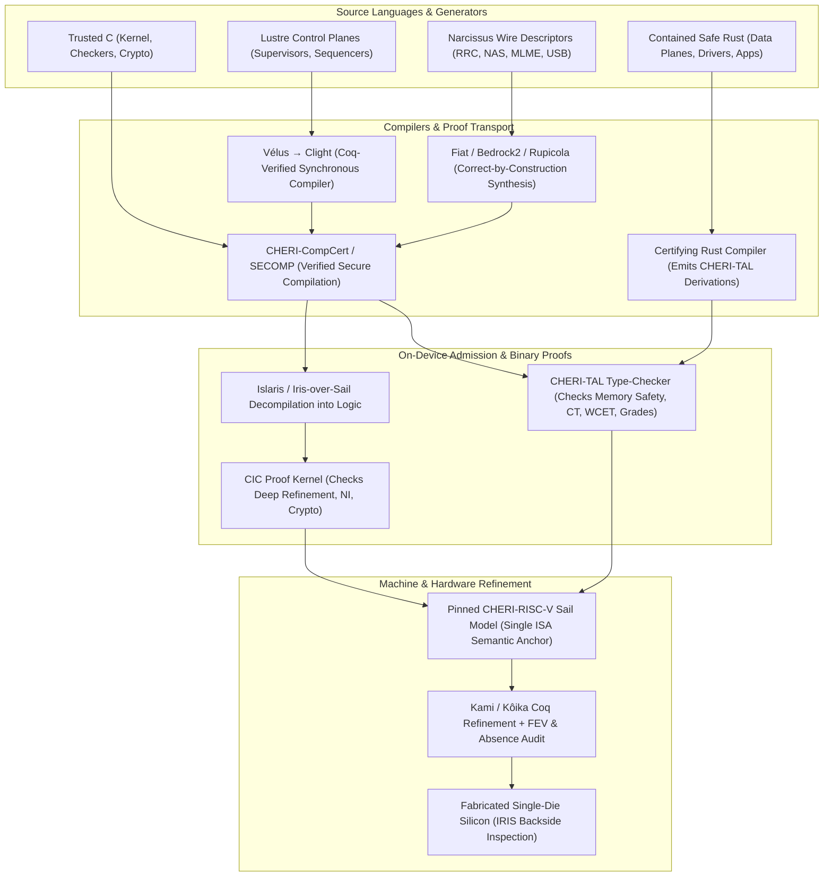

- **Trusted code is verified C; contained code is Rust by default.**
  The whole TCB, including both admission checkers ([§6](#6-trusted-computing-base-exhaustive)), is verified C compiled through CHERI-CompCert. Coq checks the compilation proofs as well as the source proofs. The C mandate selects CHERI-CompCert's verified compilation route within the single prover (R-05-019, R-05-021); the Rust producer's memory-safety certificates leave its preservation theorem tested-but-unproven (R-17-033, R-18-014). The hardware omissions (R-15-100, R-15-164), provenance deletion (R-05-137), and direct Sail proofs of the trap, context-switch and IPC fast path (R-07-050) limit the C/machine mismatch; the remaining capability-widened memory-model and kernel-refinement risk is R-07-049's. <a id="r-05-001"></a><a id="r-05-002"></a>
  The crypto core follows the same rule: its field-arithmetic kernels are **verified C compiled through CHERI-CompCert**, and its constant-time property is verified **on the artifact** against the [§15](#15-hardware-platform) leakage model. The crypto bullet below excludes both compiler-preservation claims for constant time and the CryptOpt route through checker-admitted superoptimized assembly. **No TCB component enters as a checker-admitted artifact.** <a id="r-05-003"></a><a id="r-05-004"></a><a id="r-05-005"></a>
  The analog leakage guarantees follow the same artifact discipline. The crypto core's secret-handling datapath is **masked**, with *d*-probing and composition theorems verified on the artifact against the [§15](#15-hardware-platform) probing model. A verified DRBG expands the platform root to supply per-operation masking randomness; a bare LFSR is excluded because output cancellation invalidates the probing proof. The uniform-randomness premise therefore rests on the DRBG's computational security, a named assumption beside the hardness conjectures, and the core's [§11](#11-updates) slot budget includes the expansion rate. <a id="r-05-004a"></a>
  Signing uses the hedged ML-DSA variant because the deterministic variant is materially harder to mask. A **dedicated masked datapath** at parametric sharing order *d* keeps the proof within the scope of execution-aware netlist verification: the demonstrated methods cover this shape, not an eight-lane VLEN=4096 core. Accordingly, the [§15](#15-hardware-platform) vector-crypto units carry no secret-labeled operands; the type system rejects them at the fourth rejection site below. The datapath is transcribed from a published parametric-order lineage. The original work is the probing model, composition theorem, and fault reduction.
  Contained code rides the certifying userspace toolchain (below): unverified but evidence-producing, never touching the TCB. <a id="r-05-006"></a>
  Contained code is Rust for the data planes and **Coq-verified Lustre (Vélus) for the control planes** ([§12](#12-system-servers-contained-outside-the-tcb)), the latter riding verified compilation like the TCB rather than the certifying toolchain (Vélus bullet below). <a id="r-05-007"></a>
  **Rust is the *reference* contained language, not an architectural mandate.**
  Because the kernel ABI uses capability primitives ([§7](#7-kernel)), the [§12](#12-system-servers-contained-outside-the-tcb) IDL is language-neutral, and admission checks only a hash-bound source closure ([§13](#13-packaging--supply-chain)), any memory-safe or formally verified language that produces a well-typed binary and a kernel-checked elaboration into an existing semantic anchor (or ships manual proofs, [§13](#13-packaging--supply-chain)) is admissible on equal terms. <a id="r-05-008"></a><a id="r-05-009"></a>
  A **formally verified non-Rust component may therefore be lifted in whole** (e.g., Project Everest's miTLS or HACL\*/EverCrypt via Low\*→C→CHERI-CompCert). It ships a standard binary-level memory-safety certificate ([§13](#13-packaging--supply-chain)), while its foreign-prover (F\*/Z3) proof rides as *bonus* assurance that **never enters the trust base**, because containment re-establishes memory safety at the binary level. <a id="r-05-010"></a>
- **One prover, Coq, over a kernel authored from seL4's design.** <a id="r-05-011"></a>
  The kernel is **proved end-to-end in Coq over a specification authored here**, taking seL4's endpoint model and non-interference statement as design (not artifact) and compiling through CompCert/SECOMP; CompCert, Fiat-Crypto, and Perennial-lineage storage share the same single prover. <a id="r-05-012"></a><a id="r-05-013"></a>
  - **Scope of the kernel spec:** VSpace/paging, MCS scheduling, S/U privilege rings, separate address spaces, untyped memory, retype, CNodes, and the capability derivation tree are deleted ([§7](#7-kernel), [§8](#8-authority-model)), leaving endpoints, notifications, and non-interference on a single-address-space purecap machine (*CertiKOS* supplies the layered proof method, while its shared-memory concurrency is unused by the share-nothing multikernel).
  - **Fresh non-interference proof:** seL4 supplies the model and method for non-interference, not a reusable proof artifact—seL4's own NI proof is the least-maintained layer of `l4v` and covers only a single-core kernel, so the theorem here is a *fresh* proof ([§8](#8-authority-model), [§17](#17-residual-risks-the-honest-ceiling)). <a id="r-05-014"></a>
  - **No Isabelle or `hs-to-coq` import:** Adopting seL4's Isabelle proof would create a two-prover trust base, and translating seL4's Haskell model via `hs-to-coq` is foreclosed on licence grounds ([§17](#17-residual-risks-the-honest-ceiling)). <a id="r-05-012-2"></a>
    Full rationale and lineage in [Inspirations & Prior Art](background/inspirations.md).
- **One logic allows the proofs to compose into T.** <a id="r-05-011a"></a>
  T is one linked development (below) whose seam lemmas state each conclusion in the vocabulary of the next premise. Proving a theorem in a second logic would require an unbuilt mechanized bridge between the two semantics (as illustrated by Verisoft's unclosed PVS/Isabelle split in [Inspirations & Prior Art](background/inspirations.md)). The single-prover rule rests on this composition requirement rather than claiming Coq has fewer kernel defects than other provers.
- **Independent proof re-checking can supply additional evidence without adding an axiom.** <a id="r-05-016a"></a>
  Under the **de Bruijn criterion**, re-checking a Coq proof term with an independent kernel can reject a build if the two disagree, while acceptance by a second logic never grounds admission. The checkers' own binaries apply the same asymmetry via reproducible builds and diverse double-compiling ([§6](#6-trusted-computing-base-exhaustive)), avoiding seL4's binary-level reliance on Isabelle/HOL, HOL4, and trusted SMT verdicts.
- **Admission uses one logic and two checking programs.** <a id="r-05-011c"></a>
  The CIC kernel checks proofs; the CHERI-TAL checker decides typing judgments and has a soundness theorem checked by the CIC kernel ([§6](#6-trusted-computing-base-exhaustive)). The rule therefore limits unproved logics, while admitting a second checking program whose soundness is proved in the first.
- **The single-prover rule governs the grounds for acceptance.** <a id="r-05-011b"></a>
  A tool adds a trusted checker only when an admitted claim depends on its verdict. Tools used solely for supporting evidence—riscv-formal, Isla, UPEC, GLIFT, SecVerilog, Binsec/Rel, aiT, and commercial FEV—remain untrusted ([§6](#6-trusted-computing-base-exhaustive)); any rejection of a foreign-prover artifact must cite the specific obligation it fails (such as missing RTL ⊑ Sail refinement, duplicate semantic anchor, or lack of a replayable proof term).
- **The single-prover rule binds the *checker*, not the *producer*.**
  Any solver or search tool that emits a term re-checked by the Coq kernel widens nothing ([§6](#6-trusted-computing-base-exhaustive)). <a id="r-05-015"></a>
  - **Proof-producing tools:** **SMTCoq** (certificate reconstruction, qualified for its exact solver, certificate format, plugin, and Rocq revisions by kernel replay), **CoqHammer / Sniper / itauto** (proof search and reconstruction), and **Coq-Elpi / Hierarchy Builder / Equations / MetaCoq** (checked metaprogramming, algebraic interfaces, and dependent definitions). <a id="r-05-017"></a>
  - **Domain and learned automation:** **Iris / separation-logic automation** (**Diaframe**-lineage) for kernel, RefFS/storage, and Iris-over-Sail goals; and **learned tactic synthesis** (**Tactician**, **Graph2Tac**, **Rango**, **CoqPilot**) for Coq-native proof search with in-kernel reconstruction. <a id="r-05-018"></a>
  - **Oracle rule:** Any tool may serve as a proof-search oracle provided its output is reconstructed and checked by the Coq kernel; a solver's bare verdict never authorizes admission. Bounded qualification experiments precede wider adoption. <a id="r-05-016"></a>
- **Interactive proof state is authoring feedback, not acceptance evidence.** Rocq LSP with Pytanque is the first candidate for source-located goals, premises and diagnostics; Alectryon is the candidate for rendered proof-state review. Provisional admissions, cached goals and generated pages cannot satisfy a gate: acceptance requires a fresh batch build of the exact source and dependency environment, the existing transitive-assumption audit and `rocqchk`. Feedback identifies its source revision and toolchain environment, and a changed source, dependency or configuration invalidates its current status. Recurring integration uses the existing launcher and WSL lane without making the host-only checks depend on Rocq or building another language server. <a id="r-05-018a"></a>
- **Reuse is qualified on the theorem that consumes it.** Selective stdlib, stdpp and coqutil imports precede new list, map, word or arithmetic helpers; Equations and Rocq-Elpi Derive precede hand-maintained dependent eliminators and record boilerplate; standalone CoqHammer `sauto` precedes external search infrastructure. A retained candidate has a reproducible pinned environment, an incorporation-time licence reading, unchanged client statements and an R-05-163 audit of their actual transitive assumptions, not every axiom in the imported package. Generated definitions and replay scripts are kernel checked; no declaration is widened merely to pass the audit. Iris/MoSeL and Diaframe apply to the one Iris-over-Sail logic only through proved primitive rules, and Hierarchy Builder or Actris earns integration through concrete clients and proved instance laws. A generated lens is not a representation theorem, a HeapLang channel is not this platform's IPC, and a Bedrock2 theorem is not a CHERI machine connection. <a id="r-05-018b"></a>
  Embedded proof surfaces and certifying synthesis take that same rule: AddressC and SuSLik are candidates for notation, automation and proof construction, not new authoritative memory models. A certificate with admitted obligations is unfinished, and a kernel-checked theorem over HeapLang or ordinary C is not a theorem about this target without the required transport. The [project plan](../PLAN.md#q-assessment-actions) owns their bounded comparison; [the Vela language strategy](https://github.com/symbiogenesis/VelaLang/blob/main/docs/verification-strategy.md#embedded-verification-and-certified-synthesis) records the research and its limits.
- **The semantic-anchor budget: [§15](#15-hardware-platform)'s admission test, hoisted onto the verification toolchain itself.**
  Every pair of semantic anchors that must agree is a crown-jewel seam ([§17](#17-residual-risks-the-honest-ceiling)), so the load-bearing semantic anchors are budgeted and frozen like the ISA profile ([§15](#15-hardware-platform)): <a id="r-05-019"></a>

  | Frozen semantic anchor | Scope / domain | Role in the proof tower |
  | --- | --- | --- |
  | **Sail** | CHERI-RISC-V ISA semantics | Single machine-level anchor shared by binary proofs and RTL refinement |
  | **CHERI-C / CompCert** | Verified-C memory model | Source anchor for the TCB, kernel, checkers, and crypto field arithmetic ([§7](#7-kernel)) |
  | **Gallina / CIC** | Prover metatheory | Specification and proof language checked by the CIC kernel |
  | **Radium** (RefinedRust) | Safe-Rust fragment semantics | Source anchor for contained data-plane compartments ([§18](#18-realization)) |
  | **Lustre / Vélus** | Synchronous dataflow semantics | Source anchor for deterministic server control planes ([§12](#12-system-servers-contained-outside-the-tcb)) |
  | **Kôika / Kami** | Hardware rule/module semantics | Hardware refinement anchor for authored RTL blocks ([§15](#15-hardware-platform)) |
  | **Iris-over-Sail** | Binary program logic | Single binary-level logic with the theories listed in R-13-017 ([§13](#13-packaging--supply-chain)) |

  - **One term per anchor:** Every theorem mentioning an anchor quantifies over the same artifact; re-transcribing an anchor per consumer is rejected as a duplicate anchor. <a id="r-05-019a"></a>
  - **Shared ISA term:** The Sail model enters Coq via Sail's own backend, and both the [§13](#13-packaging--supply-chain) Iris-over-Sail program logic and the [§15](#15-hardware-platform) RTL ⊑ Sail refinement quantify over that exact emitted term. <a id="r-05-019b"></a>
  - **Authored upstream, generated downstream:** The Sail model is authored and reviewed directly, never generated from the Coq development it anchors; downstream Coq generation is ordinary proof transport. <a id="r-05-019c"></a>
  - **Admission criteria for any new anchor:** A new load-bearing semantics, program logic, or translator adding authoritative semantics or a checker to the trust base is admitted only if it: (1) is **Coq-native or mechanically bridged** (kernel re-checked, SMTCoq-style), (2) **does not duplicate an existing anchor**, and (3) **retires an interim** it replaces. Each amendment demonstrates every condition. The untrusted-elaboration classification below requires its full interpretation and correspondence evidence; renaming independent semantics does not meet it. <a id="r-05-020"></a>
  - **Untrusted elaborators into an existing anchor:** An untrusted elaborator may give a source language its meaning by checked interpretation in an existing anchor under R-05-009 without adding a trusted checker or retiring an interim. Its reviewed interpretation covers parsing or parse validation, resolution, instance selection, implicit insertion and desugaring into the exact anchor term. Its resource, dependency, substitution, control and erasure laws are theorems about that image, not an independent authoritative source reduction. Accepted packages carry kernel-checked correspondence bound to the exact source, generated inputs, dependencies, configuration and interpretation; a well-typed emitted term or matching hash alone proves no source meaning. Qualification changes source and dependency bindings and substitutes well-typed terms for different operations, none satisfying the unchanged correspondence. R-05-163/R-05-164 still govern assumptions, and all binary, concrete-machine, compilation, contextual-security and final-byte obligations remain. A new independent semantics, logic or accepting checker still takes the preceding amendment route. <a id="r-05-020a"></a>
    [Vela](https://github.com/symbiogenesis/VelaLang) adopts this interpretation boundary for its [bounded first release](https://github.com/symbiogenesis/VelaLang/blob/main/docs/first-release.md#release-boundary) and [delivery sequence](https://github.com/symbiogenesis/VelaLang/blob/main/PLAN.md#vela-first-release-delivery); its language reference, surface grammar, core design and extension dossiers live in the standalone [VelaLang repository](https://github.com/symbiogenesis/VelaLang). This design decision supplies no checked primitive law, source-correspondence theorem or admitted binary; the later machine-authoring option retains its separate anchor-migration decision.
  - **Verified compilers are proof transport, not anchors:** CompCert, Vélus, Fiat/Bedrock lowering, host-side CertiCoq, and the certifying Rust→CHERI compiler connect existing anchors and are admitted freely. <a id="r-05-021"></a>
  - **Interim anchors vs. bring-up tools:** The interims on the books (F\*/Z3 for libcrux/HACL\*, EasyCrypt's Why3/SMT) each carry a Coq-native destination and a retirement ([§17](#17-residual-risks-the-honest-ceiling)), never a permanent second anchor; aiT, Binsec/Rel and Cranelift/Crocus's SMT are on no book at all, being bring-up gates, cross-checks and reference material nothing rides as its ground (R-05-073, R-05-109, R-18-020), so they owe no destination and no retirement. <a id="r-05-022"></a>
  - **Decidable interim retirement:** An interim retires once **every artifact of its named Coq-native destination has passed admission and no consumer rides the interim any longer**, and is struck from the trust-base inventory in that same generation. An empty consumer list alone retires nothing before the destination lands, and an interim whose consumer set grows without its destination advancing is a **review-gate finding** ([§17](#17-residual-risks-the-honest-ceiling)). <a id="r-05-022a"></a>
- **CompCert compiles all trusted C; translation validation against the RISC-V Sail model covers the assembly/link/image steps outside CompCert's theorem.** <a id="r-05-023"></a>
- **Decompilation into logic over the pinned Sail term.**
  The R-05-023 validation record lifts the post-CompCert binary against the Sail-emitted Coq term (Islaris-style per-instruction symbolic traces) and checks it in the CIC kernel as a refinement theorem in the same [§13](#13-packaging--supply-chain) program logic used for the IPC fast path ([§7](#7-kernel)), avoiding any solver-trusted graph-refinement validator. <a id="r-05-023a"></a>
- **Closed backend primitives for ISA instructions lacking C/Gallina syntax.** <a id="r-05-023b"></a>
  Instructions with no source-expression syntax—`vmclear` ([§7](#7-kernel)), `creclaim` ([§8](#8-authority-model)), `cbo.scrub`, `fence.t`, `cloadtags`, `csealentry`, and `cspecialrw` ([§15](#15-hardware-platform))—are reached through a closed set of **backend primitives** rather than hand-written assembly leaves (which lack source-anchor meaning and would break FPCC source correspondence). Each primitive uses the profile's mnemonic and operand form, and its source semantics *is* the pinned Sail clause for that instruction. The on-device TAL checker types the emitted instruction directly, and membership is read off the frozen ISA profile ([§3](hardware/isa-profile.md#3-custom-and-fork-and-frozen-instructions), [§4](hardware/isa-profile.md#4-cheri-feature-set)) as a duty of the two required compilers ([§18](#18-realization)).
- **The CHERI-RISC-V CompCert backend ([§6](#6-trusted-computing-base-exhaustive)) must satisfy a secure-compilation (robust-preservation) criterion, not merely functional correctness.** <a id="r-05-024"></a>
  Compilation of trusted C must *preserve compartment isolation against an adversarial linked context* (**SECOMP / SECOMP2CHERI** criterion), completing and re-homing that backend to the [§15](#15-hardware-platform) purecap profile so the TCB compiler's theorem composes directly with the Cerise universal contract for unknown code ([§13](#13-packaging--supply-chain)). The compiler remains untrusted evidence-producing machinery under FPCC. <a id="r-05-025"></a>
- **Foundational proof-carrying code (FPCC) is the delivery discipline.**
  Every binary ships a machine-checkable proof of its assurance tier ([§13](#13-packaging--supply-chain)), stated at binary level against the CHERI-RISC-V Sail model and checked at admission by the on-device checker ([§6](#6-trusted-computing-base-exhaustive)). The proof binds the final binary to its exact content-addressed source closure (via CHERI-C, Radium, Lustre, or Gallina, or a kernel-checked elaboration into one of them) with a source-correspondence theorem covering assembly, linking, and image construction. <a id="r-05-026"></a><a id="r-05-027"></a>
  - **No trusted VC generator:** FPCC rests only on the proof kernel, machine model, and spec statements; the full platform axiom set (including the TAL checker, its soundness metatheorem, and bootstrap root) is enumerated once in [§6](#6-trusted-computing-base-exhaustive). <a id="r-05-028"></a>
  - **Canonical type-level obligations (CHERI-TAL):** Memory safety, **definite initialization**, **data-race freedom**, control-flow integrity (**both runtime sentry enforcement and compose-time callee-set enumeration**), no-runtime-codegen, ABI/type conformance, examined verdicts, absent ambient state, representation-and-provenance conformance, constant-time, and WCET are carried as a *typing derivation* in the CHERI typed assembly language (`CHERI-TAL`) and re-checked per install by the on-device checker ([§6](#6-trusted-computing-base-exhaustive), [§13](#13-packaging--supply-chain)). <a id="r-05-029"></a>
  - **Deep obligations (CIC proof kernel):** Tier-0 functional refinement, non-interference ([§8](#8-authority-model)), cryptographic reductions, and unstructured constant-time or WCET residuals remain full CIC proof terms. <a id="r-05-030"></a>
  - **Compact soundness metatheorem:** Because CHERI enforces spatial safety in hardware, `CHERI-TAL` carries only the temporal-safety, exclusive-access, and typed-control-flow residual; its **soundness metatheorem** (well-typed ⇒ safe and data-race-free over the Sail model) is a single Coq proof and crown-jewel spec. <a id="r-05-031"></a>
  - **Certifying compilation & Iris-over-Sail:** Tier-0 builds ship the composed theorem *"binary refines abstract spec and robustly preserves compartment isolation,"* while binaries without a verified compiler use Islaris-style Iris-over-Sail functional/safety proofs plus the binary-level CT check below where secret-touching. <a id="r-05-032"></a><a id="r-05-033"></a>
  - **Consequence:** Compilers, extraction tooling, and the build farm drop out of the consumer-side TCB; verification is a property of the artifact, not its pedigree. <a id="r-05-034"></a>
  - **Unambiguous instruction decode:** Instruction decoding is a pure function of a bundle's contents and a slot index ([§15](#15-hardware-platform)), with the C extension's overlapping 16-bit alignments excluded and dictionary slots anchored to a fixed grid, eliminating overlapping-stream proofs. <a id="r-05-035"></a>
- **The type-level tier collapses to one primitive seen from three sides: the type is a *faithful static shadow* of the running capability machine.**
  The on-device checker validates the canonical type-level obligations through three moves defined in the [typed assembly language](languages/typed-assembly-language.md): <a id="r-05-036"></a>

  | Move | Obligations carried here |
  | --- | --- |
  | **I. Cite a runtime invariant** the machine already enforces | Spatial memory safety, no-runtime-codegen, and CFI-runtime through sentry reachability. <a id="r-05-037"></a><a id="r-05-040"></a> |
  | **II. Evaluate a Knuth-style attribute** over the already-typed control-flow graph | Temporal memory safety, definite initialization, data-race freedom, examined verdicts, constant-time, WCET, callee-set enumeration, and type/ABI conformance. <a id="r-05-038"></a> |
  | **III. Confirm a deletion** the static shadow would otherwise lie about | Representation-and-provenance conformance and no ambient mutable state. <a id="r-05-039"></a> |

  Re-checking a certificate evaluates the Move-II attributes and confirms the Move-I citations and Move-III deletions. The **soundness metatheorem** accordingly states that *attribute evaluation is sound against the four unary invariants* ([§5](#5-languages--verification) apex). <a id="r-05-041"></a>
- **Data-race freedom is an exclusive-access theorem carried by the existing linear capability grade.** <a id="r-05-096a"></a>
  For every non-atomic byte range, a writable capability is **exclusive**: the `CHERI-TAL` context-splitting rule and [§13](#13-packaging--supply-chain) manifest join deny any overlapping load or store authority across threads, compartments, or device states while that capability is live. Duplicable aliases are read-only, and shared synchronization cells use explicit atomic types accessed only via Sail-modeled atomic operations. <a id="r-05-096b"></a>
  Publication is a typestate transition (consuming exclusive writable ownership yields immutable published ownership; reclamation consumes every reader before writable ownership returns). Sequence-counter copies of concurrently writable non-atomic payloads are therefore inexpressible, no atomic `memcpy` exists, and copy-once parsers write only declared fields into definitely initialized destinations without inspecting padding.
- **Verified copy-once parsers (Narcissus (Fiat), Coq-native) on every attacker-facing wire format**, including cellular RRC/NAS (ASN.1 UPER/PER and IEI/TLV) and 802.11 MLME element grammars ([§12](#12-system-servers-contained-outside-the-tcb)). <a id="r-05-042"></a>
  - **Imperative synthesis without GC:** Narcissus derives correct-by-construction encoder/decoder pairs in Coq and lowers them to imperative Clight via **Fiat/Bedrock2/Rupicola** synthesis (counted as proof transport, not a new semantic anchor). <a id="r-05-043"></a>
  - **Why EverParse is rejected as a generator:** EverParse relies on F\*/Z3, which would widen the trust base on the most-attacked remote surface where a Coq-native generator already exists; EverParse remains admissible only as an **untrusted differential oracle (never the shipped checker)**. <a id="r-05-044"></a><a id="r-05-045"></a>
  - **Format descriptors as crown-jewel specs:** Narcissus proves correctness against its Coq format descriptor, not the prose standard; even if a descriptor is mis-transcribed, copy-once `#![forbid(unsafe_code)]` and CHERI bounds preserve memory safety and containment. To minimize transcription errors, NR RRC (3GPP TS 38.331) descriptors are compiled from vendor ASN.1 modules via a small verified **ASN.1 (X.691 UPER) → Narcissus front end**, while 5G-core NAS (TS 24.501 IEI/TLV) uses a smaller hand-written grammar cross-checked against untrusted differential oracles (`asn1scc`, `asn1c`, Wireshark dissectors, srsRAN/OpenAirInterface) on captured and fuzzed corpora ([§18](#18-realization)). <a id="r-05-046"></a><a id="r-05-047"></a><a id="r-05-048"></a><a id="r-05-049"></a><a id="r-05-050"></a><a id="r-05-051"></a>
  - **Canonicity theorem for identity-bearing formats:** Wherever encoded bytes serve as a signature, hash, content address, or cache key ([§10](#10-storage--state), [§12](#12-system-servers-contained-outside-the-tcb), [§13](#13-packaging--supply-chain)), the descriptor must also carry a Coq-checked **canonicity theorem** (*encode after decode is the identity on bytes*, so decode is injective). <a id="r-05-051a"></a>
  - **Zero-slack descriptors:** Descriptors earn canonicity by permitting one length form, one optional-field presence encoding, fixed field order, no free padding/reserved bits, and no accept-and-ignore fields; non-canonical inputs fail decoding rather than normalizing. Formats that cannot carry the theorem are refused the identity role. Peer agreement remains an empirical differential residual ([§17](#17-residual-risks-the-honest-ceiling)). <a id="r-05-051b"></a><a id="r-05-051c"></a>
- **Verified synchronous control planes (Lustre via Vélus, Coq-native) for server sequencing ([§12](#12-system-servers-contained-outside-the-tcb)).** <a id="r-05-052"></a>
  Control-plane state machines (supervision trees, protocol sequencers, mode/timing sequencers) are written in **Lustre** and compiled by **Vélus** into **CompCert Clight**, composing directly with CHERI-CompCert on the single Coq prover. <a id="r-05-053"></a>
  Synchronous dataflow makes three obligations *structural* for the control tier: **WCET** (loop-free, statically sized reactions), **determinism and causality** (Vélus's clock calculus rejects instantaneous cycles and hidden state across partition switches, [§8](#8-authority-model), [§15](#15-hardware-platform)), and **memory safety** (static allocation). <a id="r-05-054"></a><a id="r-05-055"></a><a id="r-05-056"></a>
  Data-plane logic (bulk I/O, vector/matrix math, wire parsing) stays `#![forbid(unsafe_code)]` Rust. Full rationale in [Inspirations & Prior Art](background/inspirations.md). <a id="r-05-057"></a>
- **Crypto: verified across three composed layers, post-quantum by default (ML-KEM / ML-DSA / SLH-DSA).** <a id="r-05-058"></a><a id="r-05-059"></a>

  | Assurance layer | Requirement & verification vehicle | Interim & retirement / scope |
  | --- | --- | --- |
  | **(1) Functional correctness** (implementation ⊑ scheme) | **Fiat-Crypto** (Coq-native) for classical field arithmetic; **libcrux/HACL\*** (F\*/Z3) as an explicit interim for PQ primitives. <a id="r-05-060"></a> | **Its Coq-native destination is the Gallina ML-KEM and ML-DSA authored against FIPS 203 and FIPS 204, with the CompCert-C refined against them** ([PLAN.md §4](../PLAN.md#4-verified-crypto-core-coq)), built here and retired into under R-05-022 once both primitives land. <a id="r-05-061"></a> |
  | **(2) Constant-time** (2-safety hyperproperty on the binary) | Verified directly on every secret-touching binary against the [§15](#15-hardware-platform) `Zkt`/`Zvkt` leakage model via the **CHERI-TAL secret-taint discipline** (CT-Wasm lineage, rejecting secrets at branch conditions, memory addresses, non-`Zkt`/`Zvkt` ops, or unmasked vector-crypto units) and, for unstructured corners, a **relational Iris-over-Sail proof**. <a id="r-05-062"></a><a id="r-05-063"></a><a id="r-05-069"></a><a id="r-05-070"></a><a id="r-05-071"></a><a id="r-05-072"></a> | **Binsec/Rel** supplies bounded binary-level bring-up evidence (never the axiom); scope covers any compartment holding secret-labeled material regardless of arrival channel (IDL, DMA/RoT-latched PIN/biometric, or local entropy draw). <a id="r-05-073"></a><a id="r-05-074"></a> |
  | **(3) Reduction security** (IND-CCA / EUF-CMA game reductions) | **SSProve / FCF** supply Coq-native game-based security reductions on the single proof kernel. <a id="r-05-064-2"></a><a id="r-05-075"></a> | **EasyCrypt** (Why3/SMT) is admitted where it accelerates delivery (formosa-crypto ML-KEM/ML-DSA), with the SSProve/FCF Coq-native statement as the destination. |

  - **No CryptOpt translation-validation checker (`R-05-064`–`R-05-068`):** Field-arithmetic kernels are verified C compiled through CHERI-CompCert. A CryptOpt-style randomized superoptimizer plus Coq assembly equivalence checker is **excluded, not deferred**, under the standing rule that *any net-new verified artifact whose only yield is speed on a path already correct and constant-time is inadmissible* (pessimism and slowness are free by axiom, [§1](#1-goals)). Untrusted C/IR optimization and scheduling remain admissible when existing compiler and final-artifact proofs re-establish correctness, CT, masking, and bounds without a new checker or assembly leaf. <a id="r-05-064"></a><a id="r-05-065"></a><a id="r-05-066"></a>
  - **Unsaturated limb representations & RVV batching:** Where a modulus permits an unsaturated (reduced-radix) representation, Fiat-Crypto emits straight-line C with lazy carries; independent field operations (batch verification, multi-scalar multiplication) batch across RVV lanes. Control-flow-heavy primitives (Keccak, AES, ChaCha, ML-KEM/ML-DSA NTT and samplers) use branchless `Zicond` selects and are restructured in source if a lowering fails the binary CT check—never escaping to hand-written assembly. <a id="r-05-064a"></a><a id="r-05-067"></a><a id="r-05-068"></a>
  - **Composition & preconditions:** Layers 1–2 and Layer 3 meet at the primitive's **functional specification** (a crown-jewel spec), isolating computational conjectures and idealized-model premises in [§17](#17-residual-risks-the-honest-ceiling) and depending on the tested multi-source entropy root ([§9](#9-boot--root-of-trust), [§15](#15-hardware-platform)) for uniform draws. <a id="r-05-076"></a><a id="r-05-077"></a><a id="r-05-078"></a><a id="r-05-077a"></a>
  - **Frozen cryptographic suite by role:**
    - **Category 5 device defaults:** **ML-KEM-1024**, **ML-DSA-87**, and **SLH-DSA-SHAKE-256s** for all platform-owned keys; external wire profiles may fix wire-only parameters (such as **ML-KEM-768** in the hybrid TLS group). <a id="r-05-058a"></a>
    - **Pinned hybrid KEM combiner:** Hybrid key establishment ([§12](#12-system-servers-contained-outside-the-tcb)) pins one combiner construction and states whether malicious-key binding comes from the combiner or explicit transcript binding. <a id="r-05-058b"></a>
    - **Signature split by verifier:** Replaceable image code uses **ML-DSA** for speed and compactness; immutable **metal-mask boot ROM** uses hash-based **SLH-DSA** ([§9](#9-boot--root-of-trust)) so the unpatchable silicon verifier is minimal and rests solely on the hash assumption. <a id="r-05-058c"></a>
- **Contained Rust: `#![forbid(unsafe_code)]` with no exception in all Rust-authored app and server logic.** <a id="r-05-079"></a>
  - **Verified HAL is the sole `unsafe` boundary:** Irreducible raw DMA/MMIO/descriptor primitives live in a minimal, formally verified HAL whose hardware-contract proofs establish the *initialized* postcondition on device-filled buffers, and whose MMIO shift/mask field accessors are generated and Coq-checked from an OpenTitan-`reggen`/SVD-shaped register declaration language. <a id="r-05-080"></a><a id="r-05-081"></a><a id="r-05-082"></a><a id="r-05-083"></a>
  - **Ownership-transferring DMA:** Submitting a DMA buffer consumes the caller's exclusive buffer capability and returns an opaque in-flight token until hardware completion ([§15](#15-hardware-platform)) returns initialized ownership, eliminating concurrent CPU/device access. <a id="r-05-082a"></a>
  - **Native compilation & Wasm boundary:** Contained Rust compiles to native RV64+CHERI by lowering verified safe-Rust MIR through the shared CHERI-CompCert backend ([§18](#18-realization)); Wasm bundles run only as guest data inside a precomposed native interpreter host ([§14](#14-userland)). <a id="r-05-084"></a><a id="r-05-085"></a>
- **Ambient *state* is deleted alongside ambient *authority*.**
  Safe Rust permits interior-mutable globals (`AtomicU64`, `OnceLock`, `Mutex`, `thread_local!`) that bypass object-capability scoping. The platform therefore forbids **all module-level mutable state, lazily initialized statics, thread-locals, and hidden singletons**: every capability and mutable state reference must be passed explicitly at construction or call time, while immutable `const`/`static` data remains in the read-only image. <a id="r-05-086"></a><a id="r-05-087"></a><a id="r-05-088"></a>
  - **Why this rule is load-bearing:** (1) it prevents stashing linear capabilities or relevance-graded verdicts in globals to evade typing contexts; (2) it prevents whole-program-lifetime globals from defeating static slot coloring ([§7](#7-kernel)); and (3) it ensures crash-only restart ([§16](#16-reliability)) and deterministic replay ([§10](#10-storage--state)) capture all component state.
  - **Enforced on the binary (Move III):** A compartment's static data section may carry **no tagged capability** (confirmed by a one-pass image scan), restricting the Cerise universal contract to the initial register file across Rust, Lustre/Vélus, and IDL boundaries; the ergonomic narrowing of ecosystem crates is booked in [§17](#17-residual-risks-the-honest-ceiling). <a id="r-05-089"></a><a id="r-05-090"></a><a id="r-05-092"></a>
- **Certifying userspace compilation: memory-safety PCC for all contained code.**
  The userspace Rust→RV64+CHERI compiler emits a binary-level **memory-safety certificate** (a `CHERI-TAL` typing derivation carrying the Tier-2 obligations of [§13](#13-packaging--supply-chain)) checked on-device ([§6](#6-trusted-computing-base-exhaustive)). Because safe Rust supplies source ownership types and CHERI enforces spatial safety in hardware, the certificate only needs to carry the temporal, exclusivity, and control-flow residual—removing `rustc`/LLVM from the consumer TCB ([§18](#18-realization)). <a id="r-05-093"></a><a id="r-05-094"></a><a id="r-05-095"></a>
- **Fallible results are *relevance*-graded (Move II): every security or capacity verdict must be examined.**
  Whereas capabilities are **linear/affine** (contraction denied, weakening allowed), fallible verdicts are **relevance-graded** (weakening denied, contraction allowed: each verdict must be consumed at least once). <a id="r-05-096"></a><a id="r-05-097"></a>
  - **Why typing replaces lints:** The platform has no exceptions, stack unwinding, `longjmp`, or asynchronous trap delivery ([§7](#7-kernel), [§16](#16-reliability)), and Rust's `#[must_use]` is an erasable source lint. The on-device `CHERI-TAL` checker therefore enforces examination on the binary for all attestation/appraisal verdicts ([§9](#9-boot--root-of-trust)), ECC/storage authentication status ([§10](#10-storage--state), [§15](#15-hardware-platform), [§16](#16-reliability)), capability/revocation results ([§8](#8-authority-model)), IDL outcomes ([§12](#12-system-servers-contained-outside-the-tcb)), admission verdicts ([§6](#6-trusted-computing-base-exhaustive), [§13](#13-packaging--supply-chain)), bounded-pool bindings ([§8](#8-authority-model)), and storage commits ([§10](#10-storage--state)). <a id="r-05-100"></a><a id="r-05-098"></a>
  - **Auditable discard:** Wildcard drops are rejected; ignoring a verdict requires an explicit named elimination in the derivation, adding one side condition to the `CHERI-TAL` soundness metatheorem ([§17](#17-residual-risks-the-honest-ceiling)). <a id="r-05-099"></a><a id="r-05-101"></a>
- **Sound WCET is derived syntax-directed (Move II): Shaw's max-path sum over the typed CFG.** <a id="r-05-102"></a>
  Because the hardware profile is in-order, fixed-latency, static-prediction-only, and free of pipeline overlap or timing anomalies ([§15](#15-hardware-platform)), per-instruction latencies from the **timing-annotated Sail model** sum directly over the `CHERI-TAL` control-flow graph with loop bounds. <a id="r-05-103"></a>
  - **No IPET/ILP solver and no standalone WCET estimator:** Implicit Path Enumeration (IPET) and LP solvers exist only to tighten bounds on overlapping speculative pipelines and are deleted under the standing rule (*take the trivial sound bound; pessimism is free by axiom*, matching the CryptOpt deletion above). Folding WCET into the `CHERI-TAL` cost attribute **retires the standalone Coq-verified estimator** from [§18](#18-realization). <a id="r-05-104"></a><a id="r-05-105"></a><a id="r-05-106"></a><a id="r-05-111"></a>
  - **Loop bounds & cross-checks:** Non-syntactic loop bounds are discharged as Coq source obligations, while Lustre/Vélus and Fiat/Bedrock/Rupicola artifacts emit per-node costs directly from compilation. **aiT (AbsInt)** stays an unverified out-of-band cross-check only, and statistical **MBPTA/EVT** is excluded. <a id="r-05-107"></a><a id="r-05-108"></a><a id="r-05-109"></a><a id="r-05-110"></a>
- **Indirect control transfer is *legal here* at runtime by sentry reachability (Move I) and *enumerable* at compose time by a typed callee set (Move II).**
  Under no-ambient-state, an indirect call site can jump only through sentries wired to it or loaded from vtables it was handed, enforcing runtime CFI without `Zicfilp` landing pads ([§7](#7-kernel), [§15](#15-hardware-platform)). To give [§7](#7-kernel)'s static memory plan and [§11](#11-updates)'s WCET sum a static call graph and proved recursion bound, every indirect transfer's `CHERI-TAL` code type carries its **typed callee set** (the finite set of labels its reachable sentries target, read off the sealed image at composition). <a id="r-05-112"></a><a id="r-05-113"></a><a id="r-05-114"></a><a id="r-05-116"></a>
  - **Singleton devirtualization without cloning:** Indirect calls or cross-compartment manifest edges with a single target are rewritten to direct calls at composition (preserving sentry/switcher transitions for cross-compartment calls) unless doing so would grow the image; no trampolines, monomorphized clones, or first-order defunctionalization trees are emitted, leaving closures, function pointers, and `dyn Trait` unrestricted. <a id="r-05-114a"></a><a id="r-05-115"></a>
  - **Per-compartment scope:** Intra-compartment callee sets join with manifest import/export tables ([§13](#13-packaging--supply-chain)) to form the whole-system call graph; any site the compiler cannot enumerate is refused at admission ([§17](#17-residual-risks-the-honest-ceiling)). <a id="r-05-117"></a><a id="r-05-118"></a>
- **Definite initialization is a Move-II attribute over [§7](#7-kernel)'s static slot plan, replacing a hardware initialization-tag plane.** <a id="r-05-119"></a>
  Unwritten-memory reads are rejected at admission by a classical two-point initialization flag (*uninitialized* ⊑ *initialized*, met at control-flow merges) over the static slot plan rather than trapped at runtime by a Mon CHÉRI-style second hardware tag plane ([Evaluated Architectural Alternatives](background/architectural-alternatives.md#mon-chéri-conditional-capabilities-and-an-initialization-tag-plane-rejected)). <a id="r-05-120"></a><a id="r-05-121"></a><a id="r-05-122"></a><a id="r-05-120-2"></a><a id="r-05-125"></a>
  - **Sub-granule precision & external edges:** Type-level flags track sub-object and stack-frame initialization (`MaybeUninit`) while saving one bit per SRAM granule and its DECTED/Sail/RTL obligations ([§15](#15-hardware-platform)). Device DMA fills establish initialization via the verified HAL's postcondition (`R-05-082`), and cross-compartment buffers carry initialization state in their [§12](#12-system-servers-contained-outside-the-tcb) IDL types and [§13](#13-packaging--supply-chain) manifest tables ([§17](#17-residual-risks-the-honest-ceiling)). <a id="r-05-123"></a><a id="r-05-124"></a>
- **Three further obligations reuse existing `CHERI-TAL` grades without adding new axes:** <a id="r-05-126a"></a><a id="r-05-126h"></a>

  | Value class | Reused `CHERI-TAL` grade / mechanism | Property enforced on the binary |
  | --- | --- | --- |
  | **(1) Nonces** (AEAD / protocol nonces) | **Linear grade** (contraction denied, same as capabilities) <a id="r-05-126b"></a> | Consumed by the sealing operation; cannot be duplicated, stored for reuse, or replayed across a restored checkpoint or re-derived key. <a id="r-05-126c"></a> |
  | **(2) Secrets** (keys, PINs, shares) | **Must-erase grade** (relevance axis: weakening denied, consumed only by an explicit erase) <a id="r-05-126d"></a> | Forces scrubbing of scalar registers, compiler spill slots, and caller frames on every return path (crash-only restart erases the whole compartment footprint). <a id="r-05-126e"></a> |
  | **(3) Physical & schedule quantities** | **Phantom dimension parameter** (checked by syntactic type equality, erased before codegen) <a id="r-05-126f"></a> | Prevents mixing monotonic `mtime` ticks with wall-clock time, or cycles with microseconds and bytes with elements, in WCET and freshness arithmetic. <a id="r-05-126g"></a> |

- **The on-device checker is a small *attribute-grammar evaluator*, not a general term checker.** <a id="r-05-127"></a>
  To keep the per-install `CHERI-TAL` checker on the order of $10^3$ lines with syntactic termination ([§6](#6-trusted-computing-base-exhaustive)), the [typed assembly language](languages/typed-assembly-language.md) freezes four structural restrictions: (1) predicative rank-1 prenex polymorphism <a id="r-05-128"></a>; (2) **syntactic** type equality with no type-level computation <a id="r-05-129"></a>; (3) no universes or universe polymorphism <a id="r-05-130"></a>; and (4) a **fixed, closed type-constructor vocabulary** amended only by specification update <a id="r-05-131"></a>.
  All platform attributes fit this closed grammar without adding type formers or grade axes <a id="r-05-126h-2"></a>, and checker arithmetic is restricted to bounded-width operations on **closed numerals** <a id="r-05-135"></a>. Any new attribute must prove a finite domain, no duplicated axis, and a local syntax-directed rule <a id="r-05-132"></a>; obligations requiring open-term reduction descend to the release-time CIC proof kernel, binding only the checker while leaving the producer free to use full CIC <a id="r-05-133"></a><a id="r-05-134"></a>.
- **`CHERI-TAL` is a pinned specification dependency (`cheri-rv64`).** <a id="r-05-135a"></a>
  The platform pins the `cheri-rv64` instantiation of the [typed assembly language](languages/typed-assembly-language.md), which cites hardware-enforced spatial safety, W^X, and sentry reachability so the type system carries only the temporal, exclusivity, and control-flow residual. Any version bump is a review-gate event that re-opens the soundness metatheorem ([§17](#17-residual-risks-the-honest-ceiling)). <a id="r-05-135c"></a><a id="r-05-135b"></a>
- **Representation is a typing premise: five Move-III deletions confirmed on the binary.**
  To ensure a value's type uniquely determines its bit representation without complex case analysis inside the `CHERI-TAL` soundness metatheorem, five constructs are deleted across source and binary: <a id="r-05-148"></a><a id="r-05-149"></a>

  | Deleted construct | Replacement & proof payoff |
  | --- | --- |
  | **(1) Integer→capability casts (provenance)** <a id="r-05-136"></a> | Authority is derived monotonically from existing capabilities (device MMIO derives from RoT-attested devicetree roots handed to the HAL at construction), deleting the PNVI integer-pointer provenance disjunct from the CHERI-C/CompCert memory model. <a id="r-05-137"></a><a id="r-05-138"></a> |
  | **(2) Untagged unions & type punning** <a id="r-05-139"></a> | Byte reinterpretation uses only Coq-checked accessors generated from declarations (`reggen` for MMIO, Narcissus for wire formats), keeping the TAL load rule to a single type-preserving case. <a id="r-05-140"></a> |
  | **(3) Variadic functions** <a id="r-05-141"></a> | Fixed-arity register preconditions keep typed callee sets well-formed and structurally eliminate the format-string bug class (crash records and diagnostics use fixed schemas, [§12](#12-system-servers-contained-outside-the-tcb), [§16](#16-reliability)). <a id="r-05-142"></a> |
  | **(4) Unbounded recursive data types** <a id="r-05-143"></a><a id="r-05-145-2"></a> | Every recursive type declares a static length or depth bound so [§7](#7-kernel)'s slot coloring and [§11](#11-updates)'s WCET sum always close; under the no-tightening rule, the natural bound is taken and the pessimism is free by axiom. |
  | **(5) Implicit integer conversions & silent/trapping overflow** <a id="r-05-144"></a><a id="r-05-145"></a> | Width/signedness changes and modular/saturating ops are explicit named operations <a id="r-05-147"></a>; overflow-freedom is proved via closed-numeral range side conditions in the TAL checker or CIC proof terms when runtime-dependent, avoiding both silent wrap and compartment-killing runtime traps. <a id="r-05-146"></a> |

  - **One capability per bounded collection (`R-05-149a`):** Where a collection is a single exact-bounded object whose elements share authority, revocation domain, and lifetime, it is represented as **one base capability plus 32/64-bit indices** (checked under rule 5 above) rather than interior capability pointers, eliminating unnecessary tag traffic. <a id="r-05-149a"></a>
- **Specifications and policy statements are the crown jewels.**
  Because a proof against a wrong specification verifies perfectly, independent spec review is a mandatory release gate audited against the companion **[requirements register](requirements-register.md)** (where every normative claim is restated as an atomic, testable requirement traced to its crown-jewel spec and this rationale). <a id="r-05-150"></a><a id="r-05-151"></a><a id="r-05-152"></a><a id="atomic-restatement-rule"></a><a id="r-05-153"></a><a id="r-05-154"></a>
  - **Reviewer onramp:** The [reviewer's onramp](assurance/reviewer-onramp.md) documents repository conventions, conferral sets, and `coread` blessing to reduce onboarding effort, though qualified Coq/spec reviewers remain a scarce human dependency. <a id="r-05-150a"></a>
  - **Executable spec testing:** Foundational-C separation-logic specs (kernel, storage, HAL) are runtime-tested against concrete executions via the **Fulminate** (CN) discipline ([§10](#10-storage--state)) to catch spec-transcription bugs early. <a id="r-05-155"></a>
- **The crown jewels compose into one end-to-end theorem `T` ([§17](#17-residual-risks-the-honest-ceiling), [§18](#18-realization)).**

  ```mermaid
  flowchart TD
    subgraph Invariants["Four Unary Capability-Safety Invariants (R-05-159)"]
      I1["Spatial Safety (Cerise)"]
      I2["Temporal Safety (Revocation ⋈ Linear TAL)"]
      I3["W^X (No Store∧Execute)"]
      I4["Write-Before-Read (Definite Init ⋈ Eager Zeroize)"]
    end
    subgraph Seams["Nine Cross-Subsystem Seam Lemmas (R-05-160)"]
      S1["NI ⋈ Hardware Timing Isolation"]
      S2["WCET ⋈ Temporal Isolation"]
      S3["CT ⋈ RTL ⊑ Sail Leakage"]
      S4["CHERI-TAL ⋈ Sail Soundness"]
      S5["AEAD ⋈ Storage NI"]
      S6["Storage Liveness ⋈ Schedule Fairness"]
      S7["Powerbox Consent ⋈ Robust Declassification"]
      S8["Crypto Reductions ⋈ Hardness Premises"]
      S9["Attestation ⋈ Capability Safety & Init Refinement"]
    end
    subgraph Tower["Five-Step Refinement Tower (R-05-158)"]
      T1["Source ⊑ Abstract Spec"] --> T2["Binary ⊑ Source (Robust SECOMP)"] --> T3["Binary ⊑ Pinned Sail (Checkers)"] --> T4["RTL ⊑ Sail (Functional + Hyperproperties)"] --> T5["Silicon ⊑ RTL (IRIS Fab Axiom)"]
    end
    Invariants --> Seams --> Tower --> Apex["Apex Theorem T: Whole-System Robust Non-Interference Modulo D, Relative to Ax (R-05-156)"]
  ```

  - **Statement of `T` (whole-system robust non-interference modulo declassification, on silicon):** <a id="r-05-156"></a>
    For the composed system image on the fabricated die, under compose-time policy *P* ([§7](#7-kernel), [§8](#8-authority-model)), for *every* adversary controlling *any* permitted set *C* of non-TCB compartments: two whole-system inputs (including content and cycle-level arrival timing of every external stimulus) indistinguishable to *C* under *P* produce identical attacker observations across value, timing, and in-scope architectural channels—**modulo** the powerbox declassification set *D* ([§8](#8-authority-model)) and **relative to** the axiom set *Ax*. <a id="r-05-156a"></a><a id="r-05-157"></a>
    Instantiating *C* as the victim gives the *noninfluence* direction, provided the [§8](#8-authority-model) policy model admits victim-shaped sets and defines indistinguishability over what *C* may observe. <a id="r-05-156b"></a>
  - **Refinement tower (`G3`):** `T` is discharged in the single Iris-over-Sail program logic ([§13](#13-packaging--supply-chain)) across `source ⊑ spec` ⋈ `binary ⊑ source` (robustly) ⋈ `binary-against-Sail` ⋈ `RTL ⊑ Sail` ⋈ `die-matches-RTL` (the last an IRIS fabrication axiom, the rest theorems). <a id="r-05-158"></a>
  - **Capability-safety substrate:** Beneath the tower sit **Spatial safety** (Cerise universal contract), **Temporal safety** ([§8](#8-authority-model) per-load revocation filter ⋈ `CHERI-TAL` linear capabilities), **W^X** (no write-and-execute capability), and **Write-before-Read** (`CHERI-TAL` definite initialization over eager-zeroized memory, [§7](#7-kernel)): the four unary invariants that make per-compartment, per-partition reasoning sound. <a id="r-05-159"></a>
  - **Nine seam lemmas joining the tower:** <a id="r-05-160"></a>

    | Seam | Joined guarantees | Composed result |
    | --- | --- | --- |
    | **1. NI ⋈ timing** | Explicit-flow NI ([§8](#8-authority-model)) ⋈ hardware isolation semantics ([§15](#15-hardware-platform)) | Partition-level non-interference with no channel above partition granularity |
    | **2. WCET ⋈ isolation** | Per-partition WCET ⋈ temporal isolation ([§11](#11-updates)) | WCET bounds compose across partitions with zero interference term |
    | **3. CT ⋈ RTL ⊑ Sail** | Binary constant-time proof ⋈ leakage-annotated RTL ⊑ Sail ([§15](#15-hardware-platform)) | Constant-time guarantees hold on silicon |
    | **4. CHERI-TAL ⋈ Sail** | Type-checker derivation ([§6](#6-trusted-computing-base-exhaustive)) ⋈ TAL soundness metatheorem | On-device type checking discharges binary safety at admission |
    | **5. AE ⋈ non-interference** | AEAD reduction ⋈ filesystem data-NI ([§10](#10-storage--state)) | Cross-domain confidentiality at rest |
    | **6. Liveness ⋈ schedulability** | RefFS progress ⋈ static schedule fairness ([§10](#10-storage--state), [§11](#11-updates)) | Hard-real-time tasks may safely invoke storage |
    | **7. Consent ⋈ declassification** | Verified powerbox logic ⋈ robust delimited release ([§8](#8-authority-model)) | Discharges `T`'s *modulo D* clause against adversarial steering |
    | **8. Crypto ⋈ hardness** | Scheme reductions ⋈ computational/idealized premises in *Ax* ([§17](#17-residual-risks-the-honest-ceiling)) | Cryptographic guarantees hold relative to named hardness assumptions |
    | **9. Attestation ⋈ capability safety** | Cerisier attestation contract ([§9](#9-boot--root-of-trust)) ⋈ capability safety + [§7](#7-kernel) initialisation refinement | Remote appraisal binds both code identity and the installed capability graph on the booted die <a id="r-05-161a"></a> |

  - **Composition meta-lemma & axiom ledger (`Ax`):** The composition meta-lemma proves that the four invariants and the seam lemmas, transported through the refinement tower (with explicit observation relations, attacker contexts, declassifications, and termination/progress semantics at each step), entail `T` with no unmodeled channel escaping their union. <a id="r-05-161"></a>
    `T` holds *modulo* *D* and *relative to* the five-class axiom ledger *Ax* (machine axioms, computational-security conjectures including concrete hash properties, idealized-model premises, concrete attack-estimate premises where used, and human consent/spec-faithfulness premises; [§17](#17-residual-risks-the-honest-ceiling)). <a id="r-05-162"></a><a id="r-05-162a"></a>
- **Mechanical assumption gating and constructive non-vacuity witnesses.**
  Every shipped theorem must pass two day-one gates ([§18](#18-realization)) as preconditions on its claim: <a id="r-05-167"></a><a id="r-05-168"></a>
  - **Assumption gate (`R-05-163`, `R-05-164`):** The build mechanically enumerates every shipped theorem's transitive axioms and assumptions and fails unless that set matches the register's declared set ([§6](#6-trusted-computing-base-exhaustive) and *Ax*) exactly. <a id="r-05-163"></a><a id="r-05-164"></a>
  - **Non-vacuity witnesses (`R-05-165`, `R-05-166`):** To prevent vacuously true theorems (unsatisfiable premises, overly permissive specs, or empty domains), every shipped theorem carries a machine-checked **inhabitation witness** (such as the reference composition) and, for refinement or policy statements, a **distinguishing rejected instance**. <a id="r-05-165"></a><a id="r-05-166"></a>

---

## 6. Trusted Computing Base (exhaustive)

1. Capability microkernel (verified C; size target in R-07-001) <a id="r-06-001"></a><a id="r-06-002"></a>
2. Verified crypto core (boot verification, attestation, sealing): **verified C compiled through CHERI-CompCert**, including the Fiat-Crypto field-arithmetic kernels. Constant time is **verified on the artifact** against the [§15](#15-hardware-platform) leakage model; security reductions are **Coq-native in SSProve/FCF**, with EasyCrypt as a mature complement ([§5](#5-languages--verification)). The [§5](#5-languages--verification) rule against new verified artifacts justified only by speed excludes the CryptOpt route through superoptimized assembly. <a id="r-06-003"></a>
   The TCB therefore has **no checker-admitted artifacts category**. Every component, including the whole crypto core, is verified C under the single Coq prover and verified compiler. <a id="r-06-004"></a>
3. **System-integrity reader + A/B update transactor**: a small verified component, on the order of 10× smaller than a filesystem. The reader **verifies every read of the content-addressed base image against the signed, boot-attested root** using Merkle read-verify. The transactor commits updates as an **atomic two-slot root flip past the anti-rollback floor** ([§9](#9-boot--root-of-trust), [§10](#10-storage--state)). The **entire four-layer storage stack ([§10](#10-storage--state)) remains outside the TCB**, for both the read-only system image and mutable user subvolumes. Its journal and CoW B-tree supply the image bytes that the reader re-verifies, so image integrity never depends on a correct filesystem. <a id="r-06-005"></a><a id="r-06-006"></a>
4. Minimal verified M-mode firmware <a id="r-06-007"></a>
5. Open silicon RoT (OpenTitan-class, integrated on-die per [§15](#15-hardware-platform)) and its firmware
6. Admission: **two checkers, stratified ([§5](#5-languages--verification), [§13](#13-packaging--supply-chain)).** <a id="r-06-008"></a>

  | Checker | Runs | Input | What it checks | Why it is the right size |
  | --- | --- | --- | --- | --- |
  | **CHERI-TAL type-checker** | On every install. | Type-level certificates as typing derivations. | **The type-level obligations of [§5](#5-languages--verification)** (that list is canonical; this row cites it rather than restating it), that is, every move-(I) citation, move-(II) attribute, and move-(III) deletion: including definite initialization, data-race freedom, the constant-time taint attribute, and the WCET cost annotation wherever the code is structured, plus closed-numeral overflow side conditions and the memory/ABI half of Tier 1. | It is an attribute-grammar evaluator over the frozen theory the language specification fixes ([§5](#5-languages--verification)), which is what makes the ~10³-line claim a consequence of what it decides rather than a target. <a id="r-06-009"></a><a id="r-06-008-2"></a> |
  | **CIC proof kernel** | On every install for fresh generation linkage and new or invalidated package-local proofs, with authenticated fixed-package reuse under R-13-028; predominantly at release time for deep base-image proofs, whose result is bound into the measured-boot root ([§9](#9-boot--root-of-trust)). | Source-correspondence and deep proof terms. | For every binary, refinement from its exact source-closure commitment through the final image; additionally Tier-0 functional refinement, the non-interference theorem ([§8](#8-authority-model)), crypto reductions, filesystem certificates, and residual unstructured constant-time and WCET cases. | It is intentionally larger: a CIC term checker carries universes, inductives, guard, and conversion. Package-local correspondence is checked once per unchanged authenticated context; fresh linkage connects it to the installed generation. SeL4-scale base-image composition proofs remain release-time work. <a id="r-06-010"></a><a id="r-06-008-3"></a> |

  The admission axioms are these two checkers, the spec/policy statements, the CHERI-TAL **soundness metatheorem** (well-typed ⇒ safe and data-race-free over the model, [§5](#5-languages--verification)), and the Sail model they check against. <a id="r-06-011"></a>
   **Both checkers follow the TCB's verified-compilation rule ([§5](#5-languages--verification)).** The CIC kernel's MetaCoq-style Gallina checker and the TAL type-checker are refined to CompCert-C under VST/Iris and compiled through CHERI-CompCert. The unverified MetaCoq→Rust backend is excluded: the userspace toolchain is admissible only for contained code whose emitted binary a checker re-validates, and no admission checker re-validates the checkers' own binaries. <a id="r-06-012"></a>
   Their compilation adds **no fresh axiom**: it uses the same verified CompCert as the kernel and storage. <a id="r-06-013"></a>
   **The bootstrap remains an axiom.** The checkers establish admission, so an admission certificate cannot establish trust in their own binaries. They bootstrap together with the CompCert that compiles them. Trust in those binaries rests on reproducible build, DDC (diverse double-compiling), and measurement into the boot chain by the on-die RoT ([§9](#9-boot--root-of-trust)). This is the De Bruijn root. <a id="r-06-014"></a>
   Its diversity scope covers every tool that can alter build inputs, intermediate executables or final checker bytes, including assembly, linking, archiving, stripping and image construction. Release evidence records each tool's identity, dependencies, build ancestry and independently established build path; a shared seed rebuilding itself supplies no diversity. The execution environments, input acquisition and comparer remain named trust assumptions with their grounds and shared ancestry recorded. Comparison covers the final transformed checker bytes measured by the RoT, and matching outputs cannot excuse an unevidenced shared utility. This establishes source correspondence only under those assumptions and says nothing about whether the source is benign.
   The toolchain is untrusted evidence-producing machinery: a compromised compiler cannot mint a valid proof of a property its output lacks: at worst it emits a binary genuinely satisfying the spec, confining trojans to spec slack (hence Tier-0 specs are full refinements). <a id="r-06-015"></a>
   **The checkers are the one place in the trust base where trusted code reads bytes an attacker chose, and what that exposure costs is bounded rather than assumed.** <a id="r-06-015a"></a>
   Every other TCB component reads what composition already fixed; these two read a candidate artifact and its certificate, so admission is the trust base's whole attacker-facing input surface ([§13](#13-packaging--supply-chain)). The CHERI-TAL half needs nothing added here: its per-install check is decidable and syntactically terminating, its declared resource limits are decided before any rule is evaluated, and its work is linear in the decoded image and the certificate, all of it fixed by the pinned language rather than by this platform ([typed assembly language](languages/typed-assembly-language.md), [§5](#5-languages--verification)). **The CIC kernel is the half whose cost its input's size does not bound**, conversion being the one on-device computation a well-formed term can make arbitrarily expensive, so every install-path proof runs under a step and working-set budget the generation declares, and exhausting that budget ends the install with the artifact unadmitted. The budget is not a soundness parameter: exhaustion can only refuse and never admit, so one set too low costs a delivery and never a theorem, the polarity the rest of the admission path already has ([§13](#13-packaging--supply-chain)).
   **Their authority is enumerated, because a component that decides is not thereby a component that acts.** <a id="r-06-015b"></a>
   A checker holds read authority over the candidate artifact, its certificate, and the profile, write authority over the one verdict record it emits, and nothing else: no access-system-registers permission on PCC (the kernel's alone, [§7](#7-kernel)), no sealing authority, no store-and-execute authority over anything it reads, and no capability into the content-addressed store, the transactor's roots, or any other compartment's state. It never rewrites the artifact, computes a relocation, or wires a capability: the composer that emits bytes is untrusted and joins no trust base wherever it runs, this device's own toolchain included ([§13](#13-packaging--supply-chain)), the A/B transactor consumes the verdict and commits the generation ([§11](#11-updates)), and the boot firmware installs the composed graph ([§7](#7-kernel)). A checker is therefore a predicate over bytes and never a transformer of them, and the most a hostile artifact can buy inside one is a wrong verdict rather than a wrongly authorized act.
   **TCB membership here means no certificate covers its binary, never that the machine exempts it.** <a id="r-06-015c"></a>
   The checkers run under the same universal contract as any admitted compartment ([§13](#13-packaging--supply-chain)): CHERI bounds, the W^X invariant, the sentry discipline on entry and return, and crash-only restart under the sentinel ([§16](#16-reliability)). Admission is itself a generation rather than an edit to the running system ([§13](#13-packaging--supply-chain)), so a checker that faults, overruns, or exhausts its budget costs an install and moves no other partition's slot boundary ([§7](#7-kernel), [§11](#11-updates)): the same non-work-conserving frame that denies a compartment a progress channel denies admission a lockup.
   **What stands between a hostile artifact and a wrong verdict is the checker's implementation, so that theorem is named rather than left to the build.** <a id="r-06-015d"></a>
   The soundness metatheorem says the rules are right (well-typed ⇒ safe over the model, [§5](#5-languages--verification)) and CompCert says the compilation is right (above); neither says the shipped program decides the judgment it claims to. That obligation is `CJ-ADMIT-IMPL`: the TAL evaluator accepts an artifact and certificate exactly where the pinned language's rule table does, the CIC kernel exactly where MetaCoq's Gallina checker does, each within the resource contract above, refined under VST/Iris as the rest of the TCB is (above). It is a theorem target rather than a crown-jewel specification because the judgments it is refined against are fixed elsewhere and are not artifacts this platform authors, and it is named because an unnamed obligation is one the review gate does not read and the status column does not count ([§17](#17-residual-risks-the-honest-ceiling)).
7. Powerbox and trusted consent path: the sole runtime **declassifier** ([§8](#8-authority-model)) and the small **trusted-path agent** that owns its consent UI ([§12](#12-system-servers-contained-outside-the-tcb)), driving the RoT secure-attention indicator (item 5). <a id="r-06-016"></a>
   These are the authority-minting components the [§8](#8-authority-model) non-interference theorem relies on for *user-authorized* flows: the powerbox mints the one class of capability edge not fixed at compose time, and the trusted-path agent is what makes a consent act unspoofable by the untrusted compositor: so their correctness (mint only on witnessed consent; bound the mint to the named object) is load-bearing and *cannot* be contained by CHERI the way an in-model memory fault can, a wrongful declassification being a legitimate capability operation. <a id="r-06-017"></a><a id="r-06-018"></a>
   Both are small, verified, and confined like a server, their blast radius minimized by attenuation (the powerbox holds only the authority from which grants are attenuated), but they are trusted for the declassification property and are named here rather than hidden in userland: the *consent TCB*, booked in [§17](#17-residual-risks-the-honest-ceiling).
   **The touch driver stays outside this set:** the consent path takes RoT-latched ownership of the input front-end for the prompt's duration rather than trusting the compartment that normally holds it ([§12](#12-system-servers-contained-outside-the-tcb), [§15](#15-hardware-platform)), so what the trusted set gains at the input edge is a fixed threshold-and-centroid reducer, not a programmable touch DSP. <a id="r-06-019"></a>

The verified HAL ([§5](#5-languages--verification)) (the minimal formally verified `unsafe` primitive layer) is a **contained, non-TCB** artifact: it is proven, but verification ≠ TCB membership, and its failure is bounded by CHERI + capability-checked DMA + capability confinement like any other compartment. <a id="r-06-020"></a>
It is listed here only to state explicitly that it does **not** join the TCB.
The same holds for the entire radio stack ([§12](#12-system-servers-contained-outside-the-tcb)): PHY, L2/L3, and key management are contained compartments: none of it is TCB. <a id="r-06-021"></a>
The **rollback-manager UI** ([§12](#12-system-servers-contained-outside-the-tcb), the user-facing rollback and update-history tool) is named here for the same reason in the opposite direction: it *drives* the trusted rollback path but is not part of it: the system-integrity reader + A/B transactor (item 3) and the RoT enforce the signed-root check and the anti-rollback floor whatever the UI requests ([§9](#9-boot--root-of-trust)), so it stays outside the TCB, a compromised manager able to mislead its own display but never to enact a rollback the transactor would refuse. <a id="r-06-022"></a>
An elastic domain's **pool service and session manager** ([§7](#7-kernel), [§8](#8-authority-model)) are named for the same reason as the HAL: both are members of their domain, the pool service verified and the session manager contained, and neither joins the TCB, because each holds authority bounded by its own domain's envelope and nothing outside it. <a id="r-06-022a"></a> The pool service holds its pools' roots and its own request endpoints and the session manager a request cell the kernel reads, so the worst either can do is breach the separation between members of that one domain, which share one confidentiality label; the fixed tier's schedule, its memory plan and non-interference across labels hold whatever either does. What the pool service *is* trusted for, spatial separation between its own domain's members, is why it carries a proof rather than containment alone.

Everything else (drivers, filesystems, network, display, radio, userland) is outside the TCB, secured by containment; the sole userland-resident exception is the powerbox and trusted-path agent (item 7), the consent TCB the non-interference theorem trusts for user-authorized declassification. <a id="r-06-023"></a>

The required but untrusted build artifacts are all hard prerequisites: <a id="r-06-024"></a><a id="r-06-025"></a><a id="r-06-027"></a>

- (1) **CompCert with a CHERI-RISC-V backend** whose memory model includes capabilities and provenance and whose theorem satisfies [§5](#5-languages--verification)'s secure-compilation criterion: robust preservation of compartment isolation as well as functional correctness. This backend does not yet exist in the required form. The platform is purecap-only ([§15](#15-hardware-platform)), so nothing boots without it.
- (2) A **certifying Rust→RV64+CHERI compiler that emits per-binary memory-safety certificates** ([§5](#5-languages--verification)) for Tier-2 admission ([§13](#13-packaging--supply-chain)). It is likewise unavailable off the shelf and is an in-scope workstream ([§18](#18-realization)).
- (3) A **WCET cost-annotation pass in the certifying toolchain** ([§5](#5-languages--verification), [§11](#11-updates)). It computes a syntax-directed max-path sum over the typed control-flow graph using Shaw's timing schema and the timing-annotated Sail model's per-instruction latencies ([§15](#15-hardware-platform)). Its output annotates the CHERI-TAL derivation. The trivial sound bound replaces a standalone estimator; no IPET/ILP analysis is used ([§5](#5-languages--verification)).
- (4) **Constant-time verification for every secret-touching binary** ([§5](#5-languages--verification), [§13](#13-packaging--supply-chain)). Structured code uses a decidable, per-install **CHERI-TAL taint-type discipline** of the CT-Wasm lineage. The unstructured residual uses a Coq-native relational (2-safety) program logic over the leakage-annotated Sail model. **Binsec/Rel** supplies bounded binary-level evidence during bring-up; the taint-typing derivation and residual certificate supply the closing proofs. This work belongs to the certifying-compiler / TAL workstream ([§18](#18-realization)), with no compiler-preservation route for constant time.

**The CryptOpt-style translation-validation toolchain is excluded, not deferred.** It would pair an untrusted randomized-search superoptimizer with a new Coq-verified assembly↔Fiat-Crypto equivalence checker, retargeted from x86-64 to the CHERI-RISC-V Sail model. Its sole benefit is speed on a path already functionally correct through verified compilation and constant-time on stock output ([§5](#5-languages--verification)), which is insufficient under the standing rule. Field arithmetic therefore remains verified C (item 2); R-05-064 gives the canonical consequences of this exclusion. <a id="r-06-026"></a>
All four are untrusted evidence-producing machinery: a compromised compiler or analyzer cannot mint a valid certificate for a property its output lacks, so each drops out of the consumer-side TCB, leaving only the R-06-011 axiom set as axioms, stated once at that entry rather than re-enumerated here: with the single named exception that the checkers' *own* binaries, being the admitters no certificate covers, keep their verified-compilation bootstrap (CompCert + reproducible build + DDC + RoT measurement, item 6) in the root.

---

## 7. Kernel

- **Verified capability microkernel:** a **CHERIoT-class static separation kernel, its specification authored in whole and proved end-to-end in Coq**, taking seL4's endpoint model and non-interference statement as its design (CompCert/SECOMP; CertiKOS supplies the proof *method*, not the kernel) ([§5](#5-languages--verification)), target ≤10k lines; the rest of seL4's object model is deleted by the two bullets below and by [§8](#8-authority-model)'s revocation. <a id="r-07-001"></a>
- **No untyped memory and no retype:** zero kernel allocation after boot, by the absence of any allocation primitive in the ABI rather than by delegation. <a id="r-07-002"></a>
  Kernel objects are placed by the composition-time static memory plan ([§8](#8-authority-model)), their slot disjointness decided as a side condition of the on-device type-check, and the composed graph is installed by the boot firmware under the initialization-refinement obligation below. This eliminates allocator bug classes and keeps whole-kernel verification tractable.
  - **Deletion by absence of a caller:** <a id="r-07-002a"></a> Untyped memory and retype exist to create kernel objects at runtime, and this platform creates none: static composition fixes the graph, the two sanctioned runtime authority transfers extend only edges the manifest already fixed, and the graph is complete before the first partition runs. This applies the no-consumer parsimony that excluded `Zacas`, `Zifencei`, and `Sstc` ([§15](#15-hardware-platform)) to kernel objects.
- **No capability space:** there are no CNodes, no capability-address translation, and no guarded radix lookup. <a id="r-07-002b"></a>
  A capability is a hardware object carrying a validity tag in registers and tagged memory ([§15](#15-hardware-platform)), so CNode indirection would duplicate a tag plane the machine already has. Hardware **sealing** over a composition-fixed `otype` set unforgeably distinguishes object capabilities from memory capabilities, and CHERI permissions carry the rights (the CHERIoT-lineage realization whose switcher, sealing, and sentries [§15](#15-hardware-platform) imports).
- **Multikernel:** one verified artifact instantiated once per core with identical text (verified once; duplicated per core for NUMA locality and bit-flip blast-radius containment) and strictly disjoint state (each instance owns its object region, scheduler, and partition contexts). <a id="r-07-003"></a>
  - **Sequential per-instance proof:** No shared mutable kernel data and no kernel locks; each instance's proof is sequential and parametric over its resource assignment, sidestepping verified fine-grained SMP. <a id="r-07-004"></a>
  - **Static resource partitioning:** Physical memory and devices are statically partitioned among instances at composition, where disjointness is machine-checked. <a id="r-07-005"></a>
  - **Hardware bounds enforcement:** **CHERI capability bounds** enforce that disjointness at runtime ([§15](#15-hardware-platform)). Each core's kernel instance receives memory-root authority as a permission-split set of capabilities bounded to its physical partition; capability monotonicity permits no memory derivation outside that partition and the statically declared cross-core shared windows. Seal-only and Unseal-only authorities instead bound composition-declared object-type names, carry no memory-access permission, and reach only their separately declared protected holders under the [sealing bootstrap contract](implementation/contracts/sealing-bootstrap.md). <a id="r-07-006"></a>
  - **Three cross-core channels only:** (1) inter-processor signals via interrupt-file stores into the destination core's file ([§8](#8-authority-model)) that latch a pending bit a local consumer reads at a poll site (never a machine software interrupt; `msip` is absent, [§15](#15-hardware-platform), keeping endpoint transfers core-local); (2) user-level rings ([§12](#12-system-servers-contained-outside-the-tcb)) over designated shared windows; and (3) capability transfer along statically declared cross-core grant edges. <a id="r-07-007"></a>
  - A uniprocessor build remains the minimal-proof variant. <a id="r-07-008"></a>
  - **Security contributions and limits of the share-nothing structure:** <a id="r-07-009"></a>
    Spatial isolation is already carried by CHERI (including capability-checked DMA, [§15](#15-hardware-platform)) and cross-domain timing isolation by the hardware islands, cache absence, and in-order non-speculative cores. The multikernel adds three orthogonal properties:
    - *Fault containment:* A fault corrupting one instance's live kernel state ([§16](#16-reliability)) cannot write outside that instance's partition-bounded root capability before the detector latch and RoT watchdog bite reset the die ([§15](#15-hardware-platform), [§16](#16-reliability)), preserving intact transactional state for boot-counted recovery.
    - *Authority containment:* A subverted or faulted instance holds only its partition-bounded root capability; total compromise must defeat every instance independently.
    - *Non-speculative contention deletion:* No shared mutable kernel data or locks exist to carry cross-core contention timing channels within an island.
    - The island memory partition ([§15](#15-hardware-platform)) *entails* a share-nothing kernel across islands, as islands share no mutable memory banks. <a id="r-07-010"></a>
    - *Scoped proof backstop:* Shared-state concurrency bugs are architecturally absent and single-instance flaws are partition-bounded, but flaws in the shared Sail model, CHERI semantics, sequential proof, or capability-distribution spec remain common-mode across instances. <a id="r-07-011"></a>
- **Heterogeneous multikernel:** <a id="r-07-012"></a>
  The kernel is scalar-only code: one binary runs unmodified on every core class ([§15](#15-hardware-platform)), and the per-instance proof is parametric over resource assignment and datapath class; the only class-visible kernel obligation is gating vector/matrix state (`mstatus.VS/XS`) at partition setup.
  - **No dynamic migration between classes:** Scheduling-context capabilities are gone; the static schedule pins each task to a core (and class), rejecting big.LITTLE-style HMP migration (which would drag VLEN-scale state across the die, break per-core schedulability analysis, and open a migration-timing channel). <a id="r-07-013"></a> An elastic domain's member selects its core at launch among the domain's envelope cores of that class and never migrates while running.
- **Vector/matrix state discipline: no lazy switching, ever.** <a id="r-07-014"></a>
  Lazy unit-ownership trapping leaks whether another domain used the unit. Either a V/M-class core is statically pinned to one domain, or partition switches perform **eager zeroize** of the vector register file, vector CSRs, and matrix scratchpad (`vmclear` at fixed per-class latency, [§15](#15-hardware-platform)), accounted in the partition-switch WCET budget alongside `fence.t`. When the static schedule and manifest fix `mstatus.VS` and `XS` to `Off` throughout the outgoing slot (trapping any V/M access under R-15-014), the switch elides `vmclear` on that edge as a composition-time constant rather than a runtime dirty check.
  - **Zeroize without save-and-restore:** <a id="r-07-014a"></a> Save-and-restore exists only to resume a partition cut mid-computation. Because asynchronous interrupt delivery is absent, the slot-boundary timer is the sole asynchronous trap, and [§11](#11-updates) admits only tasks whose WCET fits their slot, an admitted reaction completes before the boundary; a boundary cut is a broken-WCET fault handled by crash-only restart (G5, [§16](#16-reliability)). Omitting V/M save-and-restore removes the largest switch latency term, per-partition V/M save areas, kernel V/M save/restore proofs, and resident in-memory copies of domain vector state ([§8](#8-authority-model)).
  - **Compiler-managed cross-slot sinking:** <a id="r-07-014b"></a> A computation that genuinely spans slots sinks its own live working state to its own memory before yielding under the compiler's sink-before-yield transformation, paying only for live state where needed.
  - **Single-instruction hardware zeroize (`vmclear`):** <a id="r-07-014c"></a> `vmclear` ([§15](#15-hardware-platform)) clears all vector registers, vector CSRs, matrix architectural state, and software-managed scratchpad in one unconditional, mask-independent pass at fixed per-class latency (trapping on vectorless classes per the trap-totality rule, [§15](#15-hardware-platform)).
- **Total scalar and capability register restore:** <a id="r-07-015"></a>
  Every general-purpose register, capability register, and partition-accessible CSR is overwritten by the switch before the successor's first instruction. This kernel proof obligation replaces register-file clearing in `fence.t` under *verify rather than hedge* ([§15](#15-hardware-platform)); the register set is closed against the [§15](#15-hardware-platform) four-class state map. <a id="r-07-016"></a>
- **Power states as schedule artifacts ([§15](#15-hardware-platform)):** <a id="r-07-017"></a>
  A partition or idle context may clock/power-gate its core within its slot only when remaining slot time ≥ entry + exit WCET (a data-independent, Sail-modeled constant). Operating-point (OPP) changes occur **only at partition switches** per the composition-time OPP assignment ([§11](#11-updates)), with relock folded into the switch budget; no load-following governor exists.
- **Single privilege mode (Machine) with capability-gated privilege (CHERIoT-lineage):** <a id="r-07-018"></a>
  The platform runs **Machine mode only** (no S-mode or U-mode, deleting mode transitions, S-mode CSRs, and trap delegation). Privileged authority (CSR access, context switch, sealing) is gated by the **access-system-registers permission** on the executing program-counter capability (`PCC`).
  - **Quiescent boot firmware:** M-mode boot firmware performs power handoff and installs the initial capability distribution ([§15](#15-hardware-platform)), then goes quiescent with no SMM-analog resident handler. <a id="r-07-019"></a>
  - **Event-driven kernel entry and sentry switcher:** <a id="r-07-020"></a><a id="r-07-021"></a> The microkernel is the sole resident code holding system-register permission and switch/seal authority. It has no kernel threads and is entered only on:
    1. A **synchronous exception or syscall** on the running instruction;
    2. The **slot-boundary timer**; or
    3. A **synchronous sentry switcher call and return** ([§15](#15-hardware-platform)), which authenticates composed switcher edges and charges its bounded work to the caller. A boundary timer cut during a switcher call abandons the caller's reaction under the crash-only rule, invalidating the active call chain; protected phase state drives bounded restart cleanup before any activation stack or continuation is reused, and synchronous faults under the switcher's privileged `PCC` follow [§15](#15-hardware-platform)'s kernel-fault disposition.
    The two background kernel tasks—revocation sweep ([§8](#8-authority-model)) and memory scrubber ([§15](#15-hardware-platform))—are run-to-completion reactions dispatched into dedicated background slots via `mret`, advancing an idempotent group cursor in kernel state and discarded mid-group if cut by the boundary timer.
  - **Purecap trap vectoring:** Taking a trap installs the capability trap vector (`MTCC`) as `PCC`, saves the interrupted `PCC` in `MEPCC`, and bootstraps handler authority from `MTDC` ([§15](#15-hardware-platform)). <a id="r-07-022"></a>
  - **Unprivileged compartments in M-mode:** Every compartment (servers, drivers, apps, radio, browser origins) runs in M-mode **without** system-register permission on its `PCC`, isolated by CHERI capabilities alone ([§4](#4-organizing-principle)). <a id="r-07-023"></a>
  - **No other resident privileged code:** No hypervisor, privileged daemon, or power-management firmware resides beside the kernel. <a id="r-07-024"></a>
- **Static composition and object inventory:** <a id="r-07-025"></a>
  The component graph, capability distribution, and confidentiality-label lattice are fixed and machine-checked at build time; runtime authority transfers (powerbox declassification in [§8](#8-authority-model) and supervisor restart re-grants in [§12](#12-system-servers-contained-outside-the-tcb)) extend or re-instantiate only manifest-declared edges without minting new privilege classes or labels. <a id="r-07-026"></a>
  - **capDL-class specification:** [§12](#12-system-servers-contained-outside-the-tcb) IDL interfaces lower to a Coq capability-distribution specification carrying CHERI-bounds grants and omitting VSpace, untyped, and CNode classes. <a id="r-07-027"></a>
  - **Initialization refinement:** M-mode boot firmware is proved in Coq to instantiate the exact composed capability graph as running kernel state. <a id="r-07-028"></a>
  - **Closed kernel object and table inventory:** <a id="r-07-027a"></a> Three object classes are designated by capabilities, and two tables are held internally by the kernel (elastic domains add neither a class nor a table, storing member lists in schedule-table entries and EEVDF state in partition contexts):

| Category | Kernel structures | Role & addressing |
| --- | --- | --- |
| **Capability-designated objects (3)** | **Endpoints**, **Notifications**, **Partition contexts** | Named by sealed hardware capabilities (`otype`); fixed at composition. |
| **Kernel-held tables (2)** | **Grant table** ([§8](#8-authority-model)), **Schedule table** ([§11](#11-updates)) | Sited in kernel-owned memory; never designated by a user capability, created, derived, or revoked. |
| **Deleted seL4 classes (0)** | Untyped memory, CNodes, VSpace / page tables, Scheduling contexts, **Reply objects** | Deleted by static placement, hardware tags, Bare physical addressing, the cyclic executive, and non-blocking badge replies. |

- **IPC and frozen kernel ABI:** synchronous endpoints + notifications; all capability transfer explicit. <a id="r-07-029"></a>
  - **Rendezvous or refusal (never blocking wait):** <a id="r-07-029a"></a> Because endpoints are core-local and one partition runs at a time, an endpoint holds at most one **posted receive**. A receive finding nothing landed posts the endpoint ready and returns; a send meeting a posted receive transfers message registers and capability slots directly into the receiving partition context (where the [§8](#8-authority-model) load filter and sweep reach them) and clears the posting; a send meeting no posted receive, or a receive finding nothing landed, returns a typed refusal within its bounded cost. No partition ever blocks in the kernel, eliminating blocked queues and unbounded wait times; callers re-offer unaccepted requests on a subsequent visit.
  - **Control-only IPC:** Bulk I/O rides user-level rings ([§12](#12-system-servers-contained-outside-the-tcb)); no `io_uring`-style opcode surface re-enters the kernel. <a id="r-07-030"></a>
  - **Minimal ABI surface:** Kernel messages carry registers plus capability slots, never typed structured data (<12 primitives, formally specified and frozen with the proof). <a id="r-07-031"></a> Retype, CNode, and derivation-tree invocations are absent; the ABI covers only endpoints, notifications, partition contexts, and revocation. <a id="r-07-031a"></a>
  - **Closed five-invocation ABI numbering:** <a id="r-07-031b"></a>

| ABI surface category | Operations | Execution path & obligations |
| --- | --- | --- |
| **Numbered invocations (5)** | `(i)` Endpoint send<br>`(ii)` Endpoint receive<br>`(iii)` Poll-site yield (carries `tentative` flag in elastic domains)<br>`(iv)` Grant redeem<br>`(v)` Revoke | Synchronous trap entries numbered by the frozen kernel ABI. |
| **Notifications (0 numbered)** | Signal (MSI store to interrupt file)<br>Receive (ordinary load at poll site) | Pure memory operations ([§8](#8-authority-model)); neither traps nor takes an ABI number. |
| **Unnumbered context-cell requests** | Compositor focus/rung/suspension ([§11](#11-updates))<br>Session-manager launch/close/focus<br>Supervisor lifecycle requests ([§12](#12-system-servers-contained-outside-the-tcb)) | Written into bounded scalar cells in the caller's placed context and enacted by the kernel at slot or dispatch boundaries; adds no message decoder, queue, or callable entry. |

- **Static cyclic executive and three tenancy modes:** <a id="r-07-032"></a>

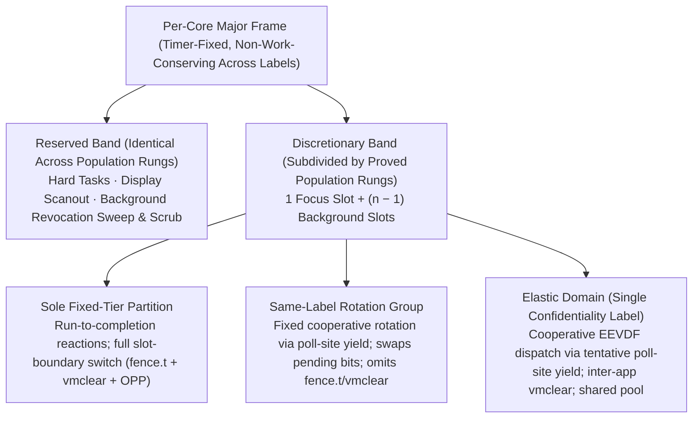

  Each core runs a **table-driven cyclic executive** of composition-fixed, time-triggered slots with no priorities, scheduling-context capabilities, or budget donation. Temporal isolation is enforced by the slot-boundary timer; high-rate servers whose poll cadence would make switch overhead dominant are pinned to dedicated cores ([§11](#11-updates)), as the radio PHY pair and sentinel are. <a id="r-07-032-2"></a><a id="r-07-033"></a><a id="r-07-034"></a>
  - **Deletes seL4 MCS and preserves time protection:** Deleting MCS collapses [§11](#11-updates) schedulability to an interval-arithmetic check and removes budget-donation timing channels. <a id="r-07-035"></a> Across confidentiality labels the schedule is **non-work-conserving** (idle slots stay idle, avoiding the unavoidable leakage of work-conserving TDMA shown by Gong & Kiyavash). <a id="r-07-036"></a> Every slot boundary pads any active synchronous kernel path to a fixed **padded boundary constant** (residency bound `H` + switch budget), protecting both **online time** (via partitioning, `fence.t`, and `vmclear`) and **offline time** (via invariant inter-slot gaps; Ge et al., EuroSys 2019).
  - **Tenants and cooperative reactions:** A schedule **tenant** is a sole compartment, a same-label rotation group, or an elastic domain; tenant count has a composition-time ceiling per core ([§11](#11-updates) population rungs). <a id="r-07-037"></a> Every partition executes cooperative run-to-completion reactions from poll site to poll site with no internal threads or inner preemptive scheduler (replacing ARINC 653's intra-partition preemption). <a id="r-07-037a"></a>

| Tenancy mode | Confidentiality & trust | Intra-slot scheduling & state clearing | Timing & admission obligation |
| --- | --- | --- | --- |
| **Sole fixed-tier partition** | Dedicated confidentiality label; mandatory for all TCB, crypto/key-holding, MMIO/DMA, multi-label, and hard-deadline components. <a id="r-07-037f"></a> | Runs alone in its slot; full slot-boundary switch (`fence.t`, `vmclear`, OPP relock) before another label runs. | Per-reaction WCET fits the assigned slot width ([§11](#11-updates)). |
| **Same-label rotation group** | Shared confidentiality label; members are mutually admitted to read each other's V/M state. | Fixed-order cooperative rotation on synchronous poll-site yield; **swaps pending bits** (`r-07-037c`); **omits `fence.t`, `vmclear`, and OPP relock** within the group (`r-07-037d`). <a id="r-07-037b"></a><a id="r-07-037c"></a><a id="r-07-037d"></a> | Derived per-reaction WCETs + rotation-step constants meet every member's declared visit cadence ([§11](#11-updates)). |
| **Elastic domain** | Single confidentiality label hosting mutually distrusting desktop applications inside a fixed resource envelope (slots, sweep slots, per-class island memory pools, NoC/bank grants, service rings). <a id="r-07-037e"></a> | Cooperative **EEVDF** dispatch over member weights and request lengths via `tentative` poll-site yields (*continue* vs. *switch-requested* with compiler state sink); swaps pending bits and **runs `vmclear` between distinct applications** (each guest host is a distinct app group). <a id="r-07-037g"></a> | Toolchain inserts poll sites on loop back-edges and recursive entries; every reaction's cost ≤ domain **yield bound**, kernel calls occur within the **call bound**, and slots fit call + yield + step bounds. <a id="r-07-037h"></a> |

  - **Elastic domain contract and activation rules:**
    - *Crown-jewel contract:* The elastic-domain contract (envelope confinement, EEVDF lag/share bound, and pool-service guarantees with per-allocation narrowing, [§8](#8-authority-model)) is a crown-jewel specification; intra-label timing and capacity exposures are booked in [§17](#17-residual-risks-the-honest-ceiling), while fixed-tier absolutes continue to hold of every non-member partition.
    - *Fixed-tier floor (`r-07-037f`):* Determinism is preserved wherever a guarantee depends on it: kernel paths, RoT, crypto core and all secret/key holders, sentinel and watchdogs, network/link stacks, powerbox/trusted-path/lock state, admission checkers, integrity reader/transactor, storage servers, supervision tree, all device drivers and MMIO/DMA holders, hard-deadline services (audio, display scanout, compositor, input), and any server serving multiple confidentiality labels (decidable from manifest declarations).
    - *EEVDF state and share bound (`r-07-037g`):* Dispatch reads only the domain's own state stored in placed partition contexts (member weights/requests/deadlines in member contexts; virtual time and focus in the session manager's), adding no kernel table. A member's lag stays within the largest request plus one call bound, and idle members leave the eligible set until pending bits or rings show work.
    - *Launching is activation, never creation (`r-07-037i`):* <a id="r-07-037i"></a> Every native member and interpreter host is installed at composition with dormant partition contexts on its eligible cores. Launch activates a dormant context and binds its initial heap from the domain pool ([§8](#8-authority-model)); close tears it down via the barrier, sweep, and zeroize before reuse. Launch, close, and focus are context-cell requests written by the domain's **session manager** (which also drives the exhaustion ladder, [§8](#8-authority-model)), with manifest edges re-instantiated by the supervision tree ([§12](#12-system-servers-contained-outside-the-tcb)).
- **No asynchronous interrupt delivery; slot-boundary timer is the sole asynchronous trap:** <a id="r-07-038"></a>
  Under AIA/IMSIC ([§8](#8-authority-model), [§15](#15-hardware-platform)), an interrupt is an MSI store that sets an architectural pending bit in an interrupt file and **never vectors the core to `MTCC`**. Partitions read pending bits with ordinary loads at poll sites inside their slots. <a id="r-07-039"></a>
  - **Irreducible, unmaskable boundary timer:** <a id="r-07-040"></a> No software-writable enable bit can mask the slot-boundary timer. When it fires, new ordinary instructions stop issuing while an irrevocable in-flight operation (plus any consequent synchronous fault handler) or active synchronous kernel path completes to `mret`; sentry switcher calls outside the trap path are cut and abandoned under the crash-only rule. The handler derives the worst-case residency bound `H` over all reachable completion prefixes, waits on `mtime` if completion finishes early, and starts the successor at the exact table instant plus the padded boundary constant (`H` + switch budget). Only a synchronous fault on an active kernel path enters the [§15](#15-hardware-platform) second-trap latch.
  - **Corollaries of deleting interrupt delivery:**
    - *Interrupt-state sentries deleted:* With no asynchronous delivery to mask, interrupt-state sentry types and bounded interrupt-disabled allow-lists are deleted rather than audited ([§8](#8-authority-model), [§15](#15-hardware-platform)). <a id="r-07-041"></a>
    - *Service latency is a schedule corollary:* Every device event waits at most its server's slot period plus in-slot handling WCET ([§11](#11-updates)). <a id="r-07-042"></a>
    - *No WCET preemption term:* Remaining trap points are syntactic poll sites in the typed CFG ([§5](#5-languages--verification)). <a id="r-07-043"></a>
    - *Partitioned interrupt context:* Pending bits are statically identity-partitioned or swapped in the switch budget with no shared state ([§15](#15-hardware-platform) admission test 3). <a id="r-07-044"></a>
    - *MSIs only; no PLIC or wired level interrupts:* <a id="r-07-045"></a> All device signals and the RoT watchdog *bark* are capability-checked IMSIC stores; only the watchdog *bite* and RoT reset/power-sequencing lines are unmaskable physical resets ([§15](#15-hardware-platform), [§16](#16-reliability)).
    - *Watchdog bark checked at slot boundary:* <a id="r-07-046"></a> The boundary-timer handler checks the sentinel's bark MSI, bounding notice of a wedged compartment at one slot period (with the sub-slot *bite* as backstop); this one response-time cost is booked in [§17](#17-residual-risks-the-honest-ceiling). <a id="r-07-047"></a>
- **Purecap kernel and binary-verified fast path:** <a id="r-07-048"></a>
  The kernel compiles to pure-capability code, backstopping out-of-model pointer corruption at runtime via hardware tag and bounds checks. Cold kernel paths are verified in Coq over CHERI-C semantics (Zaliva et al., ASPLOS 2024) and the capability-widened CompCert memory model (residual booked in [§17](#17-residual-risks-the-honest-ceiling); pointers double in width). <a id="r-07-049"></a>
  - **Binary-level fast path over Sail:** <a id="r-07-050"></a> The privilege-critical trap, context-switch, and IPC fast path (a few hundred instructions) is proved **directly at binary level against the Sail model** in the Iris-over-Sail program logic ([§13](#13-packaging--supply-chain)), removing the CHERI-C → CompCert memory-model seam from the most critical path while keeping CHERI-CompCert C for cold paths. <a id="r-07-051"></a>
- **Single address space: no MMU, no VSpace objects.** <a id="r-07-052"></a>
  `satp` is Bare, Sv39 translation and PMP are absent ([§15](#15-hardware-platform)), and seL4's VSpace, page-table, frame-mapping, and TLB-shootdown paths are deleted. **CHERI bounds provide the sole in-core spatial isolation** (and capability-checked DMA confines devices) over one physical address space (CheriOS/CHERIoT lineage; rationale in [Inspirations & Prior Art](background/inspirations.md)).

---

## 8. Authority Model

- **Capabilities are the sole authority:** <a id="r-08-001"></a>
  No ambient authority anywhere: no global namespaces, `uid`/`gid`, `setuid`, or `fork()`.
  - **Language-level completion:** [§5](#5-languages--verification) deletes ambient **state** as well (no module-level mutable statics, lazy singletons, or thread-locals), preventing source code from manufacturing unaccounted authority paths above the OS and hardware layers. <a id="r-08-002"></a>
- **Hardware layer:** CHERI capabilities (spatial safety, unforgeable references, compartments) backstopping `unsafe` Rust (the verified HAL, [§5](#5-languages--verification)) and residual C. <a id="r-08-003"></a>
  This extends unchanged to V/M-class cores: vector and matrix memory operations check explicit capability operands of the issuing context (per-element for indexed gather/scatter).
- **Kernel layer: object capabilities and single-mechanism CHERI revocation.** <a id="r-08-004"></a>
  First-class revocation uses the CHERI mechanism alone—bitmap publication, a bounded containment barrier, the kernel epoch, the per-load filter, and a budgeted reclamation sweep—with **no capability derivation tree**. Revocation completes within a guaranteed time bound, making **time-to-containment a bounded constant** (including cross-core grant edges via a verified bounded-round proxy notification and acknowledgment protocol).

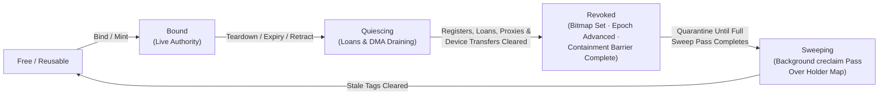

  - **Subtree revocation via grant slots (`r-08-004a`..`r-08-004d`):**
    - *Separate slot address per delegation:* <a id="r-08-004a"></a> To revoke one principal's cross-domain delegation without revoking the underlying object, the kernel places the underlying capability in a **grant slot** in a kernel-owned table and gives the delegate a **sealed grant handle** (`otype`-sealed capability bounded to that slot, [§7](#7-kernel)). Setting the revocation bit for the **slot's** granule invalidates only that handle at its next load or invocation.
    - *Colourless capability format preserved:* <a id="r-08-004b"></a> Reducing subtree revocation to the address-keyed object case preserves the capability format, which spends all 64 bits (36+4+5+5+8+6, [§4.1](hardware/isa-profile.md#41-the-capability-format)) with zero colour bits, preserving the 128-byte exactness threshold and avoiding a second revocation mechanism (*verify rather than hedge*, [§15](#15-hardware-platform)).
    - *Grant handle indirection and budget:* <a id="r-08-004c"></a> Each cross-domain call through a grant handle takes one kernel unsealing indirection (yielding a bare capability that must not be captured and whose loan must return or be cancelled before containment completes); intra-domain loads use bare capabilities directly. The static memory plan charges the fixed-capacity grant table to the [§15](#15-hardware-platform) SRAM budget; manifest and CHERI-TAL linear-capability rules ([§5](#5-languages--verification)) fix which edges use grant handles at composition.
    - *Not a CNode namespace:* <a id="r-08-004d"></a> A grant handle is a hardware capability whose bounds name its slot directly in ordinary kernel-owned revocable memory—requiring no capability-address translation, index namespace, or radix lookup.
  - **Architectural per-load revocation filter (`r-08-005`..`r-08-005b`):**
    - *Deterministic load-time check:* <a id="r-08-005"></a> A per-load check invalidates a stale capability when loaded from memory, at a fixed island-local bitmap access cost with no NoC or memory-controller transaction.
    - *Part of the load's Sail definition:* <a id="r-08-005b"></a> A capability-width load whose target is revoked writes the value back with its validity tag cleared as part of the instruction's defined Sail semantics at fixed latency.
    - *Island-local ECC-protected bitmap array:* <a id="r-08-005a"></a> Each island holds a dedicated ECC-protected revocation bitmap covering its own 64-byte-aligned revocable intervals (including its grant table), at 1 bit per 8-byte granule (`0` = live, `1` = revoked; total payload $\sum |I|/64$ bytes charged to the [§15](#15-hardware-platform) SRAM budget and fixed in the attested devicetree). Because the loaded capability's base is known only after data return, the bitmap lookup is a priced second access served by a composition-fixed per-core slot rotation at the island's local array (constant latency independent of other cores; out-of-interval bases take the same constant latency with a live result). Cross-island grant edges revoke via proxy slots in the delegate island's own grant table.
  - **Bounded containment barrier vs. budgeted background sweep (`r-08-006`..`r-08-009`):**
    - *Containment barrier (`freed ⇒ unreachable`):* <a id="r-08-006"></a> Containment completes once the kernel publishes affected bitmap bits, blocks new invocation or derivation, clears or filters live/saved register authority across affected cores, cancels or finishes outstanding grant loans, receives remote proxy acknowledgments, and drains in-flight device transfers ([§15](#15-hardware-platform)). The kernel proof connects this postcondition to Sail load, dereference, invocation, and restore rules over the complete root inventory (live/saved registers, trusted-stack/sentry roots, grant loans, proxy slots, device authority, and interior-base capabilities). Its bound is derived per composition, charged to admitted slots, and independent of untrusted cooperation or sweep progress.
    - *Incremental background sweep (`creclaim`):* <a id="r-08-007"></a> Physical reclamation runs as an idempotent, preemptible kernel reaction in its own [§11](#11-updates)-admitted per-core background slot class, resuming from a group cursor if cut by the boundary timer. Its inner loop executes `creclaim` ([§15](#15-hardware-platform)) once per CBO block to apply the load filter's conditional clear across a whole granule group and return surviving tags. <a id="r-08-007b"></a>
    - *Monotone 64-bit epoch and sweep-gated quarantine:* <a id="r-08-007a"></a> The 64-bit monotone kernel epoch advances only on kernel-mediated teardown (never wrapping in $5 \times 10^5$ years at 1/µs). A revocation bit and its underlying granule return to `Reusable` only after the containment barrier completes **and** a full sweep pass begun after that barrier has covered every location in the static holder map (including saved contexts and grant tables)—preventing stale handles from matching re-minted slots without needing an out-of-band generation bearer token or capability colour field.
    - *Forced-sweep DoS charged to fixed reservations:* <a id="r-08-008"></a> Teardown bursts (pool retirement, hibernation, grant expiry, session close, restart, user retraction) are charged to owner and sweeper slots; churn delays only the requester's reuse or exhausts its declared pool.
    - *Teardown rate expectation:* <a id="r-08-008a"></a> Low teardown frequency is expected in the fixed tier (static composition, compiled heap, GC-free storage, crash-only state) and awaits measurement on the composed roster; elastic domains size their sweep reservations for online heap reclamation.
    - *No autonomous hardware walkers:* <a id="r-08-009"></a> Autonomous hardware sweep/zeroing engines (CHERIoT-Ibex TBRE/STKZ) are declined under [§15](#15-hardware-platform) admission test 5; only the deterministic load filter is hardware, while the sweep stays software.
- **Whole-program static memory plan (compiled heap in the fixed tier):** <a id="r-08-010"></a>
  In the fixed tier, fine-grained runtime allocation is replaced by a whole-program static memory plan (an elastic domain instead receives one statically placed pool per class per island and allocates online inside it, below).
  - **Allocation as graph coloring over reservation intervals:** <a id="r-08-011"></a> The certifying compiler ([§5](#5-languages--verification), [§13](#13-packaging--supply-chain)) combines linear/affine ownership, region inference (Tofte/Talpin), and Walker/Crary/Morrisett's calculus of capabilities—realized at runtime as hardware CHERI capabilities—to export half-open **reservation intervals** over the composition's event order (running from allocation through the containment barrier and reuse gate). Static slot assignments are carried in the CHERI-TAL derivation.
  - **Three-point fragmentation collapse and reserved-span floor:** <a id="r-08-012"></a> Runtime external fragmentation is zero; over-reservation collapses toward the **charged simultaneous peak** via static coalescing of non-overlapping live ranges; and internal fragmentation is eliminated for exact-size slots (or declared explicitly for fixed-size-class pools). The charged peak is a lower bound on reserved span, which is charged once in the capacity equation.
  - **Four-term lexicographic placement objective (profile-free):**

| Priority | Objective | Mechanism & constraint |
| --- | --- | --- |
| **1 (Hard floor)** | **Minimize reserved span** | Minimizes the island's span above its charged peak; no subsequent objective may worsen any island's reserved span or admitted [§11](#11-updates) WCET bound. <a id="r-08-012a"></a><a id="r-08-012d"></a> |
| **2** | **Locality (co-location, field partitioning, bank spreading)** | Co-locates jointly reached objects into adjacent granules, splits hot/cold fields across tag granules ([§15](#15-hardware-platform)), and spreads concurrently live objects across island banks/macros to reduce array conflicts. Computed deterministically from the typed call/control-flow graphs and declared loop bounds with **no PGO profile or runtime feedback** (data-side sibling of R-10-034). <a id="r-08-012b"></a> |
| **3** | **Island-bounded addressing** | Chooses only among addresses within the owning island's root capability ([§7](#7-kernel), [§15](#15-hardware-platform)), so out-of-island placement is unrepresentable. <a id="r-08-012c"></a> |
| **4** | **Power-domain concentration** | Concentrates low-duty/standby working sets into the fewest gating domains (macros/tiers) without worsening span or WCET, emitting a per-mode **occupancy map over gating domains** for [§15](#15-hardware-platform) power mechanism 5 (build-time only; no runtime relocation). <a id="r-08-012e"></a><a id="r-08-012f"></a> |

  - **Offline complexity and checked admission (`r-08-013`..`r-08-018c`):**
    - *Offline vs. Robson's online bound:* <a id="r-08-013"></a> Online non-relocating allocators face Robson's $\Theta(\log n)$ worst-case blowup; offline allocation is solved in build-time compute (polynomial-time exact stack placement when reservation intervals form a laminar family under common alignment and unrestricted bases; constant-factor approximable in general).
    - *On-device TAL disjointness, temporal-safety, and initialization check:* <a id="r-08-014"></a> Slot disjointness wherever live ranges overlap, reuse after the containment/quarantine gate (`r-08-015`), bounded intra-compartment pool reuse (`r-08-015a`), and definite initialization (`r-08-016`) are checked as three attributes over one interference structure in a single on-device TAL pass ([§6](#6-trusted-computing-base-exhaustive)), adding zero TCB allocator code. <a id="r-08-015"></a><a id="r-08-015a"></a><a id="r-08-016"></a>
    - *Unified space-and-time certificate:* <a id="r-08-017"></a> Peak memory and WCET ([§11](#11-updates)) derive from the same static loop/recursion/allocation bounds (*memory-admissible ⟺ time-admissible* for fixed-tier partitions and elastic envelopes). Bounded runtime fan-out ($0..N$ connections) folds in as $N$ pre-colored equal-size slots. <a id="r-08-018"></a>
    - *Joint pool coloring, size classes, and provenance:* Pools of one compartment are jointly colored on provable non-co-occurrence from the admitted frame or region structure (recording reasons when not colocated) (`r-08-018a`); size-class waste is chosen against the workload histogram and recorded in the manifest (`r-08-018b`); and manifest entries declare each pool/region's **derivation source** while placement hashes initialized static regions so duplicate resident data across owners is detected and resolved or justified at composition (`r-08-018c`). <a id="r-08-018a"></a><a id="r-08-018b"></a><a id="r-08-018c"></a>
  - **Ceilings, exact information-theoretic floors, and capacity levers (`r-08-019`..`r-08-020`):**
    - *Worst-case vs. average-case ceiling and runtime value convergence:* Static coloring reserves the worst-case peak (`r-08-019`), and pools whose contents converge to equal values at runtime from unrelated derivation sources remain a capacity residual (`r-08-019a`). <a id="r-08-019"></a><a id="r-08-019a"></a>

| Plane / baseline | Information-theoretic floor | Realized expenditure & attribution |
| --- | --- | --- |
| **Revocation sidecar & pool-occupancy bitmaps** | $\log_2(2^N) = N$ bits by the fooling-set argument over $2^N$ pairwise-separable subsets of $N$ granules/slots. <a id="r-08-019b"></a> | **1 bit per granule/slot ($N$ bits total):** meets the unconditional floor exactly (unlike an $N \log_2 N$ free list). |
| **Capability tag plane** | Unconstrained floor is binary entropy $H(p)$ bits/granule for capability fraction $p$ (e.g., $0.469$ at $p=0.1$, $0.081$ at $p=0.01$); constrained floor under `{random access, non-interference, tag integrity}` is **1 bit/granule**. <a id="r-08-019c"></a> | **1 bit per 64-bit granule:** meets the constrained floor; the manifest records the counted $p$ of the placed artifact and books the $1/H(p)$ multiplier against the unconstrained floor. |
| **Functional reference baseline** | Same functional specification built without tag plane, revocation sidecar, per-core kernel replication, or ECC widening ([§15](#15-hardware-platform)). <a id="r-08-019d"></a> | Unfabricated, unsigned measurement denominator so every capacity-equation line item is either in the baseline or attributed to a named security property with a stated multiplier. |

  - **Three artifact levers when peak exceeds budget (never tightening the analysis):** <a id="r-08-019e"></a> (1) **Establish laminar reservation premises** (recording lifetime and span changes if reservations are extended); (2) **Recompute rather than store** within the consumer's [§11](#11-updates) deadline; or (3) **Size to the committed peak and evict beyond it** via manifest-declared exhaustion actions (e.g., crash-only browser origin eviction, [§14](#14-userland)). Runtime compaction and relocation never arise. <a id="r-08-020"></a>
- **No global OOM state; bounded pools and elastic domain heaps (`r-08-045`..`r-08-047e`):**
  - **Closed capacity equation and no global OOM:** <a id="r-08-045"></a> Every physical byte (kernel objects, stacks, save areas, DMA windows, rings, grant slots, quarantine entries, interpreter arenas, recovery workspaces, fixed payloads, and elastic pool extents) is charged at composition. Aggregate insufficiency rejects the generation at admission; no global pool, overcommit, swap, or OOM victim scanner exists.
  - **Declared bounded pools:** <a id="r-08-046"></a> Every static structure with variable runtime occupancy (origin compartments, connection/session slots, grant slots, consent records, quarantine entries, PCBs, interpreter arenas, device descriptors/rings, checkpoint/epoch slots, sentinel records, and elastic domain pools) is declared in the manifest with its owner, element type, fixed capacity, bind/release authorities, lifecycle `Free → Bound → Quiescing → Revoked → Sweeping → Reusable` ([§16](#16-reliability)), low/exhausted thresholds, reuse bound, exhaustion action ([§12](#12-system-servers-contained-outside-the-tcb)), recovery reserve, telemetry label, and restart/migration semantics.
  - **Relevance-graded `CapacityExhausted(pool)` verdict:** <a id="r-08-047"></a> Binding from a full pool returns a must-examine `CapacityExhausted(pool)` verdict ([§5](#5-languages--verification)) that cannot be dropped, turned into an unbounded wait, or satisfied from another pool.
  - **Elastic domain pools and verified pool service (`r-08-047a`..`r-08-047e`):**
    - *Per-class, per-island static pool extents:* <a id="r-08-047a"></a> Each elastic domain ([§7](#7-kernel)) owns one composition-fixed pool per memory class on each island it occupies (second class carrying bulk member heaps, [§15](#15-hardware-platform)).
    - *Verified pool service and exact size-class narrowing:* <a id="r-08-047b"></a> A verified per-domain pool service hands out zeroed, disjoint **chunks** gated by the containment barrier and sweep before reuse, and members sub-allocate inside their chunks via a verified heap library (Cornucopia-style). Every chunk and sub-allocation is drawn from a composition-fixed size-class table with representable lengths and class-aligned bases, making every `csetbounds` exact without runtime rounding instructions ([§15](#15-hardware-platform)).
    - *Confinement of pool-derived capabilities:* <a id="r-08-047c"></a> Every edge leaving an elastic domain is a capability-store-free ring or tag-clearing register endpoint, and external memory capabilities reaching a member lack capability-store permission, so pool-derived capabilities cannot escape the domain and pool sweeps stay within the domain's own footprint and background slots.
    - *Declared exhaustion ladder:* <a id="r-08-047d"></a> Each launched member reserves a guaranteed floor in the pool (refusing launch if unavailable). Above the floors, the domain's session manager walks a finite detector/action ladder ([§12](#12-system-servers-contained-outside-the-tcb), [§16](#16-reliability)): (1) refuse the request (`CapacityExhausted`), (2) shed owner-local state within fixed bounds, (3) semantically hibernate ([§14](#14-userland)) and terminate the least-recently-focused sacrificable member (never the focused, consent-holding, mid-transaction, or non-sacrificable member), and (4) refuse further launches.
    - *Booked elastic costs:* <a id="r-08-047e"></a> Online chunk size-class waste ($\Theta(\log n)$ Robson bound with small $n$), quarantine capacity, higher sweep reservations, and concurrency-sized pool limits are confined to the domain's own label and booked in [§17](#17-residual-risks-the-honest-ceiling).
- **Non-interference modulo robust, delimited declassification (`r-08-021`..`r-08-030`):**
  - **Fresh Coq non-interference theorem over the capability graph:** <a id="r-08-021"></a> The static capability topology defines the flow policy ($H$ cannot influence $L$ without an explicit channel capability). The kernel's Coq proof extends to a fresh non-interference theorem over the multikernel, purecap CHERI-C semantics, and powerbox declassification ([§17](#17-residual-risks-the-honest-ceiling)), adopting seL4's method without inheriting `l4v`'s single-core proof. <a id="r-08-022"></a><a id="r-08-023"></a>
  - **Delimited release and robust declassification:** <a id="r-08-024"></a> Runtime user grants through the **powerbox** ([§6](#6-trusted-computing-base-exhaustive)) are modeled as **delimited release** (Sabelfeld/Myers) satisfying **robust declassification** (Zdancewic/Myers): no compromised strategy can influence *whether*, *what*, or *to whom* the powerbox declassifies, which depends solely on the unforgeable consent act, the powerbox's verified logic, and (for persistent grants) the freshness of the consent-record store ([§10](#10-storage--state)). <a id="r-08-025"></a> The minted capability is CHERI-bounded to the single user-named object. <a id="r-08-026"></a>
  - **Timing, progress, and fault-path closure:** Explicit flow composes with the [§15](#15-hardware-platform) hardware partitioning semantics (`r-08-027`). Because slots are composition-fixed and non-work-conserving across labels, **progress and termination** are schedule constants rather than secret-dependent channels (`r-08-027a`, `r-08-027b`; population-rung width booked in [§17](#17-residual-risks-the-honest-ceiling)). Fault paths touching secret-labeled data obey constant-time typing ([§5](#5-languages--verification)), restart in the faulting partition's own slots, and report to the sentinel over a closed, labeled enumeration (`r-08-027c`). The complete security policy model is a crown-jewel specification (`r-08-028`). <a id="r-08-027"></a><a id="r-08-027a"></a><a id="r-08-027b"></a><a id="r-08-027c"></a><a id="r-08-028"></a>
  - **Two declassification kinds and no kernel IFC:** Declassification is explicit capability use—either **compose-time** (manifest edges) or **runtime** (powerbox grants). <a id="r-08-029"></a> Dynamic IFC, if ever needed, is a Tier-1 server rather than a kernel extension. <a id="r-08-030"></a>
- **Clock read-out and interrupt-send are capabilities (`r-08-031`..`r-08-034`):**
  - **Clock precision as IPC authority (no counter fuzzing):** <a id="r-08-031"></a><a id="r-08-031a"></a> `Zicntr` and `Zihpm` are absent ([§15](#15-hardware-platform)) and `mtime` is kernel-only. The time service ([§12](#12-system-servers-contained-outside-the-tcb)) grants coarse time by default and nanoseconds only to capability-authorized clients. <a id="r-08-031-2"></a><a id="r-08-031a-2"></a> Compartments without that capability receive **no clock mechanism at all** (deleting statistical clock fuzzing, which is recoverable by averaging and would add nondeterminism to [§16](#16-reliability) replay); their finest observable interval is their own composition-fixed slot period.
  - **Interrupt-send is an IMSIC page-write capability; interrupt-disable does not exist:** <a id="r-08-032"></a> Under AIA/IMSIC ([§15](#15-hardware-platform)), sending an interrupt is a capability-checked store to an interrupt file. With no asynchronous delivery ([§7](#7-kernel)) and an unmaskable boundary timer, **there is no authority to disable interrupts**, and the CHERIoT interrupt-state sentry plus its bounded disabled-window allow-list are excluded from the profile. <a id="r-08-033"></a>
  - **Per-app and per-library capability manifests:** Every app ships a compose-time capability manifest and may declare an internal compartment graph with per-library sub-manifests ([§4](#4-organizing-principle), [§14](#14-userland)). <a id="r-08-034"></a>
- **The powerbox, temporal grant scopes, clipboard, and grant retraction (`r-08-035`..`r-08-044`):** <a id="r-08-035"></a>
  The powerbox is a small verified TCB component ([§6](#6-trusted-computing-base-exhaustive)) holding only the root authority from which dynamic grants are attenuated. On an authenticated user designation over the **trusted consent path** ([§12](#12-system-servers-contained-outside-the-tcb)), it mints a capability **CHERI-bounded to the selected object alone** and hands it to the app, enforced under one of three temporal scopes by first-class revocation: <a id="r-08-036"></a><a id="r-08-037"></a>

| Temporal scope | Lifetime & evaluator | Key invariants & revocation triggers |
| --- | --- | --- |
| **One-shot** (including clipboard paste) | Single mediated use or transfer; no standing right and no durable record. | Consumed on first use; retired via revocation and zeroization on completion, cancellation, expiry, lock, or endpoint teardown. <a id="r-08-036c"></a> |
| **While-active** | Bounded lease on the kernel's trusted clock ([§7](#7-kernel), [§11](#11-updates))—never an untrusted focus predicate. <a id="r-08-038"></a><a id="r-08-042"></a><a id="r-08-043"></a> | (1) **Revoke-only compositor focus signal** (can assert *no longer active* to kill the lease early, never *still active*) (`r-08-039`);<br>(2) **Trusted per-resource duration ceiling** enforced by kernel grant expiry (requiring fresh consent to renew; sole exemption is the emergency-call microphone bound to call teardown, [§12](#12-system-servers-contained-outside-the-tcb)) (`r-08-040`);<br>(3) **Unconditional cuts dominate** (lock/idle-lock, away-gesture, physical cutoffs, camera shutter, and grant-gated peripheral power, [§9](#9-boot--root-of-trust), [§15](#15-hardware-platform)) (`r-08-041`). <a id="r-08-039"></a><a id="r-08-040"></a><a id="r-08-041"></a> |
| **Persistent** | Across sessions and power cycles via a schema-bounded **consent record** (carries no capability or validity tag). <a id="r-08-037a"></a> | **Lazy powerbox re-mint** on the grantee's first request after profile unlock (`r-08-037b`), keeping peripherals **electrically cold at boot** (`r-08-037c`). Stored in a `Fresh` region on the existing epoch counter (`r-08-037d`), invalidated if an update changes the manifest's declared interface set (`r-08-037e`), sized as a fixed-capacity per-profile pool that renders *persistent* unavailable when full (`r-08-037f`), and encrypted under the profile volume key so **BFU holds no readable consent state** (`r-08-037g`). <a id="r-08-037b"></a><a id="r-08-037c"></a><a id="r-08-037d"></a><a id="r-08-037e"></a><a id="r-08-037f"></a><a id="r-08-037g"></a> |

  - **Clipboard as a one-shot powerbox object (`r-08-036a`..`r-08-036c`):**
    - *Copy vs. paste authority:* <a id="r-08-036a"></a> Copying creates a bounded immutable snapshot of plain bytes and a canonical type in a composition-sized pool (no capabilities, executable actions, or lazy fetches; reading one's own snapshot grants nothing; ungranted peers receive no content, metadata, or notifications).
    - *Trusted paste designation:* <a id="r-08-036b"></a> The trusted-path agent ([§12](#12-system-servers-contained-outside-the-tcb)) takes over the panel and touch front-end under the RoT latch, displays the authenticated source/destination identities and snapshot identity/type/extent, and requires a new local press and minimum dwell within a finite timeout to authorize a one-shot mediated delivery (`r-08-036c`) into the destination's capability-bounded buffer.
  - **User grant retraction and trusted count (`r-08-043a`..`r-08-043f`):**
    - *Subtract-only retraction:* <a id="r-08-043a"></a> Retracting a grant sets its grant-slot revocation bit and runs the full containment barrier. Because retraction only *subtracts* authority, it needs no trusted submitter or consent path (a compromised submitter can cause at most a bounded availability fault, emptying the finite grant table once). <a id="r-08-043b"></a><a id="r-08-043f"></a>
    - *Read-only projection + trusted count:* <a id="r-08-043c"></a> An untrusted grant-review service ([§12](#12-system-servers-contained-outside-the-tcb)) renders the kernel's read-only enumeration of live grant slots. To prevent silent omission by that untrusted UI, the trusted-path agent renders a **fixed-format decimal count** of live standing grants on every prompt and offers a single secure-attention escape hatch—**retract all standing grants for this profile**—at a small booked cost inside the existing agent (`r-08-043e`). <a id="r-08-043d"></a><a id="r-08-043e"></a>
- Sandboxing, portals, and container isolation are **obviated by construction**, not reimplemented. <a id="r-08-044"></a>

---

## 9. Boot & Root of Trust

- **OpenTitan-class on-die RoT ([§15](#15-hardware-platform)):** measured boot, key storage, TRNG, monotonic counters, and boot-attempt counting. <a id="r-09-001"></a>
- **Measured post-quantum boot chain:** RoT → verified M-mode firmware → per-core kernels (all classes) → static image. <a id="r-09-002"></a>
  Every stage is measured; all signatures are post-quantum, split by verifier: **SLH-DSA** wherever immutable ROM is the verifier, and **ML-DSA** above it ([§5](#5-languages--verification)).
- **Stage zero (ROM, raw NAND boot region, and fixed-layout header):** <a id="r-09-003"></a><a id="r-09-008-2"></a>
  - **On-die metal-mask boot ROM and OTP:** Execution begins in the RoT's immutable metal-mask boot ROM (in the attested mask set, [§17](#17-residual-risks-the-honest-ceiling)) with keys, lifecycle state, and anti-rollback counters in on-die **OTP** (no BIOS, discrete SPI flash, or socketed boot device).
  - **Fixed-address raw NAND boot blocks:** <a id="r-09-004"></a> Mutable boot payloads (RoT runtime firmware, M-mode firmware, kernel, and base-image signed root) reside in A/B-duplicated reserved raw NAND blocks written only by the A/B transactor ([§6](#6-trusted-computing-base-exhaustive)) at update commit. The ROM reads them directly through the firmware-free ONFI PHY and fixed-function LDPC ECC engine ([§12](#12-system-servers-contained-outside-the-tcb)) with no FTL, wear leveling, or filesystem underneath.
  - **Grammar-free header verification:** <a id="r-09-005"></a> The boot payload sits behind a fixed-layout, length-bounded header (offset, length, hash—no container grammar or pointer-chasing), verified by SLH-DSA signature ([§5](#5-languages--verification)) against the monotonic anti-rollback floor and measured before any byte executes.
  - **SLH-DSA cold-path tradeoff:** <a id="r-09-005a"></a> The tens-of-kilobytes SLH-DSA signature and thousands of Keccak permutations run as plain 64-bit integer code on the vectorless S-class RoT ([§15](#15-hardware-platform)), paying tens of milliseconds once on the cold boot path ([§1](#1-goals)) in exchange for a minimal immutable ROM verifier and hash-only root assumption.
  - **Single ROM boot sequence:** <a id="r-09-006"></a> Verify and enter RoT runtime firmware in RoT SRAM → walk the reset table ([§15](#15-hardware-platform)) → bring up the memory controller → read both A/B headers and select per boot-target latch and boot counter → place verified M-mode image in main SRAM → release boot core. Cold boot, deep-sleep wake, and recovery generation boot all take this single path.
- **Fail-stop on start-up entropy health failure:** <a id="r-09-006a"></a>
  RoT start-up entropy tests ([§15](#15-hardware-platform)) complete and are measured into the boot chain before any stage draws randomness. On failure, the RoT derives no key, unseals no material, completes no quote, and halts in a stated [§16](#16-reliability) fault state without consuming a boot-attempt count or triggering A/B revert.
- **Composition-derived boot and wake latency bounds:** <a id="r-09-006b"></a>
  Worst-case latencies for cold boot and each RoT-sequenced re-entry (unlock wake, standby exit, update switch, reboot) are composition constants recorded in the attested devicetree beside the reset table ([§15](#15-hardware-platform))—summing rail/discharge dwells, start-up entropy sample budgets, signature verifications, retained bulk-domain in-place re-verification or collapsed-domain NAND refill ([§15](#15-hardware-platform)), and durable-state restore ([§10](#10-storage--state)) at each release point (cold-boot, wake-to-interactive, inference-ready), gated by [the product-gate contract](implementation/contracts/product-gate.md).
- **No UEFI, SMM, ACPI, or option ROMs:** <a id="r-09-007"></a> Static devicetree declares core classes, islands, NoC schedule, OPP tables, radio calibration/limits, and (where present) optional inference socket endpoints, buffers, schedules, electrical/isolation limits, and admitted unit-key/design pairs.
- **TPM 2.0 functions without a discrete TPM or TCG command stream:** <a id="r-09-008"></a>
  Measured boot, policy-sealed keys, attestation quotes, and monotonic counters are realized directly on the on-die RoT and verified crypto core ([§5](#5-languages--verification), [§6](#6-trusted-computing-base-exhaustive)) and exposed as a capability-gated **sealing & attestation IPC service** ([§12](#12-system-servers-contained-outside-the-tcb)) emitting post-quantum quotes. Both discrete off-die TPMs (foreign black box on an interposable bus) and TCG TPM 2.0 command-stream firmware (complex register-slave wire grammar and legacy RSA/ECDSA/SHA-1 agility) are excluded; the eUICC remains the sole tolerated foreign trust domain. <a id="r-09-009"></a>
- **Deep sleep and standby as measured-chain variants (no S3 resume trampoline):** <a id="r-09-010"></a>
  Suspend seals enumerated state and powers off; wake re-executes the measured boot chain. Image-derived second-class domains stay powered across wake and are re-verified in place against the booted root before use, while session-derived domains are discharged on sleep entry ([§15](#15-hardware-platform)). Cellular standby keeps the radio island continuously live at low duty cycle ([§15](#15-hardware-platform)) rather than resuming from unmeasured state. <a id="r-09-011"></a>
- **Battery-free timekeeping and authenticated network time bootstrap:** <a id="r-09-012"></a>

| Time / counter source | Scope & hardware backing | Role & security properties |
| --- | --- | --- |
| **Persistent RTC / coin cell** | **Absent by mandate** ([§4](#4-organizing-principle)). | Eliminates an always-powered stateful component; no security property depends on wall-clock time. |
| **Scheduling & sleep timers (`mtime` / RoT slow timer)** | Core-local `mtime`/`mtimecmp` ([§15](#15-hardware-platform)) and RoT always-on slow timer ([§16](#16-reliability)). <a id="r-09-013"></a> | Drives scheduling, watchdogs, and paging duty cycle while powered; free-running and never steered by network time sync. |
| **RoT monotonic counters & shutdown time floor** | On-die OTP / non-volatile storage ([§10](#10-storage--state)). <a id="r-09-016"></a><a id="r-09-023-2"></a> | Anti-rollback floor and key/credential versions survive full power loss; a coarse last-known-good **monotonic time floor** written at controlled shutdown prevents backward wall-clock rollback across reboots. |
| **Authenticated network wall-clock (`Roughtime` → `NTS` → `Secure PTP`)** | Bootstrapped after boot from explicit *time-unknown* state via the [§12](#12-system-servers-contained-outside-the-tcb) time service. <a id="r-09-014"></a><a id="r-09-015"></a> | **Roughtime** (`roughenough`) signs client nonces to establish ~1 s trusted time from cold without TLS certificate-time circularity and produces signed proof of lying servers; **NTS** and **Secure PTP** refine precision as a disciplined view over `mtime`. |

- **Attested lock states (BFU vs. AFU) and Duress Crypto-Erase:**
  - **Before First Unlock (BFU) vs. After First Unlock (AFU):** <a id="r-09-017"></a> BFU holds no resident per-profile user-data volume key while keeping the standby radio island page-reachable ([§15](#15-hardware-platform)). Presenting the primary PIN/passphrase to the credential/unlock compartment ([§12](#12-system-servers-contained-outside-the-tcb)), rate-limited by the RoT, transitions to AFU, authorizing the crypto core to derive the profile volume key ([§10](#10-storage--state)) and wake application islands via the measured chain. <a id="r-09-018"></a>
  - **Auto-return to BFU on lock or idle timeout:** <a id="r-09-019"></a> Explicit lock or idle timeout runs a scheduled RoT-attested global-mode transition ([§15](#15-hardware-platform) mechanism 3) that zeroizes per-profile volume keys, discharges all session-derived second-class memory domains (KV cache, framebuffers, decoded media) while retaining image-derived domains (weights, cold code), and re-seals application islands to BFU.
  - **Biometrics and physical peripheral cuts under lock:** Biometric match authority never survives a BFU transition (AFU convenience factor only) (`r-09-020`). Lockout cuts microphone and camera inputs and forces the **USB data path to charging-only**, while keeping cellular paging/ringing live in standby (`r-09-021`, [§15](#15-hardware-platform)). <a id="r-09-020"></a><a id="r-09-021"></a>
  - **Duress credential and forced crypto-erase:** <a id="r-09-022"></a> Presenting a distinct **duress PIN/passphrase** destroys the RoT sealing root wrapping per-profile volume keys and the device-identity secret ([§10](#10-storage--state)), executes the qualified first-class SRAM erase construction ([§15](#15-hardware-platform)), and forces immediate discharge of all `ON` or `RETAINED` second-class gain-cell domains before RoT reset (`r-09-022a`). <a id="r-09-022a"></a> The erase is one-way, non-rollbackable, and indistinguishable from a failed unlock attempt until completion (`r-09-023`), leaving the read-only signed base image untouched so the device re-derives a fresh identity and boots cleanly into factory-fresh BFU (`r-09-024`, [§3](#3-threat-model)). <a id="r-09-023"></a><a id="r-09-024"></a>
- **Attestation registers, Reference Integrity Manifest (RIM), and Recovery Generation:** <a id="r-09-025"></a>
  Attestation covers the boot chain, admission checker version, spec/policy-set version, frozen ISA-profile version, and frozen radio-generation identity ([§12](#12-system-servers-contained-outside-the-tcb), [§15](#15-hardware-platform)).

| Attestation artifact / register | Contents & owner | Appraisal & sealing role |
| --- | --- | --- |
| **Generation register** | Measurements determined solely by generation source (the 4 boot stages). <a id="r-09-025a"></a> | Appraisable against source-reproduced reference values without leaking unit identity; seal policies naming this register survive unit-state changes. |
| **Device register** | Unit-supplied extensions: OTP lifecycle state (`r-09-037`), start-up entropy verdict (`r-09-006a`), boot-target latch (`r-09-029`), enrolled root set (`r-09-036a`), and per-unit calibration ([§15](#15-hardware-platform)). | Binds the quote's combined chain digest to the physical unit's lifecycle and configuration state. |
| **Reference Integrity Manifest (RIM / CoRIM)** | ML-DSA-signed expected reference values emitted per generation and served beside quotes ([§12](#12-system-servers-contained-outside-the-tcb)). <a id="r-09-026"></a><a id="r-09-027"></a> | Bit-for-bit reproducible from source ([§10](#10-storage--state)) and bounded by DDC ([§6](#6-trusted-computing-base-exhaustive)), so relying parties trust reference values by reconstruction rather than vendor assertion. |

  - **A/B boot counting and signed recovery generation:** A/B images with RoT boot counting, automatic revert, and monotonic anti-rollback floor (`r-09-028`). <a id="r-09-028"></a> A reserved boot-time key latched by the RoT into the measured 1-bit *boot-target* register selects a minimal signed **recovery generation** (running only the rollback-manager UI and credential/unlock compartment, [§12](#12-system-servers-contained-outside-the-tcb), with no GRUB-style pre-kernel menu) (`r-09-029`). Any retained generation at or above the anti-rollback floor is selectable (`r-09-030`) and committed via the A/B transactor under credential and trusted-path consent (`r-09-031`). <a id="r-09-029"></a><a id="r-09-030"></a><a id="r-09-031"></a>
- **Monotone OTP silicon lifecycle and holder-controlled generation roots (`r-09-032`..`r-09-037`):** <a id="r-09-032"></a>

```mermaid
stateDiagram-v2
    direction LR
    [*] --> Raw
    Raw --> Test : Wafer probe
    Test --> Development : Fuse transition (closes scan/BIST/straps/provisioning;<br/>Debug Module & trace remain gated)
    Test --> Production : Fuse transition (closes scan/BIST/straps/provisioning;<br/>Debug Module & trace permanently closed)
    Development --> RMA : Authenticated RoT entry + crypto-erase
    Production --> RMA : Authenticated RoT entry + crypto-erase<br/>(Debug Module opens; terminal state)
```

  - **Acyclic hardware-enforced fuse transitions:** The five OTP states (*raw*, *test*, *development*, *production*, *RMA*) form a fixed acyclic graph with no reverse edge; monotonicity (*no sequence of transitions re-enters a left state*) is proved as an **RTL ⊑ Sail** obligation ([§15](#15-hardware-platform), [§18](#18-realization)). <a id="r-09-033"></a>
  - **Permanent closure of manufacturing surfaces and Debug Module:** Leaving *test* permanently closes scan, BIST, test straps, manufacturing flash programming, and provisioning interfaces. The Debug Module and trace are permanently closed in *production* (no Debug Module transaction can reach the fabric) and active only in *development* and terminal *RMA* behind authenticated challenge-response entry and mandatory crypto-erase. <a id="r-09-034"></a><a id="r-09-035"></a>
  - **Lifecycle-diversified ROM roots vs. holder-enrolled generation roots:**
    - *ROM root diversification:* Boot ROM signature verification keys are diversified by lifecycle state; in *production* the ROM accepts only the production root for RoT runtime and M-mode firmware. <a id="r-09-036"></a>
    - *Holder-controlled generation root set:* <a id="r-09-036a"></a> System generations and RIMs are admitted against an **enrolled root set** held in RoT counter-protected state and measured into the device register. Initialized to the vendor's key at personalization, the holder (presenting the primary credential on the trusted consent path) may add roots, remove roots, or **remove the vendor's key**—provided at least one remaining root admits a bootable and recovery generation (*signing decides who may push; proof decides what may run*).
    - *No remote or software root mutation:* <a id="r-09-036b"></a> No vendor token, remote directive, or software path can alter the enrolled root set; anti-rollback floors and production Debug Module closure still bind holder-signed generations. Factory reset and duress erase restore the root set to its personalization default (`r-09-036c`), and the RoT extends the lifecycle state as the first boot-chain measurement (`r-09-037`). <a id="r-09-036c"></a><a id="r-09-037"></a>

---

## 10. Storage & State

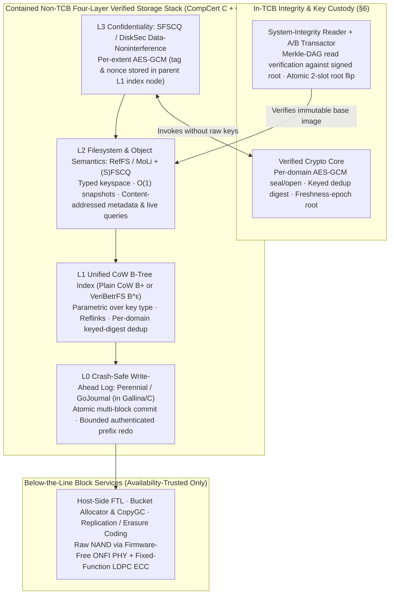

- **Immutable base image and redundant root verification:** <a id="r-10-001"></a>
  The base OS is a bit-for-bit reproducible, content-addressed Merkle-DAG image whose reads are verified at runtime against the boot-attested signed root by the small **system-integrity reader** ([§6](#6-trusted-computing-base-exhaustive), the sole storage component in the TCB).
  - **Self-checksummed redundant roots:** <a id="r-10-001a"></a> Because no parent hash covers the root node, each root carries its own checksum beside its signature and is written to multiple fixed locations (≥2 copies per slot on separately erasable regions). Boot verifies all candidate copies on their own bytes and selects the highest valid security version, never relying on an unverified slot pointer.
- **Four-layer verified storage stack (Coq/Iris, CompCert C, wholly outside the TCB):** <a id="r-10-002"></a>

| Layer | Design lineage & Coq vehicle | Core semantics & verification obligations |
| --- | --- | --- |
| **L0: Journal** | **Perennial / GoJournal** design re-expressed in Gallina and lowered GC-free via **CompCert-C + VST/Iris** (CN + Fulminate de-risking). <a id="r-10-007"></a><a id="r-10-008"></a> | Concurrent crash-safe write-ahead log providing atomic multi-block commit. **Bounded authenticated prefix redo (`r-10-002a`):** commits bind ordered payloads, addresses, and identities; incomplete uncommitted suffixes are dropped, while corrupted committed payloads refuse recovery of the affected store without partial publication. <a id="r-10-002a"></a> |
| **L1: Index** | **Unified copy-on-write B-tree** (plain CoW B+ `ExecutableIndex.v` under L0 batching, or **VeriBetrFS** $B^\varepsilon$ buffered-update tree, re-proved in Coq/Iris; Dafny/Z3 not retained). <a id="r-10-002-4"></a><a id="r-10-003"></a><a id="r-10-004"></a> | Single parametric index verified once over generic key types (bcachefs style). Plain CoW B+ is selected wherever L0 transaction batching meets endurance and slot-WCET floors with smaller proof scope; $B^\varepsilon$ is retained only where singleton unbatched writes dominate. |
| **L2: Filesystem & Queries** | **RefFS / MoLi** (concurrent linearizability, liveness, deadlock/livelock-free layered lock release for [§11](#11-updates) WCET) + **(S)FSCQ** crash refinement. <a id="r-10-005"></a><a id="r-10-002-2"></a><a id="r-10-006"></a> | Inodes, dirents, extents, xattrs, and $O(1)$ snapshot versions in one typed keyspace. **Typed metadata, secondary indexes, and live queries (`r-10-005a`..`r-10-005c`)** are views in the same L0 transaction (keyed by domain, stable namespace ID, and attribute—never storing capabilities in keys or spanning domains; live-query deltas stream over bounded SPSC rings). **Resident-object reads (`r-10-006a`, `r-10-006b`)** reserve immutable object windows once with zero per-read shared metadata writes and a complete revocation/reuse barrier ([contract](implementation/contracts/resident-object-reads.md)). <a id="r-10-005a"></a><a id="r-10-005b"></a><a id="r-10-005c"></a><a id="r-10-006a"></a><a id="r-10-006b"></a> |
| **L3: Confidentiality** | **SFSCQ / DiskSec** data-noninterference (Coq) composed with [§5](#5-languages--verification) crypto core. <a id="r-10-002-3"></a> | Proves that one confidentiality domain's storage operations and data cannot influence another's. |

  - **Why the 4-layer stack is outside the TCB:** <a id="r-10-009"></a> The immutable system image is Merkle-verified on every read by the TCB **system-integrity reader + A/B transactor** ([§6](#6-trusted-computing-base-exhaustive)), which commits updates by flipping the signed root past the anti-rollback floor ([§11](#11-updates)); any corruption introduced by L0–L3 fails the hash chain to the signed root.
- **Bcachefs-class mutable semantics, per-extent AEAD, and three-class anti-rollback split (`r-10-010`..`r-10-025`):** <a id="r-10-010"></a>
  In the mutable user-data CoW B-tree, **reflinks** are refcounted extent sharing, **snapshots** are version-keyed roots, **dedup** uses a per-domain keyed plaintext digest, and **checksums** are the per-extent AEAD tags.

| Persistent asset class | Anti-rollback & integrity mechanism | Rollback / tamper disposition |
| --- | --- | --- |
| **Platform security state** (image security-version floor, key-wrapping/sealing roots, credential attempt counters) | Bound directly to the **RoT hardware monotonic counter** ([§9](#9-boot--root-of-trust), [§12](#12-system-servers-contained-outside-the-tcb)), advancing only on updates, key rotations, or auth attempts. <a id="r-10-013"></a> | Blocks OS downgrades, key un-revocation, password resurrection, and lockout-counter replay. Membership is two-way audited by the checker against requirement declarations (`r-10-013a`, `r-10-013i`). <a id="r-10-013a"></a><a id="r-10-013i"></a> |
| **`Fresh` durable regions** (spent payments, token/revocation lists, one-time marks, app attempt counters, powerbox consent records) | Declared `Fresh` in the manifest (`r-10-013b`, `r-10-035a`); versions are hashed by the crypto core into a **freshness-epoch root** sealed once per epoch by a reserved RoT counter (`r-10-013c`) within a composition-admitted epoch-rate ceiling (`r-10-013d`). <a id="r-10-013b"></a><a id="r-10-013c"></a><a id="r-10-013d"></a> | **Fail-closed refusal (`r-10-013e`):** a `Fresh` region whose version fails epoch-root verification is refused on read ([§17](#17-residual-risks-the-honest-ceiling)), preventing replay of superseded security state. <a id="r-10-013e"></a> |
| **Rollbackable bulk user data** (mutable per-profile subvolumes) | Protected by **per-extent AES-GCM** (`r-10-022`, `r-10-024`), deliberately **not** bound to the hardware monotonic counter (`r-10-011`) to avoid per-commit counter wear. <a id="r-10-011"></a><a id="r-10-012"></a> | Offline forgery or bit corruption fails AEAD authentication on read; whole-volume physical rollback is an availability/lost-edit residual ([§17](#17-residual-risks-the-honest-ceiling)). Crypto-erase destroys the RoT-sealed volume keys (`r-10-014`). <a id="r-10-014"></a> |

  - **Conditional hardware lever to collapse the epoch split (`r-10-013f`..`r-10-013h`):**
    - *SOT-MRAM counter candidate:* <a id="r-10-013f"></a> The `Fresh` vs. bulk split exists only because OTP/flash monotonic counters wear out; a wear-free counter medium (**spin-orbit-torque MRAM**, whose write current bypasses the tunnel barrier) would allow per-commit sealing of the volume root.
    - *Two gating conditions:* <a id="r-10-013g"></a> (1) Rated endurance covering per-commit seals over the target service life **co-qualified with full decade-class non-volatile retention on a single macro** (not separate cache-retention or kilobit vehicles), and (2) magnetic/thermal tamper closure via a [§16](#16-reliability) field-and-temperature sentinel (converting external magnet tamper into fail-stop). Failed freshness verification still refuses the read regardless of medium.
    - *Magnetoelectric antiferromagnetic memory caution:* <a id="r-10-013h"></a> Compensated antiferromagnets present zero net moment but lack addressable arrays, endurance/retention qualification, and operating-temperature margin, and carry published electromigration nulls in the switching literature ([Evaluated Architectural Alternatives](background/architectural-alternatives.md)); they are recorded as an immature theoretical closure rather than a candidate.
  - **Keyed-digest deduplication, no FS compression, and below-the-line block services (`r-10-015`..`r-10-021`):**
    - *Domain-separated keyed dedup digest:* <a id="r-10-015"></a> Because AES-GCM uses random per-extent nonces, the crypto core computes a separate **per-domain PRF/MAC digest** of the plaintext under a KDF-derived dedup key. Dedup is deterministic within a domain, impossible across domains (eliminating cross-domain confirmation-of-file oracles, `r-10-016`), and rejects convergent encryption (`r-10-017`). <a id="r-10-016"></a><a id="r-10-017"></a>
    - *No filesystem compression (build-time image compression only):* <a id="r-10-018"></a> Filesystem compression is excluded, deleting CRIME/BREACH-class ratio oracles and read-path decompressors. Single-owner, build-time-compressed signed images expanded once at install/load (`r-10-019`) save stored NAND bytes without changing resident SRAM footprint (`r-10-020`; resident code density is handled by [§15](#15-hardware-platform) dictionary encoding, R-15-036a). <a id="r-10-019"></a><a id="r-10-020"></a>
    - *Below-the-line block services:* <a id="r-10-021"></a> Replication, erasure coding, tiering, bucket allocation + `copygc`, and the host-side **FTL server** ([§12](#12-system-servers-contained-outside-the-tcb)) sit below the integrity line and are trusted only for availability.
  - **Verified per-extent AEAD (`r-10-022`..`r-10-025`):**
    - *Parent-held tag and nonce:* <a id="r-10-022"></a><a id="r-10-022a"></a> Each extent is encrypted with **AES-GCM** (`Zvkned`/`Zvkg`, constant-time by `Zkt`/`Zvkt`; ChaCha20/Poly1305 is frozen out to avoid doubling the cipher Sail/proof surface, `r-10-024`) under per-profile volume keys held solely in the crypto core. The **AEAD tag and nonce are stored in the parent L1 index node** rather than beside the ciphertext (`r-10-022a`), catching misdirected reads or FTL/copygc block misplacement, while the tag serves strictly as integrity checksum and never as dedup address (`r-10-023`). <a id="r-10-023"></a><a id="r-10-024"></a>
    - *Composed verifiable-encryption theorem:* <a id="r-10-025"></a> Joins the [§5](#5-languages--verification) three-layer crypto proof ($\text{impl} \sqsubseteq \text{AEAD} \bowtie \text{CT} \bowtie \text{IND-CCA/INT-CTXT}$) with L3 **SFSCQ/DiskSec data-noninterference**.
- **Stateless base, subvolume isolation, declarative persistence, and backups (`r-10-026`..`r-10-040`):**
  - **Stateless image + per-profile subvolumes:** <a id="r-10-026"></a> The system consists of the immutable signed base image plus enumerated mutable per-profile subvolumes (everything else is `tmpfs`, gone at reboot; Wasm bundles in user volumes or `tmpfs` are re-validated before interpretation, [§14](#14-userland)). Subvolumes are separated by version-keyed CoW keyspaces and per-profile AEAD keys rather than rigid disk partitions (`r-10-027`), with declarative compiled system configuration (`r-10-028`, `r-10-029`) and RoT-sealed FDE keys resident only in AFU and bound to the enrolled root set and anti-rollback floor (`r-10-032`). Factory reset discards user volumes and re-derives device identity from the RoT (`r-10-033`). <a id="r-10-027"></a><a id="r-10-028"></a><a id="r-10-033"></a>
  - **Declarative durable regions and quiescent checkpoints (`r-10-035`..`r-10-037a`):**
    - *Declared typed regions:* <a id="r-10-035"></a> Compartments author no serializer or autosave loop; they declare typed durable regions (`Fresh` or rollbackable, `r-10-035a`) in their manifest ([§13](#13-packaging--supply-chain)), inheriting L0–L2 crash refinement. <a id="r-10-035a"></a>
    - *Quiescent L0 checkpoint, never execution resume:* <a id="r-10-036"></a> Checkpoints commit as single L0 transactions only at declared quiescent points (major-frame boundary or completed handler, [§7](#7-kernel)). Restore boots measured, initializes the compartment from the signed image, and reads schema/generation-bound durable regions as data.
    - *Strict checkpoint and backup exclusion list:* <a id="r-10-037"></a><a id="r-10-037a"></a> Checkpoints **never** contain execution state (registers, stacks, PC, V/M state, in-flight calls), capabilities/tags, keys/DRBG/nonces, leases/powerbox grants, or session/device state; only the separate `Fresh` consent-record store witnesses prior persistent grants for powerbox re-mint (`r-10-037a`). Platform key-schema migrations write the new schema beside the retained predecessor root before health-gate commitment (`r-10-036a`). <a id="r-10-036a"></a>
  - **End-to-end sealed backups and attested device-to-device migration (`r-10-038`..`r-10-040`):**
    - *DRBG-keyed Narcissus backup object:* <a id="r-10-038"></a> Exports only **rollbackable durable regions** under a 256-bit random DRBG backup key (never derived from the short PIN; displayed once on the trusted path or wrapped to an enrolled second device's RoT, with zero vendor/escrow shares).
    - *Extended backup exclusions:* <a id="r-10-039"></a> Excludes everything excluded from checkpoints plus protocol credentials ([§12](#12-system-servers-contained-outside-the-tcb)), RoT-sealed state, consent records, and `Fresh` regions (which re-initialize to fresh-install defaults on restore, preventing offline backup replay of spent tokens or attempt counters).
    - *Attested device migration:* <a id="r-10-040"></a> Transfers the backup key directly inside a mutually attested session confirmed on both devices' trusted paths without exposing a recovery secret or intermediate storage.
- **No runtime text config parsing; signed diffable generation log; profile-free layout (`r-10-029`..`r-10-034`):**
  - Config compiles to typed, signed objects per generation. <a id="r-10-029"></a>
  - **Signed, diffable generation history (`git-log-with-diffs`):** <a id="r-10-030"></a> Retains the last $N$ signed generation roots and computes structured, source-reproducible diffs across three signed inputs—**content-addressed image objects**, **compiled config values**, and **reference integrity manifests**—surfaced via the rollback-manager service ([§12](#12-system-servers-contained-outside-the-tcb)). <a id="r-10-031"></a>
  - FDE keys are RoT-sealed to the enrolled root set over the generation register and anti-rollback floor, resident only in AFU, and zeroized on lock/idle/shutdown. <a id="r-10-032"></a>
  - **Profile-free static code layout:** <a id="r-10-034"></a> Linker function ordering and compiler basic-block layout derive deterministically from the admitted call/control-flow graphs and [§15](#15-hardware-platform)'s backward-taken / forward-not-taken rule with **no PGO corpus or runtime feedback** (code-side sibling of the static memory plan, [§8](#8-authority-model)). <a id="r-08-012b-2"></a>

---

## 11. Updates

- **Image-based, atomic A/B updates and rollback:** <a id="r-11-001"></a>
  Deltas fall out of content addressing, and the running base is never mutated. Rollback pins a prior signed root at or above the anti-rollback floor—either **automatically** (health-gated after a failed update, [§16](#16-reliability)) or **user-driven** (selecting a retained generation from the signed diffable history, [§10](#10-storage--state), via the rollback-manager UI, [§12](#12-system-servers-contained-outside-the-tcb), or boot-selected recovery generation, [§9](#9-boot--root-of-trust)). <a id="r-11-002"></a> Both paths commit through the single trusted A/B transactor ([§6](#6-trusted-computing-base-exhaustive)), with user-driven rollback credential-gated and consent-witnessed.
  - **Whole-machine update scope:** Because no foreign computers exist ([§4](#4-organizing-principle)), this single mechanism updates radio, storage, display, and OS together; optional immutable modules have no update path (replacement activates a pre-admitted unit-key/design pair, or requires a new generation). <a id="r-11-003"></a>
  - **Separately versioned radio generation:** The radio generation ([§12](#12-system-servers-contained-outside-the-tcb)) is patchable for security within its certified regulatory envelope and re-certified as a delta when protocol behavior changes. <a id="r-11-004"></a>
- **Three-part generation admission (Proof, Freshness, and Step):**

| Admission gate | Requirement & mechanism | Failure disposition |
| --- | --- | --- |
| **Proof-checked admission** | On-device checker validates every new binary's proof against the current spec-set and Sail-model versions before the transactor commits (revving either forces re-admission). <a id="r-11-005"></a> | Refuses install; running generation unaffected. |
| **Freshness admission** | Update directives carry an expiry checked against the monotonic time floor ([§9](#9-boot--root-of-trust)), and the age of the newest verified directive is surfaced to the holder to distinguish withheld from absent updates. <a id="r-11-005a"></a> | Refuses install of expired directive; never blocks boot. |
| **Step admission** | The *installing* generation's reader, checker, and transactor admit the successor: cross-generation descriptors (pack, manifests, directive, L2 key schema) carry fixed-header versions (`r-11-005b`), and a successor is emitted against the installing generation's versions, spec-set, and Sail model (except the unchanging ROM boot header, [§9](#9-boot--root-of-trust)). Devices multiple steps behind walk the directive's step table in order, booting each intermediate generation under the health gate and floor. <a id="r-11-005b"></a> | Refuses mismatched install step; preserves multi-step upgradeability across service life without multi-grammar readers. |

- **Temporal admission (interval-arithmetic schedulability proof in Coq):** <a id="r-11-006"></a>
  The task set admits only with a machine-checked Coq **interval-arithmetic check** over the static cyclic executive ([§7](#7-kernel)) verifying that slot WCETs fit the major frame and task periods are harmonic with it.
  - **Harmonic period manufacture, shared-slot rotations, and elastic domains (`r-11-006a`..`r-11-008`):**
    - *Harmonic period assignment:* <a id="r-11-006a"></a> The untrusted composition tool manufactures harmonic periods from non-harmonic physical deadlines (display, radio, touch, audio) via **period distortion** (faster visits, spending frame capacity) and **hyperperiod growth** (spending frame length), recording assigned vs. deadline-derived periods in the admission artifact for the checker to verify.
    - *Intra-group rotation arithmetic:* <a id="r-11-006b"></a> For every same-label rotation group ([§7](#7-kernel)), the checker verifies that derived per-reaction bounds plus rotation-step constants meet every member's declared visit cadence.
    - *Elastic domain envelope and focus dispatch bound:* <a id="r-11-006c"></a> An elastic domain's envelope admits as one tenant in the frame, while its members admit by the yield bound ([§7](#7-kernel)). The artifact carries a derived worst-case **focus dispatch bound** (from input latch to the focused member's next dispatch across all rungs, permutations, and admissible loads—summing the slot gap, one call bound, one yield bound for state sink, the intra-slot step with inter-app `vmclear`, and the EEVDF lag term) and verifies every member's minimum share and shortest-slot fit.
    - *Hard deadlines and standing reservations:* Monitor availability, watchdog windows, and radio deadlines (HARQ, ACK, DRX paging, connection anchoring) ship as theorems (`r-11-007`), alongside two standing reservations in every frame: **display scanout** ([§15](#15-hardware-platform)) and the **[§8](#8-authority-model) revocation sweep background slot class** (`r-11-008`). <a id="r-11-007"></a><a id="r-11-008"></a>
  - **Switch-duty ratio ($\sigma$), buffering vs. core-pinning, and cross-core phasing (`r-11-009`..`r-11-014d`):**
    - *Switch-duty ratio:* <a id="r-11-009"></a> Every visit charges the padded **boundary constant** ([§7](#7-kernel), covering the switch budget and timer-hold residency bound `H`), so admission explicitly prices $\sigma = C_{\text{switch}} / T_{\text{poll}}$ (e.g., polling a 1 Gb/s link every 12 µs against a ~3 µs switch would spend $\sigma \approx 25\%$ on switching alone).
    - *Lever 1 — Raise $T_{\text{poll}}$ by buffering:* <a id="r-11-010"></a> A descriptor ring or FIFO of depth $D$ stretches the poll cadence to $D \times \text{inter-arrival}$ (e.g., $D = 256$ yields a ~3 ms poll at $\sigma \approx 0.1\%$), declared in the [§12](#12-system-servers-contained-outside-the-tcb) interface artifact and bounded by the device's latency deadline.
    - *Lever 2 — Pin high-rate servers to dedicated cores:* <a id="r-11-011"></a> When the deadline prevents buffering and $\sigma$ exceeds the composition threshold, the server is inadmissible as a slotted task and is **statically pinned to a dedicated core** of its class ([§7](#7-kernel), [§15](#15-hardware-platform)), deleting partition switches (`fence.t`, `vmclear`, OPP relock) altogether. The two radio-PHY V-class cores and the S-class sentinel are instances of this general rule (`r-11-012`), leaving the remaining slotted partitions with **long slots** where switch overhead amortizes to a negligible fraction (`r-11-013`). <a id="r-11-012"></a><a id="r-11-013"></a>
    - *Per-core uniprocessor reduction and cross-core frame phasing:* Static core assignment reduces multiprocessor scheduling to per-core uniprocessor checks (`r-11-014`). Each core's major frame carries a **phase offset in mesochronous spine cycles** ([§15](#15-hardware-platform)) against a single platform-wide origin (`r-11-014a`), from which the artifact derives and checks worst-case **end-to-end latency bounds for every cross-core and ensemble-link call chain** (`r-11-014b`). The untrusted composition tool optimizes offsets to minimize hop waits and align data-parallel V-class frames (`r-11-014c`), and population rung swaps preserve phase offsets by subdividing only the discretionary band (`r-11-014d`). <a id="r-11-014"></a><a id="r-11-014a"></a><a id="r-11-014b"></a><a id="r-11-014c"></a><a id="r-11-014d"></a>
  - **Derived WCET tables, schedule synthesis, and ensemble link tables (`r-11-015`..`r-11-017a`):**
    - *Syntax-directed WCET derivation:* <a id="r-11-015"></a> Each per-(class, OPP) WCET entry is derived as a syntax-directed max-path sum (Shaw's schema, [§5](#5-languages--verification)) over the typed CFG using the timing-annotated Sail model ([§15](#15-hardware-platform)) as its instruction latency table and carried as cost annotations on the CHERI-TAL derivation. Tighter compiler lowerings (R-18-014c) directly free non-work-conserving frame capacity (`r-11-015a`), and an untrusted ILP/SMT/evolutionary schedule synthesizer packs slots and TDM NoC schedules against the Coq interval-arithmetic checker (`r-11-015b`). Lustre/Vélus control-plane bounds are loop-free and structural (`r-11-016`), and admission selects the slowest deadline-meeting OPP per partition (`r-11-017`). <a id="r-11-015a"></a><a id="r-11-015b"></a><a id="r-11-016"></a><a id="r-11-017"></a>
    - *Ensemble link slot tables:* <a id="r-11-017a"></a> For an ensemble ([§15](#15-hardware-platform)), one composition act emits every member's artifact plus per-link non-work-conserving slot tables (in spine cycles with direction, guard band ≥ skew + link latency and oscillator-tolerance bounds, and a kernel-owned all-core idle leap slot per re-alignment cadence on the leader link), bound by digest into the link session context ([§12](#12-system-servers-contained-outside-the-tcb)).
- **Three orthogonal schedule axes (Global Mode, Workflow Profile, and Compartment Population):**

| Schedule axis | Trigger & attestation weight | Scope of change & invariants |
| --- | --- | --- |
| **Global power/mode** (*performance*, *battery*, *docked*) | Rare, explicit, **RoT-attested global transition** ([§15](#15-hardware-platform)); never load-following. <a id="r-11-018"></a> | Re-assigns OPPs, TDM NoC schedule, frame phases, and watchdog windows. Edge certificates prove guards, carry-in work, uninterrupted hard services, checkpoint/restore, revocation/sanitization, peak memory, and recovery bounds. |
| **Workflow profile** | Explicit user-authorized selection from a finite preconfigured catalog ([preset recipes](implementation/workflow-profiles.md#preset-recipes)). <a id="r-11-018a"></a> | Selects app rosters, foreground budgets, continuing services, checkpoint policy, and slate bindings while keeping global hardware settings and the reserved band fixed (unless paired with an attested global transition). |
| **Compartment population rungs** (e.g., opening/closing a tab or app) | Frequent **major-frame table swap** (1 switch constant + table load); neither RoT-attested nor load-following. <a id="r-11-019"></a> | Keeps the **reserved band identical** across rungs (`r-11-020`) and subdivides the **discretionary band** along a pre-proved geometric ladder (`4 / 8 / 16 / 32` slots per C-class core, `r-11-021`) shaped as **1 focus slot + $(n-1)$ background slots** (`r-11-022`). |

  - **Seven invariants of the population-rung ladder (`r-11-020`..`r-11-027`):**
    1. *Invariant reserved band (`r-11-020`):* Hard tasks, display scanout, revocation sweep, and system servers occupy a reserved band identical across all rungs. <a id="r-11-020"></a>
    2. *Geometric discretionary ladder (`r-11-021`):* Every rung (`4 / 8 / 16 / 32` discretionary slots per C-class core in the reference instantiation, [§15](#15-hardware-platform)) is an independently admission-proved schedule bound into the signed generation and measured at boot. <a id="r-11-021"></a>
    3. *Focus-majority shaping and admitted input-to-response bound (`r-11-022`, `r-11-022a`):* One focus slot (or multiple shorter focus slots per frame) takes a composition-fixed majority of the discretionary band, with an admission-checked worst-case **input-to-response bound** from input latch through focus-slot entry to next display scanout. <a id="r-11-022"></a><a id="r-11-022a"></a>
    4. *Tenant permutation invariance (`r-11-023`):* Rebinding focus at a major-frame boundary permutes the slot→tenant map (sole compartment, same-label group, or elastic domain permuted whole); interval arithmetic quantifies only over slot widths, offsets, task periods, and $\sigma$, never occupants. <a id="r-11-023"></a>
    5. *Major-frame table swap (`r-11-024`):* Switching rungs swaps pre-proved schedule tables at a major-frame boundary without runtime admission. <a id="r-11-024"></a>
    6. *Strictly lifecycle-driven, never load-following (`r-11-025`):* The rung index is a function of the count of live discretionary tenants (moving only on user-originated open/launch/close events, never utilization or queue depth; rung-index channel booked in [§17](#17-residual-risks-the-honest-ceiling)). <a id="r-11-025"></a>
    7. *Hard top-rung ceiling (`r-11-026`):* Above the top rung, the population manager (e.g., browser for origins, [§14](#14-userland)) suspends a live tenant to frozen-resident state (freeing an execution slot) or hibernates/discards it through the `Reusable` gate (freeing memory). <a id="r-11-026"></a>
  - **Vector/matrix and atomic WCET inputs:** <a id="r-11-027"></a> Tasks using vector, matrix, divide/FPU, or fixed-latency atomic RMW (`Zaamo`/`Zabha`, no LR/SC retry loops) carry those units' deterministic latencies ([§15](#15-hardware-platform)) into WCET; eager `vmclear` enters partition-switch terms while compiler state sinking counts as in-slot WCET ([§7](#7-kernel)).

---

## 12. System Servers (contained, outside the TCB)

Each server runs in its own compartment ([§4](#4-organizing-principle)) with an explicit capability manifest, crash-only design, and supervised restart. <a id="r-12-001"></a>
- **Data/control plane split:** <a id="r-12-002"></a> The *data plane* (bulk I/O, ring processing, vector/matrix math, wire parsing) defaults to `#![forbid(unsafe_code)]` safe Rust; the *control plane* (sequencing, supervision, protocol state machines, mode/timing control) defaults to **Lustre** compiled by the Coq-verified **Vélus** compiler ([§5](#5-languages--verification)), where determinism, causality, and WCET are structural. Any `unsafe` is confined to the verified HAL ([§5](#5-languages--verification)). Alternatively, a server may be a formally-verified non-Rust lift (e.g., Project Everest F\*/Low\* in the TLS compartment below), carrying the same binary-level memory-safety certificate ([§13](#13-packaging--supply-chain)) plus bonus functional assurance. <a id="r-12-003"></a>
- **Four-class on-die functional taxonomy:** <a id="r-12-004"></a> Every function on the host die falls into one of four classes ([§4](#4-organizing-principle)). Software on cores drives fixed-function *matter* through capability-checked MMIO/DMA; functions conventionally delegated to firmware-running coprocessors move to host cores, reduce to fixed-function hardware, or are banned. Approximation stacks without formal specifications (radio PHY estimation, ISP, software rasterization) rely on downstream integrity checks and measured output quality without adding per-device crown-jewel specs; the biometric matcher is bounded to a secondary factor. The optional immutable module owes its separate device contract and proofs, and an ensemble peer ([§2](#2-non-goals-deliberate)) is these same four classes on another die ([§15](#15-hardware-platform)).

| Class | Realization | Members |
| --- | --- | --- |
| **Software on cores: TCB** | Trusted, proven, minimal | Kernel (sole system-register holder)<br>Crypto core<br>Integrity reader + A/B transactor<br>M-mode firmware + RoT<br>Admission checkers (TAL + CIC)<br>Powerbox + trusted-path agent |
| **Software on cores: non-TCB** | Contained: capability-confined, restartable | Servers / drivers / filesystems<br>Network + radio PHY / L2 / L3<br>Display / ISP / inference<br>Apps + browser origins<br>Verified HAL |
| **Matter** | Fixed-function + register slaves: no instruction fetch, no firmware | Link-layer turnaround timer<br>USB-PD + DisplayPort sequencers<br>Sensor scan / sample sequencers<br>FEC (LDPC / polar), flash ECC<br>Transceiver + sensor AFEs<br>Scanout controller<br>eUICC (tolerated foreign oracle) |
| **Excluded foreign computers** | Banned by platform mandate, not mitigated; not on die or board | Baseband processor<br>Wi-Fi / BT controller firmware<br>SSD controller firmware<br>Embedded controller, PMU microcontrollers (Pcode/SCP/AOP-class)<br>ME / PSP / SMM management cores<br>ISP firmware<br>Discrete GPU / accelerator firmware<br>Processing-in-memory (autonomous in-array compute) |

- **Ring data plane (the secure `io_uring`):** <a id="r-12-005"></a>
  All bulk I/O rides bounded SPSC shared-memory rings with notification wakeups (the **Microkit / LionsOS / sDDF** / virtio idiom, [§7](#7-kernel), [§18](#18-realization)), where the peer is always a server and never the kernel.
  - **No authority across the data plane:** Descriptors name only `(session-table index, offset, length)` into pre-delegated capabilities (`r-12-006`), and ring pages lack capability-store permission (`r-12-007`). Ensemble link frames carry only ring descriptors and untagged payload bytes whose indices select the *receiving* link server's composition-delegated session table, with no capability or address crossing the wire (`r-12-007a`). <a id="r-12-006"></a><a id="r-12-007"></a><a id="r-12-007a"></a>
  - **Fence-free Ztso ring proof and CHERI-TAL slot typestate:** Both peers use one canonical verified copy-once ring library proved against a Byzantine peer under **Ztso ([§15](#15-hardware-platform)) with no fence** (preserved across islands via R-15-015a, `r-12-008`). Head, tail, and notification words are the only concurrent atomics; each payload slot is a CHERI-TAL ownership state machine (`free/writable` → producer release → consumer immutable acquire → completion return, `r-12-008a`). Service is metered on the session's schedule slot (`r-12-009`), zero-copy uses a session-scoped DMA capability, and cross-service linked ops and credential registration are absent. <a id="r-12-008"></a><a id="r-12-008a"></a><a id="r-12-009"></a>

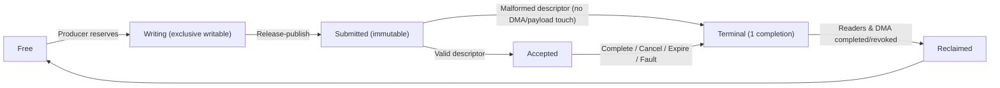

| Ring contract dimension | Normative guarantee & bounds |
| --- | --- |
| **Header & constants** | Generated interface artifact records capacity, index width, descriptor size/alignment, max batch size, and session generation; 4-word header holds atomic `producer_idx`, `consumer_idx`, `notification_word`, and immutable `generation` (wrapping modulo capacity with sequence disambiguation; common schema in the IDL wire-format crown-jewel spec). <a id="r-12-091"></a> |
| **Malformed-descriptor refusal** | Descriptors carry a closed operation tag, unique live request ID, bounded scalars, buffer references `(index, offset, length, direction, content_type)`, optional finite-class deadline, and closed flags; unknown tags, reserved flags, bad bounds, duplicate IDs, or stale generations produce a defined refusal completion without fallback parsing. <a id="r-12-092"></a> |
| **Single terminal completion** | Every accepted request ends in one completion (`ok`, `refused`, `invalid`, `cancelled`, `deadline_expired`, `peer_restarted`, `device_fault`, `resource_exhausted`, plus optional closed refinement), except session teardown where revocation + generation change logically marks all live requests `peer_restarted`. <a id="r-12-093"></a> |
| **Six-state monotone slot lifecycle** | `Free → Writing → Submitted → Accepted → Terminal → Reclaimed` (diagram above); malformed requests jump `Submitted → Terminal` without acquiring device authority or touching payload. <a id="r-12-094"></a> |
| **Queue-full refusal (`would_block`)** | Follows the [§8](#8-authority-model) bounded-pool contract: full request rings return relevance-graded `would_block` with no overwrite, borrowing, or blocking; completion capacity is sized at composition to at least max concurrent accepted requests. <a id="r-12-095"></a> |
| **Notifications & proved sleep edge** | Notification word is a binary armed state (no wrap analysis); consumer drains budget, arms word, re-reads producer index, and sleeps only if empty—excluding lost wakeups and bounding coalesced/spurious wakeups to one empty drain. <a id="r-12-096"></a> |
| **Typed cancellation & deadline classes** | Control-plane cancellation names `(generation, request_id)` and resolves deterministically (`Submitted` or at declared cancellation point → `cancelled`; past commit point → `too_late`; else `not_live`). Deadlines come from finite interface classes evaluated at declared points without preemption or priority donation. <a id="r-12-097"></a> |
| **Non-transactional batching** | Batches amortize publication/drain up to max batch size and slot budget; every request validates, cancels, and completes independently (compound atomicity requires one dedicated typed operation). <a id="r-12-098"></a> |
| **Generation-gated restart & idempotence** | Restart, reset, or revocation increments session generation, refuses old descriptors, quiesces/revokes DMA, and reinitializes indices; idempotence claims must declare the operation subset, stable ID, dedup bound, and duplicate-effect proof. Uncorrectable ECC, impossible ownership, or missed DMA quiescence fail-stops under [§16](#16-reliability). <a id="r-12-099"></a> |
| **Bounded zero-copy & tag clearing** | Full extent and direction validated against session-table capability before DMA starts; scatter/gather uses a fixed max segment count (WCET charged at max where constant-time requires, [§15](#15-hardware-platform)), capabilities end at completion, and non-capability DMA writes clear covered tags. <a id="r-12-100"></a> |
| **Composition-priced variants** | Interface artifact records per-variant validation, payload/segment bounds, device-service bound, cancellation cleanup, completion, notifications, and drain rate; composition proves no overwrite and bounded progress (using deeper rings or core pinning when switching dominates, [§7](#7-kernel)). <a id="r-12-101"></a> |

- **Interface layer (canonical fork-and-frozen IDL):** <a id="r-12-010"></a>
  All server protocols and capability manifests use one canonical typed IDL profile (`interfaces/ring-reference.json`, unifying WIT-derived types and FIDL-derived packed wire layout) that generates marshalling, wire layouts, flow predicates, verified copy-once parsers, and Coq interface skeletons (`RingContract.v`) without a translation seam (the kernel is not an IDL endpoint).
  - **First-class flow annotations and restricted grammar:** Each type carries confidentiality and integrity labels checked by Tier-1 cross-domain flow theorems (`r-12-011`); the grammar admits only closed variants, no recursion, and explicit list/string bounds (`r-12-012`). <a id="r-12-011"></a><a id="r-12-012"></a>
  - **Receiver-side semantic validation:** Because valid capability bounds do not prevent semantic confused-deputy inputs (e.g., an out-of-range callee index), the IDL declares which received values serve as indices, lengths, offsets, or selectors into receiver state, and the receiver's Tier-1 proof discharges validation at use (`r-12-012a`). IDL types document the contract while kernel capabilities + CHERI + Coq specs enforce it; the emitted wire-format mapping is a crown-jewel spec (`r-12-013`). <a id="r-12-012a"></a><a id="r-12-013"></a>
  - **Objects, intents, and transformations:** Object references pair an out-of-band capability with its [§10](#10-storage--state) typed metadata identity; intents are closed variants (*view*, *edit*, *render*, *play*, *convert-to(type)*, *share*—never command strings); and transformation edges declare bounded content types, resource limits, and target interface worlds (`r-12-013a`). <a id="r-12-013a"></a>
- **Sealing & attestation service (TPM-equivalent and Factotum-style credential broker):** <a id="r-12-014"></a>
  The userspace face of the crypto core ([§5](#5-languages--verification), [§6](#6-trusted-computing-base-exhaustive)) and RoT ([§9](#9-boot--root-of-trust)), exposing **seal/unseal, attestation quotes, reference-manifest retrieval, and monotonic counters** over rings while **keys never leave the crypto core**. Seals bind to either the exact measured vector or an enrolled-root reference-manifest signature at or above the anti-rollback floor, plus the requesting compartment's graph identity (name, not image hash, surviving updates while excluding peers). Relying parties retrieve the reproducible reference integrity manifest through this service (`evidence ⋈ reference-values`, `r-12-015`). <a id="r-12-015"></a>
  - **Protocol-credential broker without a generic signing oracle (`r-12-015a`, `r-12-015b`):** Key generation/import returns a non-exportable credential capability bound to a typed protocol role, principal, peer/origin scope, permitted operation, transcript/domain separator, use count, and expiry (serving TLS, WireGuard, WebAuthn, and device/cable auth with no raw key export or unconstrained *sign*/*decrypt*/*derive*). Apps can attenuate but never widen credential capabilities, and fresh user approval routes through the powerbox and trusted consent path. <a id="r-12-015a"></a><a id="r-12-015b"></a>
  - **Attestation-authenticated session contract (`r-12-015c`):** Each selected construction's reference model is a **crown-jewel specification** with a machine-checked protocol argument binding appraised measured state (software-only or unit-specific, [§9](#9-boot--root-of-trust)) to the authenticated session-key holder, fresh challenge/anti-replay state, peer/role, and transcript context (covering replay, concurrent sessions, identical software on another unit, relayed handshakes, and model key-compromise cases; failed appraisal refuses the session while the running generation continues, [§17](#17-residual-risks-the-honest-ceiling)). <a id="r-12-015c"></a>
  - **Ensemble link session (`r-12-015d`):** Two ensemble members ([§2](#2-non-goals-deliberate)) mutually authenticate via unit-specific quotes on both registers (matching the composition's ensemble identity and the attested devicetree's expected RoT-rooted unit identity, with quote-key-to-device-identity binding as the model's first obligation and no persistent link-layer address). Key establishment uses the single composition-fixed hybrid PQ suite; the crypto core encrypts/authenticates every established frame (bounding line rate by crypto-core throughput in the [§11](#11-updates) slot tables) with associated data `(link, session_epoch, schedule_slot_count)` and context binding the link slot-table digest (admitting at most 1 frame per slot). Fixed-size handshake frames run only in composition-reserved slots at fixed cadence before session establishment; failed peer authentication refuses the link without halting the machine. <a id="r-12-015d"></a>
- **Credential & unlock service:** <a id="r-12-016"></a>
  Gates the Before-First-Unlock → After-First-Unlock transition ([§9](#9-boot--root-of-trust)) by matching the primary credential (PIN/passphrase) and running contained safe-Rust **biometric matching** over register-slave sensor DMA streams (under-display ultrasonic or power-button capacitive fingerprint + camera where fitted, [§15](#15-hardware-platform)).
  - **RoT rate-limiting, duress erase, and secondary-factor biometrics (`r-12-017`..`r-12-019`):** Correct match authorizes the crypto core and RoT to derive the per-profile volume key under RoT attempt rate-limiting (`r-12-017`); a distinct **duress credential** triggers an indistinguishable RoT crypto-erase (`r-12-018`); and biometrics act strictly as a **secondary factor** (unlocking live AFU sessions, never releasing BFU keys, `r-12-019`). <a id="r-12-017"></a><a id="r-12-018"></a><a id="r-12-019"></a>
  - **On-die WebAuthn platform authenticator (`r-12-020`):** Discharges FIDO2/WebAuthn on-die; external roaming hardware security keys (YubiKey-class) are declined as unverified foreign computers ([§4](#4-organizing-principle), [Evaluated Architectural Alternatives](background/architectural-alternatives.md)). <a id="r-12-020"></a>
- **Rollback-manager service (untrusted generation-history UI):** <a id="r-12-021"></a>
  A contained non-TCB compartment (running live or in the recovery generation, [§9](#9-boot--root-of-trust)) presenting the signed generation history ([§10](#10-storage--state)) and structured diffs (image hashes, typed config diffs, reference-manifest changes). <a id="r-10-030-2"></a><a id="r-12-021-2"></a> Selection asks the trusted reader + A/B transactor ([§6](#6-trusted-computing-base-exhaustive)) to stage a root; the transactor and RoT independently enforce the signature, **anti-rollback floor**, primary-credential check, and **trusted consent path** (`r-12-022`), while user-data snapshot restore remains a separate clearly labeled action ([§10](#10-storage--state)). <a id="r-12-022"></a>
- **Filesystem, block servers, and firmware-free storage lower half:**
  - **Contained verified filesystem and availability block services (`r-12-023`, `r-12-024`):** The [§10](#10-storage--state) four-layer verified filesystem (`L0`–`L3`) and below-the-line safe-Rust Tier-1 block services (replication, erasure coding, tiering/writeback cache, bucket allocator + copygc, host-side FTL) run wholly outside the TCB; system-image integrity rides the small TCB reader + A/B transactor. <a id="r-12-023"></a><a id="r-12-024"></a>
  - **Firmware-free ONFI flash interface and mandatory multi-layer ECC (`r-12-025`..`r-12-030`):** Raw NAND attaches through a firmware-free on-die ONFI PHY + fixed-geometry ECC engine, with wear leveling, mapping, and GC in the host safe-Rust Tier-1 FTL (banning NVMe/eMMC vendor firmware, `r-12-025`). Nonvolatile ECC mandates per-page **soft-decision LDPC with read-retry** (`r-12-026`) beneath a **RAISE / chipkill-class die- and plane-level parity layer** (`r-12-027`), paired with full cryptographic integrity/anti-rollback because persistent media leave the die across power-down (`r-12-028`). The host FTL runs telemetry-guided **patrol read scrubbing** (`r-12-029`), keeping all ECC hardware fixed-function and management in safe Rust (`r-12-030`), composing with [§10](#10-storage--state) AEAD/Merkle checks and feeding error telemetry to the [§16](#16-reliability) sentinel. <a id="r-12-025"></a><a id="r-12-026"></a><a id="r-12-027"></a><a id="r-12-028"></a><a id="r-12-029"></a><a id="r-12-030"></a>
- **Object fabric (Plan 9 private namespace/plumber + BeOS typed attributes/translators, without ambient authority):** <a id="r-12-024a"></a>
  A contained non-TCB service where the caller delegates its [§14](#14-userland) session namespace capability to run [§10](#10-storage--state) typed queries and live subscriptions.
  - **Signed composition-time handler/translator graph (`r-12-024b`, `r-12-024e`):** Built from package [§13](#13-packaging--supply-chain) interface descriptors with no runtime registration, plugin loading, shell commands, or content-sniffing (`r-12-024b`). *Resolution* derives object capabilities monotonically from the caller's delegated namespace capability, and *handoff* passes only that object capability plus attenuated local buffer capabilities to the selected handler (`r-12-024e`). <a id="r-12-024b"></a><a id="r-12-024e"></a>
  - **One-shot translator chains and streaming media templates (`r-12-024c`, `r-12-024f`, `r-12-024d`):** Both bind pre-composed node/ring pools admitted under [§11](#11-updates) (`r-12-024c`), with every content format parsed by a [§5](#5-languages--verification) Narcissus verified copy-once parser (`r-12-024f`). Outputs re-enter the [§10](#10-storage--state) store in the caller's confidentiality domain, and deterministic conversion caching keys strictly on `(input_content_address, translator_package_id_version, declared_params, output_content_type)` within the same domain (`r-12-024d`). <a id="r-12-024c"></a><a id="r-12-024f"></a><a id="r-12-024d"></a>
- **Network & time synchronization:** <a id="r-12-031"></a><a id="r-12-035-2"></a>
  An IPv6-only single stack with Narcissus-verified wire parsers and binary-level memory-safety certificates across compartments, retargeted onto rings from safe-Rust start-froms (**smoltcp** TCP/IP, **hickory-dns** DNS-over-TLS resolver, **roughenough** Roughtime, [§18](#18-realization)).
  - **Formally verified TLS 1.3 and X.509 certificate validation (`r-12-032`, `r-12-032a`):** TLS 1.3 uses hybrid PQ key exchange backed by the [§5](#5-languages--verification) crypto core, targeting Rust-native **hax**/SSProve-verified **Bertie** (or F\*/Low\* **miTLS**) as bonus assurance (`r-12-032`). DER X.509 chains are parsed by Narcissus and validated in a separate **Verdict**-lineage compartment against a **crown-jewel validation policy** curated from RFC 5280 and Verdict models using an image-pinned trust-anchor set (refusing all chains in the [§9](#9-boot--root-of-trust) time-unknown state, `r-12-032a`). <a id="r-12-032"></a><a id="r-12-032a"></a>
  - **Differential-test oracles and dissolved NIC (`r-12-033`, `r-12-034`):** **IRONSIDES** (SPARK DNS) and **AdaCore SPARK TCP + Huginn-TCP** serve as off-device differential oracles (`r-12-033`). The NIC is capability-gated and dissolved like the modem (`r-12-034`): MAC and PCS run in host software on V-class cores + FEC units over a fixed-function line front-end, frozen-coefficient 1000BASE-T datapath, and IEEE-1588 timestamp unit, polled at ring-amortized cadence ([§11](#11-updates)). <a id="r-12-033"></a><a id="r-12-034"></a>
  - **Three-source capability-scoped time synchronization (`r-12-035`..`r-12-037`):** Cross-checks **Roughtime** (cold bootstrap), **NTS** (internet precision), and **secure PTP** (local-LAN nanoseconds), handing out coarse time by default and high-precision by capability ([§8](#8-authority-model), `r-12-035`) over the NIC's firmware-free **IEEE-1588 hardware timestamp unit** (keeping `mtime` separate, `r-12-036`). Secure PTP runs time-receiver-only with Narcissus-parsed frames and mandatory authentication TLVs keyed via **NTS-for-PTP** (`r-12-037`), while link-layer MAC addresses are RNG-drawn with no persistent factory MAC ([§15](#15-hardware-platform)). <a id="r-12-035"></a><a id="r-12-036"></a><a id="r-12-037"></a>
- **Radio stack (the dissolved modem):** <a id="r-12-038"></a>
  Software-defined radio in ordinary contained compartments with no baseband processor.
  - **Statically pinned V-class PHY servers and fixed-function SoftMAC turnaround (`r-12-039`):** Cellular, Wi-Fi, and receive-only GNSS PHYs run as separate compartments statically pinned to radio V-class cores + FEC units ([§11](#11-updates), [§15](#15-hardware-platform)). Sub-slot RX/TX turnaround deadlines (BLE `T_IFS` 150 µs, 802.11 SIFS 10/16 µs, 802.15.4 ~192 µs) are met by a **firmware-free timing sequencer** in the transceiver datapath (openwifi low-MAC style, [§18](#18-realization)), keeping all protocol state, scheduling, and crypto in host software (`r-12-039`). <a id="r-12-039"></a>
  - **L2/L3 servers, zero negotiation, and curated Tamarin state-machine models (`r-12-040`..`r-12-044`):**
    - *Narcissus parsers + 5G/6G-only control plane:* MAC/RLC/PDCP/RRC/NAS, 802.11 MLME, and BT L2CAP/GATT sit behind verified ASN.1 UPER/PER and MLME parsers (`r-12-040`). Cellular implements only **NR RRC and 5G-core NAS** (and 6G successors), making 2G/3G/4G downgrade unexpressible and enforcing mutual authentication (5G-AKA) and non-null ciphers for all non-emergency service (`r-12-041`, `r-12-042`; handset IMS voice owes its own verified session client and grammars). <a id="r-12-040"></a><a id="r-12-041"></a><a id="r-12-042"></a>
    - *Lustre/Vélus sequencers + non-negotiated configuration:* Wire parsers form the data plane while protocol state machines and T3xx timers compile from Lustre via Vélus under Tier-1 flow theorems (`r-12-043`). Each protocol fixes a single admissible ciphersuite and version at composition with zero fallback negotiation (`r-12-043a`). <a id="r-12-043"></a><a id="r-12-043a"></a>
    - *Refinement against curated symbolic reference models:* Each Lustre sequencer carries a machine-checked refinement (`r-12-043b`) against a per-protocol **crown-jewel reference model** (`r-12-043c`) transcribed from version-pinned upstream **Tamarin** symbolic analyses (5G-AKA, RRC, 802.11 WPA3/SAE, BT pairing; unanalyzed procedures hand-transcribed, `r-12-043e`) so upstream session-security proofs and sequencer conformance compose (`r-12-043d`), leaving prose-faithfulness, ideal-crypto abstraction, and external-prover trust explicitly booked in [§17](#17-residual-risks-the-honest-ceiling) (`r-12-043f`). Session keys stay in crypto-core-backed compartments (`r-12-044`). <a id="r-12-043b"></a><a id="r-12-043c"></a><a id="r-12-043e"></a><a id="r-12-043d"></a><a id="r-12-043f"></a><a id="r-12-044"></a>
  - **Contained eUICC oracle (`r-12-045`..`r-12-047`):** The sole tolerated foreign computer ([§4](#4-organizing-principle)) attaches as a zero-authority register-slave AKA oracle (`r-12-045`) over a synchronous fixed-function **ISO7816 interface block** (divided host clock, hardware bit framing/parity, bounded FIFO, completion MSI, no DMA, `r-12-046`) with APDU/TPDU traffic parsed copy-once by Narcissus in the AKA client (`r-12-047`). <a id="r-12-045"></a><a id="r-12-046"></a><a id="r-12-047"></a>
  - **Zero-authority emergency calling mode (`r-12-048`..`r-12-054`):** E911/E112 runs in a separate **zero-authority emergency compartment** holding no volume keys, user data, or identity beyond regulatory `IMEI` and location (`r-12-048`), entered only by an **unspoofable local consent act** or regulatory trigger (RoT-attested and lit on the secure-attention indicator, never network-initiated, `r-12-049`), working at BFU or post-duress erase and eager-zeroized on call end (`r-12-050`). The local entry act mints a call-lifetime **microphone capability bounded to the emergency compartment** (`r-12-051`), exempt from the while-active re-prompt ceiling (`r-12-052`), visibly indicated (`r-12-053`), and strictly subordinate to the **sealed physical microphone and radio cutoffs** (`r-12-054`). <a id="r-12-048"></a><a id="r-12-049"></a><a id="r-12-050"></a><a id="r-12-051"></a><a id="r-12-052"></a><a id="r-12-053"></a><a id="r-12-054"></a>
  - **Three-layer regulatory emission guarantee (`r-12-055`..`r-12-056`):** <a id="r-12-055"></a>

| Regulatory layer | Enforcement mechanism | Mutability & security property |
| --- | --- | --- |
| **1. Primary: Passive analog envelope** | Band-limited PA, fixed SAW/BAW/duplexer filters, fixed-gain final stage, narrowband antenna, and switched bank of pre-certified multi-band RF paths. | **Un-programmable matter:** physically cannot radiate outside certified passbands or above ceiling EIRP regardless of software state. |
| **2. Secondary: OTP/RoT-latched limit registers** | Frequency, power, and mask limits fused at manufacture or latched at boot from RoT-verified signed calibration ([§9](#9-boot--root-of-trust)). | **Unwritable until reset:** a compromised radio stack cannot exceed the certified envelope. |
| **3. Tertiary: Attested frozen radio generation** | Protocol and parser stack pinned per certified build and attested. <a id="r-12-055-2"></a> | **Patchable per generation:** keeps the emission envelope immutable while allowing RRC/NAS parser security fixes (behavior changes use delta re-certification). <a id="r-12-056"></a> |

- **Drivers, capability-profiled USB, input, and sensor front-ends:**
  - **Safe-Rust drivers & lock/away-gated USB (`r-12-057`..`r-12-062`):** Each device runs in its own restartable compartment over the verified HAL's typed `tock-registers`-style interface and capability-checked DMA (`r-12-057`). USB runs in userland with data lanes **held charging-only when locked (BFU/idle-locked)** (`r-12-058`) or when the user engages the **physical restricted-mode control** (lid-close/face-down or ganged cutoff switch driving a **fixed-function data-lane mux** that physically disconnects D+/D-/SuperSpeed/SBU while keeping VBUS/CC charging live, `r-12-059`). USB is profiled by capability rather than spec version (`r-12-060`, `r-12-060-2`): the floor is **ML-DSA device/cable authentication** parsed by Narcissus before opening the DMA window (`r-12-061`), and the ceiling bans **all USB4/Thunderbolt/PCIe tunneling and general VDMs**, admitting only output-only native **DisplayPort alternate mode** (`r-12-062`). <a id="r-12-057"></a><a id="r-12-058"></a><a id="r-12-059"></a><a id="r-12-060"></a><a id="r-12-061"></a><a id="r-12-062"></a><a id="r-12-060-2"></a>
  - **Polled AIA/IMSIC interrupts and input front-ends (`r-12-063`, `r-12-064`):** External HID devices attach through the verified USB stack with Narcissus-parsed report descriptors and **cannot answer consent prompts** (`r-12-063`); on-device inputs (touchscreen, buttons, fingerprint) are register-slave sensor front-ends with no legacy PS/2, i8042, 8259-PIC, or ambient PLIC (`r-12-064`), and all device interrupts are capability-gated AIA/IMSIC pending bits serviced by **time-triggered polling** ([§7](#7-kernel)). <a id="r-12-063"></a><a id="r-12-064"></a>
  - **Dissolved EC, camera ISP, and generalized register-slave AFEs (`r-12-065`..`r-12-072`):** Power/reset sequencing moves to the RoT, battery/thermal sensing and raw-capacitance touch DSP move to host software, off-die pack protection stays pure analog (`r-12-065`), and **USB-PD negotiation** runs in a firmware-free fixed-function sequencer bounded by analog pack protection + RoT-latched PD limits (`r-12-066`). Camera sensors stream raw Bayer over capability-bounded DMA to V-class software ISP compartments beneath a **mechanical lens shutter** and powerbox grants (`r-12-067`). Across radio, camera, biometric, touch, audio ADC/DAC, and IMU sensors, the **AFE + scan/event sequencer is firmware-free matter** while adaptive DSP is host V-class software (`r-12-068`), allowing fixed-function analog/mixed-signal conditioning without adding programmable state (`r-12-069`). Readout may be fixed-cadence or **event-driven** (threshold wake or neuromorphic temporal-contrast pixels, `r-12-070`), confining event timing to the owning island's static NoC/memory partition to preserve non-interference (`r-12-071`) and satisfying all R-15-010 hardware admission tests as a net-new AFE + host-DSP co-design (`r-12-072`). <a id="r-12-065"></a><a id="r-12-066"></a><a id="r-12-067"></a><a id="r-12-068"></a><a id="r-12-069"></a><a id="r-12-070"></a><a id="r-12-071"></a><a id="r-12-072"></a>
- **Service manager & composition-fixed capacity policy:** <a id="r-12-073"></a>
  A synchronous **Lustre** supervision tree ([§5](#5-languages--verification)) communicating with the kernel via scalar partition-context slots under the [lifecycle context contract](implementation/contracts/supervisor-context.md) (one retire or start request per slot boundary, validated against the immutable manifest and serialized snapshot with no new kernel object or invocation). Restart re-grant **re-instantiates only manifest-declared edges** without minting authority (`r-12-074`). <a id="r-12-074"></a>

| Capacity policy dimension | Compiled Lustre control-plane contract |
| --- | --- |
| **Closed detector → action table** | Compiled into the Lustre plane with no BPF hooks, plugins, or runtime victim scoring (`oom_score_adj` and cgroup walks deleted). **Detectors:** `pool-low`, `pool-exhausted`, `oldest-waiter-past-bound`, `quarantine-backlog-past-bound`, `release-missed-deadline`, `restart-rate-past-bound`, `population-ceiling-reached`, `checkpoint-space-unavailable`. **Actions:** refuse request ([§8](#8-authority-model)), shed owner-local state, suspend tenant ([§11](#11-updates)), checkpoint & terminate tenant ([§10](#10-storage--state)), terminate ownership-closed group ([§16](#16-reliability)), step down population rung ([§11](#11-updates)), disable nonessential service, restart subtree, fail-stop subsystem, or escalate to RoT reset. <a id="r-12-087"></a> |
| **Typed forward-progress triggers** | Triggers on resource-specific progress signals (remaining pool members, oldest waiter age, quarantine count, failed bindings/window, teardown/sweep completion age, label-permitted ring occupancy, restart/eviction counts) at fixed sampling cadence and $O(1)$ compartment-independent cost (no PSI stall metrics). <a id="r-12-088"></a> |
| **Five composition-fixed criticality classes** | Every tenant/pool member carries one class—`non-sacrificable`, `suspendable`, `checkpoint-and-terminable`, `restartable-without-checkpoint`, or `discardable`—plus dependency groups and ordered action ladders; runtime focus selects only within an identical-policy equivalence class, and critical capacity is reserved rather than score-protected. <a id="r-12-089"></a> |
| **Bounded owner-local shedding** | Optional pre-suspension/termination action running at an admitted quiescent point in a fixed slot over owner-local state, returning a relevance-graded list of freed entries verified against the pool's completion predicate ([§16](#16-reliability)). <a id="r-12-090"></a> |

- **Display, RoT-latched trusted consent path, and V-class software rendering/decode:** <a id="r-12-075"></a>
  Per-surface and per-input capabilities make ambient keylogging and screen-scraping unexpressible.
  - **RoT-latched trusted consent path (`r-12-076`..`r-12-081a`):**
    - *Hardware bi-implication across indicator, scanout, and touch front-end:* Powerbox consent prompts are rendered by a small verified **trusted-path agent** ([§6](#6-trusted-computing-base-exhaustive)) into its own capability-held framebuffer while the untrusted Tier-1 compositor is bypassed (`r-12-076`). A single **RoT hardware latch** simultaneously lights the **secure-attention indicator**, switches the **scanout controller's source select** to the agent's framebuffer, and re-delegates both the **touch AFE's DMA window and configuration MMIO** from the touch driver to the agent (`r-12-077`, `r-12-078`, `r-12-076-2`).
    - *Stateless threshold-and-centroid reducer & latchable-only inputs:* The agent evaluates presses using a **fixed threshold-and-centroid reduction** against a baseline snapshotted from its own first prompt frames (never trusting driver DSP or calibration, `r-12-079`, `r-12-080`), and accepts responses **only from RoT-latchable on-device front-ends** (touchscreen, buttons, and fingerprint AFE via the unlock service—never external USB HID, `r-12-081`). The companion **grant-review service** (`r-12-081a`) is an untrusted non-TCB viewer/retractor whose completeness is checked against the trusted-path agent's standing-grant count ([§8](#8-authority-model)). <a id="r-12-076"></a><a id="r-12-077"></a><a id="r-12-078"></a><a id="r-12-076-2"></a><a id="r-12-079"></a><a id="r-12-080"></a><a id="r-12-081"></a><a id="r-12-081a"></a>
  - **Software rendering on V-class cores and isolated media decode (`r-12-082`..`r-12-084b`):** Graphics rendering runs in software on V-class RVV cores (**tiny-skia**, **cosmic-text/swash**, and a net-new no-JIT RVV 3D rasterizer, `r-12-082`, `r-12-083`) over CHERI-bounded surfaces scanned out by a firmware-free open-RTL **scanout controller** with no GPU, command-stream validator, or shader-IR compiler (`r-12-084`, `r-12-082-2`). Media decoding runs in its own zero-device compartment (`r-12-084a`) combining a **Narcissus bitstream syntax parser** with V-class RVV pixel stages, sized at composition against the [§15](#15-hardware-platform) decode ceiling (`r-12-084b`). <a id="r-12-082"></a><a id="r-12-083"></a><a id="r-12-084"></a><a id="r-12-082-2"></a><a id="r-12-084a"></a><a id="r-12-084b"></a>
- **Inference server, autonomous agents, and qualified immutable inference modules:**
  - **M-class software inference server (`r-12-085`):** An optional Tier-1 compartment (mandatory in the first-release laptop floor, [§18](#18-realization)) serving quantized models over rings with per-session memory zeroized on teardown and no secret-labeled channel (allowing MoE routing within the server's fixed slots and banks). Models are **data, not code**: capacity (resident bytes, context, quantization, all experts resident with fixed top-$k$, KV footprint, and token-rate bank grant) is fixed at composition with no storage-boundary routed fetch, validated by a **canonical non-recursive Narcissus shape descriptor** while GEMM/attention kernels carry the memory-safety and WCET proofs. <a id="r-12-085"></a>
  - **Autonomous agents as default-deny powerbox clients (`r-12-085a`..`r-12-085e`):** An agent is an ordinary contained compartment (`r-12-085a`) whose model output is untrusted data: tool calls are restricted to manifest-declared IDL ring interfaces (undeclared interfaces refused before any consent prompt, `r-12-085b`, `r-12-085c`) and every action requires a live or standing powerbox grant witnessed on the trusted path. The agent, never the model, holds authority (`r-12-085d`), and while an agent may drive the resident toolchain to produce next-boot native code or current-session validated Wasm bundles, it holds no executable-memory or signing authority (`r-12-085e`). <a id="r-12-085a"></a><a id="r-12-085b"></a><a id="r-12-085c"></a><a id="r-12-085d"></a><a id="r-12-085e"></a>
  - **Optional qualified immutable inference modules (`r-12-085f`..`r-12-085n`):**

| Qualification dimension | Normative requirement |
| --- | --- |
| **Composed broker & gate ([Q24](../PLAN.md#q24-qualify-immutable-inference-modules))** | Fixed-logic module behind a pre-composed host broker, ring, and socket manager; requires complete contract, model/proof artifacts, authentication, grants, state erasure, and physical/timing qualification before receiving user data (FPGA/commercial cards are experiment evidence only). <a id="r-12-085f"></a> |
| **Immutable manifest & Narcissus formats** | Binds finite graph/constants, quantization, tokenizer, circuit/implementation revisions, protocol, private-state footprint, and timing/electrical envelope; manifest, certificates, endorsements, and protocol records join the Narcissus inventory, and the module carries non-executable proof data or its installed digest. <a id="r-12-085g"></a> |
| **Host CIC proof admission** | Crown-jewel immutable-inference contract covers arbitrary-card containment plus complete qualified circuit interface, crypto, bounds, and state transitions; checked at generation admission by the host CIC kernel within bounded size/fuel/time (whole-model functional correctness is a separate optional claim). <a id="r-12-085h"></a> |
| **Attestation-session authentication** | Binds unique module key possession, fresh challenges, roles, endpoint, manifest, generation policy, schedule, and epoch via the hybrid PQ suite and holder-admitted roots; module crypto block is isolated from inference with reset-safe entropy/derivation tested against nonce/mask reuse across power cycles, while host keys stay in the host crypto core. <a id="r-12-085i"></a> |
| **Powerbox destination grant** | Names app/agent, authenticated unit and design/model, input objects, destination, operation, and temporal scope (no secret-labeled content; replacement or reconnection requires fresh authentication/evaluation, and failure never redirects). <a id="r-12-085j"></a> |
| **Single-domain private state & scrub** | Volatile state (KV tensors, prompts, activations, queues, RNG/sampling) belongs to one confidentiality domain per activation with no cross-domain sharing; reassignment requires a proved and physically qualified reset/scrub with a fixed host isolation deadline. <a id="r-12-085k"></a> |
| **Explicit arithmetic theorem scope** | Specifies widths, signedness, rounding, scales, reduction order, clipping, approximations, token bounds, and tie rules over executable Sail + generated Rocq semantics and circuit refinement (distinct from floating-point fidelity or silicon identity). <a id="r-12-085l"></a> |
| **Pinned reproducible release inputs** | Model, tokenizer, quantization, and hardware inputs are pinned with licenses and separate provenance evidence before incorporation. <a id="r-12-085m"></a> |
| **Coexistence with software/remote paths** | Software inference retains the first-release laptop floor and remote inference retains its grants until Q24 evaluates the full trade space. <a id="r-12-085n"></a> |

- **Telemetry monitor:** <a id="r-12-086"></a>
  Permanently resident on the dedicated S-class sentinel core ([§15](#15-hardware-platform)), consuming CHERI tag traps, slot-overrun faults, DMA denials, heartbeats, ECC/NoC telemetry, thermal sensors, and radio-limit traps with a proved detection-latency bound and deterministic restart/revoke/rollback responses.

---

## 13. Packaging & Supply Chain

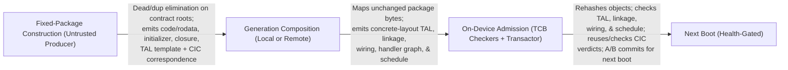

- **Native packages, generations, and untrusted composition:** <a id="r-13-001"></a>
  A native package = content + exact content-addressed **source closure** + capability manifest + **proof object**; native installation = proof check + store insertion + capability wiring, with no maintainer scripts, post-install execution, or runtime native code fetching (precomposed hosts may read validated Wasm guest bundles as data, [§14](#14-userland)). <a id="r-13-002"></a>
  - **Every native install composes a new generation (`r-13-001a`):** Installing, removing, or reconfiguring a native package composes a new signed generation over the roster, committed by the A/B transactor for the next boot ([§11](#11-updates)) with health-gated rollback, the anti-rollback floor, and durable-state migration ([§9](#9-boot--root-of-trust), [§10](#10-storage--state)); Wasm app bundles run as interpreted guest data without changing the generation. The base image remains a fixed reproducible release object, while composition varies placement, concrete TAL binding, wiring, graph, and schedule per roster (with the transparency log recording shared base and package identities rather than device-specific generation roots). <a id="r-13-001a"></a>
  - **No empty pre-proved native compartment slots (`r-13-001b`):** Unknown native occupants cannot reserve banks ([§8](#8-authority-model)), schedule slots ([§11](#11-updates)), NoC capacity, or initial authority ([§7](#7-kernel)) ahead of time; precomposed Wasm hosts ([§14](#14-userland)) and streaming media templates ([§12](#12-system-servers-contained-outside-the-tcb)) already contain their admitted code and fixed authority. <a id="r-13-001b"></a>
  - **Untrusted composer, artifact-not-pedigree (`r-13-001c`):** Both package construction and generation composition are untrusted producer acts (runnable locally on the device or remotely): unchanged packages map without re-lowering, while any error in the memory plan, schedule, wiring table, or handler graph fails on-device admission ([§6](#6-trusted-computing-base-exhaustive), [§11](#11-updates)). <a id="r-13-001c"></a>
  - **Single-manifest ensemble composition (`r-13-001d`):** An ensemble is composed from one manifest (naming members, endpoint units, links, leader ends, and rosters), embedding the manifest's content hash as the **ensemble identity** in every member's generation register ([§9](#9-boot--root-of-trust)). Each member installs and boots independently; links come up only between members carrying the same ensemble identity on the expected units ([§12](#12-system-servers-contained-outside-the-tcb)). <a id="r-13-001d"></a>
- **Content-addressed capability image (no on-device ELF loader):** <a id="r-13-003"></a>
  A package is a set of content-addressed objects ([§10](#10-storage--state)) with fixed identities under R-13-028 (binding actual output-object digests), never an offset-linked ELF container:

| Artifact component | Role & admission check |
| --- | --- |
| **Immutable code-and-rodata image** | Hash-verified against the signed root; the sole region over which execute authority is ever wired ([§14](#14-userland)). <a id="r-13-004"></a> |
| **Writable data-initializer** | Fresh allocation eager-zeroized at plan-assigned slots ([§7](#7-kernel)) and treated as *uninitialized* in the CHERI-TAL derivation until stored to ([§5](#5-languages--verification)). <a id="r-13-005"></a> |
| **Exact source closure** | Source, generated inputs, dependency sources, configuration, and semantic-anchor version, each named by hash. <a id="r-13-006"></a> |
| **Proof object** | First-class **CHERI-TAL typing derivation** template + CIC-checked **source-correspondence theorem** binding the source closure to the final binary ([§5](#5-languages--verification)). <a id="r-13-003-2"></a> |
| **Capability-wiring table & manifest** | Per-slot `(source_object, offset, bounds, permissions)` deriving monotonically from the initial distribution ([§7](#7-kernel)), plus the capability manifest and [§12](#12-system-servers-contained-outside-the-tcb) interface descriptor. |

  - **Self-contained pack archive and content-aware transfer (`r-13-007`..`r-13-010`):** Store objects serialize into one hash-indexed pack archive (Fuchsia-archive / IPFS-CAR / `fs-verity` style) that deduplicates on install or maps in place (`r-13-007`). Content-aware `cp` and fetches transfer only missing objects within a single confidentiality domain (`r-13-008`), decoded on-device by a **Narcissus copy-once verified reader** compiled from a crown-jewel format descriptor (`r-13-009`). **ELF is strictly producer-side build interchange** (including for the resident toolchain): the on-device ELF loader is *deleted rather than hardened* (`r-13-010`). <a id="r-13-007"></a><a id="r-13-008"></a><a id="r-13-009"></a><a id="r-13-010"></a>
  - **Contract-rooted dead and duplication elimination (`r-13-010a`, `r-13-010b`):**
    - *Dead elimination:* LTO, section GC, and stripping retain only the closure reachable from package component graphs, typed callee sets, manifest exports, interrupt/scheduled-entry roots, and contracts; CHERI-TAL and correspondence proofs cover the *stripped* image (re-grounding CHERIoT's export/import compartment structure on RV64 capabilities, `r-13-010a`, [Inspirations & Prior Art](background/inspirations.md)). <a id="r-13-010a"></a>
    - *Duplication elimination & non-resident metadata:* Identical-function merging, intra-compartment outlining/tail-merging, and public-argument specialization run during package construction, and immutable code/rodata objects are **mapped across compartments via capabilities** without copying; relocations, symbols, debug/unwind metadata, ELF headers, source closures, and proofs never occupy execution SRAM (`r-13-010b`). Proofs cover the *merged* image, specialization never touches confidential values (R-15-036g), and merging runs **before** [§15](#15-hardware-platform) dictionary selection because the two are partly substitutive (R-15-036i, R-15-036o, R-15-036p). <a id="r-13-010b"></a>
- **Assurance tiers:** <a id="r-13-011"></a>
  | Tier | Scope | Required assurance | Admission path |
  | --- | --- | --- | --- |
  | **Tier 0** | TCB components. | Full functional refinement at binary level, robust preservation of compartment isolation (secure compilation, [§5](#5-languages--verification)), and the non-interference theorem over the full component graph ([§8](#8-authority-model)). | CIC proof terms, mostly checked at release time and bound into the measured boot root ([§6](#6-trusted-computing-base-exhaustive), [§9](#9-boot--root-of-trust)). |
  | **Tier 1** | Servers that cross confidentiality boundaries; radio L2/L3 servers and parsers are canonical. | Binary-level policy proofs: memory/ABI conformance, handler termination, information-flow theorems from the [§12](#12-system-servers-contained-outside-the-tcb) IDL annotations, and constant-time for key-schedule, PIN, session-key, and radio-key paths that handle secret-labeled material. | CHERI-TAL taint typing where structured, with only unstructured residuals descending to proof terms ([§5](#5-languages--verification), [§6](#6-trusted-computing-base-exhaustive)). |
  | **Tier 2** | Apps and contained code. | Mandatory binary-level memory-safety and data-race-freedom certificate, carrying **the subset of [§5](#5-languages--verification)'s type-level obligations this tier requires** (that list is canonical; this row cites and scopes it rather than restating it): ABI/type well-formedness, no runtime codegen, temporal safety, definite initialization, data-race freedom, and CFI, plus manifest consistency, which is a tier-local admission check and outside the canonical list. The obligations left out here (examined verdicts, absent ambient state, representation-and-provenance conformance, constant-time, and WCET) are scoped out by tier, never absent from the canonical list. Full functional PCC is deliberately not required because app intent is unspecified. | A CHERI-TAL typing derivation checked by the [§6](#6-trusted-computing-base-exhaustive) on-device type-checker; admission is type-checking the artifact, not trusting the producer. <a id="r-13-012"></a><a id="r-13-011-2"></a> |

  - **Universal contract, Iris-over-Sail program logic, and AOT compute (`r-13-013`..`r-13-022`, `r-13-025`):**
    - *No uncertified shortcut & substrate boundary:* Source correspondence proves installed bytes implement only source-permitted behavior; there is no `#![forbid(unsafe_code)]` shortcut (`r-13-013`), and the hardware universal contract (CHERI + caps + capability-checked DMA, Cerise-style) is defense-in-depth under a **refuse-uncertified-code** policy (`r-13-014`, `r-13-025`), without adding a hardware Write-before-Read plane to hedge admission definite-initialization typing (`r-13-015`). <a id="r-13-013"></a><a id="r-13-014"></a><a id="r-13-015"></a><a id="r-13-025"></a>
    - *Katamaran / Cerisier / Iris-over-Sail:* **Katamaran** discharges per-instruction separation-logic obligations between **Isla** and **Islaris** (with a proved translation to **μSail**), **Cerisier** extends Cerise to attestation (`r-13-016`), and unary safety, the universal contract, relational constant-time, and syntax-directed cost form **one Iris-over-Sail program logic with four theories** plus **StkTokens** (`r-13-017`). <a id="r-13-016"></a><a id="r-13-017"></a>
    - *AOT V/M-class compute & OpenCL/SPIR-V/HIP adaptation (`r-13-018`..`r-13-018c`):** All V/M-class "shaders" and kernels are AOT-compiled and certified before admission (`r-13-018`). OpenCL C, SPIR-V, and HIP source/API adaptations lower at build time into the checked source-correspondence chain (`r-13-018a`), mapping work-items to loops and RVV lanes under the [§8](#8-authority-model) pool lifecycle and [§11](#11-updates) schedule budgets (`r-13-018b`), with published revision/feature/test scope in the [compute compatibility plan](implementation/compute-compatibility.md) (`r-13-018c`). <a id="r-13-018"></a><a id="r-13-018a"></a><a id="r-13-018b"></a><a id="r-13-018c"></a>
    - *Tier-2 `unsafe`, secret-label CT, and binary-level intra-compartment safety (`r-13-019`..`r-13-022`):** Tier-2 apps disallow `unsafe` outside the verified HAL or a manual proof (`r-13-019`) and owe binary-level CT only if they receive secret-labeled material (`r-13-020`). Inter-compartment containment is compiler-independent while intra-compartment memory safety is proved at binary level by the Tier-2 certificate (`r-13-021`) with no trusted-toolchain fallback (`r-13-022`). <a id="r-13-019"></a><a id="r-13-020"></a><a id="r-13-021"></a><a id="r-13-022"></a>
- **Supply-chain defense & witnessed transparency log (`r-13-023`..`r-13-024`):**

| Defense mechanism | Threat addressed & operation | Scope & explicit residual |
| --- | --- | --- |
| **1. Checked source correspondence** | Rejects build-farm tampering or trusting-trust injection by binding final installed bytes (including assembly, linking, and image construction) to the exact included source closure. <a id="r-13-023"></a> | Does not detect a logic backdoor present in reviewed source (xz/liblzma archetype). |
| **2. Intra-app library compartmentalization** | Confines a subverted-but-memory-safe dependency at runtime via manifest-declared sub-compartments and seal/switch boundaries ([§7](#7-kernel), [§8](#8-authority-model), [§14](#14-userland)). <a id="r-13-024"></a> | Bounds authority to the dependency's sub-manifest while Tier-2 certificates handle memory corruption. |
| **3. Append-only transparency log & offline inclusion proofs** | Logs shared base-image roots and package names (over source closure, manifest, interface descriptor, and fixed contract; artifact root optional, device-specific generation roots stay private). Offline inclusion/consistency proofs against a co-signed checkpoint travel inside the pack; locally composed packages over already-logged or locally authored closures need no new log entry. <a id="r-13-023a"></a><a id="r-13-023b"></a> | Enables public comparison and offline self-hosting, but does not by itself prevent a publisher from logging two valid variants and delivering the malicious one to a targeted victim (`r-13-023a`). |
| **4. Proved witness quorum policy** | Crown-jewel witness-policy reference model requiring quorum intersection ($2K - N > f$ for flat $K$-of-$N$ with $\le f$ Byzantine witnesses), atomic successor persistence before co-signing, and authenticated key/policy continuity. <a id="r-13-023c"></a> | Unavailable witnesses deny install without lowering thresholds; witness conduct remains an external assumption. |

- **Scoped reproducibility, resident self-hosting toolchain, and fixed-package reuse (`r-13-026`..`r-13-029`):**
  - **Scoped bit-for-bit reproducibility (`r-13-026`):** Mandatory for the **base image** (underwriting the reference integrity manifest, [§9](#9-boot--root-of-trust), [§10](#10-storage--state)) and with DDC for the **two bootstrap checker binaries** ([§6](#6-trusted-computing-base-exhaustive)); all other binaries admit on their checked source-correspondence theorem. <a id="r-13-026"></a>
  - **Resident certifying toolchain (`r-13-027`..`r-13-027b`):** Compilers, prover, and package/composition passes ship as resident contained compartments so **every generation the device runs it can also produce** from its own store (`r-13-027`; ROM-verified boot images remain locally reproducible as a check but not locally signable, bootstrap trust is relocated rather than closed, and proof objects ship in the closure rather than being searched per install). Builds run either in a step-budgeted **composition mode** ([§11](#11-updates)) or as members of the **desktop elastic domain** ([§7](#7-kernel)) writing hash-verified store objects with no execute, sealing, or wiring authority (`r-13-027a`). Self-composing devices hold one **crypto-core-resident local generation key** whose public half joins the holder's enrolled root set ([§9](#9-boot--root-of-trust)) and whose signatures require credential-gated trusted-path consent (`r-13-027b`). <a id="r-13-027"></a><a id="r-13-027a"></a><a id="r-13-027b"></a>
  - **Fixed-package artifact and verdict reuse across rosters (`r-13-028`, `r-13-029`):** Under the [fixed-package contract](implementation/contracts/fixed-packages.md), unchanged packages map across rosters without re-lowering or rebuilding. Each generation rehashes objects and checks concrete-layout CHERI-TAL bindings, modular linkage, wiring, handler graph, placement, and schedules, while reusing package-local correspondence and hyperproperty CIC verdicts from the current admitted generation's authenticated checked-set root whenever the artifact, proof, contract, spec/model/checker, and policy context match (`r-13-028`). SBOM and proof artifacts ship with every release (`r-13-029`). <a id="r-13-028"></a><a id="r-13-029"></a>

---

## 14. Userland

- **Capability-native core utilities (`r-14-001`):** Reimplemented from scratch, not ported. <a id="r-14-001"></a>
- **System-wide W^X as a proven encoding invariant (`r-14-002`..`r-14-004a`):**
  - **Permission-lattice exclusion of `Store ∧ Execute` (`r-14-002`, `r-14-003`):** The 32-codepoint capability permission encoding ([§15](#15-hardware-platform)) admits no set holding both store and execute, making W^X a finite machine-checked property of every capability in every reachable state (with the initial-distribution check kept as redundant confirmation) and subsuming Harvard splits, MMU page-granular NX/DEP bits, and PMP hedges (`r-14-002`, `r-14-003`). <a id="r-14-002"></a><a id="r-14-003"></a>
  - **Zero runtime code generation, grounded on authority (`r-14-004`, `r-14-004a`):** Only install-time wiring ([§13](#13-packaging--supply-chain)) derives execute-only authority over read-only image regions; native compilers (including the resident toolchain) write non-executable store objects for next-boot admission, and Wasm runs pure-interpreted (`r-14-004`). Runtime JIT is refused on **authority** grounds (no runtime minting of executable capabilities), never on verifiability grounds (since Coq-verified JITs like Jitk exist, `r-14-004a`). <a id="r-14-004"></a><a id="r-14-004a"></a>
- **Least-authority native apps and intra-app library compartmentalization (`r-14-005`..`r-14-007b`):**
  - **Memory-safe native domains & Wasm arena scope (`r-14-005`):** Native apps and interpreter hosts are least-authority domains carrying the [§13](#13-packaging--supply-chain) Tier-2 memory-safety certificate (safe Rust by default or verified lifts); interpreted Wasm guests inherit arena confinement rather than object-level linear-memory safety or CT unless separately proved. <a id="r-14-005"></a>
  - **Mandatory intra-app compartmentalization for parsers & capability-holding libraries (`r-14-006`, `r-14-007`):** To contain memory-safe-but-malicious dependencies (`r-14-006`), apps partition into static library compartments with sub-manifests and seal/switch transitions ([§7](#7-kernel)). This is **mandatory** for any dependency that parses **attacker-controlled input** (codecs, decompressors, wire parsers) or any **third-party library** handed capabilities beyond pure compute (passing buffers as non-retainable **local capabilities**, [§15](#15-hardware-platform), `r-14-007`). <a id="r-14-006"></a><a id="r-14-007"></a>
  - **Label count vs. intra-label compartment count (`r-14-007a`, `r-14-007b`):** Because same-label compartments share a slot under [§7](#7-kernel) rotation while distinct discretionary **labels** divide the non-work-conserving frame, label count is the budgeted composition-time capacity quantity (`r-14-007a`), but **mandatory R-14-007 isolation boundaries never merge to save capacity** (`r-14-007b`). <a id="r-14-007a"></a><a id="r-14-007b"></a>
- **Browser, web applications, and desktop lifecycle management (`r-14-008`..`r-14-014`):**

| Browser & web app dimension | Normative execution & containment contract |
| --- | --- |
| **Per-origin containment & AOT-accelerated pure interpreter** | Per-origin compartments, software rendering on C/V-class cores ([§12](#12-system-servers-contained-outside-the-tcb)), powerbox-only file/clipboard access, and **no JIT** (`r-14-008`). Dynamic JS/Wasm run in pure-Rust interpreters ([userspace-porting.md](implementation/userspace-porting.md)) using threaded dispatch, **corpus-selected AOT superinstructions** (`r-14-008a`, bounded by the [§15](#15-hardware-platform) SRAM and [§8](#8-authority-model) memory plan budgets, `r-14-008b`), and **origin-private data-plane inline caches** (preserving cross-domain non-interference within fixed-width slots, `r-14-008c`, and differentially tested off-device against `test262` and the Wasm spec suite with caches disabled, `r-14-008d`). <a id="r-14-008"></a><a id="r-14-008a"></a><a id="r-14-008b"></a><a id="r-14-008c"></a><a id="r-14-008d"></a> |
| **Native browser chrome & unified engine** | Browser chrome and built-in libraries are native Tier-2 code (`r-14-008e`), while both fetched and packaged JS/Wasm remain interpreted guest data (`r-14-008f`). Browsing, standalone web apps, and embedded views share one generation-selected engine codebase with strictly private DOM/interpreter/storage state per app/profile and origin (`r-14-008g`). <a id="r-14-008e"></a><a id="r-14-008f"></a><a id="r-14-008g"></a> |
| **Hosted vs. packaged web apps & WIT-derived bridge** | Hosted apps are HTTPS views; packaged apps bind a signed content-addressed asset closure and package origin that only successor-generation updates can alter (`r-14-008h`). Packaged frontends reach native services only through the [§12](#12-system-servers-contained-outside-the-tcb) **WIT-derived frozen IDL bridge** (deriving caller identity from the authenticated binding/epoch, retiring on navigation/revocation, and excluding shell/filesystem/dynamic-loader access, `r-14-008i`) under the browser's declared origin, memory, storage, and scheduling budgets (`r-14-008j`). <a id="r-14-008h"></a><a id="r-14-008i"></a><a id="r-14-008j"></a> |
| **Fixed origin pool ($P$), eviction policy, & retained tab sets** | Ships a pool of $P$ identical origin compartments (`r-14-009`): opening a tab binds a free member and raises the [§11](#11-updates) rung; the $(P+1)$-th tab waits for a victim to satisfy its `Reusable` predicate via checkpoint-and-retirement or discard (`r-14-010`), making deep tab sets **retained state rather than concurrent compute** (`r-14-011`). The manifest declares the victim equivalence class, protected states (focused, consent-bearing, audio-active, mid-transaction, non-checkpointable), tie-break, reuse bound, all-protected outcome, and eviction telemetry (`r-14-014`). <a id="r-14-009"></a><a id="r-14-010"></a><a id="r-14-011"></a><a id="r-14-014"></a> |
| **App hibernation, slate-slot swapping, & desktop elastic domains** | Under the [lifecycle contract](implementation/workflow-profiles.md#lifecycle-and-the-meaning-of-zero), hibernation releases volatile backing and slots only after schema-bound durable commit and full `Reusable` sanitization (`r-14-011a`). Fixed-tier compositions rebind private physical arenas across open-app records via pre-proved **slate-slot swapping** (`r-14-011b`), whereas laptop desktop profiles run ordinary native apps and Wasm hosts in a **general elastic domain** (and security-sensitive apps in per-app **isolated elastic domains** with one-way session-manager control, `r-14-011c`), restoring from each domain's checkpointed **resume set** after lock/sleep. <a id="r-14-011a"></a><a id="r-14-011b"></a><a id="r-14-011c"></a> |

- **No Linux-personality shim; composition-time WASI-shaped capability namespace (`r-14-012`..`r-14-013`):**
  Foreign binaries and syscall-translation shims/VMs are banned (`r-14-012`). Source ports recompile to RV64+CHERI (`r-14-013`) against a WASI-shaped capability libc whose "filesystem" is a **composition-resolved Plan 9 private namespace** mapping app-local paths to manifest capabilities with no runtime `mount`/`bind` or global lookup (`r-14-012a`). <a id="r-14-012"></a><a id="r-14-012a"></a><a id="r-14-013"></a>
- **Shared verified Wasm Core 3.0 interpreter & elastic application hosts (`r-14-013a`..`r-14-015`):**

| Wasm engine & host contract | Normative requirement & proof scope |
| --- | --- |
| **Shared proved interpreter (`r-14-013a`, `r-14-013c`)** | Single pure-interpreter library compartment carrying machine-checked **soundness** (refining pinned guest semantics) and **robust guest confinement** (influence restricted to declared imports/exports); used by both app hosts and the browser's origin compartments (whose inline caches are differentially tested against its caches-disabled proved baseline, while web JS remains unverified and origin-contained). Linear-memory internal object safety and intra-slot timing are outside arena confinement unless separately proved. <a id="r-14-013a"></a><a id="r-14-013c"></a> |
| **Curated WebAssembly Core 3.0 crown-jewel spec (`r-14-013b`, `r-14-013d`)** | Curated from **WasmCert** and the **SpecTec**-mechanized official Wasm 3.0 specification: covers all Core 3.0 features (typed references, tail calls, multiple memories, `memory64`/`table64`, exceptions, extended const expressions, bounded resumable **guest GC** over arbitrary valid struct/array types, and **fixed-width + relaxed SIMD** with standard `DET` NaN/relaxed choices and AOT/scalar-fallback handlers). Missing upstream mechanization blocks release. <a id="r-14-013b"></a><a id="r-14-013d"></a> |
| **Precomposed elastic Wasm hosts & activation-bound identity (`r-14-013e`, `r-14-013f`)** | Under the [application-host contract](implementation/contracts/application-host.md), first-release hosts validate and interpret local or fetched `.wasm` closures in the running generation (`r-14-013e`). Each concurrent guest uses a distinct host instance and application group (`vmclear`) bound to `(profile, bundle_digest, host_instance, activation_epoch)` with powerbox-gated imports and atomic quiesce/sweep replacement (`r-14-013f`). <a id="r-14-013e"></a><a id="r-14-013f"></a> |
| **Checked native yield bounds & segmented backing (`r-14-013g`)** | Every path (parsing, validation, start, dispatch, imports, bulk ops, growth, GC, checkpoint, cleanup) obeys the elastic member's native yield bound via resumable steps and explicit bounded data stacks; memory grows from the host pool (zeroed, optionally segmented with a flat-memory proof) without overcommit or paging. <a id="r-14-013g"></a> |
| **Bounded guest object arenas (`r-14-015`)** | Every JS/Wasm interpreter uses a composition-bounded object arena ([§8](#8-authority-model) pool with fixed size classes, max counts, cyclic-graph handling, `CapacityExhausted` verdicts, and [§11](#11-updates)-admitted GC WCET); bulk arena backing defaults to the second memory class while interpreter bodies and optional bounded hot state stay first-class ([§15](#15-hardware-platform)). <a id="r-14-015"></a> |

  - **MVP baseline before gated post-MVP acceleration ([Wasm execution contract](implementation/contracts/wasm-execution.md), `r-14-013h`):** <a id="r-14-013h"></a>
    - *Minimum viable engine:* Uses bounded decoded instruction records, resolved branch offsets, explicit guest stacks, and an immutable image-owned handler table (with distinct representations for numbers, guest references, and native capabilities, proved constant native stack use, and complete GC/yield root publication), gated at M8a + Q34f/Q34g/Q34h before commissioning optional acceleration.
    - *Post-MVP acceleration options (commissioned only on measured target miss with a priced proof/qualification record):* Register-resident operand windows and fused handlers (preserving aliasing, trap order, polls, and proved bounds-check elision), composition-selected whole-loop handlers, untrusted Wasm-to-Wasm specialization/preinitialization (re-validated as guest bytes), and host-owned immutable validation/IR caches (revalidated on load)—all preserving the single proved engine without runtime code emission or R-05-065 speed-only optimizers.
- **Concrete porting targets (non-normative):**
  COSMIC Desktop, Zed, Rust `uutils`/`findutils`/`diffutils`, Servo, and a new GGUF inference runtime are mapped to their target mechanisms in [Userspace Porting Targets](implementation/userspace-porting.md). <a id="r-15-005-2"></a>

---

## 15. Hardware Platform

- **Base ISA, privilege & address space (`r-15-001`..`r-15-006`, `r-15-009`):**
  - **RV64IMV + CHERI (purecap-only, Machine mode only, no MMU):** <a id="r-15-001"></a><a id="r-15-001a"></a><a id="r-15-002"></a><a id="r-15-003"></a> Uses an `IM_Zicsr` base with purecap-only addressing (no hybrid mode, so `DDC` is absent and excluded from [§7](#7-kernel) total restore, `r-15-001c`). Atomics (`A`) narrow to unconditional AMOs (`Zaamo` + byte/halfword `Zabha`), excluding `Zacas` (CAS), `Zalrsc` (LR/SC), and `C` (compressed). `V` supplies all floating point via the RVV FPU (no scalar `F`/`D`), and `Zifencei`/`fence.i` is excluded under W^X ([§14](#14-userland)). **Ztso (RVTSO)** is the normative memory model. CHERI protects a single physical address space with `satp` fixed to Bare (no Sv39 MMU) and no hypervisor extension (`r-15-006`). Machine mode is the sole privilege mode (no S/U modes), with privilege gated by CHERI permission ([§7](#7-kernel)). Open RTL is proven to refine a single core-class-parameterized Sail model (**RTL ⊑ Sail**). <a id="r-15-001c"></a><a id="r-15-006"></a>
  - **Fork-and-frozen matrix extension:** <a id="r-15-005"></a><a id="r-15-009"></a> Admitted only if it clears an **order-of-magnitude dense-GEMM throughput threshold** over the M-class's existing RVV unit (otherwise GEMM uses RVV). Its Sail semantics and instruction surface are defined at the measured stage of the freeze; until then the model carries only M-class geometry. At re-pin time, the [profile's matrix status](hardware/isa-profile.md#3-custom-and-fork-and-frozen-instructions) compares attached AME (`Ztt`), integrated IME (`Zvvm`), and vector-coupled VME (`Zvt`, from `Zvopmm`) on revision/ratification status, register/CSR state, memory/restart semantics, M-class VLEN dependence, and arithmetic/rounding semantics under the admission test and amendment review gate.
  - **Permanent 36-bit (64 GB) dense physical address space and non-executable device map:**
    - *36-bit architectural constant (`r-15-002a`):* A capability's address field is 36 bits (64 GB ceiling), and purecap loads/stores take no integer base. Because both memory classes fit on one die (no external memory bus, chiplets, or bonded stacks; ensemble links join separate address spaces), composition rejects any aperture outside 36 bits. <a id="r-15-002a"></a>
    - *Dense physical map (`r-15-002b`):* Every memory region and MMIO aperture is placed densely inside the 36-bit space without wide power-of-two scattering, enforced on the authored attested devicetree ([§9](#9-boot--root-of-trust)) and bank/macro/tier binding map. <a id="r-15-002b"></a>
    - *Permanent 64 GB ceiling (`r-15-002c`):* First-class memory is capped at 16 GB, second-class at 40 GB, and the remaining 8 GB holds all MMIO apertures and the revocation sidecar ([§8](#8-authority-model)). Workloads (including software model serving) must fit within the enumerated [§18](#18-realization) roster with no swap or overcommit; an optional module has its own constant/state budget and adds no host memory. <a id="r-15-002c"></a>
    - *Non-executable device regions (`r-15-002d`):* Every `IOMemory` device region has `executable` clear in the physical address map (checked in the CMake template, compositions, and generated RTL SoC map package, independently of [§14](#14-userland) capability distribution). Instruction fetches check the PMA `executable` attribute and fault when clear or outside declared regions; plain memory (e.g., datapath scratchpad) may also be non-executable, and `read_idempotent` needs no corresponding fetch rule. <a id="r-15-002d"></a>
- **64+1-bit CHERI Concentrate capability format & dialect semantics (`r-15-007`..`r-15-008`):**
  The capability format re-parameterizes CHERI Concentrate to **64+1 bits**: fields are a 36-bit address, a 4-bit object type, 5-bit encoded permissions, a 5-bit exponent, and 8-bit base and 6-bit top mantissas, which spends all 64 bits (36+4+5+5+8+6) with the validity tag outside the 64 bits (exponent `0` = denormal at effective exponent `0`; `k + 1` = normalized at effective exponent `k`). One capability encoding and one parameterized Sail model govern the platform (with a conditional re-pin review if ratified RVY lands, [§17](#17-residual-risks-the-honest-ceiling), [§18](#18-realization)). <a id="r-15-007"></a>

| Aspect / instruction | Specification & assurance rationale |
| --- | --- |
| **Representation correctness & permission lattice** | Re-parameterizing `sail-cheri-riscv` preserves the bounds/sentry algebra so Cambridge monotonicity, provenance, and non-forgeability proofs reuse directly, owing a **representation-correctness proof** over encode/decode and `(base, top)` derivation (`r-15-007a`). The 5-bit permission field is a **total, non-orthogonal 32-codepoint lattice** with unassigned codepoints mapped to bottom (fail-closed) and monotonicity proved over its join/meet (`r-15-007b`, following CHERIoT 1.0's compressed-permission precedent). <a id="r-15-007a"></a><a id="r-15-007b"></a> |
| **No SDP bits, separated Seal/Unseal, & unrepresentable W+X** | Software-defined permission (SDP) bits are absent (`r-15-007n`); composition-fixed 4-bit `otype`s provide 16 machine-enforced sealed classes ([§7](#7-kernel)). No lattice element holds both `Permit_Seal` and `Permit_Unseal` (`r-15-007o`), keeping grant-slot minting ([§8](#8-authority-model)) separate from cross-domain unsealing. Likewise, no lattice element holds both `Permit_Store` and `Permit_Execute` (`r-15-007l`, `r-15-007p`), making W+X capabilities **unrepresentable in the encoding** ([§14](#14-userland)). At reset, `c2` and `c3` hold distinct global Seal-only and Unseal-only capabilities over `[0,13)` (cursor 0, no memory/execute rights); firmware derives exact-type mint/redemption authorities and clears broad copies before kernel handoff per the [sealing bootstrap contract](implementation/contracts/sealing-bootstrap.md). <a id="r-15-007n"></a><a id="r-15-007o"></a><a id="r-15-007l"></a><a id="r-15-007p"></a> |
| **Bounds precision, fixed width, & exact static narrowing** | Bounds are byte-exact below 128 B (128 B requires an even base; larger bounds round at worst to $\text{length}/2^6$, `r-15-007c`). The 64+1-bit width is fixed at final freeze (`r-15-007d`); any post-freeze format change requires full image/blob reprovisioning with no runtime conversion. Because [§8](#8-authority-model)'s static slot plan and elastic size-class tables align and quantize every narrowable object at composition, **every bounds narrowing is exact by layout** (`r-15-007k`), and runtime rounding/assertion instructions (`CRAM`, `CRRL`, `YAMASK`, `CSetBoundsExact`) are excluded. <a id="r-15-007c"></a><a id="r-15-007d"></a><a id="r-15-007k"></a> |
| **Merged register file, tag-clearing derivations, & ISAv9 inheritance** | A single merged file of $32 \times (64+1)$-bit registers holds capabilities and 64-bit integers (integer writes clear the tag; uncompressed `(base, top)` shadow bounds are computed combinationally on capability writeback and cleared on `cclear`, reset, or integer write, adding zero architectural state or `fence.t` surface, `r-15-007i`). Non-monotonic derivations clear the tag rather than trapping (`r-15-007h`). Where the profile is silent on *semantics* (never membership), version-pinned ISAv9 governs (`r-15-007j`), including standard sealed-entry and forward/backward sentry semantics (`r-15-008`). <a id="r-15-007h"></a><a id="r-15-007i"></a><a id="r-15-007j"></a><a id="r-15-008"></a> |
| **Indexed capability load/store (`cld` / `csd`)** | `cld rd, cs1[rs2 << imm]` and `csd` check bounds/permissions at `base + (rs2 << imm)` and access memory **without materializing an intermediate capability** (`r-15-007e`), recovering code size against the 33–43% code-size penalty for deleting the C extension and removing intermediate-capability representability from the dereference path (`r-15-007f`, `Zkt`-listed; `cincoffset`+load/store fusion remains for other cases, and RVY `YSH1ADD`..`YSH4ADD` is only a partial target). Whether the shift scale immediate is carried is selected from emitted-mix measurement at the freeze (`r-15-007g`). <a id="r-15-007e"></a><a id="r-15-007f"></a><a id="r-15-007g"></a> |
| **Declined `CTestSubset` (`YSS`) & `CClearTags`; admitted `cloadtags` & `creclaim`** | `CTestSubset`/`YSS` is declined (`r-15-007m`): there is no GC, cross-compartment buffer extents are fixed by [§12](#12-system-servers-contained-outside-the-tcb) IDL/manifests (`cgetlen`/`cgetperm` suffice for single-capability checks), and our non-orthogonal permission lattice would require a bespoke restatement. For the [§8](#8-authority-model) revocation sweep, **`cloadtags`** (`r-15-007q`) reads a CBO-block group of stored validity tags into an integer register in fixed `Zkt` time (gating the 256 data bitline sense amplifiers to cut sweep sense-amp energy by >90%), and **`creclaim`** (`r-15-007s`) conditionally clears in place any tag in that CBO block whose capability base is marked in the revocation bitmap and returns the surviving tags in fixed `Zkt` time. Unconditional bulk **`CClearTags`** is declined (`r-15-007r`) because non-capability stores already clear tags and reclaimed memory uses `cbo.zero`. <a id="r-15-007m"></a><a id="r-15-007q"></a><a id="r-15-007r"></a><a id="r-15-007s"></a> |

### Instruction-set profile (normative)

The ISA is curated, not inherited.
- **Five-part admission test (`r-15-010`..`r-15-014b`):**
  An extension or feature is admissible only if it satisfies all five parts. <a id="r-15-010"></a><a id="r-15-011"></a>
  1. **Deterministic architectural semantics:** Its behavior is a Sail-expressible function of architectural state (applying [§5](#5-languages--verification)'s semantic-anchor freeze).
  2. **Data-independent timing:** It has operand-value-independent latency on the `Zkt`/`Zvkt` constant-time list; or the [§8](#8-authority-model)/[§13](#13-packaging--supply-chain) flow discipline proves no secret-labeled operand reaches it; or its data-dependent behavior is confined to the owning island's static NoC/memory budget (e.g., event-driven sensor readout).
  3. **No new hidden shared microarchitectural state survives a partition switch un-flushed by `fence.t`:** Discharged by absence, flushing, or proving the state constant across the switch interval (e.g., 1000BASE-T echo canceller trained only in a traffic-free phase).
  4. **No new authority path outside capabilities** ([§8](#8-authority-model)).
  5. **No autonomous behavior:** No hardware walkers, updaters, or feedback loops outside a task's static [§11](#11-updates) WCET bound (the Sv39 page walker leaves with the MMU).
  - *Application of existing commitments (`r-15-010a`, `r-15-012`):* Each part applies an existing specification commitment (and governs [Evaluated Architectural Alternatives](background/architectural-alternatives.md) alongside *one base ISA, one kernel binary*). Speculation fails (1)–(3); SMT and dynamic branch prediction fail (3); LR/SC (`Zalrsc`) fails (3) and (1); table-free crypto suites pass all five. <a id="r-15-010a"></a><a id="r-15-012"></a>
  - *Two-act freeze and trap on unused encodings (`r-15-014`..`r-15-014b`):* The profile is frozen with the proof like the IDL, and all reserved/custom/unused encodings **trap** (`r-15-014`). The **provisional freeze** fixes all non-measured choices so the toolchain has a total compilation target immediately; the **final freeze** settles the closed list of measured-output parameters (realized dictionary size/entries, bundle/header/slot widths, call/global-address form, `bfext`/`bfins`, `cld`/`csd` scale immediate, fusion set, welded CBO block size, per-class bank count, and matrix instruction surface; `r-15-014a`). Every unit without an instruction surface names whether it is decided at the measured second act (matrix) or provisional act (FEC units; `r-15-014b`). <a id="r-15-014"></a><a id="r-15-014a"></a><a id="r-15-014b"></a>
- **Defense-in-depth companion clause (*verify rather than hedge*, `r-15-013`, `r-15-013a`):**
  - *Disjoint failure-domain test:* <a id="r-15-013"></a> A redundant defense-in-depth mechanism is admitted only if it covers a genuinely disjoint failure domain that the primary mechanism's formal verification does not reach (admitting the crypto core's hardware boundary, on-die ECC, and the RoT, while declining PMP, IOMMU/IOPMP, MTE, shadow stacks, and a Harvard split as redundant against verified CHERI, [§7](#7-kernel), [§17](#17-residual-risks-the-honest-ceiling)).
  - *Complete role enumeration on decline:* <a id="r-15-013a"></a> Declining a structure must enumerate and dispose of **every role** it performed in its source architecture (citing the covering mechanism, requirement entry, or inapplicability), not only the role it is filed under.
- **Memory model: Ztso (RVTSO), normative (`r-15-004`, `r-15-015`..`r-15-018-2`):**
  - *Three-part structural & RTL-refinement discharge (`r-15-004`, `r-15-015`, `r-15-015a`, `r-15-016`):* <a id="r-15-004"></a><a id="r-15-015"></a><a id="r-15-015a"></a><a id="r-15-016"></a> (1) **Per-core:** In-order issue plus a FIFO store buffer implements TSO natively (with a deterministic 1-bit register-valid scoreboard and fixed-depth pending-load FIFO for *stall-on-use* scalar load-latency hiding, and program-order coalescing of consecutive SRAM stores to the same 256-bit ECC codeword). (2) **Per-location:** Single-copy cacheless memory makes each bank arbiter the serialization point (**multi-copy-atomic by construction**). (3) **Fabric & memory controller:** The TDM NoC and memory controller preserve each hart's program order of memory requests across banks, macros, shared ring windows, and device endpoints (discharged structurally via composition-time TDM schedule constraints or by RTL ordering proof), making whole-path Ztso an **RTL ⊑ Sail proof obligation**.
  - *SRAM-only store buffer and ordered unbuffered second-class/device stores (`r-15-015b`..`r-15-015d`):* <a id="r-15-015b"></a><a id="r-15-015c"></a><a id="r-15-015d"></a> Only first-class SRAM stores enter the FIFO store buffer. Device-space stores and second-class memory stores take an **ordered unbuffered path**: they issue into the fabric only after all prior buffered SRAM stores have drained into the fabric, and complete (at endpoint accept for device stores, including full-FIFO clock-domain crossing bounds, or at atomic data/tag/ECC bank completion plus permitted refresh phases for second-class stores) before instruction retirement, keeping slow endpoints out of `fence.t`'s SRAM drain constant while preserving TSO store→store and descriptor-before-doorbell ordering (with any outstanding tail at timer expiry priced in [§7](#7-kernel)'s complete residency prefix). The attested devicetree ([§9](#9-boot--root-of-trust)) partitions **device authority by latency class** (`r-15-015c`) so a slow endpoint (e.g., divided-clock ISO7816 eUICC) sits in its own thin driver compartment whenever its worst-case accept dominates the compartment's [§11](#11-updates) slot bound (`r-15-015d`).
  - *Fence-free rings, binary `fence` semantics, and rejection of SC (`r-15-017`..`r-15-018-2`):* <a id="r-15-017"></a><a id="r-15-018"></a><a id="r-15-018-2"></a> Cross-island rings ([§12](#12-system-servers-contained-outside-the-tcb)) need **no `fence` instruction** under Ztso (`r-15-017`). Standard `fence` encodings reduce to `drain | nop` in Sail and Isla (draining the store buffer iff predecessor has `PW`/`PO` and successor has `PR`/`PI`; `fence.tso` is a no-op; reserved `fm` values trap under `r-15-014`). Full sequential consistency (SC) was evaluated and rejected across all hart counts and issue widths (`r-15-018`, `r-15-018-2`): (1) without an L1 cache, stalling every load on store-buffer drain pays full flat-SRAM latency; (2) speculative load issue is forbidden by admission tests (1)–(3); (3) SC requires an active drain-before-load behavioral interlock rather than a structural FIFO property; and (4) SC only removes the single store→later-load relaxation edge while leaving multi-hart interleaving semantics and Isla litmus obligations intact.
- **Control-flow prediction: static only, normative (`r-15-019`..`r-15-023`, `r-10-034-2`):**
  - *Backward-taken / forward-not-taken with zero mutable predictor state:* <a id="r-15-019"></a><a id="r-15-020"></a><a id="r-15-021"></a><a id="r-15-022"></a> BHT, BTB, RAS, and all dynamic direction/target/return predictors are **deleted** (strictly stronger than flushing in `fence.t` and discharged structurally via the microarchitectural absence contract below). Run-ahead fetch follows only the statically determined path into a small stream-determined fetch buffer over cacheless SRAM, leaking no execution history.
  - *Accepted branch penalties & decode-stage / static-layout recovery:* <a id="r-15-023"></a><a id="r-10-034-2"></a> Forward conditional branches, indirect branches, and returns pay deterministic resolve penalties priced into [§11](#11-updates) WCET. To minimize resolve distance without mutable state, the pipeline computes PC-relative targets in Fetch/Decode, reads `cjalr` target capability registers (and shadow bounds) in Decode to redirect immediately when no older in-flight instruction writes `cs1`, and pairs with [§10](#10-storage--state)'s profile-free static code layout (`r-10-034-2`).
- **Instruction encoding: fixed-rate dictionary format, normative (`r-15-036a`..`r-15-036q`):**
  Every executable object is stored, fetched, and decoded in a single **fixed-rate dictionary encoding** (no mode bit or second decoder path). <a id="r-15-036a"></a>
  - *Bundle structure, stateless decode, and finite reflection proof (`r-15-036a`..`r-15-036d`):* <a id="r-15-036b"></a><a id="r-15-036c"></a><a id="r-15-036d"></a> Each bundle is a fixed-width unit read from flat SRAM at fixed latency (reference: 128-bit bundle = 16-bit header + seven 16-bit slots; an 8-slot 128-bit DSE variant with an 8-bit header or 15-bit indices + 1 inline escape bit per slot is preferred wherever the realized dictionary fits in 32,768 entries, and permuting dictionary indices per signed composition gives zero-hardware-cost ISR). Each slot holds either a **dictionary index** into a freeze-committed ROM table of complete canonical 32-bit instructions (`Fin N → Instr`) or half of a 2-slot verbatim **escape** marked by a per-slot header bit (unallocated indices and invalid escape-start headers trap under `r-15-014`). Escapes never straddle a bundle boundary and control-flow targets are slot-aligned (`r-15-036b`). At the reference 16-bit slot the architectural PC stays a byte address at 2-byte alignment, decode is a pure stateless function of `(bundle, slot_index)` with **no mid-instruction reinterpretation**, decoder correctness reduces to finite reflection `∀ i, exec(dict i) ≡ exec(canonical i)` (`r-15-036c`), and the format clears all five amendment-gate criteria (`r-15-036d`).
  - *Bundle-unit WCET, constant-time balancing, and secret-free scope (`r-15-036e`..`r-15-036g`):* <a id="r-15-036e"></a><a id="r-15-036f"></a><a id="r-15-036g"></a> Fetch WCET ([§11](#11-updates)) counts **bundles** at fixed latency (`r-15-036e`), and [§5](#5-languages--verification) constant-time branch balancing balances **encoded bundle counts** across secret-dependent arms (`r-15-036f`). No compression oracle arises (`r-15-036g`): encoding is composition-time only, over public freeze-committed code objects containing no secrets and never specialized on confidential values (`R-13-010d`).
  - *Density model, escape-packing term $\lambda$, and RVC break-even (`r-15-036h`..`r-15-036j`):* <a id="r-15-036h"></a><a id="r-15-036j"></a> For slot width $w$, $k$ slots, header $h$, dictionary hit rate $p$, and expected odd-slot escape-padding `nop`s $\lambda$ per instruction (using a format-allocated canonical `nop` dictionary entry, while non-pair-aligned escapes start at any slot $0..k-2$), encoded size is $(w + h/k)(2 - p + \lambda)$ bits/instruction (at reference $w=16, h=16, k=7$: $36.6 - 18.3p$ before $\lambda$, with RVC break-even reached at *p* = **0.804** for 70% optimistic RVC and $p = \mathbf{0.728}$ for 75% pessimistic RVC):

| Hit rate *p* | λ | Bits per instruction | Fraction of canonical |
| --- | --- | --- | --- |
| 0.95 | 0.007 | 19.33 | 60.4% |
| 0.90 | 0.015 | 20.38 | 63.7% |
| 0.85 | 0.022 | 21.43 | 67.0% |
| 0.80 | 0.029 | 22.48 | 70.2% |
| 0 | 0.333 | 42.67 | 133.3% |

  - *Dictionary selection, operand stratification, address forms, and outlining (`r-15-036i`, `r-15-036k`..`r-15-036q`):*

| Rule / candidate | Normative disposition & measurement order |
| --- | --- |
| **Post-stripping freeze selection (`r-15-036i`)** | Because [§13](#13-packaging--supply-chain) dead/duplication elimination (`R-13-010a`..`c`) is partly substitutive with dictionary coding, stripping and outlining run **first**, and the permanent freeze-time dictionary is selected once with headroom against the stripped release-roster corpus ([freeze measurement contract](implementation/contracts/freeze-measurement.md)). <a id="r-15-036i"></a> |
| **Operand-class stratification (`r-15-036k`)** | Dictionary entries include immediates, so **site-invariant** instructions (register-only ops, small literals, stereotyped prologue/epilogue `csc`/`clc` frame offsets) hit, whereas **site-varying** displacements (`auipcc`+`cincoffset`, `cjal`, forward branches) miss ($p \le 1 - x$). Hit rate $p$ must be reported **stratified by operand class**, with an explicit index-allocation policy (instance count vs. marginal value for recurring forms). <a id="r-15-036k"></a> |
| **Call & global-address forms (`r-15-036l`) vs. excluded `Zcmt` (`r-15-036q`)** | In our 36-bit Bare physical space, fixed-base call targets are composition-time constants: a 1-instruction **absolute** call/address form is site-invariant (sharing one dictionary entry across all callers) without `Zcmt`'s JVT CSR, branch-path memory read, or bespoke capability-bounds check (`r-15-036q`). Whether CHERI-CompCert emits composition-time absolute vs. PC-relative forms (preserving `R-13-028` position-independent reusable package code where required) is decided at the freeze from measured output (`r-15-036l`). <a id="r-15-036l"></a><a id="r-15-036q"></a> |
| **Refused `Zcmp` (`r-15-036m`) & struck single-check multi-save (`r-15-036n`)** | Stereotyped *k*-register saves already hit as *k* dictionary slots (halving `Zcmp`'s byte win to $k-1$ slots), and `cm.push`/`cm.pop`'s restartable trap model requires hidden microarchitectural sequencer state (`r-15-036m`). An all-or-nothing single-check form (`[`csp` − adj, `csp`)`) would be admissible on structure, but is **struck ahead of the freeze** because compiler outlining (`r-15-036o`) removes the same prologues without spending custom opcode space (`r-15-036n`). <a id="r-15-036m"></a><a id="r-15-036n"></a> |
| **Intra-compartment outlining & tail merging (`r-15-036o`, `r-15-036p`)** | CHERI-CompCert (`R-18-014a`, under `R-05-024`) runs **intra-compartment** outlining and tail merging over frame-free recurring regions (`r-15-036o`). Because outlining trades inline slots for call/return cycles (paying full indirect-return latency without a RAS against [§11](#11-updates) slot widths, and coupling to absolute vs. PC-relative call slot costs), it is **measured first on both axes**, recording `(bytes removed, worst-case cycles added)` per region class before measuring `r-15-036l` and `r-15-067d` (`r-15-036p`). <a id="r-15-036o"></a><a id="r-15-036p"></a> |

- **Atomics: unconditional AMOs only (`Zaamo` + `Zabha`), no CAS (`Zacas`), no LR/SC (`Zalrsc`), normative (`r-15-024`..`r-15-030`):** <a id="r-15-024"></a>
  - *`Zalrsc` (LR/SC) and `Zacas` (CAS) excluded (`r-15-025`, `r-15-026`, `r-15-030`):* <a id="r-15-025"></a><a id="r-15-026"></a><a id="r-15-030"></a> `Zalrsc` fails admission test (3) (hidden per-hart reservation register and cross-hart contention channel) and test (1) (spurious SC failure nondeterminism and eventuality rules). `Zacas` (including 128-bit `amocas.q`) has no consumer in a lock-free share-nothing multikernel ([§7](#7-kernel)) with SPSC rings ([§12](#12-system-servers-contained-outside-the-tcb)) and no capabilities in shared mutable memory. Both are deleted from the Sail decode surface, removing retry loops from [§11](#11-updates) WCET (`r-15-030`) and shrinking the memory-model proof surface ([§17](#17-residual-risks-the-honest-ceiling)).
  - *`Zaamo` + `Zabha` retained (`r-15-027`, `r-15-028`):* <a id="r-15-027"></a><a id="r-15-028"></a> `Zaamo` (word/doubleword) and `Zabha` (byte/halfword width extension of unconditional `amoswap`/`add`/`and`/`or`/`xor`/`min`/`max`, with no sub-word CAS) support reference counts (`Arc`, CoW extents) and constructor-injected/handle-passed sub-word cancellation and state flags that survive [§13](#13-packaging--supply-chain)'s ambient-state ban (`r-15-028`). With `Zalrsc` and `Zacas` deleted, `Zabha` is required for lowering-admissibility of `AtomicU8`/`AtomicU16`/`AtomicBool` RMW without race-inducing wider accesses or locks; it passes all five admission tests as a single bounded fixed-latency transaction.
- **Macro-op fusion: decoder-stage, architecturally transparent, admitted (`r-15-031`..`r-15-034`):**
  - *Purecap-matched fusion set:* <a id="r-15-031"></a><a id="r-15-031a"></a><a id="r-15-031b"></a><a id="r-15-031c"></a> The decoder fuses a frozen set of adjacent instruction pairs selected at composition from the profile's own emitted instruction mix (`r-15-031a`), including capability **offset-then-dereference** (`cincoffset` + load/store, narrowed but not deleted by `cld`/`csd`), **PCC-relative capability materialization** (`auipcc` + `cincoffset`), **address-then-narrow** (`csetaddr`/`cincoffset` + `csetbounds`), compare-and-branch, and short dependent-ALU chains (narrowed by `bfext`/`bfins`, `r-15-031b`). Widening the set toward capability arithmetic adds no state, flush-set member, or proof obligation (`r-15-031c`).
  - *Five-test compliance and architectural transparency:* <a id="r-15-032"></a><a id="r-15-033"></a><a id="r-15-034"></a> It passes all five admission tests (`r-15-032`), rides ordinary **RTL ⊑ Sail** functional refinement (`r-15-033`), and requires only that the frozen set be listed as single fixed-latency entries in the timing-annotated Sail model (`r-15-034`), with mandatory backend emission under `R-18-014a`.
- **Write-before-Read: property kept in CHERI-TAL, hardware tag plane declined (`r-15-035`):** <a id="r-15-035"></a>
  Use of uninitialized memory is closed at zero silicon by [§5](#5-languages--verification)'s CHERI-TAL definite-initialization attribute over the [§7](#7-kernel)/[§8](#8-authority-model) static slot plan rather than a second per-granule metadata plane.

- **Excluded ISA extensions & CSRs (removed or never implemented, `r-15-025-2`, `r-15-002-2`, `r-15-003-2`, `r-15-036`..`r-15-052b`, `r-15-001b`):**

| Excluded feature / extension | Disposition & normative rationale |
| --- | --- |
| **Initialization-tag plane (Mon CHÉRI WbR)** | Retained as [§5](#5-languages--verification)'s CHERI-TAL definite-initialization attribute; hardware tag plane fails the defense-in-depth test (`r-15-025-2`, `r-15-002-2`) because the validity tag covers pointers, eager-zeroize prevents prior-tenant disclosure, and TAL/HAL/TCB proofs cover data use. Deletion saves 1 DECTED-covered bit/granule, a Sail invariant, an RTL-refinement obligation, and a DSE parameter while gaining sub-granule/stack precision at admission (`r-15-003-2`; [Evaluated Architectural Alternatives](background/architectural-alternatives.md)). <a id="r-15-025-2"></a><a id="r-15-002-2"></a><a id="r-15-003-2"></a> |
| **`C` (compressed), `Zalrsc`, `Zacas`, & `Zkr`** | `C` is excluded because overlapping 16-bit decodings create gadgets, ambiguous binary proofs, and alignment state, while the fixed-rate dictionary encoding recovers the former 33-43% code-size penalty as a saving (foreclosing `VerifiedOS-C`, `r-15-036`). `Zalrsc` and `Zacas` are excluded per "Atomics" above. `Zkr` entropy CSR is excluded (`r-15-037`) so the RoT TRNG + verified DRBG remains the sole entropy root. <a id="r-15-036"></a><a id="r-15-037"></a> |
| **Virtual memory (`Sv39`/`48`/`57`, `Svadu`/`e`), S/U modes, & closed CSR bank** | CHERI provides single-address-space spatial isolation (`satp` Bare, no MMU/walker/TLB, `r-15-038`; [Inspirations & Prior Art](background/inspirations.md)), and PCC system-register permission replaces S/U rings. [isa-profile.md](hardware/isa-profile.md) enumerates the **closed CSR bank** (`r-15-001b`), deleting the S bank, `frm`, `mstateen`, `menvcfg`, `srmcfg`, `Zkr`, `scounteren`, PMP, `Sdtrig`, and `DDC` so total restore ([§7](#7-kernel)) and `fence.t` completeness quantify over a closed list; absent addresses trap. <a id="r-15-038"></a><a id="r-15-001b"></a> |
| **Scalar FP (`F`/`D`, `f0`–`f31`, `frm`, `Zfinx`/`Zdinx`)** | All FP uses the RVV FPU (`VL=1` for scalars in integer/vector registers), deleting the 32-register `f` bank from [§7](#7-kernel) total restore, `cclear`, and Sail state (`r-15-039`, `r-15-040`). Dynamic `frm` and accrued flags (`fflags`) are separately deleted as mutable cross-instruction state (`r-15-039c`). `Zfinx`/`Zdinx`/`Zhinx*` are excluded (`r-15-039d`) because RVV `.vf` forms still name `f` registers and `Zfinx` would add a second FP datapath or ABI. Vector-FP extensions with `.vf` forms re-home their scalar operand to an integer register (`r-15-040b`, e.g., `vfwmaccbf16.vf`). Observable semantics (`r-15-040c`): RNE-only on vector FP, `<fenv.h>` unimplementable ([userspace-porting.md](implementation/userspace-porting.md)), and `vfmv.f.s` zero-extends instead of NaN-boxing. Duplicate `vfmv.v.f`/`vfmv.s.f` encodings are struck at provisional freeze while `vfmv.f.s` is retained (`r-15-040d`). <a id="r-15-039"></a><a id="r-15-040"></a><a id="r-15-039c"></a><a id="r-15-039d"></a><a id="r-15-040b"></a><a id="r-15-040c"></a><a id="r-15-040d"></a> |
| **`vstart` & fault-only-first vector loads (`vle*ff.v`)** | Vector ops are all-or-nothing from element 0 (`vstart` deleted, `r-15-039a`, `r-15-040a`) since interrupts are polled, there is no MMU page fault, and capability/boundary faults restart. Fault-only-first loads (`vle<eew>ff.v`) are deleted (`r-15-039b`) because there are no pages and callers clamp `vl` directly from capability bounds via `vsetvli`. <a id="r-15-039a"></a><a id="r-15-040a"></a><a id="r-15-039b"></a> |
| **Scalar AES/SHA-2 rounds (`Zkne`/`Zknd`/`Zknh`)** | Vector cores use table-free `Zvkned`/`Zvknhb`/`Zvkg` (including `VL=1`) alongside the masked crypto datapath ([§5](#5-languages--verification)), keeping `Zvkt` to one contract (`r-15-041`), while vectorless cores use integer SHA-3/SHAKE with `Zbb` and retain `Zbkb`/`Zbkc`/`Zbkx` (`r-15-042`). <a id="r-15-041"></a><a id="r-15-042"></a> |
| **Pointer masking (`Ssnpm`/`Smnpm`), `Zicfiss`/`Zicfilp`, & MTE colouring** | Obviated by deterministic byte-granular CHERI bounds, forward/backward sentries, CHERI revocation, and Rust ownership (`r-15-043`, `r-15-044`, `r-15-045`; [Evaluated Architectural Alternatives](background/architectural-alternatives.md)). <a id="r-15-043"></a><a id="r-15-044"></a><a id="r-15-045"></a> |
| **Hints/waits (`Zicbop`, `Zihintntl`, `Zawrs`), `Zifencei`, & dead/unused suites** | Prefetch/NTL hints and `Zawrs` add state without proof benefit (`r-15-046`). `Zifencei`/`fence.i` has no runtime consumer under W^X and cacheless measured-boot loading (`r-15-047`). ShangMi (`Zks*`/`Zvks*`) and `Zimop`/`Zcmop` are dead Sail surface (`r-15-048`), as are **`Zbc`** (`clmulr` unused over `Zbkc`), **`Zalasr`** (redundant with Ztso), **`Zicclsm`** (misaligned accesses trap), and **`Smctr`/`Ssctr`** (control-transfer history oracle; `r-15-048a`). <a id="r-15-046"></a><a id="r-15-047"></a><a id="r-15-048"></a><a id="r-15-048a"></a> |
| **`Smstateen`/`mstateen`, `menvcfg`, `Ssqosid`/CBQRI, & ID CSRs** | `mstateen` (`r-15-049`) and `menvcfg` (`r-15-049a`) gate nonexistent lower modes (`cbo.zero` and purecap are unconditional in M-mode). `Ssqosid`/CBQRI (`srmcfg`, RCID/MCID, bandwidth registers) is omitted (`r-15-050`, `r-15-051`) because TDM NoC slots and bank/macro/tier bindings fix bandwidth at composition. `misa` is read-only (`r-15-052`), `mvendorid`/`marchid`/`mimpid`/`mconfigptr` are hardwired zero (`r-15-052a`), **`mhartid`** is read-only and selects per-hart kernel state/class/island at boot (`r-15-052b`), and all dynamic prediction is absent. <a id="r-15-049"></a><a id="r-15-049a"></a><a id="r-15-050"></a><a id="r-15-051"></a><a id="r-15-052"></a><a id="r-15-052a"></a><a id="r-15-052b"></a> |

- **Adopted ISA extensions, standing adoptions, & bespoke instructions (`r-15-053`..`r-15-067p`, `r-15-029`, `r-05-126`):**

| Adopted / candidate feature | Specification, consumers, & freeze disposition |
| --- | --- |
| **`Zkt` + `Zvkt`, *d*-probing model, & address-timing rule** | `Zkt`/`Zvkt` is both the architectural leakage model for [§5](#5-languages--verification) constant-time verification and an **RTL ⊑ Sail** theorem (`r-15-053`). Beside it stands the crypto core's glitch- and transition-extended *d*-probing crown-jewel spec (discharged against the masked gate-level netlist and bring-up characterization, `r-15-053a`; residuals in [§17](#17-residual-risks-the-honest-ceiling)). Because banked SRAM serializes same-bank collisions, scalar and vector memory timing depends on addresses; the timing model uses the bank-conflicted WCET bound while the [§5](#5-languages--verification) CT type discipline forbids secret-labeled addresses (`r-15-053b`). <a id="r-15-053"></a><a id="r-15-053a"></a><a id="r-15-053b"></a> |
| **`Zicond` (`czero.eqz`/`nez`) & conditional capability move (`cmovz`/`cmovn`)** | `Zicond` provides branchless integer select (`r-15-054`). Because bitwise OR destroys capability tags, the dialect adds **`cmovz cd, cs1, rs2`** and **`cmovn`** (`r-15-054a`), moving a whole 64+1-bit capability register on `rs2 == 0` / `rs2 != 0` in fixed `Zkt` time without branches or stack spills, keeping secret-dependent pointer selects inside [§5](#5-languages--verification)'s typed CT discipline. <a id="r-15-054"></a><a id="r-15-054a"></a> |
| **`Zaamo` + `Zabha`** | Single-instruction, fixed-latency unconditional atomic RMW from word/doubleword (`Zaamo`, powering Rust `Arc`, `r-15-029`) down to byte/halfword (`Zabha`, powering `AtomicU8`/`U16`/`Bool`). <a id="r-15-029"></a> |
| **Vector/scalar crypto (`Zvkned`/`Zvknhb`/`Zvkg`/`Zvbb`/`Zvbc`, `Zbkb`/`c`/`x`) & frozen Keccak (`Zvknhk` / `vkeccak.vi`)** | Table-free non-secret AES/SHA-2/GHASH on RVV and bit-manipulation on scalar cores (`r-15-055`; x86 [AES-NI](https://www.intel.com/content/www/us/en/developer/articles/technical/advanced-encryption-standard-instructions-aes-ni.html) and compatibility layers are excluded, and secret AES uses the [§5](#5-languages--verification) masked datapath; [crypto reuse inventory](assurance/proof-reuse/crypto.md#evercrypt-and-vale-aes-gcm)). Fork-and-frozen **`vkeccak.vi`** (`r-15-056`, tracking RISC-V PQC RVG-84 `Zvknhk` over EGW 2048 / EGS 32 at SEW 64) executes full **24-round** (SHA-3/SHAKE) and **12-round** (TurboSHAKE/KT12) Keccak-*p*[1600] in mandatory `Zvkt` data-independent latency (`r-15-056a`, `r-15-057`, `r-15-057a`), proved against FIPS 202 and NIST ACVP vectors (`r-15-058`) and placed on vector-bearing cores (`LMUL≤1` at V-class `VLEN=4096`, `LMUL=8` at C-class `VLEN=256`, `r-15-059a`; declined on the vectorless S-class RoT, `r-15-059`). <a id="r-15-055"></a><a id="r-15-056"></a><a id="r-15-056a"></a><a id="r-15-057"></a><a id="r-15-057a"></a><a id="r-15-059a"></a><a id="r-15-058"></a><a id="r-15-059"></a> |
| **`Zicboz` (`cbo.zero`), `fence.t`, `mtimecmp`, & capability-read AIA/IMSIC** | `Zicboz` (`cbo.zero`) zeroes data, clears tags, and regenerates ECC per CBO block for [§7](#7-kernel) eager zeroize and WbR disclosure prevention (`r-05-126`, `r-15-060`), while `Zicbom` (`cbo.clean`/`flush`/`inval`) is excluded (`r-15-061`). Platform-custom **`fence.t`** (`r-15-062`) flushes the store buffer in padded constant time. M-mode `mtimecmp` is programmed directly (`Sstc` excluded, `r-15-063`). **AIA/IMSIC** (`r-15-064`..`r-15-066a`) makes the platform MSI-only via capability-checked stores into M-mode pending arrays (excluding PLIC, wired interrupts, S/VS files, and delivery/threshold logic); `mie`/`mip` retain only `MTIP` and hardwired-one `MTIE` for the unmaskable boundary timer. <a id="r-05-126"></a><a id="r-15-060"></a><a id="r-15-061"></a><a id="r-15-062"></a><a id="r-15-063"></a><a id="r-15-064"></a><a id="r-15-065"></a><a id="r-15-066"></a><a id="r-15-066a"></a> |
| **`Zba`/`Zbb`/`Zbs`, `Zvfbfwma` + `Zvfbfmin`, & structural `Ziccid`** | Fixed-latency bit-manip (`Zba`/`b`/`s`), M-class bf16 widening MAC (`Zvfbfwma`, `r-15-067`) plus its bf16 conversion dependency **`Zvfbfmin`** (`r-15-067i`), and **`Ziccid`** instruction-fetch coherence held structurally via cacheless SRAM and W^X (`r-15-067j`). <a id="r-15-067"></a><a id="r-15-067i"></a><a id="r-15-067j"></a> |
| **Bespoke code-size & media-cycle candidates (`bfext`/`bfins`, `csetbounds` imm, `rcstep`)** | Custom I-type **`bfext` / `bfins`** (`r-15-067a`..`r-15-067d`) targets bit-packed wire parsers/encoders (UPER RRC, 5G-NAS, 802.11 MLME) and generated MMIO accessors against the 33–43% code-size penalty for deleting the C extension; custom **`csetbounds` large immediate** (`r-15-067e`) collects one 16-bit slot rather than four bytes; and custom **`rcstep rd, rs1, rs2`** (`r-15-067f`..`r-15-067h`) executes one fixed-latency `Zkt` AV1/Daala range-coder renormalization step (a serial stage measured at roughly 45% of decode time on conventional machines). All three clear the 5 admission tests and are **decided at the measured freeze** (dropped by default if standard lowering / `VLEN=4096` RVV meets the capacity or [§11](#11-updates) slot ceiling). <a id="r-15-067a"></a><a id="r-15-067b"></a><a id="r-15-067c"></a><a id="r-15-067d"></a><a id="r-15-067e"></a><a id="r-15-067f"></a><a id="r-15-067g"></a><a id="r-15-067h"></a> |
| **Standing adoptions (`Zvldot`/`Zvbdot`, `Zvzip`, integer vector SAD) & dropped/conditioned (`Zibi`, `Zvfbfa`, `Zvfofp8min`)** | A **standing adoption** (`r-15-067k`) discharges the admission test now with zero Sail/encoding surface until ratification, abandonment, or material reshaping: (1) **`Zvldot` / `Zvbdot`** (`r-15-067l`, vector dot products setting the RVV int8 GEMM denominator, while unratified `Zvqdotq` is refused); (2) **`Zvzip`** (`r-15-067m`, fixed-latency interleave/deinterleave for PQC NTT butterflies and V-class I/Q radio streams); and (3) **integer vector absolute difference** (`r-15-067n`, expanding admitted media encode resolution/rate). **`Zibi`** is dropped (`r-15-067o`, saving only one 16-bit slot); **`Zvfbfa`** is excluded on its `vtype` mode bit and lack of consumer, while **`Zvfofp8min`** is conditioned on a mode-free instruction encoding (`r-15-067p`). <a id="r-15-067k"></a><a id="r-15-067l"></a><a id="r-15-067m"></a><a id="r-15-067n"></a><a id="r-15-067o"></a><a id="r-15-067p"></a> |

- **CHERI capability-ISA features (CHERIoT-lineage, adopted explicitly, `r-15-044-2`, `r-15-068`..`r-15-074`):** <a id="r-15-044-2"></a>

| CHERI-ISA feature | Normative behavior & disposition |
| --- | --- |
| **Capability jump-and-link (`cjalr`) & Griotte qualification (`r-15-068`, `r-15-069`)** | `jal`/`jalr` (`cjalr`) unseals a forward-edge sentry into PCC and seals the return address into the link register as a backward-edge sentry (`r-15-068`), serving both intra-compartment calls and the [§7](#7-kernel) cross-compartment switcher. Bounded qualification of Griotte's Rocq/Iris call/return contracts ([Inspirations & Prior Art](background/inspirations.md#griotte-qualified-switcher-proof-prior-art)) maps one call onto the profile's permissions, finite `otype`s, ABI, and Sail primitives before theorem transfer (`r-15-069`). <a id="r-15-068"></a><a id="r-15-069"></a> |
| **Masked register clear (`cclear`) & declined stack high-water CSRs (`mshwm`/`mshwmb`)** | Custom S-type **`cclear h, mask`** (`r-15-069a`, `r-15-069b`, `Zkt`-listed, re-pin target `ZcheriSanitary`) zeroes any subset of 16 registers in half `h` in one fixed-latency cycle to cut the [§7](#7-kernel) compartment switcher's worst-case scrub bound. CHERIoT's **`mshwm`/`mshwmb`** stack high-water CSRs (and STKZ engine) are declined (`r-15-069c`) because they only improve mean latency, leak call-graph depth across domains if unpadded, and add CSR restore state; eager stack zeroize uses fixed-latency `cbo.zero`. <a id="r-15-069a"></a><a id="r-15-069b"></a><a id="r-15-069c"></a> |
| **Vector/matrix all-state clear (`vmclear`, `r-15-069d`, `r-15-069e`)** | Custom **`vmclear`** clears the vector register file, vector CSRs, matrix architectural state, and class datapath scratchpad in one fixed per-class `Zkt` pass for [§7](#7-kernel)'s partition switch (trapping on vectorless classes; elided statically at composition when an outgoing manifest fixes `mstatus.VS`/`XS = Off`). <a id="r-15-069d"></a><a id="r-15-069e"></a> |
| **Plain sentries only (`r-15-070`) & forward/backward-edge CFI split (`r-15-071`, `r-15-072`)** | CHERIoT's interrupt-state sentries (`enabled`/`disabled`/`inherit`) are excluded (`r-15-070`) because asynchronous interrupt delivery is absent ([§7](#7-kernel)). Forward/backward-edge sentries enforce coarse-grained call/return CFI (`r-15-071`), while exact target-set membership is enforced at zero silicon by [§5](#5-languages--verification)'s CHERI-TAL **typed callee set** (`r-15-072`). <a id="r-15-070"></a><a id="r-15-071"></a><a id="r-15-072"></a> |
| **Capability trap CSRs (`MTCC`/`MEPCC`/`MTDC`), `mcause`/`mtval` reporting, & double-trap fail-stop (`r-15-073`..`r-15-073c`)** | `MTCC`, `MEPCC`, and `MTDC` bootstrap the single-M-mode trap path (`r-15-073`), and capability violations report ISAv9 cause codes and details through existing `mcause` and `mtval` (`r-15-073a`). No second saved-PC bank (`ErrorEPCC`/`Smrnmi`) or software-visible `mstatus.MDT` exists (`r-15-073b`): a synchronous trap taken while the 1-bit internal trap-path state is live (between trap entry and `mret`; boundary timer events wait until `mret`) **preserves `MEPCC`/`mcause`/`mtval` untouched and latches an immediate die fail-stop to the RoT** (`r-15-073c`, [§16](#16-reliability)). <a id="r-15-073"></a><a id="r-15-073a"></a><a id="r-15-073b"></a><a id="r-15-073c"></a> |
| **Local / global capabilities & `store-local` (`r-15-074`)** | Only stack capabilities carry `store-local` (with `load-global`/`load-mutable` transitivity), so local capabilities cannot be captured into heap or global memory and expire at call return ([§12](#12-system-servers-contained-outside-the-tcb), [§14](#14-userland)). <a id="r-15-074"></a> |

- **No PMP (`r-15-075`, `r-15-076`), deleted performance counters (`r-15-077`), & lifecycle-fused debug (`r-15-016-2`, `r-15-078`..`r-15-079a`):**
  - *No PMP or `Smepmp` (`r-15-075`, `r-15-076`):* <a id="r-15-075"></a><a id="r-15-076"></a> CHERI is the sole spatial memory-protection mechanism (following CHERIoT and Codasip A730; [Inspirations & Prior Art](background/inspirations.md)): immutable text/W^X is covered by [§14](#14-userland) capability monotonicity, per-core partition bounds by [§7](#7-kernel) root capabilities, and crown-jewel secret fencing by the crypto core's hardware boundary and sealed handles ([§12](#12-system-servers-contained-outside-the-tcb)). By *verify rather than hedge*, formal verification of CHERI reachable-capability monotonicity (Bauereiss et al., ESOP 2022) plus **RTL ⊑ Sail** replaces PMP's redundant in-band check ([§17](#17-residual-risks-the-honest-ceiling)).
  - *Performance counters & trigger module deleted (`r-15-077`, `r-15-079a`):* <a id="r-15-077"></a><a id="r-15-079a"></a> `Zicntr`/`Zihpm` (`rdcycle`, `rdtime`, `rdinstret`, `mcycle`, `minstret`, `mhpmcounter*`, `mhpmevent*`, `mcountinhibit`, and counter-read permission) and `Sdtrig` (`tselect`, `tdata1`–`tdata3`, match logic, and watchpoint traps) are **deleted in all lifecycle states** so no timing oracle or M-mode-writable comparator state enters Sail, RTL, total restore, or `fence.t`. Scheduling uses memory-mapped `mtime`/`mtimecmp` ([§9](#9-boot--root-of-trust)), and wild writes are caught by CHERI bounds faults (`mcause`/`mtval`).
  - *Hardware lifecycle-fused Debug Module (`r-15-016-2`, `r-15-078`, `r-15-079`):* <a id="r-15-016-2"></a><a id="r-15-078"></a><a id="r-15-079"></a> In production, the RoT's monotone OTP lifecycle fuse holds the RISC-V Debug Module's clock/reset gated off and its fabric port electrically quiesced—proved architecturally absent under **RTL ⊑ Sail** (no DM transaction reaches the fabric in production). In development/RMA states, DM and trace require an ML-DSA-signed, serial-bound RoT challenge-response, lifecycle-diversified keys, and prior crypto-erase ([§9](#9-boot--root-of-trust)).
- **Implementation timing contracts (normative microarchitectural bounds, `r-15-080`..`r-15-088`):**

| Contract | Normative microarchitectural requirement & WCET/CT discharge |
| --- | --- |
| **Fixed-latency integer `DIV`/`REM` (`r-15-080`)** | Always executes in fixed worst-case latency; operand-dependent early-out dividers (KyberSlash class) are forbidden. <a id="r-15-080"></a> |
| **Fixed-latency RVV FPU & static rounding (`r-15-081`..`r-15-083`)** | The sole RVV FPU runs in fixed latency across all operand classes including subnormals (`r-15-081`); `vfdiv`/`vfsqrt` are either fixed-latency or excluded from the CT list because [§8](#8-authority-model)/[§13](#13-packaging--supply-chain) flow typing proves no secret reaches them (`r-15-082`). Rounding is encoded statically per instruction (default RNE; no dynamic `frm` CSR, `r-15-083`). <a id="r-15-081"></a><a id="r-15-082"></a><a id="r-15-083"></a> |
| **Misaligned accesses trap (`r-15-084`)** | Never split in hardware, eliminating address-dependent line-crossing latency. <a id="r-15-084"></a> |
| **Mask-independent `Zvkt` timing (`r-15-085`)** | `Zvkt`-listed vector ops never skip cycles or memory accesses for masked-off elements. <a id="r-15-085"></a> |
| **Vector memory bank-conflict split & XOR sub-bank skew (`r-15-085a`, `r-15-085b`)** | Unit-stride, segment, and whole-register accesses stay **on** the `Zvkt` list; within each island's SRAM grant ([§8](#8-authority-model)), a stateless combinational XOR address skew (`subbank_id = addr[b:a] ^ addr[c:b+1]`, Budnik-Kuck / Rau) eliminates power-of-two stride conflicts. Indexed gather/scatter (`vluxei`/`vloxei`/`vsuxei`/`vsoxei`) and runtime-strided accesses (`vlse`/`vsse`) are **off** the list (`r-15-085a`): [§8](#8-authority-model)/[§13](#13-packaging--supply-chain) CT typing forbids secret element addresses, and [§11](#11-updates) WCET charges the **fully-conflicted bound** (all elements hitting one bank, absorbed inside the non-work-conserving slot, `r-15-085b`). <a id="r-15-085a"></a><a id="r-15-085b"></a> |
| **Static-only fetch, Ztso drain, & fixed-latency AMOs (`r-15-086`..`r-15-088`)** | Fetch timing is a fixed function of architectural state and static prediction (`r-15-086`). The Ztso store buffer drains at partition switch as part of the `fence.t` padded constant (`r-15-088`). `Zaamo`/`Zabha` AMOs complete in fixed data-independent worst-case latency at the single-copy SRAM bank arbiter (`r-15-087`). <a id="r-15-086"></a><a id="r-15-088"></a><a id="r-15-087"></a> |

- **RTL-against-Sail refinement: the bottom arrow of G3 (`r-15-089`..`r-15-100`):**
  Microarchitectural obligations split into **refinement obligations** over modeled architectural state (**RTL ⊑ Sail**) and **absence obligations** over unmodeled structures (below). <a id="r-15-089"></a>

| Verification rung / aspect | Scope, trust tier, & role in G3 |
| --- | --- |
| **1. Kami / Kôika Coq refinement (`r-15-091`, `r-15-092`)** | **Closing theorem vehicle** in the same Coq kernel ([§6](#6-trusted-computing-base-exhaustive), following Erbsen et al., PLDI 2021). Net-new blocks without legacy RTL (capability/tag DMA fabric, TDM NoC, fixed-function sequencers) are authored directly in Kami (default) or Kôika (`r-15-092`); each version records its proved circuit object, emitter, wrappers, and exact synthesis-input digest, requiring a checked correspondence to generated SystemVerilog for theorem-tier closure. <a id="r-15-091"></a><a id="r-15-092"></a> |
| **2. Sail-generated SystemVerilog + commercial FEV (`r-15-090`)** | **Day-one unbounded observational-equivalence evidence** (Oxford / lowRISC CHERIoT-Ibex methodology via Jasper-class FEV) for imported/modified cores (CHERI-CVA6 scalar front end, Ara, Gemmini) ahead of their Coq close. <a id="r-15-090"></a> |
| **3. Deferred proof over shipped SystemVerilog (`r-15-093`)** | Optional OOPSLA-2025-lineage foundational Verilog-semantics close for imported cores; budget-gated under [§5](#5-languages--verification) and admitted only if it retires the Sail-FEV evidence step. <a id="r-15-093"></a> |
| **4. `riscv-formal` / `rvfi` & Isla bridge (`r-15-094`)** | `riscv-formal`/`rvfi` (YosysHQ SVA + BMC) provides fast bounded-depth bring-up refutation (`r-15-094`), while **Isla** symbolic execution translates the frozen Sail model into concrete RTL litmus, ordering, and constant-time obligations. <a id="r-15-094"></a> |
| **Timing-annotated Sail model & honest scope (`r-15-095`..`r-15-097`, `r-15-100`)** | Hyperproperties (`Zkt`/`Zvkt` 2-safety, Ztso ordering, static fetch timing) are checked against the **timing-annotated Sail model** (`r-15-095`, `r-15-100`), which simultaneously supplies sound per-instruction latency bounds to [§5](#5-languages--verification)/[§11](#11-updates) WCET derivation without unverified aiT-class cache/pipeline abstract interpretation (`r-15-096`). **RTL ⊑ Sail** is the least-built layer of the stack, staged per class in [§18](#18-realization) with silicon fabrication residuals booked in [§17](#17-residual-risks-the-honest-ceiling) (`r-15-097`). <a id="r-15-095"></a><a id="r-15-100"></a><a id="r-15-096"></a><a id="r-15-097"></a> |

- **Microarchitectural absence contract: removals Sail cannot express (`r-15-098`..`r-15-107`):** <a id="r-15-098"></a>
  - *ISA-visible vs. microarchitectural removals (`r-15-099`..`r-15-100b`):* <a id="r-15-099"></a><a id="r-15-100a"></a><a id="r-15-100b"></a> **ISA-visible removals** (MMU/Sv39 walker, PMP, S/U rings, `C`, `Zifencei`, `Zalrsc`/`Zacas`, scalar `F`/`D`, dynamic `frm`, `vstart`, `vle*ff.v`, asynchronous interrupts) are absences in the frozen Sail model itself (`r-15-099`). **Microarchitectural removals**—speculation, out-of-order issue, all dynamic branch/target/return predictors, prefetchers, SMT, I-/D-/tag caches, and reactive/load-/activity-/temperature-driven DVFS—are invisible to Sail and discharged by a structural **absence contract** directly on the RTL (`r-15-100a`). Two removals are explicitly conditional on deferred [Evaluated Architectural Alternatives](background/architectural-alternatives.md) (`r-15-100b`): static code overlays would retire the `Zifencei` exclusion (without retiring the I-cache exclusion), and a deterministic generation-tag plane would retire the second-tag-plane exclusion.
  - *Structural discharge over Kami/Kôika and imported SystemVerilog (`r-15-101`..`r-15-103`, `r-15-105`..`r-15-107`):* <a id="r-15-101"></a><a id="r-15-102"></a><a id="r-15-103"></a><a id="r-15-105"></a><a id="r-15-106"></a><a id="r-15-107"></a> To enforce the hyperproperty that **cycle-level timing and memory traffic depend only on the instruction stream and architectural state, never prior execution history** (`r-15-101`), the contract verifies the sufficient structural condition that the forbidden state elements do not exist: as a Coq structural predicate over declared registers for Kami/Kôika blocks (`r-15-102`) and as an elaborated-netlist + synthesis-provenance audit for imported SystemVerilog cores (`r-15-103`). Converting behavioral flush/partitioning proofs into structural absence checks shrinks the **RTL ⊑ Sail** obligation (`r-15-105`), discharges `fence.t` flush-set completeness (`r-15-106`), and stands as a distinct [§18](#18-realization) gate and [§17](#17-residual-risks-the-honest-ceiling) audit residual (`r-15-107`).
  - *Decidable fetch-buffer vs. prefetcher boundary and PCC range check (`r-15-104`, `r-15-104a`):* <a id="r-15-104"></a><a id="r-15-104a"></a> A forbidden **prefetch engine** holds a table updated from prior execution, whereas the admitted **static-path fetch buffer** is table-free and fetches only statically determined successors of already-fetched instructions (`r-15-104`, with `Zicbop` hints excluded). Every run-ahead fetch request's complete byte footprint (including bundle/burst rounding) is checked before fabric issue against the current tagged, unsealed, execute-permitted PCC bounds (no wraparound) and declared PMA `executable` attributes (`r-15-104a`); PCC changes revalidate or discard queued/in-flight requests, out-of-bounds/non-executable requests issue no traffic and raise no exception ahead of demand, and buffer depth has no independent cap beyond the timing-annotated model and `fence.t` drain bounds.
- **Proof-aware design-space exploration (DSE, `r-15-108`..`r-15-110`):** <a id="r-15-108"></a><a id="r-15-109"></a><a id="r-15-109a"></a><a id="r-15-110"></a>
  Pre-silicon DSE selects the frozen microarchitectural parameters (per-class VLEN, core counts, issue width, pipeline depth, memory-issue width, per-class bank counts, bank/macro/tier-to-island bindings, scratchpad sizes, the single welded CBO block size shared by `cbo.zero`/`cloadtags`/`creclaim`/`cbo.scrub`, FEC decoder geometry, and TDM-NoC schedule) using a multi-objective utility function that weights **proof simplicity** (Sail-surface and refinement-effort proxies) alongside performance, area, power, and WCET (`r-15-108`). The five-part admission test, [§8](#8-authority-model) non-interference, [§11](#11-updates) WCET (`r-15-109`), and the [§18](#18-realization) eight-member product floor and five capacity/bandwidth/area comparisons across both ends of the density band (`r-15-109a`) are **hard pruning constraints**, while the untrusted DSE tool's chosen configuration is discharged by per-class **RTL ⊑ Sail** proofs (`r-15-110`).

**Core count per class is in that set because the reticle prices it.** <a id="r-15-108a"></a>
The High-NA half field (~400 mm² usable of ~430 mm²; memory subsystem below) hard-bounds the single logic tier (and shares the planar tier with the array in the single-tier case). Core count and issue width spend the same non-stackable planar area and are weighed as **one explicit Pareto axis** against the stated first-class floor at both ends of the density band ([§18](#18-realization)): in-order single/dual issue and fusion cap what a wider core returns, whereas each additional C-class core deletes a partition-switch budget ([§11](#11-updates)) and relieves the [§17](#17-residual-risks-the-honest-ceiling) population-wall divisor.

### Heterogeneous single-die topology <a id="r-15-005-3"></a>

All host-core compute sits on one die with one base ISA, one kernel binary, and one parameterized formal model; an ensemble ([§2](#2-non-goals-deliberate)) joins several such machines with no shared compute or memory across an ensemble link (interconnect below). <a id="r-15-111"></a>
Scalar front ends share one microarchitecture (CVA6-class, **modified to static-only prediction per the profile**) across all classes, so kernel-path WCET is a single analysis. <a id="r-15-112"></a>
The canonical **core-class table** below gives reference composition counts (searched by parameter selection above; disjointness machine-checked per [§7](#7-kernel)).

| Class | Count | Datapath | Role and typical owners <a id="r-15-113"></a> |
| --- | --- | --- | --- |
| **C-class** | ×6 | RV64IMV+CHERI purecap, in-order single/dual-issue, VLEN=256 | Control and application: kernel instances, servers, apps, browser origins, radio L2/L3 compartments |
| **V-class** | ×4 general + ×2 radio-pinned | Shared scalar front end + decoupled Ara-lineage long-vector unit, VLEN=4096, 8 lanes | Long-vector compute: software rasterization, compositing, codecs, ISP, and data-parallel work; the radio-pinned pair (statically assigned per [§7](#7-kernel), never time-shared with non-radio domains) hosts the cellular and Wi-Fi PHY servers |
| **M-class** | ×2 | Shared scalar front end + tightly coupled systolic GEMM unit (32×32 int8 / 16×16 bf16, Gemmini-lineage) + mid-length vector (VLEN=1024) + software-managed scratchpad | Matrix and AI: the inference server ([§12](#12-system-servers-contained-outside-the-tcb)) is the typical owner |
| **S-class** | ×1 architectural, realized as a detection-lockstepped pair ([§16](#16-reliability)) | Minimal scalar-only core, no vector unit | Sentinel: permanently and exclusively owns the telemetry monitor ([§12](#12-system-servers-contained-outside-the-tcb)); its guaranteed budget is the whole core, collapsing the availability proof |
| **RoT** | ×1 | OpenTitan-class block on-die: own scalar RV64+CHERI control core (the die's purecap capability format in a minimal scalar profile, so no second capability encoding forks the model), TRNG, OTP/key storage, monotonic counters, and the watchdog, in its own clock/power island | The platform's only management processor: measured boot, key custody, and attestation ([§9](#9-boot--root-of-trust)) |

| Class / Attachment | Normative Architecture & Coprocessor Contract |
| --- | --- |
| **Core pinning rule** <a id="r-15-114"></a> | Pinning is an admission outcome of the [§11](#11-updates) switch-duty inequality (radio-pinned V-class pair, S-class sentinel, or a high-rate wired NIC if ring-depth amortization fails), deleting switch cost via composition-parameter re-instantiation. |
| **V-class vector vs. GPU/SIMT** <a id="r-15-115"></a> | No fixed-function graphics (no rasterizer, texture units, ROPs, or command processor; core-issued register arithmetic uses ordinary ISA admission per [§4](#4-organizing-principle)) and no SIMT warp scheduler. Vector data carries no tags; capability checks land on scalar-issued vector memory ops (per-element for gather/scatter). **A vector store clears the capability tag of every granule it overwrites** (including partial-granule writes) to prevent stale-tag forgery. <a id="r-15-115a"></a> **Every element runs its capability check, but only active elements raise a capability exception:** masked-off elements execute their check and take a padded bank cycle presenting no fabric address if the check fails, preserving both mask-independent timing and capability confinement. <a id="r-15-115b"></a> |
| **M-class systolic GEMM unit** <a id="r-15-116"></a> | Admitted beside the VLEN=1024 RVV datapath only where it clears an **8–10× sustained dense-GEMM throughput margin** (and wider per-watt margin; 32×32 int8 / 16×16 bf16 K² MACs/cycle with O(K) operand reuse vs. 128 int8 / 64 bf16 MACs/cycle on VLEN=1024), preferring a zero-tile-state ratified track (`Zvvm` IME); small/irregular GEMM folds onto VLEN=1024 RVV, and if dense GEMM falls below 8–10× at the second-act freeze, the bespoke matrix extension is deleted by default. **The denominator is normative:** measured against the strongest admitted M-class RVV expression (including the standing batched vector dot-product adoption, [performance-estimates.md](performance/performance-estimates.md)); falling below threshold deletes the matrix extension, M-class, `vmclear`'s matrix scope, and software de-quantization duty. <a id="r-15-116a"></a> |
| **RVV de-quantization & MX scaling** <a id="r-15-117"></a> | The constant VLEN=1024 RVV unit unpacks low-bit-width weights (K-quant, codebooks via `vrgather` and bit-manipulation) and applies MX microscaling block scales in software without an ACE/Arm-FPMR-style architectural scale register ([Evaluated Architectural Alternatives](background/architectural-alternatives.md)). **Booked price:** comparable-node hardware block-scaled dot-product units report ~7.0× (FP32) and ~4.8× (bf16) throughput and ~4.9× / ~3.8× energy over software emulation, charged in the M-class vector slot in exchange for zero per-format matrix state. <a id="r-15-117a"></a> |
| **Coprocessor boundary** <a id="r-15-118"></a> | Every byte moved by the matrix or FEC units is core-issued with explicit capability operands: no independent DMA mastership, no translation context, and no firmware. |
| **Radio V-core FEC units (`ldpcdec` / `polardec`)** <a id="r-15-119"></a> | Fixed-geometry arithmetic for **5G NR / 6G LDPC and polar decoders only** (legacy 2G/3G/4G turbo and convolutional decoders are absent; owed at the provisional freeze, [§3](#3-threat-model), [§12](#12-system-servers-contained-outside-the-tcb)). TS 38.212 owns the code tables (held by the builder under its in-house carve-out, never tracked here, [§17](#17-residual-risks-the-honest-ceiling)); exploration freezes unit count, parallelism, max lifted block length, iteration bound, and polar list width under invariant mnemonics/encoding. <a id="r-15-119a"></a> Two custom-0 (`funct3=100`, family in `funct7`) instructions—`ldpcdec cd, cs1, rs2` and `polardec cd, cs1, rs2`—take separate soft-LLR input (`cs1`) and hard-bit output (`cd`) capabilities and a packed descriptor (`rs2`: soft/hard counts and declared code-set index, with **no verdict register** since the transport-block CRC decides). <a id="r-15-119b"></a> **Each decoder completes at one fixed latency** (max lifted block length at the deterministic iteration bound, never stopping early). <a id="r-15-119c"></a> |
| **Integrated RoT** <a id="r-15-120"></a> | On-die integration removes the discrete-RoT interposer/probing surface at the cost of single-mask-set concentration ([§17](#17-residual-risks-the-honest-ceiling)). |

### Radio subsystem, wired link, and sensor front-ends

| Subsystem / Layer | Architectural Contract & Bounds |
| --- | --- |
| **On-die transceiver** <a id="r-15-121"></a> | Register-slave direct-RF/zero-IF ADC/DAC + digital front end (filtering, decimation), configured via capability-gated MMIO, streaming I/Q to/from radio V-cores via capability-bounded DMA windows; no instruction fetch or firmware. |
| **Link-layer timing sequencer** <a id="r-15-122"></a> | Fixed-function timer inside the transceiver datapath meeting sub-slot turnaround deadlines (BLE `T_IFS` 150 µs, 802.11 SIFS 10/16 µs, 802.15.4): packet-end event triggers a fixed timer driving RX/TX switch and gating a software-preloaded buffer/channel word ([§12](#12-system-servers-contained-outside-the-tcb)) with no firmware, passing all 5 admission tests as a verified-RTL **split-MAC / SoftMAC** (Nordic-`tIFS` / openwifi form, not FullMAC controller firmware, [§4](#4-organizing-principle), [§11](#11-updates), [§17](#17-residual-risks-the-honest-ceiling)). <a id="r-15-123"></a> |
| **Off-die analog & emission envelope** <a id="r-15-124"></a> | Off-die PA, LNA, filters, switches, and tuners form a switched bank of pre-certified fixed analog paths (**primary regulatory layer**, [§12](#12-system-servers-contained-outside-the-tcb)); transceiver TX power/spectrum-mask limit registers form the **secondary layer**, latched at boot from RoT-verified signed calibration ([§9](#9-boot--root-of-trust)) and immutable until reset. <a id="r-15-125"></a> |
| **Per-unit calibration manifest** <a id="r-15-126"></a> | Factory-measured trim (PA/filter, oscillator, touch/sensor AFE, SRAM assist) is emitted as a typed, serial-bound manifest signed by the provisioning key and anchored in RoT monotonic-counter state ([§9](#9-boot--root-of-trust)). Booked as the **one per-device artifact reproducibility cannot reach** ([§17](#17-residual-risks-the-honest-ceiling)), bounded by construction: mis-trim cannot exceed the passive analog envelope or certified ceilings and degrades only performance/availability (caught by ECC/fail-stop, [§16](#16-reliability)). <a id="r-15-127"></a> **Drift/aging get end-of-life worst-case margin, never runtime closed-loop self-calibration** ([§1](#1-goals)); software in-band tracking (AFC, channel estimation) and rare RoT-attested maintenance-mode re-trim remain admissible. <a id="r-15-128"></a> |
| **5G-SA / 6G generation floor** <a id="r-15-129"></a> | RF paths and FEC units support **5G standalone and 6G only**; 2G, 3G, 4G, and 5G-NSA are absent from silicon, deleting downgrade attacks in hardware ([§3](#3-threat-model), [§12](#12-system-servers-contained-outside-the-tcb)). <a id="r-15-130"></a> Emergency calling (E911/E112) uses 5G-SA/6G emergency registration in the zero-authority emergency mode ([§12](#12-system-servers-contained-outside-the-tcb)); a legacy emergency-only receiver is declined ([Evaluated Architectural Alternatives](background/architectural-alternatives.md), [§17](#17-residual-risks-the-honest-ceiling)). <a id="r-15-131"></a> |
| **Hardware-random MAC identity & capacity** <a id="r-15-132"></a> | No factory-burned MAC or OUI exists on the die; every Wi-Fi, Bluetooth, and wired NIC address is a fresh draw from the RoT TRNG / verified DRBG root ([§16](#16-reliability)) with locally-administered/unicast bits forced, rotated by the [§12](#12-system-servers-contained-outside-the-tcb) network compartment ([§8](#8-authority-model)) and logged verbatim in the public replay record (cellular uses 5G SUCI from the same root). <a id="r-15-133"></a> Two radio-pinned V-cores + FEC deliver LTE-class throughput via reduced-bandwidth NR, scaling by core count. <a id="r-15-134"></a> |
| **Wired link (dissolved NIC)** <a id="r-15-135"></a> | Split-MAC copper Ethernet: analog line front-end, capability-bounded streaming DMA window, fixed-function IEEE-1588 timestamp/clock unit ([§12](#12-system-servers-contained-outside-the-tcb)), and host V-class DSP/MAC software with zero controller firmware ([§4](#4-organizing-principle)). **Normative rate split:** <a id="r-15-136"></a> **100BASE-TX** dissolves completely into host software under [§11](#11-updates) ring-depth amortization; **1000BASE-T** (continuous 4-pair echo/NEXT cancellation failing the switch-duty rule in pure software) uses a **fixed-function PCS-and-canceller datapath trained at link-up and frozen per link epoch** (meeting test 3 per epoch; marginal cable drift costs link-bounce re-train availability, [§16](#16-reliability), [§17](#17-residual-risks-the-honest-ceiling)); <a id="r-15-137"></a><a id="r-15-138"></a> **10GBASE-T and above are declined** ([§17](#17-residual-risks-the-honest-ceiling)). <a id="r-15-139"></a> |
| **Sensor & transducer front-ends** <a id="r-15-140"></a> | Every sensor (capacitive-touch, audio, image, IMU, under-display ultrasonic or power-button capacitive fingerprint) is a **register-slave AFE + scan/sample/event sequencer** streaming raw samples over capability-bounded DMA with fixed-function conditioning and V-class host DSP ([§12](#12-system-servers-contained-outside-the-tcb)). Readout is fixed-cadence or **event-driven** (threshold comparator / neuromorphic temporal-contrast pixels, confined to the owning island's static NoC/memory partition). <a id="r-15-141"></a> Raw-AFE silicon + host DSP is booked as a net-new co-design ([§17](#17-residual-risks-the-honest-ceiling)). <a id="r-15-142"></a> **Indivisible, RoT-latchable ownership:** a front-end's DMA window and configuration MMIO are granted/revoked together; <a id="r-15-143"></a> for consent/credential front-ends (touchscreen, buttons, fingerprint, [§9](#9-boot--root-of-trust)), ownership sits in an **RoT-latched register** driven with the secure-attention indicator so the trusted-path agent ([§12](#12-system-servers-contained-outside-the-tcb)) preempts the driver without cooperation ([§17](#17-residual-risks-the-honest-ceiling)). <a id="r-15-144"></a> |

### Physical peripheral cutoffs, enclosure, and radiation hardening

| Mechanism | Hardware Realization & Guarantee |
| --- | --- |
| **Layered physical cutoffs** <a id="r-15-145"></a> | User-actuated switches independent of all software, firmware, and RoT for the microphone, radios, and wired data port (admitted under *verify rather than hedge* with zero Sail/proof cost, complementing [§9](#9-boot--root-of-trust) attested gates). |
| **Three enable drivers** <a id="r-15-148-2"></a> | (1) **Capability liveness by default** ([§8](#8-authority-model)): idle peripherals are powered down, and grant liveness drives an unsuppressible hardware **in-use indicator** (the ensemble link uses its composition-fixed grant). <a id="r-15-146"></a> (2) **Attested lock state & away-gesture** (laptop lid-close, phone face-down): cuts mic, camera, and USB data, while standby paging radio (or BFU emergency-call mic, [§12](#12-system-servers-contained-outside-the-tcb)) stays up via its scoped grant; <a id="r-15-147"></a> mobile away-gesture keeps cellular paging/ringing alive while revoking Wi-Fi, Bluetooth, and general cellular data unless granted persistent reachability ([§8](#8-authority-model)). <a id="r-15-149"></a> (3) **Manual sealed cutoff**: hard override dominating all software/emergency enables (a thrown mic switch yields a mute emergency call, [§17](#17-residual-risks-the-honest-ceiling)). <a id="r-15-148"></a> |
| **Sealed Hall-effect switches** <a id="r-15-150"></a> | Detented external slider/rotary with a coded magnet pole pattern read by paired opposite-polarity Hall/reed sensors inside the sealed IP-rated cavity (dominant load-switch on mic/radio rail or USB mux, IRIS-auditable). Single/saturating/absent fields read as *cut* (shaped-field restore and stray-field cut are booked in [§17](#17-residual-risks-the-honest-ceiling)). |
| **USB-C charging-only mux & camera shutter** <a id="r-15-151"></a> | Lockout, away-gesture, or manual USB control directly drives the **fixed-function data-lane mux** ([§12](#12-system-servers-contained-outside-the-tcb)) to cut data pairs while keeping VBUS/CC/PD charging live. The camera uses a **mechanical lens shutter** backed by powerbox per-app consent ([§8](#8-authority-model)) and capability revocation on lockout. <a id="r-15-152"></a> |
| **Faraday enclosure & bulkhead RF feed** <a id="r-15-153"></a> | Continuous conductive shell referenced to internal 0 V ground with seam gaskets, internal shield cans over RoT/crypto/RF, waveguide vents, and filtered I/O. External antennas cross via a **circumferentially bonded coaxial RF feed** (bounded by emission-envelope registers, while ensemble links cross as filtered ciphertext I/O). <a id="r-15-154"></a> Attenuates EMI, EMFI glitching (residual caught by fixed-latency ECC/fail-stop, [§16](#16-reliability)), ESD, and TEMPEST emanations ([§17](#17-residual-risks-the-honest-ceiling)). <a id="r-15-155"></a> |
| **Cosmic-ray SEUs & radiation hardening** <a id="r-15-156"></a> | A Faraday cage does not stop cosmic-ray neutrons/muons, and thin mass shielding worsens SEUs via spallation; SEUs are met in logic by end-to-end SECDED/DECTED ECC with bit-interleaving and scrubbing, CHERI tags, fail-stop sentinel, multikernel containment ([§7](#7-kernel)), and RoT watchdog ([§16](#16-reliability)). Where warranted (space/avionics), the die uses a **deployment-graded rad-hard process** (SOI logic tier, **bottom dielectric isolation** on GAA/CFET memory tiers, SEU-hardened cells, PIC64-HPSC precedent, [Inspirations & Prior Art](background/inspirations.md)), preserving `RTL ⊑ Sail` unchanged. <a id="r-15-157"></a> |

### Memory subsystem

The memory hierarchy at a glance (navigation aid only): cacheless SRAM bound per island on the same die as the cores, reached through the TDM NoC and a memory controller that applies no cryptography at all, with device DMA capability-checked on the same capability- and tag-carrying fabric. <a id="r-15-159-2"></a>

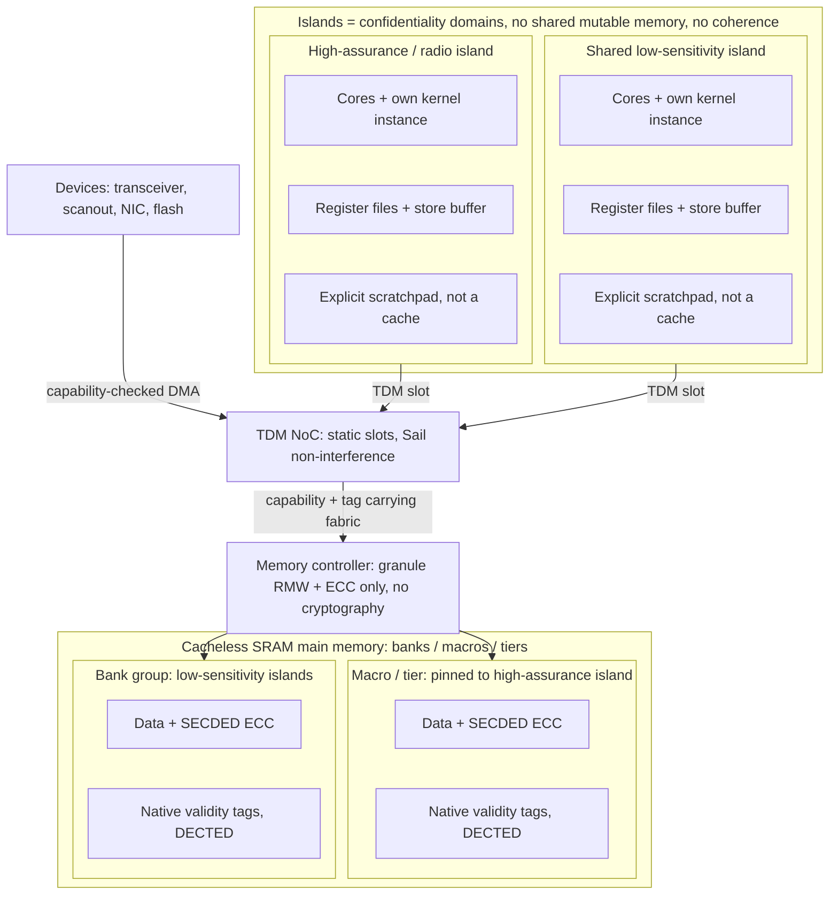

- **Main memory's first class is bespoke on-die SRAM on the *same* die as the cores, graded by tier for backside inspectability.** <a id="r-15-158"></a>
  Static 6T SRAM eliminates DRAM refresh, activation counters, row buffers, and channel buses from the Sail model ([§18](#18-realization)) and provides a flat worst-case memory-access constant ([§11](#11-updates)). Density and idle leakage are recovered through static transistor-level levers: **sequential (monolithic) 3D tiers, CFET-stacked cells, and gate-all-around (nanosheet) transistors** patterned with **High-NA EUV**; **asymmetric-threshold (asymmetric-Vt) cells, gate-length biasing, and state-retentive sleep-transistor gating of idle banks** (scheduled by the composition-time power vector, never an idle detector), joined on the logic tier alone by **fixed reverse body/well bias** and an **undoped fully-depleted channel**; plus **fixed composition-time read/write assist**. <a id="r-15-159"></a>
  - **Inspectability grading (`r-15-160`..`r-15-161`):** Backside infra-red inspection (IRIS, [§17](#17-residual-risks-the-honest-ceiling)) requires **frontside power delivery** (**backside power delivery is declined for the whole machine**). <a id="r-15-160"></a> **Gate-all-around and CFET are admitted for the upper passive memory tiers and declined for the bottom logic tier** (which holds the RoT, cores, capability fabric, and memory controller on an IR-resolvable SOI node); upper-tier self-heating and multi-cell soft-error rates are met by bit-interleaved ECC/scrubbing and optional rad-hard bottom dielectric isolation. <a id="r-15-161"></a> Dynamic/adaptive assists, body bias, and activity-driven bank gating are declined in favor of static **power mechanism 5** ([§8](#8-authority-model)), and sub-threshold operation is admitted only for idle-bank retention ([Evaluated Architectural Alternatives](background/architectural-alternatives.md)). <a id="r-15-189b-2"></a>
  - **Monolithic 3D integration (`r-15-162`..`r-15-163a`):** **Chiplets and bonded die-stacking are declined** ([§4](#4-organizing-principle)); upper tiers are built monolithically on the same wafer with **no die-to-die memory or fabric link anywhere in the host** (ensemble links join separate machines, and qualified inference modules are message-only peripherals, [§17](#17-residual-risks-the-honest-ceiling)). <a id="r-15-162"></a> Consequently, static body bias applies to the logic tier only, sequential-3D thermal budgets cap upper-tier device quality and sustained power ([§16](#16-reliability)), and **6T SRAM tier stacking is conditional on complementary p-type back-end devices reaching array-grade industrialization** (n-type back-end arrays have reached 275 Mb while complementary back-end pairs remain at single-cell scale across `SnO`, `TeOx`, 2D `MoS₂`/`WSe₂`, and 400 °C laser-annealed silicon; see the full literature survey in [Evaluated Architectural Alternatives](background/architectural-alternatives.md#a-second-die-radio-bifurcation-sram-chiplets-and-bonded-stacking-declined-once-at-the-trust-structure-they-share), [§17](#17-residual-risks-the-honest-ceiling), [§18](#18-realization)). <a id="r-15-163"></a> That p-type limit binds complementary 6T cells and not n-type-only 2T magnetic cells ([§10](#10-storage--state)). <a id="r-15-163a"></a>
- **No hardware caches (`r-15-164`..`r-15-169`):** **No L1, L2, last-level cache, or cache-coherence protocol exists** (`Zicbom` dropped). <a id="r-15-164"></a><a id="r-15-169"></a> Deleting caches eliminates the dominant WCET-pessimism term ([§11](#11-updates)), cache-timing side channels, coherence directories, and way-coloring, shrinking the `fence.t` flush set to the store buffer alone ([Inspirations & Prior Art](background/inspirations.md)). Retained fast structures—register files, the Ztso **store buffer**, the **static-path fetch buffer** (serving backward-taken inner loops R-15-019 within the sequential bundle window, cleared by `fence.t`), and explicit **V/M software-managed scratchpads**—pass the history-freeness test (*contents are a function of program text or explicit software placement, never of access history*), which excludes any integrity-tree node buffer holding recently-used nodes. <a id="r-15-165"></a><a id="r-15-166"></a><a id="r-15-167"></a> Scalar cores carry **no local scratchpad by default** (register file directly to flat SRAM, saving proof surface, [§2](#2-non-goals-deliberate), with locality recovered statically via [§8](#8-authority-model) and [§10](#10-storage--state); admitted only as a DSE parameter on pinned predictable cores). <a id="r-15-168"></a><a id="r-15-173-2"></a><a id="r-08-012a-2"></a>
- **Capacity arithmetic & roster fit (`r-15-170`..`r-15-174`):** The SRAM **planning band is 30–50 Mb/mm² of macro** (including periphery and repair redundancy before ECC/tag metadata), so **one decimal gigabyte occupies roughly 160–270 mm² of macro before platform metadata**. <a id="r-15-170"></a> The external cell-scaling reference is TSMC A14 NanoFlex Pro ([IEDM 2026 paper 3-2 abstract, by Shien-Yang Wu and Chih-Hao Chang](https://iedm26.mapyourshow.com/8_0/sessions/session-details.cfm?scheduleid=331)), reporting a **bitcell below 0.017 µm²** (2028 target): before macro overhead, **more than 1/0.017 Mb/mm² (about 58.8)** and **less than 8000 × 0.017 = 136 mm² per decimal GB** (against a 0.020 µm² reference, cell area falls by more than 15% and bits per cell-array area rise by more than 17.6%), without raising the macro planning band ahead of repaired-macro qualification. A High-NA EUV **half field** (~430 mm², 26 × 16.5 mm) derates to **~400 mm²** usable planar footprint after scribe lanes, seal ring, black-border keep-out, and sequential-3D/IRIS fiducials, housing the whole system die. Reference first-class budgets (under the 16 GB ceiling): **4–8 GB** on a phone (8–16 sequential-3D tiers) and **8–16 GB** on a laptop/desktop; if tiers under-deliver, capacity bends rather than returning DRAM or a second die ([§2](#2-non-goals-deliberate), [§18](#18-realization)). <a id="r-15-173"></a> Because the bulk class (oxide-semiconductor 2T0C decks) contains no pFET, **the complementary-device grading decides only first-class headroom**: without stacked 6T tiers, the first class is the **single planar tier (0.5–1 GB**, ~170–290 mm² with codeword metadata leaving 110–230 mm² for logic, whereas 2 GB would leave ≤ 50 mm²), sized against hundreds of megabytes of scalar working set while bulk lives on the second class. <a id="r-15-173a"></a>
  - **Per-class roster fit & ensemble sharding (`r-15-171`..`r-15-171a`):** Base system, servers, and compositor fit first-class SRAM; framebuffers, bounded per-origin arenas ([§12](#12-system-servers-contained-outside-the-tcb), [§14](#14-userland)), and 4-bit-quantized models (~0.5–0.7 GB/B parameters, all MoE experts resident with fixed top-k; no swap, overcommit, or routed storage fetch) fit the second class ([§18](#18-realization)). <a id="r-15-171"></a> On an ensemble, a model larger than one member's bulk class is **statically sharded at composition** across members with fixed-frame ring exchanges over link slot tables ([§11](#11-updates), [§12](#12-system-servers-contained-outside-the-tcb)) and no routed weight/expert/activation fetch across the link. <a id="r-15-171a"></a>
  - **Island-exclusivity tax & compression (`r-15-172`, `r-15-174`):** Whole-macro/tier island binding forfeits pooling, costing a bounded composition-visible **capacity tax** ([§18](#18-realization)) but **zero leakage tax** because unallocated arrays are powered off via power mechanism 5. <a id="r-15-172"></a><a id="r-15-189l-2"></a> Fixed-rate compartment-local encodings (4-bit weights, block-compressed textures) are admitted; variable-rate memory compression or deduplication is banned ([Evaluated Architectural Alternatives](background/architectural-alternatives.md)). <a id="r-15-174"></a>

#### Two-class memory architecture & 2T0C lifecycle (`r-15-247`..`r-15-247t`)

| Property | Normative Contract |
| --- | --- |
| **Two static latency classes** <a id="r-15-247"></a> | Class 1 is volatile 6T SRAM (scalar working set and cycle-critical arrays); Class 2 is **back-end-of-line n-type oxide-semiconductor 2T0C gain-cell decks** stacked monolithically on the same die. Assigned statically at composition ([§8](#8-authority-model)), **each enters [§11](#11-updates) as one fixed latency constant** with no cache, migration, tiering, or wake-on-access ([§18](#18-realization)). |
| **Latency-criticality boundary (zero trust gradient)** <a id="r-15-247s"></a> | Tags, ECC, and the [§8](#8-authority-model) revocation load filter are identical across both classes; **no TCB boundary tracks the memory boundary.** The first class carries kernel objects, stacks, register-save areas, DMA windows, rings, grant slots, quarantine entries, recovery workspaces, the servers' scalar working sets, bounded hot guest data, and all hard-task and hot code; the second carries bulk by volume, framebuffers, images, vector and matrix extents, bulk interpreter object arenas, media buffers, cold statically-placed code, which reaches the class through the measured chain's loader and through nothing else (power architecture below), and model weights, which are the largest single item and not the category. ([§14](#14-userland)) |
| **Image-derived vs. session-derived domains** <a id="r-15-247t"></a> | Every second-class domain is labelled at composition in disjoint banks: **image-derived** (content-addressed image extents, model weights, cold code, delegated without capability-store permission so all validity tags are clear) or **session-derived** (KV cache, framebuffers, decoded media, interpreter arenas). **Only image-derived domains may enter `RETAINED`**; session-derived domains are `ON` when their island is resident and `OFF` (discharged on mode exit, including lock to BFU, [§9](#9-boot--root-of-trust), standby, and chain re-entry) otherwise, confining the refresh-signature residual ([§17](#17-residual-risks-the-honest-ceiling)) to resident session-derived banks. |
| **Dynamic gain-cell mechanism** <a id="r-15-247n"></a> | A 2T0C cell stores charge on an unlatched gate node (DRAM by mechanism, composition-fixed *static* by timing), containing **no pFET** and thereby dissolving the two-case complementary-device grading above. |
| **Native per-class validity tags & atomic commit** <a id="r-15-247a"></a> | **Validity tags are native to each class's own array, one plane per class**, at granule alignment, read/written in parallel with data. One validity bit per 64-bit granule is 15.6 MB per GB of data, and about 47–70 MB of SRAM per GB once that plane carries its own DECTED code, so a 40 GB bulk tier's sidecar would consume 188–560% of a 0.5–1 GB first class; native tags cost 1.5625% plus that code, some 4.7–7.0% of the bulk array, while preserving single-medium granule atomicity and a single `cloadtags` [§11](#11-updates) cost constant. **Commit is atomic at the granule** on both classes; a failed refresh or discharge write triggers a **fail-stop sentinel event**. <a id="r-15-247b"></a> |
| **No decay-based sanitization** <a id="r-15-247c"></a> | **No reset, sanitization, or containment guarantee rests on a decay rate**, and fast-decaying tag planes are prohibited (cooling and $V_t$ drift extend retention); **retention figures are lower bounds consumed by the refresh deadline alone.** |
| **Authority invalidation before residue sanitization** <a id="r-15-247d"></a> | Crown-jewel reset ordering on every second-class reset, wake, and `OFF→ON` transition: tag-plane discharge is confirmed before any requester names the domain, and data-plane clear/discharge is confirmed before measured execution or delegation. Realized as **one atomic pass over both planes** through the cells' write devices (one dwell and one completion read per phase, non-vacuously covering every bank in the domain; retained image-derived domains on re-entry verify all tags clear in the measured stage before release). <a id="r-15-247d-2"></a> |
| **Grounded-bitline discharge & completion** <a id="r-15-247e"></a> | Discharge asserts every write wordline in the bank against grounded write bitlines (no dedicated per-cell bleed device), landing deterministically on **all-zeros** (untagged NULL) and **obviating the `OFF→ON` ECC regeneration sweep**. Completion is a **fixed worst-corner dwell followed by one read per phase of a fail-stop indication latched in the always-on RoT domain**, with no polling loop or retry. <a id="r-15-247f"></a><a id="r-15-247f-2"></a> |
| **Staggered schedule & register-slave maintenance** <a id="r-15-247g"></a> | Bank discharge and refresh phases are fixed and staggered at composition against voltage-droop, thermal, and power-signature limits ([§11](#11-updates) mode-transition dwell constant). **No instruction is added (`r-15-247h`):** discharge runs while the RoT holds in reset every initiator that can address the domain (leaving standby paging islands live), and **refresh is a fixed-function register slave's static share of each second-class bank's TDM schedule** on `ON` and `RETAINED` domains at the hot-corner cadence ([bank-count contract](hardware/bank-count-dse-contract.md)), passing admission test 5 as decisionless matter while `cbo.scrub` remains ECC verify-and-correct and `cbo.zero` handles runtime block zeroing. <a id="r-15-247h"></a> |
| **Code placement, `RETAINED`, exit discharge, & rail state** <a id="r-15-247j"></a> | All [§11](#11-updates) hard-task and hot code sits on Class 1; Class 2 code placement carries an admission-visible WCET fetch delta. **Second-class `RETAINED` (`r-15-247k`)** is maintenance-accessible (refreshed on schedule) and requester-inaccessible (any requester decode fail-stops). <a id="r-15-247k"></a> **Domains leaving a mode are discharged on the exit path (`r-15-247q`)**, narrowing cold-boot exposure to domains `ON`/`RETAINED` at power loss ([§17](#17-residual-risks-the-honest-ceiling)). <a id="r-15-247q"></a> **No rail state, refresh cadence, or discharge schedule is a function of any runtime measure (`r-15-247r`)**—only of the public mode index ([§14](#14-userland)). <a id="r-15-247r"></a> |
| **Bank granularity & macro qualification** <a id="r-15-247p"></a> | Second-class bank granularity is admitted jointly against the [§11](#11-updates) island bandwidth ceiling (hard constraint up to the [§18](#18-realization) floor), bitline read energy, and the hard concurrent-activation droop envelope, with whole-bank island binding and no cross-island interleaving (making inference token rate a composition-time constant of assigned banks). **Per-class density, retention, and latency (`r-15-247m`)** are measured at qualification on a **repaired megabit-class custom macro carrying complete tag, ECC, refresh, discharge, and routing overhead**: retention floor is measured at the **hot corner (thermal trip temperature) and end of service life** (setting the refresh cadence and [§18](#18-realization) mode power), and cold-corner ceiling sets the [§17](#17-residual-risks-the-honest-ceiling) remanence window. <a id="r-15-247m"></a> |

#### End-to-end ECC, granule write path, and disturbance deletion (`r-15-175`..`r-15-185`)

- **End-to-end SECDED data / DECTED tag ECC across a 256-bit codeword:** Every on-die array (register files, vector register files, matrix scratchpads, native CHERI tags, and main memory) carries correcting ECC, and the check travels *with* the word across the NoC and memory controller (ensemble links and optional inference sockets terminate the on-die check at the member edge and carry their own frame codes/tags). <a id="r-15-175"></a><a id="r-15-176"></a>
  - **256-bit codeword amortization (`r-15-181a`):** <a id="r-15-181a"></a> Extended Hamming's check-bit count grows as the logarithm of the payload (`2^r ≥ k + r + 1`, plus the overall parity bit), so SECDED alone falls 12.5 → 7.0 → 3.9 → 2.1% across payloads of 64, 128, 256, and 512 data bits. That ladder understates what the width buys here, because it omits the code protecting the validity tags: a codeword carries one tag bit per 64-bit granule of its payload, those tags take the DECTED code below, and that code's cost is **nearly flat in the payload width** (5, 7, 8, and 9 check bits at 1, 2, 4, and 8 tag bits, the fewest a linear code of minimum distance 6 admits, which double-error correction with triple-error detection needs: by the Plotkin bound no four words of length 8 and no sixteen of length 11 lie that far apart, and a nonlinear code reaching 8 at 8 tag bits moves only the 512 rung the width declines), since correcting two errors over a very short word spends most of its length on check bits regardless. Counting tags and both codes together, total metadata per byte of data falls **21.9 → 14.1 → 8.6 → 5.5%** across the same four widths, and the step from 128 to 256 is worth 5.5 points where the data code alone showed 3.1. Of those bits the tag plane with its own code is 12 of the 22 at 256 and 9 of the 18 at 128, some 4.7% and 7.0% of the payload. **256 bits is normative and 128 bits is the fallback** where a macro cannot sense 256 bits plus metadata in a single access (512 is not taken, its further 3.1 points being the smallest step on the ladder, alongside its write amplification).
  - **Bit-interleaving, `cbo.scrub`, & independent DECTED tag plane (`r-15-177`..`r-15-180`):** Mandated **physical bit-interleaving** splits multi-cell upsets into single-bit errors, and **background scrubbing** prevents error accumulation (long-retained domains under power mechanism 5 owe a scheduled `ON` scrub interval or exit-path sweep). <a id="r-15-177"></a><a id="r-15-189k-2"></a> Scrubbing is a kernel reaction in a [§11](#11-updates) background slot issuing synchronous, idempotent `cbo.scrub` at fixed per-block latency (never an autonomous hardware walker). <a id="r-15-177a"></a> Native CHERI validity tags carry **DECTED (double-error-correct, triple-detect)** <a id="r-15-178"></a> **covering the tag bits of exactly one codeword independently of the data code** ([Evaluated Architectural Alternatives](background/architectural-alternatives.md)). <a id="r-15-178a"></a> Correction has **deterministic fixed latency** folded into [§11](#11-updates) WCET; corrected errors report telemetry to the sentinel and uncorrectable errors trigger a **fail-stop sentinel event** ([§16](#16-reliability)). <a id="r-15-179"></a> ECC is the memory path's sole integrity mechanism ([§17](#17-residual-risks-the-honest-ceiling)). <a id="r-15-180"></a>
- **Whole-granule atomic write path (`r-15-181`..`r-15-183`):** No sub-granule write exists on the fabric. <a id="r-15-181"></a> Sub-granule core stores merge in a fixed-latency read-modify-write stage at the memory controller that **verifies the existing codeword's ECC before merging** (full 256-bit vector or store-buffer-coalesced stores R-15-015 bypass the merge read); **`cbo.zero` allocates whole lines** with zero data, cleared tags, and valid SECDED/DECTED codewords in one fixed-latency pass ([§7](#7-kernel)); <a id="r-15-182"></a> and **device DMA is 8-byte tag-granule-aligned** with zero-fill of trailing partial granules inside the delegated buffer, clearing tags on covered granules without straddling ([§12](#12-system-servers-contained-outside-the-tcb)). <a id="r-15-183"></a>
- **Rowhammer and RowPress are DRAM disturbance mechanisms, and the apparatus that answers them is deleted rather than tuned (`r-15-184`):** <a id="r-15-184"></a> No activation counter, alert, or back-off (RFM/PRAC) exists on either memory class. Class 1 bistable 6T SRAM has no capacitor refresh loop (local read/write/half-select disturb is met by asymmetric-$V_t$ margin and interleaved SECDED/DECTED ECC). Class 2 2T0C capacitive wordline/bitline disturbance (`RowPress`-analog parasitic gate-drain $C_{\text{gd}}$ and bitline-to-storage-node coupling) is bounded at qualification (`sigma_disturb` across `T_ret_floor`..`T_ret_ceiling` at full slot-rate hammering), excluded cross-domain by static bank-to-island partitioning, and met intra-domain by cell margin, ECC, and the fixed schedule ([§17](#17-residual-risks-the-honest-ceiling)).
- **Autonomous processing-in-memory is banned (`r-15-185`):** Analog or autonomous in-memory compute is excluded ([§4](#4-organizing-principle)); the only admitted densification is M-class **deterministic digital compute-in-SRAM** (bit-serial exact MACs, Sail-expressible). <a id="r-15-185"></a>

### Power architecture (power states are schedule artifacts, never control loops)

Every banned mechanism (SMM PM handlers, Pcode/SCP/AOP PMU microcontrollers, reactive DVFS, turbo, autonomous throttling) shares a hidden feedback loop from workload or temperature to performance state. <a id="r-15-186"></a> Deleting the loop leaves five admissible mechanisms:

| Mechanism | Trigger & Scope | Timing & Side-Channel Invariant |
| --- | --- | --- |
| **1. Race-to-idle with in-slot gating** <a id="r-15-187"></a> | Partition (or idle) gates its core inside its own non-work-conserving slot when remaining slot ≥ entry + exit WCET. | Cross-partition invisible (slot boundaries do not move; idle core emits no fabric traffic); exit latency is a data-independent Sail-modeled constant ([§7](#7-kernel)). |
| **2. Static per-partition operating points (DVFS without the D)** <a id="r-15-188"></a> | Partition OPP (2–3 coarse OPPs per class, floored by ECC/CHERI-tag margin) is a composition-time constant selected by [§11](#11-updates) admission and switched only at partition boundaries. | Reprograms the island's divider ratio and rail set-point from the composed OPP index alone (no load, activity, or temperature input; no PLL retuning; Hertzbleed has no carrier). **Shared resources (NoC, memory controller, main memory) never scale.** |
| **3. Pre-proved global mode schedules** <a id="r-15-189"></a> | Rare RoT-attested global transitions on explicit authority; never load-following. | Audits $\log_2(\text{\#modes})$ bits per event. Answers big.LITTLE honestly: the die is all-LITTLE (in-order, modest fixed clocks); task migration stays banned ([§7](#7-kernel)). |
| **4. Deep sleep as a boot-chain variant** ([§9](#9-boot--root-of-trust)) | Whole-machine or island power-off; statelessness avoids preserving application execution state. | Resume re-measures via the [§9](#9-boot--root-of-trust) chain; erasure and power-loss remanence require construction-specific qualification. |
| **5. Composition-time gating of unallocated main memory** <a id="r-15-189a"></a> | Static memory plan's occupancy map read as a power vector at RoT-attested mode transitions (Mechanism 3 applied to memory). | Three states (`ON`, `RETAINED`, `OFF`) as a function of mode index alone; fail-stop on non-`ON` decode; data-independent dwell constants in the mode-transition budget ([§17](#17-residual-risks-the-honest-ceiling)). |

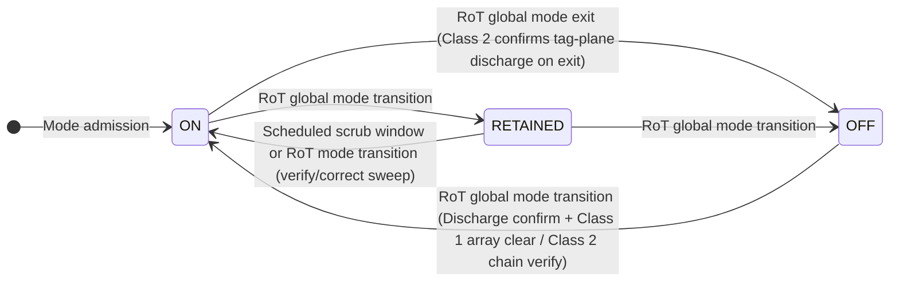

- **Mechanism 5 contract (`r-15-189b`..`r-15-194`):**

| Facet | Normative Power-Gating & Standby Contract |
| --- | --- |
| **Static Reachability vs. Reactive Loops** <a id="r-15-189b"></a><a id="r-15-189b-3"></a><a id="r-15-189h"></a> | Static allocation ([§8](#8-authority-model)) makes the unreachable array set a build constant. A domain's power state is a function of the composition-time mode schedule and current mode index alone—never of access history, occupancy watermark, idle timer, or observed leakage. Declined (each rebuilds a reactive loop or channel): idle-timer/watermark bank gating, wake-on-access / cold-array slow paths, runtime occupancy compaction (admitted statically in [§8](#8-authority-model)), leakage/temperature/aging retention-rail modulation, cross-island shared rails with divergent mode participation, and bandwidth-driven memory DVFS. |
| **Three-State Lattice & Gating Granularity** <a id="r-15-189d"></a><a id="r-15-189e"></a><a id="r-15-189f"></a> | **`ON`**: addressable at flat modeled latency and scrubbed. **`RETAINED`**: reduced-rail sleep-transistor retention (Class 1) or maintenance-accessible/requester-inaccessible refresh (Class 2); **not addressable** (access faults, never wakes). **`OFF`**: rail collapsed. Transitions occur only at RoT-commanded global mode transitions. The gating domain is the **macro or tier** (never the bank, where power delivery is shared); shared-macro state is the conjunction over bound islands' mode participation. Composition emits the `{ON, RETAINED, OFF}` power vector into the **attested static devicetree** ([§9](#9-boot--root-of-trust)) and mode descriptor hash. |
| **Static Containment & Fail-Stop Decode** <a id="r-15-189g"></a><a id="r-15-189i"></a> | For every mode $M$, the union of address ranges authorized by capabilities reachable in $M$ must be contained in $M$'s `ON` domains (checked at admission by the [§8](#8-authority-model) disjointness pass; violations fail to type-check). Hardware decode and TDM scheduling admit only `ON` domains; decoding to a non-`ON` domain is a **fail-stop sentinel event** ([§16](#16-reliability)), never a wake. Rail collapse/restore uses RoT-sequenced **fixed dwell times and staggered ramp order** (PDN provisioned for worst-case simultaneous-on set; no current-sensing soft-start loop). |
| **OFF→ON Sanitization & Physical Erasure** <a id="r-15-189j"></a><a id="r-15-189n"></a> | Before admission, an `OFF→ON` transition gates on a single-read **discharge confirmation** (non-confirmation stops the transition) and, on **Class 1**, a mandatory **array-wide clear** (zero data, cleared tags, fresh SECDED/DECTED codewords at fixed latency). Class 1 physical erasure is a qualified postcondition of storage-node discharge across supply/temperature corners, not an inference from rail voltage (does not close uncontrolled power loss). On **Class 2**, mode-exit discharge drains every storage node through its write device to deterministic all-zeros (`tag = 0`), obviating a capacity-scaled regeneration sweep while leaving power-off plaintext remanence booked in [§17](#17-residual-risks-the-honest-ceiling). |
| **RETAINED Scrubbing & Substrate Floor** <a id="r-15-189k"></a><a id="r-15-189l"></a><a id="r-15-189m"></a> | Retention voltage floor is fixed by worst-corner DECTED tag-plane margin (lowered on the logic tier by undoped FD-SOI channels lacking random dopant fluctuation). Modes holding a domain `RETAINED` past the single-bit error accumulation bound ([§16](#16-reliability)) must schedule a periodic `ON` scrub interval (in standby, the **DRX period is the scrub period**) or run a full verify-and-correct sweep on exit. This removes the idle-power tax of island exclusivity, scales deployment leakage to composed rosters rather than fabricated capacity, and relieves sequential-3D thermal paths. Rail state publishes only the attested mode index (over Class 1's static differential arrays; Class 2 periodic refresh current is booked in [§17](#17-residual-risks-the-honest-ceiling)); rails never depend on runtime tab count, population rung ([§11](#11-updates)), or pool occupancy ([§14](#14-userland)). |
| **Cellular-Reachable Standby & Bulk Re-Verification** <a id="r-15-190"></a><a id="r-15-190a"></a><a id="r-15-190-2"></a><a id="r-15-190b"></a><a id="r-15-191"></a><a id="r-15-192"></a> | Standby is a **pre-proved global mode (Mechanism 3)** where only the **radio island** (radio V-cores, kernel instance, [§12](#12-system-servers-contained-outside-the-tcb) paging path, DRX timer, bound SRAM bank in retention, TDM slice, and RoT; memory controller needs no crypto carve-out) stays live—running idle-mode DRX paging (~1.28 s cycle) as an admitted periodic hard task withcore gating (Mechanism 1) between occasions—while all other Class 1 macros/tiers collapse to `OFF` (Mechanism 4/5) and re-measure on wake ([§9](#9-boot--root-of-trust)). On **Class 2**, image-derived bulk domains default to `RETAINED` (milliwatts of refresh vs. tens-of-seconds NAND refill; session-derived domains take `OFF` when non-resident). On running-mode re-entry (unlock wake, standby exit, generation switch, reboot, excluding watchdog bite), the [§9](#9-boot--root-of-trust) M-mode loader re-verifies retained image-derived bulk extents in place against the generation root and confirms all tags clear before releasing island cores (discharging and refilling any extent/tag that fails); `OFF` bulk domains are refilled by owner capabilities at [§8](#8-authority-model) quiescent points (data) or by the [§9](#9-boot--root-of-trust) loader while requesters are held in reset (code). |
| **Thermal Fail-Stop & Single Management Processor** <a id="r-15-193"></a><a id="r-15-194"></a> | TDP-provisioned so throttling never engages normally; critical temperature triggers a rare ~1-bit attested global transition (orderly halt or proved low-power/recovery mode), and temperature readout is capability-gated ([§8](#8-authority-model)). **The RoT is the sole management processor** (power sequencing, reset, mode orchestration, watchdog; verified in the TCB, never resident on application cores; SMM remains banned, [§7](#7-kernel)). |

- **Clocking, asynchronous boundaries, and reset sequence table (`r-15-195`..`r-15-198a`):**

| Mechanism / Boundary | Synchronization & Timing Discipline |
| --- | --- |
| **Mesochronous Clock Spine & OPP Switching** <a id="r-15-195"></a> | All modeled islands (cores, fabric, memory, device blocks) run mesochronous as integer divisions of one PLL hierarchy; intra-machine crossings use deterministic ratio synchronizers with fixed Sail-modeled latency, and the TDM NoC schedule is stated in spine cycles. The PLL hierarchy locks once in the reset table; an OPP switch touches only the island's divider ratio (fixed spine cycles) and rail set-point (dwelt to worst-case bound), never retuning a PLL ([§11](#11-updates)). |
| **Three Terminated Asynchronous Boundaries** <a id="r-15-196"></a><a id="r-15-197"></a> | No modeled path crosses unrelated clocks: **(1) RoT independent slow clock** ([§16](#16-reliability) watchdog failure-domain separation; crosses via multi-flop synchronizers proved under one-sided monotone elapsed-time bounds); **(2) external interface clocks** (USB PHY, ONFI, radio ADC/DAC, ISO7816, ensemble link; terminate in bounded FIFOs behind capability-checked DMA windows with fabric side on the island clock); and **(3) asynchronous reset** (synchronized per domain). Residual metastability escape is booked beside SEU as a physical fault class caught by ECC/fail-stop/watchdog ([§16](#16-reliability)). |
| **Ensemble Link Scheduled Leap** <a id="r-15-196a"></a> | Each ensemble member ([§2](#2-non-goals-deliberate)) keeps its own clock spine. Across the composition-fixed leader tree, a follower reads its leader endpoint's one-sided arrival phase (only after crypto-core tag verification) and, in a reserved kernel-owned idle **leap slot** ([§11](#11-updates)), the boot-core kernel steps the spine's single **frame-origin register** ([§7](#7-kernel), [§9](#9-boot--root-of-trust)) by at most the qualified skew bound. Receive slots carry a guard band ≥ skew + link latency bound; endpoints hold no phase accumulator, latency estimator, or origin write path, and fixed-latency claims across members hold at slot cadence ([§17](#17-residual-risks-the-honest-ceiling)). |
| **Attested Reset Sequence Table & Staged Island Release** <a id="r-15-166-2"></a><a id="r-15-198"></a><a id="r-15-198a"></a> | Power and reset sequencing is a dependency-ordered **sequence table in the attested devicetree** ([§9](#9-boot--root-of-trust)) walked by the verified RoT firmware ([§6](#6-trusted-computing-base-exhaustive)): RoT/OTP → clock spine → memory controller → boot island → remaining islands per mode schedule (mode transitions, standby, and deep-sleep wake re-enter suffixes of this one crown-jewel table; island resets are local, watchdog bite resets the die). Islands release at fixed table steps as their bound domains finish verification (shell and telephony islands release ahead of inference so wake is interactive while weights finish verifying, [§18](#18-realization)); RoT start-up entropy health tests ([§9](#9-boot--root-of-trust)) run concurrently after RoT rail-up and complete before the first entropy-drawing step. |

- **Memory path, native tags, capability-checked DMA, and temporal isolation (`r-15-199`..`r-15-221`):**
  - **No memory-path cryptography (`r-15-199`..`r-15-202`):** <a id="r-15-199"></a> Because both memory classes sit on the same package/die as the cores without an exposed external bus, removable module, or die-to-die memory link, the memory controller carries **no encryption, authentication, or integrity/anti-replay tree**—only the fixed-latency granule RMW stage and ECC encode/check. Integrity-tree node buffers would reintroduce access-history-dependent cache state (failing admission test 3 and WCET bounds), while invasive in-package probing is out of scope ([§3](#3-threat-model), [§17](#17-residual-risks-the-honest-ceiling)) and crown-jewel secret custody stays inside the hardware crypto core ([§7](#7-kernel), [§12](#12-system-servers-contained-outside-the-tcb)). <a id="r-15-201"></a><a id="r-15-202"></a> **Orderly zeroization and uncontrolled power loss remain distinct (`r-15-200`):** <a id="r-15-200"></a> SRAM volatility alone establishes neither negligible remanence nor erasure; Class 1 macros, registers, and key-storage constructions are qualified under abrupt power loss, cooling, discharge, and retention corners alongside Class 2 measurements, naming all sensitive plaintext/key copies and distinguishing completed erase constructions from measured decay ([§17](#17-residual-risks-the-honest-ceiling)).
  - **Native CHERI tag plane (`r-15-203`..`r-15-204`):** <a id="r-15-203"></a> One validity tag per 64-bit capability granule (**one plane per class, not two planes on either**, definite initialization being carried by [§5](#5-languages--verification) typing) is stored **natively in the array word** and read/written in parallel with data, deleting reserved-memory tag tables and tag caches ([§18](#18-realization)). With 64-bit granules, the ECC data payload is unchanged while the tag plane doubles to 1.56% of the array while the DECTED code over it grows by about one check bit per codeword rather than doubling with the plane, offset by halving capability-dense structures. Native tag bits are protected by **DECTED ECC in the array** (tag-integrity failure is an ECC and fail-stop sentinel event), and non-capability transducer/DMA writes clear tag bits by construction. <a id="r-15-204"></a>
  - **Microarchitecture & end-to-end ECC:** Uniformly across all core classes (including V and M): in-order, no speculative execution, **static-only branch prediction (no dynamic predictor state)**, no SMT, **no hardware caches or coherence protocol**, and **mandatory end-to-end ECC across all SRAM arrays, register files, scratchpads, native tags, and interconnect hops**, with Rowhammer answered by **deleting the RFM and PRAC apparatus rather than tuning it** on both memory classes.
  - **Capability-checked DMA without IOMMU or IOPMP (`r-15-205`..`r-15-210`):** <a id="r-15-205"></a> Neither an IOMMU nor an IOPMP exists on the die. Every DMA-capable true device (NIC, flash, USB, scanout, audio, radio stream; V/M cores are already CHERI-governed cores) is either a **core-issued capability-operand mover** (coprocessor discipline) or an **autonomous streaming engine holding a delegated, bounds-checked, revocable window capability** ([§7](#7-kernel), [§8](#8-authority-model), anchored by Markettos et al. HASP 2020, CHERI at SoC Level, and CHERIoT). <a id="r-15-206"></a><a id="r-15-207"></a><a id="r-15-213-2"></a>
    - *In-flight DMA revocation & capability-carrying fabric (`r-15-208`..`r-15-209`):* <a id="r-15-208"></a><a id="r-15-209"></a> An autonomous engine's window capability lives in a fabric-side window register at the owning island's memory controller, which checks the [§8](#8-authority-model) revocation bitmap at the start of each TDM grant and refuses the grant when set; a core-issued mover's bounded transfer completes inside the core's slot under the [§8](#8-authority-model) containment barrier, making device time-to-containment a composition constant (bitmap publication + at most one TDM window rotation + one granted slot, entering [§11](#11-updates)). The interconnect propagates capabilities, tags, and revocation state while clearing tags on non-capability transducer writes ([§18](#18-realization)).
    - *Ownership completion boundary (`r-15-208a`, `r-15-210`):* <a id="r-15-208a"></a><a id="r-15-210"></a> DMA completion becomes visible in RTL only after the engine stops issuing, all accepted writes reach SRAM, and the delegated window closes or re-authorizes away from the device—discharging the hardware premise of the HAL's linear in-flight token ([§5](#5-languages--verification)) with zero CPU/device data races in Sail (`RTL ⊑ Sail`, [§17](#17-residual-risks-the-honest-ceiling)).
  - **Temporal isolation, partition-switch cost, and `fence.t` (`r-15-211`..`r-15-221`):** <a id="r-15-211"></a><a id="r-15-212"></a> Architecturally guaranteed non-interference in the Sail model rests on `fence.t` at partition switches, SRAM bank/macro/tier partitioning, and TDM NoC/island separation (bandwidth is a consequence of NoC schedule and bank binding, never regulated by excluded `Ssqosid`/CBQRI).
    - *Three platform switch terms + context term (`r-15-213`, `r-15-220`..`r-15-220a`):* <a id="r-15-213"></a><a id="r-15-220-2"></a><a id="r-15-220"></a><a id="r-15-220a"></a> With no dynamic predictors, speculation, or caches, the **platform switch cost** is three per-class constants: **(1) the `fence.t` padded constant (which *is* the store-buffer drain)**, **(2) eager vector/matrix zeroize** (`vmclear`, R-07-014c; no V/M save, R-07-014a), and **(3) OPP relock** ([§11](#11-updates)). The complete [§7](#7-kernel)/[§11](#11-updates) boundary constant pads those three plus the **context term** (total register/CSR restore and pending-bit swap, which intra-slot rotation performs alone) and outstanding unbuffered operations.
    - *`fence.t` specification and 4-class RTL state map (`r-15-214`..`r-15-219`, `r-15-221`):* <a id="r-15-214"></a><a id="r-15-215"></a><a id="r-15-215-2"></a><a id="r-15-216"></a><a id="r-15-217"></a><a id="r-15-218"></a><a id="r-15-218-2"></a><a id="r-15-219"></a><a id="r-15-221"></a> Adopted as a fork-and-frozen instruction (Wistoff et al. CVA6 lineage) with full Sail semantics, `fence.t` flushes **only the store buffer**—completing at a **padded per-class constant latency** (worst-case SRAM store-buffer drain, never early, eliminating outgoing-buffer-occupancy timing channels that a plain ordering `fence` leaks; unbuffered device/refresh tails belong to [§7](#7-kernel)'s residency prefix). In `RTL ⊑ Sail`, every RTL stateful structure maps to one of four classes: **(a) architectural/context-switched** (covered by the kernel's proved-total GPR/cap/CSR restore and [§7](#7-kernel) eager V/M zeroize, not `fence.t`), **(b) partition-owned** (spatially bound SRAM banks/macros/tiers, TDM slots, interrupt files; in-flight DMA is capability-bounded), **(c) `fence.t`-flushed** (the store buffer alone, counted once with the Ztso drain), or **(d) stream-determined pipeline state** (fetch buffer and decode/execute latches emptied by pipeline drain); any unmapped RTL state is a refinement failure.

- **Interconnect, islands, ensemble link, and immutable inference sockets (`r-15-222`..`r-15-228k`):**

| Subsystem | Structural Isolation & Scheduling Contract |
| --- | --- |
| **Islands & Per-Core Shared-Island Slotting** <a id="r-15-222"></a><a id="r-15-222a"></a> | No caches, coherence protocol, or coherence directory exist; intra-island memory ordering is Ztso with fences. High-assurance domains hold an island exclusively. Where a low-sensitivity island hosts multiple domains concurrently on distinct cores, memory-controller arbitration and NoC injection are sub-divided into a **fixed per-core rotation** sized to the longest bank transaction (atomic RMW, R-15-087), making latency independent of peer-core activity ([§11](#11-updates), [§17](#17-residual-risks-the-honest-ceiling)). |
| **Cross-Island Ring Windows & Slot-Local Phasing** <a id="r-15-223"></a><a id="r-15-223a"></a><a id="r-15-224"></a> | Islands share no mutable memory except designated ring windows ([§12](#12-system-servers-contained-outside-the-tcb)) ordered by Ztso + fabric per-hart order (R-15-015a). Composition lays out ring exchanges at 8-byte tag-granule alignment (R-15-183), sized/phased to complete within **one TDM window grant slot** with batched source IPI notifications (R-15-015b/c, R-11-014b/c), making worst-case fabric wait equal typical wait. **Radio-pinned V-cores** form an exclusive island at the top rung: separate SRAM macro/tier and dedicated clock/power island ([Inspirations & Prior Art](background/inspirations.md)). |
| **TDM NoC & Graded SRAM Binding** <a id="r-15-225"></a><a id="r-15-015a-2"></a><a id="r-15-226"></a><a id="r-15-226a"></a><a id="r-15-227"></a><a id="r-15-228"></a><a id="r-15-228a"></a> | The NoC runs a composition-time TDM schedule carrying Sail non-interference semantics ([§17](#17-residual-risks-the-honest-ceiling)) and preserving per-hart request order across banks/macros (discharging the third part of Ztso; no best-effort QoS or `Ssqosid`/CBQRI). SRAM binds to islands in a graded hierarchy (**separate macro/tier → bank group → bank within a macro**, fixing the Mechanism 5 power-gating domain at macro/tier); high-assurance islands take whole-macro/tier exclusivity, while low-sensitivity bank bindings use static controller arbitration (R-17-003b/c). The bank/macro/tier→island map is attested in the devicetree ([§9](#9-boot--root-of-trust)) as a fixed input to the [§8](#8-authority-model) memory plan, quantizing each island's bandwidth ceiling for [§11](#11-updates). |
| **Ensemble Link (Off-Die Network Edge)** <a id="r-15-228b"></a><a id="r-15-228c"></a><a id="r-15-228d"></a><a id="r-15-228e"></a> | Connects distinct single-die machines ([§2](#2-non-goals-deliberate)) as a point-to-point network edge (never a memory, coherence, capability, USB-cutoff, or 10GBASE-T LAN link). **Matter endpoint (`r-15-228c`):** streaming-engine DMA device with recovered clock (terminated in FIFO), epoch-frozen equalization, fixed-latency linear block-code encoder/decoder, revocable TX/RX ring windows owned by the link server compartment, and a table-driven slot timer (no retry buffer, credit/ack state, arbiter, parser, cipher, or unverified leap path, audited by A-18..A-21). **Non-work-conserving schedule (`r-15-228d`):** emits one fixed-size frame per slot (authenticated idle frame when empty, indistinguishable on the wire before crypto-core decryption; scheduled handshake/padding before establishment, [§12](#12-system-servers-contained-outside-the-tcb)). **Constant-time FEC + AEAD tag (`r-15-228e`):** fixed-iteration block code corrects noise at constant latency; the crypto core verifies the whole-frame session authentication tag before the verified Narcissus parser reads any field, and any tag failure stops the link until scheduled re-establishment. |
| **Immutable Inference Sockets** <a id="r-15-228f"></a><a id="r-15-228g"></a><a id="r-15-228h"></a><a id="r-15-228i"></a><a id="r-15-228j"></a><a id="r-15-228k"></a> | **Message-only device edge (`r-15-228f`):** connects one host endpoint to one qualified inference module via host broker and capability-checked mover (token IDs/tensor blocks only; no card-supplied host address, DMA, capability, interrupt, or peer route). **Fixed-budget session (`r-15-228g`):** composition-constant slots/frames; encrypted and authenticated against unit/design identity, endpoint, epoch, and schedule before verified parsing; unused slots burn; malformed/stale records stop the session. **Replacement lifecycle (`r-15-228h`):** devicetree declares the broker/socket state machine and finite admitted unit/design pairs; ordered removal stops work, completes authenticated scrub, destroys keys, and isolates before power-off (surprise removal isolates immediately without trusting card drain/erase). **Host control & accounting (`r-15-228i`..`r-15-228k`):** RoT sequence table and passive electrical protection govern power/reset; all fixed coefficients/experts reside on the module die and are accounted separately from host memory; **Absence Contract A-22** verifies the absence of instruction execution, firmware, mutable weights/adapters, private nonvolatile storage, and host-memory mastership. |

- **Display, media, watchdog, entropy root, and anti-features (`r-15-229`..`r-15-246`):**

| Subsystem / Pipeline Stage | Admitted Fixed-Function or Software Mechanism | Excluded Mechanism & Rationale |
| --- | --- | --- |
| **Scanout Controller & Display Links** <a id="r-15-229"></a><a id="r-15-230"></a><a id="r-15-231"></a><a id="r-15-232"></a><a id="r-15-233"></a><a id="r-15-234"></a><a id="r-15-235"></a> | Open-RTL firmware-free DMA scanout engine (and audio I/O) with a permanent [§11](#11-updates) TDM NoC slice, bank-group binding, and line-buffer FIFO sized to worst-case refresh/pixel width (0.5–4 GB/s; underrun cannot arise from contention and raises a [§16](#16-reliability) sentinel fault that visibly blanks affected lines). Built-in panel uses point-to-point **eDP** (laptop) or **MIPI DSI** (phone/tablet); external monitor uses powerbox-consented **DisplayPort Alt Mode on USB-C** (with USB-PD power) or dedicated **DP** with a fixed-function alt-mode sequencer and copy-once Narcissus-parsed **EDID** capped to 128–512 B. | **USB4/Thunderbolt DP tunneling, MST daisy-chaining, HDCP, DP++**, and 32 KB unbounded EDID parsing. |
| **Panel Timing Controller, Emissive Compensation, Refresh, & HDR** <a id="r-15-236"></a><a id="r-15-236a"></a><a id="r-15-236b"></a><a id="r-15-236c"></a><a id="r-15-236d"></a><a id="r-15-236e"></a><a id="r-15-237"></a> | Fixed-function TCON (automotive/space/consumer graded) with optional stateless panel-self-refresh and instantaneous APL luminance limiter. Admits **AMLCD**, **Micro-LED** (with static factory-measured demura table attested in devicetree), and **OLED** with stateless per-frame in-pixel threshold compensation. Scanout reservation is admitted at maximum enumerated refresh rate (e.g., 120/240 Hz) and wide-gamut 10/12-bit HDR format; **Content Match Refresh Rate** selects fixed multiples (e.g., 24 fps → 48/120 Hz, $\log_2(\text{\#rates})$ bits), while scaling, HDR transfer/tone mapping, and local-dimming zone computation run in safe Rust on V-class RVV ([§12](#12-system-servers-contained-outside-the-tcb)). Capacitive touchscreen is a raw-capacitance AFE sensor ([§12](#12-system-servers-contained-outside-the-tcb)). | **Smart-panel firmware/overdrive DSPs**, **per-pixel aging compensation loops** accumulating drive history in panel memory (foreign computer violating R-12-075), **Adaptive-Sync / VRR / Dynamic Refresh Rate** (leaks cross-surface render timing), **frame-sequential 3D shutter emitters**, **Dolby Vision / HDR10+ panel-executed dynamic tone mapping**, and **resistive or firmware-DSP touch controllers**. |
| **Media Decode Pipeline & Graphics Acceleration** <a id="r-15-238"></a><a id="r-15-238a"></a><a id="r-15-238b"></a><a id="r-15-238c"></a><a id="r-15-238d"></a><a id="r-15-238e"></a><a id="r-15-239"></a> | Five-stage video decode split on V-class cores: **(1) syntax layer** in verified Narcissus software ([§5](#5-languages--verification), [§12](#12-system-servers-contained-outside-the-tcb)); **(2) symbol decoding** via the core-issued fixed-latency `rcstep` instruction; **(3–5) reconstruction, in-loop filters/film grain, and color/scaling** in RVV software (bit-exact conformance tested as a Tier-2 compartment, [§13](#13-packaging--supply-chain)). Decode capacity is a **declared composition ceiling** (formats/levels/rates above the [§18](#18-realization) floor; sessions exceeding it are refused at open). Graphics rendering runs as ordinary capability-confined RVV code on V-class cores. | **Fixed-function silicon codec blocks** (unpatchable silicon parsers), **autonomous bitstream DMA walkers** (fail admission test 5), **M-class int8/bf16 systolic arrays for inverse transforms** (not bit-exact), **bespoke assembly equivalence checkers**, **hardware DRM / protected media paths** ([§17](#17-residual-risks-the-honest-ceiling)), and **GPUs / GPU command processors / SIMT cores**. |

  - **Single windowed RoT watchdog (`r-15-240`):** <a id="r-15-240"></a> Exactly one non-deletable hardware watchdog (bark/bite) on the RoT's independent slow clock, catching out-of-model events (SEUs, glitching, errata, wedged timers). Windowed (early and late pets both fault) with bounds from the [§11](#11-updates) schedule theorem and RoT-nonce challenge-response pets from a single capability holder; no external or PMIC watchdogs.
  - **Single entropy root, continuous health testing, and DRBG discipline (`r-15-004-2`, `r-15-241`..`r-15-241e`):** <a id="r-15-004-2"></a><a id="r-15-241"></a><a id="r-15-241a"></a><a id="r-15-241b"></a><a id="r-15-241c"></a><a id="r-15-241ca"></a><a id="r-15-241d"></a><a id="r-15-241e"></a> All firmware is open, reproducible, and measured, and every internal draw is recorded in the deterministic-replay trace (verbatim if public, sealed commitment if secret). Because excluding `Zkr` concentrates platform randomness in one root (Host TRNG in the RoT feeding the verified DRBG in the crypto core):
    - *Multi-source continuous fail-stop testing (`r-15-241b`, `r-15-241e`):* Multiple independent physical noise sources spanning **at least two physical mechanisms** feed the root, each attributed and continuously health-tested (start-up sample budget before first output plus online repetition-count/adaptive-proportion tests sized to the stochastic model); any test failure latches a [§16](#16-reliability) **fail-stop** with no degraded fallback ([§17](#17-residual-risks-the-honest-ceiling) books fab subversion).
    - *Vetted conditioning, two-source extraction qualification, and DRBG hypothesis (`r-15-241c`..`r-15-241d`):* Raw noise never reaches consumers; it is conditioned in the RoT by a vetted non-keyed cryptographic conditioner (with a finite qualification gate under the [source-model contract](hardware/trng-source-model-contract.md#10-two-source-extraction-qualification) evaluating deterministic two-source extraction before the conditioner, requiring physical joint-independence evidence, concrete parameter witnesses, and bounded latency/storage without weakening conditioner or DRBG obligations). The verified DRBG is seeded at a stated length, reseeds on draw-count/interval bounds and every RoT lifecycle/lock transition ([§9](#9-boot--root-of-trust)), and takes this seeding discipline as an explicit hypothesis of its refinement theorem.
  - **Consolidated platform anti-features (`r-15-242`..`r-15-246`):** <a id="r-15-242"></a><a id="r-15-243"></a><a id="r-15-244"></a><a id="r-15-245"></a><a id="r-15-246"></a> No UEFI, SMM, ACPI/AML, ME/PSP coprocessors, SMT, speculation, dynamic branch predictors (BHT/BTB/RAS/indirect), LR/SC or general CAS (`Zalrsc`/`Zacas`), 32-bit modes, hybrid capability mode (no DDC), legacy boot, option ROMs, variable-length `C` extension (replaced by fixed-rate dictionary `r-15-036a`), foreign computers ([§4](#4-organizing-principle), [§12](#12-system-servers-contained-outside-the-tcb)), discrete/SIMT GPUs or uncertified accelerators, fixed-function codecs, reactive power management, hardware caches/coherence, RVWMO weak memory ordering, **analog compute-in-memory** (non-deterministic conductance drift, persistent plaintext weight custody, and reactive calibration loops; only binary storage below the [§10](#10-storage--state) line or digital bit-serial SRAM CIM is admissible), SGX-class enclaves, ASLR/shadow-stacks/landing-pads, or any future speculation-derived/hidden-state ISA extension.

---

## 16. Reliability

- **Fault isolation and confidentiality on the fault path (`r-16-001`..`r-16-002a`):** Any driver or server crash (render, inference, radio) is contained and supervisor-restarted without implicating the kernel; eager zeroization ([§7](#7-kernel)) prevents cross-restart residue, and a radio-stack crash costs connectivity until restart, never platform integrity. <a id="r-16-001"></a><a id="r-16-002"></a> Because a fault is an observation, the fault path satisfies the [§8](#8-authority-model) confidentiality policy via three mechanisms: <a id="r-16-002a"></a>
  1. *Secret-independent in-model faults:* Every binary receiving secret-labeled material is CT-verified ([§5](#5-languages--verification), [§13](#13-packaging--supply-chain)), so its control flow, memory accesses, and potential traps are functions of public inputs alone.
  2. *Peer-invisible restarts:* Restarts execute inside the faulting partition's own non-work-conserving slots ([§7](#7-kernel)), moving no peer's slot boundary.
  3. *Schema-bounded telemetry:* Crash records carry a closed fault-class enumeration to the sentinel telemetry monitor ([§12](#12-system-servers-contained-outside-the-tcb)) under a policy label; ambient verbose logs are banned (faults on a non-secret compartment's own data are booked in [§17](#17-residual-risks-the-honest-ceiling)).
- **Crash consistency, ECC telemetry, layered watchdogs, and rollback (`r-16-003`..`r-16-008`):**
  - *Storage & display telemetry (`r-16-003`..`r-16-004`):* <a id="r-16-003"></a><a id="r-16-004"></a> Machine-checked crash consistency on the integrity path, checksummed CoW + patrol scrub for user data, and end-to-end ECC telemetry across cores, scratchpads, NoC, and main memory. Because scanout bandwidth is statically reserved ([§15](#15-hardware-platform)), **display underrun** indicates an ECC or hardware fault, raises a sentinel fault, and visibly blanks affected lines.
  - *Layered watchdogs & transactional reset (`r-16-005`..`r-16-007`):* <a id="r-16-005"></a><a id="r-16-006"></a><a id="r-16-007"></a> The sentinel monitor responds surgically (restart, revoke, roll back) at **slot-boundary granularity** (bark sets a pending bit read by the boundary-timer handler, [§7](#7-kernel), [§17](#17-residual-risks-the-honest-ceiling)); the RoT watchdog is the sub-slot last resort (**bite = reset**, safe because state is transactional, shared with thermal fail-stop, [§15](#15-hardware-platform)). Boot counting into a minimal recovery state bounds reset-loop abuse to finite downtime.
  - *Automatic and user-driven rollback (`r-16-008`):* <a id="r-16-008"></a> Supplements health-gated auto-rollback ([§11](#11-updates)) with deliberate user rollback across the signed generation history ([§10](#10-storage--state)) via the untrusted rollback UI ([§12](#12-system-servers-contained-outside-the-tcb)) or boot recovery selector ([§9](#9-boot--root-of-trust)), enforced by the A/B transactor and RoT anti-rollback/credential gates.
- **Fault-injection detection and containment (`r-16-008a`..`r-16-008g`):** Voltage/clock glitching, laser injection, and EMFI push silicon outside Sail semantics; under *detect, correct, or contain, never shield* ([§15](#15-hardware-platform); Faraday enclosure attenuation is uncredited bonus), each injection target has an explicit disposition: <a id="r-16-008a"></a>

| Fault Target / Position | Detection & Containment Mechanism | Scope, Invariants, & Residuals |
| --- | --- | --- |
| **Baseline Stored State, Capabilities, Kernel, & Wedged Cores** <a id="r-16-008b"></a> | **Stored state:** Pervasive SECDED/DECTED ECC across all SRAM, register files, scratchpads, NoC, and tag plane (uncorrectable = fail-stop, [§15](#15-hardware-platform)). **Capabilities:** Validity tag + bounds trap. **Live kernel state:** Confined to one partition by the multikernel and crash-restarted ([§7](#7-kernel)). **Wedged/runaway core:** Reached at next slot boundary (bark) or reset (bite). | **Transient datapath arithmetic strikes** (corrupted result neither pointer nor stored) are unclaimed at consumer grade and answered by deployment-graded software redundancy ([Evaluated Architectural Alternatives](background/architectural-alternatives.md), [§17](#17-residual-risks-the-honest-ceiling)). |
| **Position 1: Software Control-Flow Signatures on Three Fault-Critical Sequences** <a id="r-16-008c"></a><a id="r-16-008e"></a><a id="r-16-008f"></a> | Applied strictly to **(1) measured-boot stage verify-then-transfer**, **(2) RoT credential comparison**, and **(3) one-way fuse lifecycle transitions** ([§9](#9-boot--root-of-trust), [§15](#15-hardware-platform)). The compiler folds a per-basic-block constant into a running signature register checked at region exit against the CFG-predicted value (mismatch raises ECC-class fail-stop), and **acceptance is a multi-bit computed token** over a **doubled comparison** with the signature check between them (skipping refuses). | **Software-only (no signature hardware, landing pads, shadow stacks, or new ISA/CSR surface):** Checked at admission on typed binaries ([§5](#5-languages--verification)) or fixed/measured in ROM at tapeout ([§9](#9-boot--root-of-trust)), priced in syntax-directed WCET ([§11](#11-updates)). Proved in-model over the crown-jewel **protected-sequence fault model** (≤ 1 skipped/corrupted instruction per activation, [§6](#6-trusted-computing-base-exhaustive)); multi-faults and epilogue faults are booked in [§17](#17-residual-risks-the-honest-ceiling). |
| **Position 2: Dual-Core Lockstep on the Sentinel (S-Class) Core Alone** <a id="r-16-008d"></a> | Because the sentinel ([§12](#12-system-servers-contained-outside-the-tcb)) is the resident detector (and a watchdog catches a stopped sentinel, not one that continues after suppressing an alert), the minimal **S-class core ([§15](#15-hardware-platform)) is realized as a detection-only lockstepped pair** executing the same stream at a **fixed cycle skew**. A comparator checks committed results and bus traffic (and self-latches if disabled), reporting divergence directly to the **RoT** (triggering a transactional bite reset). | **Detection, not voting (2× minimal scalar logic, 1× ECC arrays, zero Sail/ISA surface):** Determinism eliminates false divergence; C/V/M cores are never replicated (`r-16-008e`). |
| **Physical Excursion Sensors (Supply, Clock, Timing-Margin, & Light)** <a id="r-16-008g"></a> | OpenTitan Earl Grey-class **supply monitors** and **clock monitors** on RoT, sentinel, and core islands; **timing-margin detectors** in RoT and core datapaths (tripping on slack collapse under voltage dips, clock spikes, or EM pulses); and logic-tier **light sensors** (preserving backside IRIS paths, [§15](#15-hardware-platform)). | Island trips latch ECC-class fail-stop to the RoT; RoT trips trigger watchdog bite; disabling latches fail-stop. Thresholds are qualification constants (zero Sail/CSR surface); coverage is characterization evidence booked in [§17](#17-residual-risks-the-honest-ceiling). |

- **Time-to-remediation vs. time-to-full-fix (`r-16-009`..`r-16-010`):** <a id="r-16-009"></a><a id="r-16-010"></a> Live remote exploits are answered at **detection latency** by an attested sentinel transition that revokes the compromised compartment's capabilities ([§8](#8-authority-model)), withdraws its rings ([§12](#12-system-servers-contained-outside-the-tcb)), and drops the surface to a pre-proved safe subset (e.g., 5G/6G-only floor, [§15](#15-hardware-platform)) or fail-stop. Because narrowing authority is monotone, containment needs no new proof and completes within the [§8](#8-authority-model) revocation bound, while the full proof-carrying fix (re-derived Narcissus parser, re-proved Tier-1 flows, re-admitted generation, [§11](#11-updates)) lands off the critical path.
- **Deterministic failure reproduction and bounded crash records (`r-16-011`..`r-16-022`):** <a id="r-16-011"></a><a id="r-16-012"></a><a id="r-16-013"></a><a id="r-16-014"></a> Deterministic builds, schedule-fixed frequencies, fixed-latency divide/FPU/atomic RMW (`Zaamo`/`Zabha`), static-only prediction, and Ztso ([§15](#15-hardware-platform)) make timing-sensitive failures reproducible without ambient verbose logs. A fault emits a **schema-bounded, authenticated crash record** via the sentinel ([§12](#12-system-servers-contained-outside-the-tcb)): fault class, faulting capability/PC, compartment ID, ECC/tag cause, and a **sealed input trace** against the reproducible base image's signed root ([§9](#9-boot--root-of-trust), [§10](#10-storage--state)) for **off-device replay over Sail semantics**. Internal host nondeterminism is recorded explicitly in two classes (`r-16-015`..`r-16-022`): <a id="r-16-015"></a>

| Nondeterminism / Diagnostic Class | Recording & Replay Treatment | Confidentiality & Reproduction Scope |
| --- | --- | --- |
| **Public Internal Nondeterminism** <a id="r-16-016"></a> | Drawn link-layer addresses ([§15](#15-hardware-platform)), time-service reads at granted precision ([§8](#8-authority-model)), sentinel physical-event streams (ECC corrections, tag traps, thermal/voltage telemetry, [§12](#12-system-servers-contained-outside-the-tcb)), and optional inference-module external messages enter the sealed trace **verbatim as values**. | Discloses nothing beyond the crash record; off-device replay reproduces values and control flow bit-identically (module-internal private randomness is not reconstructed). |
| **Secret Internal Nondeterminism (Entropy Root Draws)** <a id="r-16-017"></a><a id="r-16-018"></a><a id="r-16-019"></a><a id="r-16-020"></a><a id="r-16-022"></a> | Every RoT TRNG / verified DRBG draw ([§15](#15-hardware-platform): nonces, IVs, ephemeral keys, blinding factors) is recorded as a **RoT-sealed hash commitment, never a raw value**, and off-device replay substitutes fresh entropy. | **CT verification ([§5](#5-languages--verification), [§13](#13-packaging--supply-chain)) makes instruction sequences, addresses, capability operations, schedules, and in-scope faults invariant under entropy substitution.** If a fault depends on one specific draw ([§17](#17-residual-risks-the-honest-ceiling)), the commitment verifies candidates while unsealing requires powerbox-mediated declassification under RoT debug lifecycle state. |
| **On-Device Verbose Diagnostic Sink** <a id="r-16-021"></a> | Capability-scoped, confidentiality-labeled sink **gated behind RoT debug lifecycle state** and fused off in production ([§15](#15-hardware-platform)). | Any cross-domain dump requires powerbox-mediated declassification ([§8](#8-authority-model)), never an ambient log. |

- **Capacity recovery contract and action ladder (`r-16-023`..`r-16-028`):** The recovery half of the [§8](#8-authority-model) bounded-pool contract:

| Requirement | Normative Capacity-Recovery Rule |
| --- | --- |
| **Pre-Funded Recovery Reservations** <a id="r-16-023"></a> | Every recovery path is pre-funded at composition across memory, schedule ([§11](#11-updates)), NoC bandwidth, storage transactions ([§10](#10-storage--state)), grant slots, quarantine/zeroize state ([§8](#8-authority-model)), DMA quiescence authority, and one preallocated terminal telemetry record, completing within its bound even when the target pool and adjacent non-reserved queues are full. |
| **Whole-Unit Victim Termination** <a id="r-16-024"></a> | Terminates a manifest-declared ownership unit whole (compartment, same-label group, [§7](#7-kernel); browser origin, [§14](#14-userland); app tenant; or supervised subtree, [§12](#12-system-servers-contained-outside-the-tcb)): stops scheduled entry, quiesces/cancels DMA, revokes exported grants/handles ([§8](#8-authority-model)), completes the containment barrier, commits/discards durable state ([§10](#10-storage--state)), zeroizes private state ([§7](#7-kernel)), sweeps quarantine to `Reusable`, and re-grants only manifest-fixed authority—proven by the compositor to include all exclusively owned objects/grants and exclude shared services or other labels. |
| **Verified Reclamation & Finite Action Ladder** <a id="r-16-025"></a> | Each action declares `reclaim_min` and `complete_by` (verified by the monitor: execution stopped, DMA quiesced, authority revoked, zeroization/checkpoint/quarantine sweep complete). A shortfall advances the pool's finite pre-certified ladder: **(1) decline request** (if contract permits) → **(2) bounded owner-local shed** ([§12](#12-system-servers-contained-outside-the-tcb)) → **(3) suspend/checkpoint/terminate permitted ownership group** → **(4) verify reclamation by deadline** → **(5) escalate to next group or lower population rung** ([§11](#11-updates)) → **(6) restart owning subtree** → **(7) fail-stop subsystem** → **(8) RoT reset** (only if authorized by watchdog policy). No rung borrows peer resources or skips quarantine. |
| **Idempotent Teardown Joining** <a id="r-16-026"></a> | Pool members advance monotonically (`Bound` → teardown → `Reusable`, [§8](#8-authority-model)) under at most one teardown; repeated detector events join the in-progress teardown rather than selecting another victim, and model checking covers repeated events, restarts, duplicate releases, and resets in every state. |
| **Bounded, Attested Recovery Rates** <a id="r-16-027"></a> | A finite synchronous state machine enforces per-detector assertion/clear thresholds, minimum dwell time, maximum interventions per window, restart/eviction backoff, and rate-limit escalation (counted in the attested event class R-17-030m) so threshold oscillation cannot induce an unbounded loop. |
| **Schema-Bounded Non-Blocking Telemetry** <a id="r-16-028"></a> | Emits one schema-bounded record under the pool's confidentiality label (pool ID, detector class, threshold/value, ownership group, action, promised vs. actual reclamation, state reached, latency bucket, escalation count, generation/rung, terminal failure class; no pointers, strings, or stack dumps), using R-16-023's preallocated terminal record if the ring is full so logging failure never delays recovery. |

---

## 17. Residual Risks: the Honest Ceiling

The residuals group by trust source, indexed below and developed in the entries that follow. <a id="r-17-001"></a>

| Trust source | Residuals |
| --- | --- |
| **Proof gap** (deferred, not assumed) | RTL ⊑ Sail (least-built layer)<br>End-to-end composition theorem<br>Fresh non-interference proof<br>Admission-checker soundness<br>Ensemble composition of the non-interference theorem across the link |
| **Spec gap** (crown jewels) | Policy + IDL wire-format mapping<br>Leakage (architectural and probing) / Ztso / fence.t statements<br>Protected-sequence fault model<br>Radio grammars<br>Format agreement with a peer implementation<br>Pinned Wasm guest semantics<br>Crypto functional specs<br>Floors are relative to authored specifications |
| **Physical / fab gap** | Silicon vs verified RTL<br>Invasive physical attack<br>Power / EM at probe level: the masking theorems' probing model is an axiom about the silicon<br>Fault-injection coverage beyond the protected-sequence fault model: evidence, not theorem<br>Combined probe-and-fault adversary: the two axioms do not compose<br>Factory calibration trust<br>Entropy-source subversion<br>Second-class refresh signature: continuous, data-dependent, on the user-derived fraction of bulk memory<br>Second-class confidentiality remanence: an hours-scale power-off plaintext window no construction closes<br>The process stack: an assumption no foundry supplies, priced at the [§18](#18-realization) floor's yield-and-unit-cost line<br>Sealed-cutoff actuation: a shaped field at the chassis restores a cut peripheral, and a stray field throws one<br>The ensemble link: ciphertext on a wire outside the shield, N copies of one mask set, and the two-machine attestation relation |
| **Human consent** | User grants the wrong authority<br>Consent-path TCB |
| **Cryptographic premises** | Computational conjectures for public-key, symmetric and hash constructions<br>Idealized oracle/permutation models and concrete instantiation<br>Concrete attack-cost estimates and stored-secret planning horizon<br>Stream-cipher DRBG expansion under the masking randomness<br>The ensemble link session: authored here, with no upstream analysis to curate |
| **Commercial acceptance** | Open cellular certification<br>5G/6G-only coverage trade<br>USB-auth interop trade |

- **Boundary-property coverage matrix (`r-17-001a`..`r-17-001b`):** <a id="r-17-001a"></a><a id="r-17-001b"></a> Every declared boundary × property pair in the derived coverage matrix must cite either a discharging requirement or a residual recorded here (a pair with neither is a spec defect, [§5](#5-languages--verification)). Tooling verifies that each enumeration is stated once, every pair appears once and cites a live requirement, and each cell's standing (all, some, or none of its constrained crown-jewel specifications authored) is derived from the crown-jewel inventory.
- **Timing, spatial-isolation, fault-path, and population-wall residuals (`r-17-002`..`r-17-008a`):**

| Seam / Residual Class | Deleted or Narrowed Vehicles | Standing & Residual Channel / Cost |
| --- | --- | --- |
| **Timing Channels & NI ⋈ Timing Seam** <a id="r-17-002"></a><a id="r-17-003"></a> | Deletes transient execution, dynamic branch-predictor state (BHT/BTB/RAS), `Zalrsc` LR/SC contention, reactive DVFS, caches/coherence, and work-conserving slack ([§7](#7-kernel), [§15](#15-hardware-platform)); narrows remaining channels via memory/NoC partitioning, `fence.t`, eager zeroize, gated clock precision, and fixed-latency arithmetic/vector timing. | Software NI ([§8](#8-authority-model)) and [§15](#15-hardware-platform) timing isolation are designed to compose; the **composition proof itself** is open, and statically predicted wrong-path fetch hits flat SRAM at fixed latency with no I-cache footprint. |
| **Graded Spatial Seam: Disjoint Macros, Shared Macros, Shared Islands, & Ensemble Wire** <a id="r-17-003b"></a><a id="r-17-003c"></a><a id="r-17-003d"></a> | **(1) Disjoint macros/tiers (`r-17-003b`):** structural absence of shared address/data paths or arbiters (`Ssqosid`/CBQRI excluded). **(2) Shared macro at bank granularity (`r-17-003b`):** contention scheduled away by controller arbitration; shared periphery, power rail, and thermal mass remain as physical residuals (crown-jewel islands take whole-macro/tier exclusivity, [§15](#15-hardware-platform)). **(3) Concurrent cores in a shared low-sensitivity island (`r-17-003c`):** per-core slotting ([§15](#15-hardware-platform)) schedules away contention over shared bank ports and the RMW stage. **(4) Ensemble link (`r-17-003d`):** separated by slot tables and authenticated sessions ([§12](#12-system-servers-contained-outside-the-tcb), [§15](#15-hardware-platform)) with no shared memory/clock/retry. | All four cases are stated against the **unauthored NoC/island isolation model** (a crown-jewel spec); the inventory claims *absent* only for disjoint-macro paths and link arbitration/retry, *residual* for shared-macro/shared-island/wire separation, and *proved* for none until that model is authored. |
| **Fault-Path Channel on Non-Secret Data** <a id="r-17-003a"></a> | Secret-receiving binaries are CT-verified ([§5](#5-languages--verification), [§13](#13-packaging--supply-chain)) and restarts execute inside the faulting partition's own slots ([§7](#7-kernel)). | A compartment holding no platform secret carries no CT obligation, so whether and how it faults can depend on its own data; disclosure in exported crash records ([§16](#16-reliability)) is bounded by the **closed fault-class enumeration and schema** rather than a proof. |
| **Population Wall, Workflow Selection, Elastic Domains, & Field Unmeasurability** <a id="r-17-004"></a><a id="r-17-005"></a><a id="r-17-006"></a><a id="r-17-007"></a><a id="r-17-007a"></a><a id="r-17-007b"></a><a id="r-17-008"></a><a id="r-17-008a"></a> | Non-work-conserving frames divide discretionary capacity across confidentiality labels ([§7](#7-kernel); per-origin browser isolation makes each origin a label, [§14](#14-userland)) using [§11](#11-updates) population rungs. On the desktop, ordinary apps share one general elastic domain ([§7](#7-kernel), [§14](#14-userland), Q34i) as a single tenant (`r-17-008`). | **(1) 1/$n$ background collapse (`r-17-005`):** on 6 C-cores, a background origin gets ~1% of one core at the 32-rung (~4% at the 8-rung); foreground focus stays fast while background is near-stopped. **(2) Unreclaimable cross-label idle slots (`r-17-006`):** idle labels burn slots ([Performance Estimates](performance/performance-estimates.md)). **(3) Rung-index & workflow lifecycle channels (`r-17-007`, `r-17-007a`):** compartments read their slot width (log-coarse tenant count) and focus/workflow transitions (bounded by human rate; Q32). **(4) Intra-domain elastic coupling (`r-17-007b`):** siblings sharing an elastic label observe dispatch latency, pool `CapacityExhausted`, and hibernation timing (mitigated by isolating sensitive apps into dedicated domains/islands). **(5) Field margin unmeasurability (`r-17-008a`):** with PMUs, production debug/trace, and bandwidth counters deleted ([§15](#15-hardware-platform)), field overruns trap via the slot timer and replay via crash records ([§16](#16-reliability)), but intra-slot finish margin and peer performance are unmeasurable on production parts. |

- **Consent path, autonomous agents, fresh NI proofs, deterministic replay, and specification gap (`r-17-009`..`r-17-016b`):**
  - **Consent-path ⋈ declassification seam (`r-17-009`..`r-17-013e`):** <a id="r-17-009"></a> System-fixed flows satisfy absolute non-interference; user-authorized flows satisfy non-interference **modulo robust, delimited declassification** at the powerbox ([§8](#8-authority-model)), adding the epoch-sealed persistent consent store ([§10](#10-storage--state)) as a premise (`r-17-009a`) and booking three residuals: <a id="r-17-009a"></a>
    1. *Consent TCB & temporal lease (`r-17-010`..`r-17-011`):* <a id="r-17-010"></a><a id="r-17-010a"></a><a id="r-17-011"></a> The powerbox, trusted-path agent (including standing-grant count and retract-all), RoT secure-attention indicator, and RoT-latched touch front-end reducer/ownership register ([§6](#6-trusted-computing-base-exhaustive), [§9](#9-boot--root-of-trust), [§12](#12-system-servers-contained-outside-the-tcb), [§15](#15-hardware-platform)) are verified TCB additions; *while-active* grants are ceiling-bounded leases strictly weaker than one-shot if a compromised compositor colludes with an app.
    2. *Crown-jewel release specs (`r-17-012`):* <a id="r-17-012"></a> The delimited-release bound and robust-declassification statement ([§8](#8-authority-model)).
    3. *Human comprehension & open abuse-resistance (`r-17-013`, `r-17-013e`):* <a id="r-17-013"></a><a id="r-17-013e"></a> Comprehension (user authorizing the wrong grant) is irreducible; abuse resistance (prompt fatigue/shaping against a high-risk user, [§3](#3-threat-model)) remains open because rate/anomaly heuristics would inject unspecifiable policy oracles into the TCB.
  - **Autonomous-agent, single-owner device, and root-enrolment residuals (`r-17-013a`..`r-17-013h`):** <a id="r-17-013a"></a>
    - *Prompt injection & machine-rate requests (`r-17-013b`..`r-17-013d`):* <a id="r-17-013b"></a><a id="r-17-013c"></a><a id="r-17-013d"></a> Confinement ([§12](#12-system-servers-contained-outside-the-tcb)) bounds what an agent holds, never what untrusted content induces it to *ask for*, and machine-rate requests pressure the user toward wider standing grants; software, remote, and immutable-hardware inference all return untrusted proposals with no theorem of factuality, absence of learned triggers, or intent.
    - *Current-state auditability, single-human powerbox, and root enrolment (`r-17-013f`..`r-17-013h`):* <a id="r-17-013f"></a><a id="r-17-013g"></a><a id="r-17-013h"></a> Standing grants ([§8](#8-authority-model)) are attributable and enumerable in bounded time, with **no append-only historical consent log**. Deleting `uid`/`gid` ([§2](#2-non-goals-deliberate)) makes the powerbox single-human per unlocked composition (shared use requires a second device or composition; fleet policy is wired statically at composition in [§13](#13-packaging--supply-chain) with no remote declassifier channel). Holder root enrolment ([§9](#9-boot--root-of-trust)) authorizes all future generations from that signer (coerced enrolment is answered by the primary duress credential, [§12](#12-system-servers-contained-outside-the-tcb)).
  - **Fresh non-interference proofs across multikernel and ensemble (`r-17-014`..`r-17-014a`):** <a id="r-17-014"></a><a id="r-17-014a"></a> Stated in seL4's unwinding style ([§8](#8-authority-model)), the NI theorem is a **fresh proof and mechanization** across three dimensions seL4's single-core proof never reached—multikernel composition + SemperOS-lineage revocation, purecap CHERI-C semantics ([§7](#7-kernel)), and robust delimited declassification—plus a **fourth ensemble dimension (`r-17-014a`)** composing per-member NI across the untrusted-wire ensemble link ([§12](#12-system-servers-contained-outside-the-tcb), [§15](#15-hardware-platform), [§18](#18-realization)).
  - **Deterministic replay modulo secret entropy (`r-17-015`):** <a id="r-17-015"></a> Replay reproduces control flow, capability operations, schedule, and faults because the enumerated nondeterminism (entropy draws, link-layer address draws, counter reads, the sentinel's physical-event stream) is recorded ([§16](#16-reliability)). Because secret draws travel as sealed commitments, **(1)** a fault turning on one specific secret draw requires powerbox-mediated declassification under RoT debug state to reproduce, and **(2)** entropy substitution soundness rests on the CT verification residual ([§5](#5-languages--verification), [§13](#13-packaging--supply-chain)).
  - **Specification gap & bounded peer agreement (`r-17-016`..`r-17-016b`):** <a id="r-17-016"></a><a id="r-17-016a"></a><a id="r-17-016b"></a> Proofs check compliance with specifications, never intent; **crown-jewel specifications** are tracked exclusively in the derived crown-jewel inventory (mechanically audited bidirectionally against register conferrals). Independent **peer format agreement (`r-17-016b`)** requires the peer's bounded descriptor, decoded meaning relation, and implementation correspondence ([parser research companion](assurance/proof-reuse/parsers.md#bounded-peer-agreement)); [deterministic pushdown language equivalence is decidable](https://doi.org/10.1007/3-540-63165-8_221), but uncooperative peers remain on differential testing under compartment containment ([§5](#5-languages--verification), [§12](#12-system-servers-contained-outside-the-tcb), [§13](#13-packaging--supply-chain)).

- **Hardware seam register (`r-17-017`..`r-17-030`, `r-17-025a`):** Because residual gaps concentrate where two mechanisms meet, every hardware junction is enumerated with its owner and disposition before admission ([§15](#15-hardware-platform)): <a id="r-17-017"></a><a id="r-17-017-2"></a>

| Hardware Seam | Resolution / Residual Disposition & Section Owner |
| --- | --- |
| **Interrupts ⋈ cyclic executive** <a id="r-17-018"></a> | *Dissolved:* asynchronous delivery deleted; arrival is polled latched state, slot-boundary timer is the sole asynchronous trap, and watchdog bark notices at slot granularity ([§7](#7-kernel), [§16](#16-reliability)). |
| **`fence.t` ⋈ state inventory** <a id="r-17-019"></a> | Discharged via the 4-class RTL state map: store buffer alone in the flushed class (no caches) and register files in the context-switched class under total kernel restore ([§15](#15-hardware-platform)). |
| **Memory path ⋈ power gating** <a id="r-17-020"></a> | *Dissolved:* memory path holds no key, counter, or root register, so standby retains only the radio SRAM bank and TDM slice with no cryptographic carve-out ([§15](#15-hardware-platform)). |
| **Scanout ⋈ TDM fabric** <a id="r-17-021"></a> | Standing admitted TDM/bank/FIFO reservation; underrun is a [§16](#16-reliability) fault class, and scanned lines cross no crypto stage ([§15](#15-hardware-platform)). |
| **Memory tiers ⋈ inspectability** <a id="r-17-022"></a> | Graded on one die: bottom logic tier is IRIS-imaged; upper memory tiers are un-imaged passive arrays incapable of execution ([§15](#15-hardware-platform)). |
| **Revocation ⋈ schedule** <a id="r-17-023"></a> | Containment is the bounded register/loan/proxy/device barrier; the sweep runs in sized background slots ([§8](#8-authority-model), [§11](#11-updates)). |
| **Write path ⋈ ECC and tag planes** <a id="r-17-024"></a> | No sub-granule fabric write exists; sub-granule stores use fixed-latency controller RMW after ECC check ([§15](#15-hardware-platform)). |
| **Retention ⋈ sanitization** <a id="r-17-024a"></a> | *Separated by name:* Class 2 authority invalidation is a confirmed mode-exit discharge of the tag plane through cell write devices (made cheap by the tag plane's ~1.56% share of the array), while residue sanitization is a separate step and neither rests on decay ([§15](#15-hardware-platform), [§16](#16-reliability)). |
| **Clock domains ⋈ determinism** <a id="r-17-025"></a> | Mesochronous from one clock spine; exactly three asynchronous boundaries are terminated and unmodeled ([§15](#15-hardware-platform)). |
| **Ensemble link ⋈ clocks, schedule, attestation, & memory** <a id="r-17-025a"></a> | Recovered clock joins the external-interface boundary; follower origin steps by a scheduled leap within the qualified skew bound (never a loop or PLL retune, holding fixed latency at slot cadence; a compromised leader or wire delay within an accepted slot can walk the origin by at most the skew bound per cadence inside the guard band, visible only to time-granted partitions, [§8](#8-authority-model)); slot tables are co-emitted ([§11](#11-updates)); sessions bind to peer identity ([§12](#12-system-servers-contained-outside-the-tcb)); and the link touches no memory path ([§15](#15-hardware-platform)). |
| **Boot ⋈ storage** <a id="r-17-026"></a> | Stage zero reads fixed-address NAND from ROM/OTP with no filesystem or partition grammar ([§9](#9-boot--root-of-trust)). |
| **Calibration ⋈ attestation** <a id="r-17-027"></a> | Factory-measured per-unit trim is signed, RoT-anchored, and bounded by passive analog envelopes and ECC/fail-stop ([§15](#15-hardware-platform)). |
| **Inspectability ⋈ density** <a id="r-17-028"></a> | IRIS is scoped to the frontside-powered FD-SOI logic die while the upper memory stack is checked at runtime by ECC/fail-stop ([§15](#15-hardware-platform)). |
| **Debug ⋈ lifecycle** <a id="r-17-029"></a> | Debug/trace is electrically fused absent in production as an `RTL ⊑ Sail` obligation ([§15](#15-hardware-platform)). |
| **eUICC ⋈ platform** <a id="r-17-030"></a> | Synchronous host-clocked ISO7816 interface block behind a verified Narcissus parser ([§12](#12-system-servers-contained-outside-the-tcb)). |

- **Fail-closed seam register:** refusals that are correct alone can jointly silence the device, a cross-boundary life-safety composition the boundary-indexed coverage matrix cannot express. A refusal is not admitted until this register accounts for its meetings; the seam register below names refusals and their owners, while the atomic register owns their exact requirements and acceptance criteria. <a id="r-17-030a"></a>

  | Seam | Correct refusal and composed availability cost |
  | --- | --- |
  | **Thermal trip ⋈ work in progress** <a id="r-17-030b"></a> | Critical temperature triggers a rare attested global transition with no running exemption ([§15](#15-hardware-platform)). This avoids continuous throttling's data-dependent channel but lets an adversary or an ordinary hot enclosure stop the device. |
  | **Watchdog bite ⋈ restart cadence** <a id="r-17-030c"></a> | Bite resets safely because state is transactional; boot counting bounds abuse into minimal recovery and bounded downtime ([§16](#16-reliability)), the model for the other seams. |
  | **Containment ⋈ attacked-surface duty cycle** <a id="r-17-030d"></a> | Fast monotone containment precedes proof-gated remediation, leaving one budgeted degraded window ([§16](#16-reliability), below); repeated forcing creates durable partial denial visible only as windows per unit time. |
  | **Admission refusal ⋈ delivery** <a id="r-17-030e"></a> | A missing derivation refuses even safe code, a crypto primitive whose lowering resists constant-time hardening is refused rather than shipped with a hand-written leaf ([§5](#5-languages--verification)), and the same pass rejects a power vector that would gate reachable SRAM. A safe binary can fall outside the frozen TAL fragment or its limits, and a well-typed CIC proof can exhaust the install budget ([§6](#6-trusted-computing-base-exhaustive)). Refusal leaves the running generation unchanged but can indefinitely delay a valid update or remediation; exhaustion proves neither ill-typing nor unsafe code, and a cheaper proof or larger budget need not fit finite device resources. No availability claim assumes eventual successful installation. |
  | **Sealed cutoffs ⋈ emergency calling** <a id="r-17-030f"></a> | A microphone cutoff yields a connected but mute call and a radio cutoff yields none ([§12](#12-system-servers-contained-outside-the-tcb), [§15](#15-hardware-platform)). No emergency override exists because it would give compromised software the same lever. |
  | **Coverage floor ⋈ emergency calling** <a id="r-17-030g"></a> | Calls use 5G-SA or 6G only; legacy fallback is absent from silicon, so no call is possible outside that coverage ([§12](#12-system-servers-contained-outside-the-tcb), [§15](#15-hardware-platform)). Unlike a switch, this denial is neither chosen nor predictable by the user. |
  | **Duress erase ⋈ accidental entry** <a id="r-17-030h"></a> | The duress credential crypto-erases rather than unlocks, protects only future recoverability, and is irreversible when accidentally entered on the wrong side of an unmodeled human protocol. |
  | **Untrusted compositor/driver ⋈ consent path** <a id="r-17-030i"></a> | Premature revocation or resistance to touch-front-end ownership can deny a prompt but cannot forge or capture a grant ([§8](#8-authority-model), [§12](#12-system-servers-contained-outside-the-tcb)); unavailable authority is nevertheless indistinguishable at the surface from refused authority. |
  | **Radio-stack crash ⋈ connectivity** <a id="r-17-030j"></a> | A wholly non-TCB stack crash costs connectivity until restart and never platform integrity ([§16](#16-reliability)); successful containment makes that outage the user's complete experience. |
  | **Detector trip ⋈ continued operation** <a id="r-17-030n"></a> | ECC/tag failure, protected-sequence signature mismatch, lockstep divergence, an environmental sensor trip, residual synchronizer failure, an access decoding to a domain the running mode leaves off, or failed rail discharge all fail-stop ([§15](#15-hardware-platform), [§16](#16-reliability)). An external EM probe can therefore stop a correctly behaving device without software access; each detector is still right to stop. |
  | **Entropy-test failure ⋈ fresh randomness** <a id="r-17-030o"></a> | Start-up or online health failure has no reduced-rate or last-known-good path: key generation, sealing, attestation, and fresh-nonce protocols stop ([§15](#15-hardware-platform)), and a start-up test failing before the first measured draw halts the boot in a stated failure state rather than booting to a usable device on a weak root ([§9](#9-boot--root-of-trust)). Weakening this refusal would spend confidentiality, so it is retained despite denial beyond the RoT. |
  | **Display underrun ⋈ trusted path** <a id="r-17-030p"></a> | Underrun visibly blanks lines rather than showing unauthenticated bytes ([§15](#15-hardware-platform), [§16](#16-reliability)), but thereby denies the consent prompt without requiring a software compromise. |
  | **Budget refusal ⋈ roster** <a id="r-17-030q"></a> | A workload outside the static budget is refused rather than paged or overcommitted ([§15](#15-hardware-platform)), and a composition whose declared freshness commit rates sum past the counter's rated endurance is refused on the same pass ([§10](#10-storage--state)). This second delivery-side member includes ordinary growth, keeping the register an inventory rather than only a threat model. |
  | **Freshness refusal ⋈ durable application state** <a id="r-17-030s"></a> | A `Fresh` region that does not verify against the sealed epoch root is refused rather than returned ([§10](#10-storage--state)), so an adversary with physical access to the storage holds a permanent denial of that state, and an exhausted commit quota holds a temporary one. The refusal is correct because every alternative presents a superseded state as current, which is the one thing the class exists to prevent. |
  | **Pool exhaustion ⋈ the action ladder** <a id="r-17-030u"></a> | A full bounded pool answers a binding request with the typed exhausted verdict ([§8](#8-authority-model)) and its owner walks a finite pre-certified ladder ([§12](#12-system-servers-contained-outside-the-tcb), [§16](#16-reliability)), a full I/O ring the same refusal in its data-plane instance ([§12](#12-system-servers-contained-outside-the-tcb)) and a full consent-record store the same refusal taken at the prompt rather than at a binding request ([§8](#8-authority-model)), so a principal that can legitimately fill a pool holds a bounded denial of that pool's service, priced to itself where R-08-008 reaches; no global reserve, victim search, or emergency allocator exists to move the shortage onto another owner, so the composed cost is availability of the exhausted service, rate-counted under the same accounting as the containment windows. |
  | **The log and the directive ⋈ installing at all** <a id="r-17-030v"></a> | A generation lacking inclusion for its base-image root or a package identity, or whose checkpoint fails the witness policy, is refused ([§13](#13-packaging--supply-chain)), as is one offered under directive metadata whose expiry precedes the monotonic time floor ([§11](#11-updates)), or one composed in a version the installing reader does not install or proved against a spec-set the installing checker does not carry ([§11](#11-updates)), so a party able to withhold log material, to stop refreshing directives, or to compose only for a step the device is not at holds a denial of *updating* for as long as the withholding lasts. What is spent is the install path alone: the running generation continues, and the denial is visible rather than silent because the age of the newest verified directive is surfaced. Refusal is the correct direction because each alternative installs an artifact whose public commitment or log-history consistency, whose currency, or whose reading is unestablished, which is the property each requirement exists to establish. |
  | **Attestation authentication ⋈ the session** <a id="r-17-030y"></a> | Missing or failed evidence, freshness, session binding or appraisal refuses the attestation-authenticated session ([§12](#12-system-servers-contained-outside-the-tcb)). Disrupting that exchange can deny its service, but produces no weaker peer-authentication claim and changes no running generation. The accepted-session guarantee is bounded by the construction's declared endpoint and key-compromise assumptions; a valid software measurement cannot substitute for the missing session relation. |
  | **The declared manifest ⋈ the action asked for** <a id="r-17-030w"></a> | A tool call naming an interface an agent's manifest does not carry is refused *before* any consent prompt ([§12](#12-system-servers-contained-outside-the-tcb)), so an agent whose manifest is narrower than its later behaviour holds a standing denial of that behaviour and the holder cannot lift it from the prompt, the prompt being what the refusal precedes. The ordering is the whole of it: routing an undeclared call to the user would make the declared surface widenable under consent fatigue and therefore advisory. What is spent is the action asked for and never authority, and the provocation is the holder's own agent asking for what it did not declare rather than an adversary or ordinary growth. |
  | **The endpoint with no ready peer ⋈ the transfer** <a id="r-17-030x"></a> | A send or receive meeting no ready peer is refused rather than parked ([§7](#7-kernel)), so a partition that is never ready holds a standing denial of *transfer* against every peer offering to it, for as long as it stays unready. The refusal is typed and returns inside the caller's own invocation, so the caller keeps its slot and re-offers at its next visit, and the latency is paid in buffer depth rather than in kernel state. It is the one member here whose cost lands on the *offering* party rather than on the one that failed, and the alternative is not a milder degradation but the blocking call this design deletes, which would return the unbounded wait the admission arithmetic has no bound to read. A permanently unready peer is a liveness fault for the supervision tree to restart ([§12](#12-system-servers-contained-outside-the-tcb)), not a wait to be held open. |
  | **The ensemble link ⋈ the sharded function** <a id="r-17-030z"></a> | A peer that fails attestation, freshness, appraisal, or key binding, or that attests an ensemble identity or a unit the composition does not name, is refused the link ([§12](#12-system-servers-contained-outside-the-tcb)), and a frame that fails its tag, a corrupted frame included, stops it ([§15](#15-hardware-platform)), each stopping the link and never the machine, which boots and runs its own generation; so a party able to withhold a peer, hold it at another composition, cut the wire, or degrade it past the code holds a standing denial of every function sharded across that link for as long as the withholding lasts, re-establishment being a scheduled act at a fixed cadence and never on demand. What is spent is availability alone and the link's alone: no member yields a weaker peer claim or delivers an unverified frame, no member's schedule, memory, or authority moves, the denial is a server's and reaches no emergency path, and its rate is counted with the containment entries. Refusal is the correct direction because a link carried at an unmatched composition is an ensemble nobody admitted, a frame delivered on the code's verdict alone is an integrity claim resting on noise against an adversary, and a retry is the reactive element the link deletes. |
  | **The qualified module socket ⋈ optional inference** <a id="r-17-030za"></a> | Missing qualification or proof, failed unit/session authentication, missing route permission, incomplete scrub, bad records, or an absent/unmatched module leaves that inference route unavailable for further delivery or reassignment; already disclosed prompts retain their custody limits. The host continues, with unrelated slots and grants unchanged; there is no implicit replay or alternate destination. Repeated attachment faults spend only the declared management budget, and neither the first release's laptop floor nor the handset's emergency functions depend on a module. The cost can be physical replacement, and it persists while the required evidence, grant or qualified unit is withheld. |
  | **Authenticated recovery ⋈ stored-state availability** <a id="r-17-030zb"></a> | R-10-002a refuses an affected store when committed payload or evidence distinguishing unfinished work from corruption cannot authenticate. Corruption or withholding can deny that store while evidence is unavailable. This spends availability without partial publication, unverified reads, a lower anti-rollback floor or erasure of other stores. Ordinary reset/crash within the persistence contract still preserves every acknowledged transaction; corruption refusal is not an alternative to that guarantee, and the bulk-data freshness residual remains unchanged. |
  | **Workflow transition and hibernation ⋈ foreground availability** <a id="r-17-030zc"></a> | Missing edge evidence, unavailable recipes, failed guards and incomplete checkpoint or retirement refuse the requested profile or backing transfer (R-11-018, R-11-018a, R-14-011a). Before teardown the old state remains; after teardown reserved recovery determines availability. Space exhaustion, failed restore and repeated requests can delay the foreground, never revive old authority, release unready backing or consume protected-service reservations. |
  | **Elastic pool exhaustion ⋈ the desktop** <a id="r-17-030zd"></a> | A full elastic pool refuses the chunk, then further launches, and hibernates only members whose declared class permits it, never the focused or a protected one ([§8](#8-authority-model)). A user who opens more than the pool holds therefore meets a refused launch or a hibernated background application, and a member that cannot grow its heap meets its own `CapacityExhausted`; the shortage never leaves the domain, never borrows fixed-tier memory or time, and never reaches another label. |
| **Guest activation and retirement ⋈ app iteration** <a id="r-17-030ze"></a> | Validation, authority or capacity failure refuses the affected activation, and an unbounded host profile is excluded from admission ([§14](#14-userland)). A replacement rejected before commit keeps the old app usable; failure after commit leaves it closed with acknowledged durable work. Incomplete retirement retains quarantine and may delay relaunch. Qualification counts these outcomes separately from native installs and guest traps/growth failures, tests both sides of commit and recovery, and charges transition peaks without moving fixed-tier deadlines. |
  | **Resident-read retention ⋈ storage availability** <a id="r-17-030zf"></a> | Failed authority, identity, authentication or reservation admission refuses a retained read with no payload (R-10-006b); exhaustion permits only its declared bounded fallback. Closing a reservation stops new reads and retains charged quarantine until completion and safe reuse. Denied or delayed reads and retained capacity are the availability cost, never premature mutation, zeroization or reuse, and holder failure cannot cause unbounded retirement or spend another domain's budget. |
  | **Fixed-package evidence reuse ⋈ native installation** <a id="r-17-030zg"></a> | Corrupt objects, missing actual checkers/proofs, unauthenticated or stale checked state and failed fresh layout/linkage/global checks stop the install under R-13-028, leaving the running generation and prior authenticated state intact. An invalidated cache needs actual budgeted proof checking and can delay an otherwise safe update; it never grants a degraded admission path. |
  | **Background floor ⋈ degradation** <a id="r-17-030k"></a> | A background origin receives roughly one percent of one core. It is not a refusal itself, but is the near-stopped floor toward which the other seams degrade; a work-conserving notion of degradation understates it. |
  **Composition:** an adversary able to provoke faults, heat, or restart loops can degrade or silence the device; an emergency call can fail through thermal/watchdog fail-stop, an externally injected detector trip, unavailable 5G-SA/6G coverage, or a sealed cutoff. Each cause is retained on its own terms, but jointly they form the life-safety case. <a id="r-17-030l"></a> Every member spends availability, never confidentiality, integrity, or authority; no device-level availability guarantee is claimed. Software cutoff overrides, legacy-radio fallback, and continued thermal operation are rejected because each reopens the risk its refusal deletes.
  **Rate:** per-incident containment budgets do not expose repeated forcing, so containment entries are an attested, countable event class and degraded-subset windows per unit time are budgeted. <a id="r-17-030m"></a>

  **Membership:** requirements confer refusals and the seams collect them bidirectionally; neither an unconferred member nor an uncollected conferral is admitted. <a id="r-17-030r"></a> This detects disagreement, not semantic completeness: `tools/check.py` lexically over-approximates refusal language and requires each candidate to be conferred or dispositioned. <a id="r-17-030t"></a> It found the detector, entropy, display, and budget members; the detector is reachable without software. The scan is a regenerated review agenda, not a proof that no refusal was omitted.
- **Toolchain, verification, and subsystem proof seams (`r-17-031`..`r-17-048a`):**

| Proof Seam / Concentration | Mechanism & Offsets | Named Residuals & Fallbacks |
| --- | --- | --- |
| **Compilation ⋈ Robust Safety & Mandatory Tier-2 Admission** <a id="r-17-031"></a><a id="r-17-032"></a><a id="r-17-033"></a><a id="r-17-034"></a> | Secure compilation ([§5](#5-languages--verification)) closes CompCert-correctness ⋈ Cerise-robust-safety. Raising Tier 2 to a mandatory CHERI-TAL certificate ([§13](#13-packaging--supply-chain)) deletes intra-compartment memory unsafety and removes `rustc`/LLVM from the app trust base while keeping CHERI + capability DMA beneath. | **(1) Heavy preservation obligation (`r-17-031`)** on the TCB compiler. **(2) Untrusted Rust certifier & off-path completeness (`r-17-033`):** admission soundness rests on the CHERI-TAL metatheorem and on-device checker; a buggy certifier can only fail to emit a valid derivation (refused = availability/delivery risk, never safety), so safe-Rust preservation against **Radium** ([§18](#18-realization)) is backfilled as completeness assurance with no uncertified fallback. **(3) Typed callee set (`r-17-034`):** sites resisting static enumeration are refused (no-codegen already excludes interpreters, [§13](#13-packaging--supply-chain), [§14](#14-userland)); cross-compartment sentry wiring rests on the manifest crown-jewel spec ([§5](#5-languages--verification)). |
| **Remediation Window, Native Generation Cost, & Lifecycle Diagnostics** <a id="r-17-035"></a><a id="r-17-035a"></a><a id="r-17-036"></a> | Monotone containment ([§8](#8-authority-model), [§16](#16-reliability)) is fast and needs no proof; full fixes stay proof-gated. Fixed packages ([§13](#13-packaging--supply-chain)) avoid rebuilding/re-checking unchanged local CIC proofs, and crash diagnosis uses off-device replay ([§16](#16-reliability)). | **(1) Degraded-capability window (`r-17-035`):** budgeted interval between fast containment and proof-gated fix ([§16](#16-reliability)). **(2) Native install boundary (`r-17-035a`):** native changes activate at next boot (whole-roster layout/wiring/schedule/TAL checks, bulk re-verify, and Q31 fixed-placement overhead; checker/model updates require cold checking; remote composition discloses roster while local composition uses R-13-023b; Wasm updates stay same-session, [§14](#14-userland)). **(3) Dev verbose sink (`r-17-036`):** RoT lifecycle-gated (fused off in production, [§15](#15-hardware-platform)) and powerbox-declassified ([§8](#8-authority-model)). |
| **Single-Mechanism Concentration: CHERI Alone** <a id="r-17-037"></a><a id="r-17-037-2"></a> | Deleting the MMU, S/U privilege rings, PMP/`Smepmp`, and IOMMU/IOPMU ([§7](#7-kernel), [§15](#15-hardware-platform), [Inspirations & Prior Art](background/inspirations.md)) removes walkers, TLBs, the VM subsystem, and S-mode CSR/delegation state (*verify rather than hedge*). | **(1) In-core spatial isolation & W^X** rest on CHERI monotonicity alone with no MMU/PMP disjoint backstop (hedged out-of-band by formal CHERI verification, leaving `RTL ⊑ Sail` and fab residuals). **(2) Application-class single-address-space purecap** and **(3) M-mode-only capability privilege on a multikernel** scale beyond CHERIoT's single-core precedent. **(4) Device access** rests on capability-checked DMA and the tag-carrying fabric ([§15](#15-hardware-platform), [§18](#18-realization)) with bounded in-flight revocation ([§8](#8-authority-model)). |
| **Admission-Checker Stratification (CHERI-TAL + CIC Kernel)** <a id="r-17-038"></a><a id="r-05-092-2"></a><a id="r-17-038-2"></a><a id="r-05-091"></a><a id="r-17-038-3"></a><a id="r-05-126i"></a><a id="r-05-135d"></a> | Splits admission by proof scale ([§5](#5-languages--verification), [§6](#6-trusted-computing-base-exhaustive), [§13](#13-packaging--supply-chain)): a small decidable (~$10^3$-line) **CHERI-TAL type-checker** checks per-install artifact safety using a [closed numeral arithmetic grammar](languages/typed-assembly-language.md#76-the-one-permitted-computation), while the **CIC proof kernel** checks artifact-local source correspondence and release-time deep proofs. | Eight named residuals: **(1) CHERI-TAL soundness metatheorem** is a crown-jewel spec; **(2) temporal/control-flow TAL discipline** over CHERI-RISC-V is net-new ([§18](#18-realization)); **(3) relevance grade** forbids silent drops but not wrong responses after inspection (and pre-admission ROM/boot carries it as Tier-0 proof, [§9](#9-boot--root-of-trust)); **(4) no-ambient-state (`r-05-092-2`, `r-17-038-2`, `r-05-091`)** forbids hidden globals but not over-injection in the compose-time topology ([§7](#7-kernel), [§8](#8-authority-model)); **(5) frozen checker theory (`r-17-038-3`)** trades open refinement expressiveness for the small checker axiom (recovered only via spec amendment, [§5](#5-languages--verification), [§15](#15-hardware-platform), [§19](#19-evaluated-architectural-alternatives-non-normative)); **(6) totalized arithmetic** decides closed numeral bounds per-install while runtime-dependent bounds descend to release-time CIC proofs; **(7) grade labels (`r-05-126i`: nonces, secret erasure, units)** bind only what was labeled; and **(8) external TAL pin (`r-05-135d`)** creates a version-bump review seam. |
| **`Sail ⋈ RTL` Seam, Microarchitectural Absences, & Per-Block Fallbacks** <a id="r-17-039"></a><a id="r-17-040"></a><a id="r-17-039a"></a> | `RTL ⊑ Sail` ([§15](#15-hardware-platform), [§18](#18-realization)) uses laddered vehicles: **Sail-generated SystemVerilog plus commercial FEV** is the day-one equivalence gate for imported cores; **Kami/Kôika** (Coq) is the closing vehicle for net-new blocks; **riscv-formal/rvfi** (SVA + BMC) is the cheapest bring-up gate; **Isla** (symbolic Sail) generates the obligations. | **(1) Coq refinement is the sole unbounded close**; **(2) timing/ordering (2-safety CT, Ztso, static fetch) are hyperproperties** over timing-annotated Sail; **(3) least-built layer**, narrowed by proof-aware DSE ([§15](#15-hardware-platform)); **(4) microarchitectural absences (`r-17-040`)** invisible to Sail are discharged via the **[absence contract](hardware/absence-contract.md)** (in-prover for Kôika/Kami, netlist/provenance audit for imported cores). **Late/partial fallback (`r-17-039a`, [PLAN.md](../PLAN.md)):** closes per block; a late/partial arrow restricts the unit to [§1](#1-goals) **G2 evidence tier** and re-opens zero rejected mechanisms (PMP/shadow-stack backward edge ride FEV/RVFI/Isla + netlist audit while forward edge rides TAL/sentries; capability fabric is Kôika-authored and closes first; MTE is statistical and replaced by linear/affine caps + sweep; and the **initialization plane's disclosure leg has a true disjoint fallback in eager zeroization**, [§5](#5-languages--verification)). |
| **Syntax-Directed WCET & Binary Constant-Time Seams** <a id="r-17-041"></a><a id="r-17-042"></a> | **WCET (`r-17-041`):** Shaw max-path sum ([§5](#5-languages--verification)) carried as CHERI-TAL cost annotations; with no overlap/speculation, the standalone Coq-verified estimator is retired rather than built, MBPTA/EVT stays rejected, and **aiT (AbsInt) stays the unverified commercial cross-check**, never the axiom. **CT (`r-17-042`):** verified directly on every secret-touching binary via CHERI-TAL taint-typing + relational Sail logic for unstructured residuals (branchless `Zicond` hardening, no CryptOpt/assembly escape, Binsec/Rel as bounded gate). | **WCET residuals:** (1) timing-annotated Sail latency magnitudes are a crown-jewel spec; (2) inherits `RTL ⊑ Sail`; (3) multi-core composability without interference rests on the [§15](#15-hardware-platform) isolation proof. **CT residuals:** inherits `RTL ⊑ Sail` and the crown-jewel `Zkt`/`Zvkt` leakage spec, and relies on flow-theorem secret labeling across IDL channels, DMA windows, front-ends (PIN path, [§13](#13-packaging--supply-chain)), and entropy draws (powering replay substitution, [§16](#16-reliability)). |
| **Verified Storage, Synchronous Control Plane, Definite Init, & Kernel Object Model** <a id="r-17-043"></a><a id="r-17-043a"></a><a id="r-17-044"></a><a id="r-17-045"></a><a id="r-17-045a"></a> | **Storage (`r-17-043`..`r-17-043a`):** 4-layer stack ([§10](#10-storage--state)) is wholly non-TCB behind the small TCB reader + A/B transactor ([§6](#6-trusted-computing-base-exhaustive)). **Control plane (`r-17-044`):** Lustre/Vélus ([§5](#5-languages--verification), [§12](#12-system-servers-contained-outside-the-tcb)) compiles to Clight in Coq, making WCET, memory safety, and determinism structural. **Definite init (`r-17-045`):** CHERI-TAL Write-before-Read attribute ([§5](#5-languages--verification)) with hardware init-tag plane excluded ([§15](#15-hardware-platform)). **Kernel model (`r-17-045a`):** deletes untyped/retype, CSpace, and CDT ([§7](#7-kernel), [§8](#8-authority-model)). | **Storage (7 residuals):** (1) fresh Coq proofs; (2) L0 GoJournal re-proved over CompCert-C with VST/Iris (CN reference); (3) crown-jewel AE ⋈ NI functional spec; (4) RefFS/MoLi liveness ⋈ [§11](#11-updates) definite-releases spec; (5) per-domain keyed dedup digest widens crypto-core interface and reveals intra-domain equality (below-the-line services can deny availability); (6) bulk user-data volume surrenders anti-rollback (security-critical state uses counter-quota `Fresh` regions); and (7) declarative durable state (`r-17-043a`) carries a quiescent-checkpoint rollback window, schema-migration duty ([§11](#11-updates)), and durable-defect risk (bounded by per-region/factory discard). **Lustre:** control/data split is a crown-jewel spec. **Init:** surrenders hardware trap hedge (disclosure closed by eager zeroize, [§7](#7-kernel)) and moves DMA/delegated-buffer init to HAL postconditions and IDL manifests. **Kernel:** fresh Gallina spec trades upstream seL4 CSpace/CDT scrutiny for a smaller model and retired CDT proof. |
| **Proof Trust Base & CHERI Parameterization Oracle Cost** <a id="r-17-046"></a><a id="r-17-047"></a><a id="r-17-048"></a><a id="r-17-048a"></a> | **Proof trust base (`r-17-046`..`r-17-048`):** CIC kernel + CHERI-TAL checker ([§6](#6-trusted-computing-base-exhaustive) item 6, bootstrapped via CompCert + reproducible build + DDC + RoT measurement), CHERI-TAL soundness metatheorem, Sail ISA model, crown-jewel specs, and retiring F\*/Z3 (libcrux/HACL\*) and EasyCrypt/Why3/SMT interims as primitives migrate to Coq-native Fiat-Crypto + SSProve/FCF (using mathcomp/Hierarchy Builder/Coq-Elpi rather than a second Lean 4 kernel, `r-17-047`). Heterogeneous blocks grow the Sail model while profile exclusions shrink decode/state surface (`r-17-048`). | **CHERI parameterization (`r-17-048a`):** narrowing the capability format ([§15](#15-hardware-platform)) makes `sail-cheri-riscv` locally parameterized, degrading differential oracles in two terms—proportionally for algebraic bounds/representability oracles, and wholesale as instruction-level oracles (Spike, QEMU, test suites) track RVY's `Y*` mnemonics, RVY-A/B/C encodings, CT sealing, and RV64LYA CSRs. Compensated by the Coq representation-correctness proof, enumerated permission lattice, and re-reading eligible oracles at every re-pin/amendment. |

- **Cryptographic, regulatory, and product-scope residuals (`r-17-049`..`r-17-057`):**

| Area | Scope, Premises, & Mitigations | Honest Residual & Ceiling |
| --- | --- | --- |
| **Cryptographic Reductions, Concrete Estimates, Idealized Models, & 20-Year Horizon** <a id="r-17-049"></a><a id="r-17-049e"></a><a id="r-17-049f"></a><a id="r-17-049g"></a><a id="r-17-049b"></a><a id="r-17-049c"></a><a id="r-17-049d"></a><a id="r-17-049a"></a> | Layer-3 proofs ([§5](#5-languages--verification), [crypto reference inventory](assurance/proof-reuse/crypto.md#cryptographic-premises-and-parameter-evidence)) reduce security to MLWE, MSIS/SelfTargetMSIS, ECDLP/CDH, and symmetric/hash conjectures, hedged by hybrid PQ+classical key exchange ([§12](#12-system-servers-contained-outside-the-tcb)). Stored-secret policy selects **20 years from each datum's creation** as its minimum confidentiality planning horizon (`r-17-049g`). | **Attack estimates (`r-17-049e`):** Core-SVP and classical sieving expressions such as `2^(0.292b + o(b))` carry hidden terms and reduction loss that must be stated per parameter record. **Idealized models (`r-17-049f`):** ROM/QROM/ideal-permutation arguments and per-use hash properties (Merkle, boot/update, SLH-DSA, keyed PRF dedup/DRBG) remain explicit premises. **Generation-only migration & role diversity (`r-17-049b`):** broken assumptions are answered by signed generation updates, never wire negotiation; signatures diversify across roles (hash-only ROM root vs. ML-DSA). **Masked lattice gadgets (`r-17-049c`) & implementation ⋈ reduction seam:** arithmetic-to-Boolean conversions (compression, re-encryption compare, decomposition/rejection) are non-permutations requiring per-gadget fault obligations; above primitive specs sit TLS 1.3, WireGuard, cellular AKA (for the four radio protocols that layer is machine-checked upstream, [§12](#12-system-servers-contained-outside-the-tcb)), and the locally authored **ensemble link session (`r-17-049d`)**. **Entropy subversion (`r-17-049a`):** online health tests ([§9](#9-boot--root-of-trust), [§15](#15-hardware-platform)) catch source failure, while fab-trimmed distribution subversion inherits the silicon supply-chain residual. |
| **Regulatory, Refused Messaging/NFC, & Emergency Calling** <a id="r-17-050"></a><a id="r-17-051-2"></a><a id="r-17-051"></a><a id="r-17-051a"></a><a id="r-17-051b"></a><a id="r-17-052"></a> | **FCC** permits SDR certification with OTP-locked RF compliance parameters; **EU** abandoned the RED Article 3(3)(i) delegated act in January 2026, leaving three-layer emission immutability ([§12](#12-system-servers-contained-outside-the-tcb)) compliant. | **Commercial carrier/PTCRB/GCF certification (`r-17-050`)** of an open UE stack (mitigated by module certification and CBRS/OnGo first ring) and the **5G-SA/6G-only coverage trade (`r-17-051`)**. **First-release refusals:** no SMS/MMS/RCS/bundled messenger (`r-17-051a`, [alternatives](background/architectural-alternatives.md#first-release-messaging-refused)) and no NFC/contactless proximity surface across all four uses (`r-17-051b`, [alternatives](background/architectural-alternatives.md#the-contactless-proximity-surface-declined-across-all-four-uses)). **Emergency calling (`r-17-052`):** runs as an isolated zero-authority mode ([§12](#12-system-servers-contained-outside-the-tcb)) admitting unauthenticated/null-ciphered 5G-SA/6G VoNR sessions and a BFU microphone grant ([§8](#8-authority-model), [§9](#9-boot--root-of-trust), [§15](#15-hardware-platform)), but **never overrides physical cutoffs** and cannot connect on legacy/NSA/EPS-fallback networks. |
| **Wired-Link, Media, & Laptop-Floor Product Ceilings** <a id="r-17-053"></a><a id="r-17-053a"></a><a id="r-17-053b"></a> | Dissolving NIC and codec firmware ([§15](#15-hardware-platform)) and meeting the [§18](#18-realization) laptop workload floor eliminate foreign computers. | **Wired link (`r-17-053`):** 10GBASE-T+ declined (tops out at 1000BASE-T; ensemble link is unaffected) and epoch-frozen echo canceller re-trains on link bounce under thermal drift. **Media (`r-17-053a`):** declared decode ceiling (refuses above), higher RVV software energy per frame than fixed silicon, and no hardware DRM/protected media path. **Eleven laptop-floor forfeits (`r-17-053b`):** (1) no general web browser in release 1; (2) lock/lid-close seals app islands and resumes only from declared checkpoints ([§9](#9-boot--root-of-trust), [§14](#14-userland)); (3–5) the three media costs; (6) no VRR; (7) shared elastic-domain envelope vs. population wall; (8) native installs wait for reboot while interpreted Wasm runs in-session; (9) no cellular/eUICC/Bluetooth/emergency calling on the laptop; (10) classical handshake cost and interactive parity gap on a reticle-scale single die; and (11) battery life is a declared figure rather than a pre-silicon proved clause. |
| **Lock-State, Off-Device Backup, Link-Layer Identity, USB Auth, & Trusted Time** <a id="r-17-054"></a><a id="r-17-054a"></a><a id="r-17-055"></a><a id="r-17-056"></a><a id="r-17-057"></a> | AFU→BFU key eviction ([§9](#9-boot--root-of-trust), [§10](#10-storage--state), [§15](#15-hardware-platform)), RNG-drawn MAC addresses ([§15](#15-hardware-platform)), PQ USB cable/device authentication ([§12](#12-system-servers-contained-outside-the-tcb)), and battery-free Roughtime/NTS/PTP time ([§9](#9-boot--root-of-trust), [§12](#12-system-servers-contained-outside-the-tcb)). | **Lock state & backup (`r-17-054`, `r-17-054a`):** bounded by PIN entropy + RoT rate-limiter, open while actively unlocked, irreversible on accidental duress entry, and off-device backups (`r-17-054a`) rest solely on the holder's recovery secret. **Link-layer identity (`r-17-055`):** random MACs do not prevent RF fingerprinting, timing/sequence correlation, or higher-layer tracking, and a compromised SoftMAC could emit a chosen (though never factory-persistent) address. **USB auth (`r-17-056`):** attests identity rather than benignity (contained by capability DMA and powerbox consent) and forces unauthenticated peripherals to charging-only unless the user consents. **Trusted time (`r-17-057`):** cold-booted offline devices lack wall-clock time until Roughtime succeeds, and on-path network/PTP delay attacks can stall or shift computed wall-clock time within delay bounds (availability, never backward rollback). |

- **Physical, side-channel, fault-injection, silicon supply-chain, and composition residuals (`r-17-058`..`r-17-066`):**
  - **Rowhammer, cold-boot remanence, standby LPA, and the unencrypted memory path (`r-17-058`, `r-17-059`..`r-17-059a`):** <a id="r-17-058"></a> Rowhammer stays listed here only as the narrowed per-class residual [§15](#15-hardware-platform) states, never as a live remote primitive. **Class 1 cold-boot remanence** is unresolved pending construction-specific qualification ([§15](#15-hardware-platform); SRAM volatility alone proves neither negligible recovery windows nor that keys decay before bulk data after uncontrolled power loss, `r-17-059a`), and **static SRAM Leakage Power Analysis (LPA)** during extended locked `RETAINED` standby is booked as a physical rail-probe residual (where asymmetric-$V_t$ and gate-length-biased cells make quiescent current weakly data-dependent, [Evaluated Architectural Alternatives](background/architectural-alternatives.md)). **On-die memory path (`r-17-059`..`r-17-059a`):** <a id="r-17-059"></a><a id="r-17-059a"></a> With main memory on the same die/package as the cores, interposition, splicing, and replay require **invasive in-package physical attack (out of scope, [§3](#3-threat-model))**; there is no defense-in-depth encryption or integrity tree beneath the package boundary (powered-die thermal laser stimulation reads SRAM keys and data alike, while mode-exit discharge narrows power-loss custody without spending a net-new cipher pipeline on the least-built arrow, [§15](#15-hardware-platform), [§18](#18-realization)). Shared-macro coupling shrinks to power/thermal/periphery (eliminated for crown-jewel islands by whole-macro/tier exclusivity and for the radio island by its dedicated clock/power island and macro/tier, with TEMPEST attenuated at far field by the Faraday enclosure, [§15](#15-hardware-platform)).
  - **Analog side channels, fault injection, combined adversary, Class 2 refresh/remanence, cutoffs, and external edges (`r-17-058a`..`r-17-058i`):**

| Physical Residual | Construction & Proved Scope | Explicit Axiom / Unclosed Physical Window |
| --- | --- | --- |
| **Crypto-Core Analog Channel (Masked Datapath)** <a id="r-17-058a"></a> | Architectural `Zkt`/`Zvkt` CT covers timing/addresses ([§15](#15-hardware-platform)). Analog power/EM on the crypto core is answered by a **dedicated masked datapath** ([§5](#5-languages--verification)) with machine-checked $d$-probing and composed security (vector crypto carries no secret-labeled operands; shield cans and RoT power island provide uncredited attenuation). | The **silicon probing model** is a crown-jewel physical axiom ([§6](#6-trusted-computing-base-exhaustive)): delay imbalance, coupling, collection beyond order $d$, low per-share noise in deterministic all-SRAM logic, public TDM slot activation boundaries ([§7](#7-kernel), [§11](#11-updates)), and computational DRBG randomness are carried under bring-up characterization. |
| **Fault-Injection Ceiling** <a id="r-17-058b"></a> | The two [§16](#16-reliability) detector positions stop unaddressed single-fault cases, and the three protected sequences carry their detection as a theorem over the crown-jewel protected-sequence fault model ([§6](#6-trusted-computing-base-exhaustive), [§16](#16-reliability)). | Five limits beyond the single-fault model: **(1) multi-fault injection** is absorbed by region brevity, doubled comparison, RoT attempt counters, excursion sensors, and watchdogs (evidence, not theorem); **(2) compare-and-fail-stop epilogue faults** are multiplied in cost by doubling, not closed; **(3) lockstep covers only the S-class sentinel** (C/V/M rely on ECC, tags, multikernel, and watchdogs); **(4) transient datapath strikes** are unclaimed at consumer grade ([Evaluated Architectural Alternatives](background/architectural-alternatives.md)); and **(5) trip outcomes** form a 1-bit safe-error oracle bounded by attempt counters and restart costs. |
| **Combined Probe-and-Fault Adversary** <a id="r-17-058c"></a><a id="r-17-058d"></a> | The probing model ([§15](#15-hardware-platform)) and protected-sequence fault model ([§16](#16-reliability)) do not compose automatically (`r-17-058c`). The design selects an **ineffective-fault countermeasure (`r-17-058d`)**—fine-grained share-level detection/correction on incompressible permutation blocks—proved as a **reduction theorem over the two existing axioms** (every single in-model fault is either *effective* and caught by [§16](#16-reliability) detection or confined to *one share* within the [§15](#15-hardware-platform) probing bound; tile-probe-and-fault axioms are declined). | The three [§16](#16-reliability) protected sequences sit outside the statistical-filter class (`r-17-058c`). Multi-faults, beyond-order probes, and the safe-error oracle remain outside the conjunction, and no row quotes combined coverage until the reduction checks on the artifact. |
| **Class 2 Refresh Signature & Power-Off Confidentiality Remanence** <a id="r-17-058e"></a><a id="r-17-058f"></a> | **Refresh signature (`r-17-058e`):** periodic whole-array 2T0C refresh ([§15](#15-hardware-platform)) puts stored Hamming weight into domain supply current continuously without software access, biting only on the **user-derived fraction of bulk memory** (KV cache, framebuffers, decoded media; model weights are public). **Remanence (`r-17-058f`):** mode-exit tag-plane discharge closes **authority remanence**. | Near-field probe readout of refreshed user-derived bulk banks while resident (`r-17-058e`), and an **hours-scale power-off plaintext confidentiality window (`r-17-058f`)** on Class 2 domains `ON` or `RETAINED` at abrupt power loss (closed by no construction here; ceasing refresh is a power action, never sanitization). |
| **Magnetic Sealed Cutoffs, Ensemble Wire, & Inference Modules** <a id="r-17-058g"></a><a id="r-17-058h"></a><a id="r-17-058i"></a> | **Cutoffs (`r-17-058g`):** through-wall magnetic pole patterns ([§15](#15-hardware-platform)) fail cut on ambiguous fields. **Ensemble wire (`r-17-058h`):** protected by attested session AEAD and fixed slot schedules ([§12](#12-system-servers-contained-outside-the-tcb), [§15](#15-hardware-platform)). **Inference socket (`r-17-058i`):** wrapper theorem bounds host authority and slots. | **Cutoffs:** a shaped external field at the chassis can restore a cut peripheral (physical holder), and a stray field can throw one into cut (availability cost). **Ensemble wire:** exposes fixed-rate ciphertext, public handshake fields, and unshielded SerDes near-field emissions per link. **Inference module (`r-17-058i`):** adds a separate mask set, fabricated unit, connector, and physical limits (key extraction/cloning, relay, altered silicon, EM/faults, power-loss remanence, removed-card custody, and fixed-weight triggers; Q24). |

  - **Silicon supply chain, reproducible mask handoff, IRIS backside inspection, and the process-stack axiom (`r-17-060`..`r-17-063b`):** <a id="r-17-060"></a>
    - *Design-to-mask reproducibility & signed mask-set digest (`r-17-060a`..`r-17-060d`):* <a id="r-17-060a"></a><a id="r-17-060b"></a><a id="r-17-060c"></a><a id="r-17-060d"></a> Splits the RTL-to-silicon interval at the **mask set**: the tapeout database at the agreed pre-OPC handoff is a **bit-for-bit reproducible function** of the RTL, pinned toolchain, and seeded/ordered configuration ([§18](#18-realization)), signed at handoff and named in the part's attested identity ([§9](#9-boot--root-of-trust)). Commercial LEC and LVS bridge RTL-to-layout on the **evidence rung** (not a Coq theorem, `r-17-060b`), and post-handoff OPC/fab corrections are a named re-runnable transformation rather than bit identity (`r-17-060c`).
    - *IRIS backside optical inspection, tier grading, substrate provenance, & calibration (`r-17-061`..`r-17-063a`):* <a id="r-17-061"></a><a id="r-17-061a"></a><a id="r-17-061b"></a><a id="r-17-062"></a><a id="r-17-063"></a><a id="r-17-063a"></a> Non-destructive **IRIS** (Infra-Red, In-Situ; Huang) images the **bottom FD-SOI logic tier** (which holds all computing structures, uses frontside power because **backside power delivery is refused**, and uses buried oxide as a backside reveal stop and SEU/latch-up barrier, [§15](#15-hardware-platform), [Evaluated Architectural Alternatives](background/architectural-alternatives.md)). **Upper sequential-3D memory tiers (`r-17-061`)** are poorly reached by IR and carry GAA/CFET, but are passive ECC/tag arrays that execute nothing; blanket unpatterned **layer-transfer donor wafers and FD-SOI substrates (`r-17-061a`)** carry materials-provenance (yield/variability/bit-error) risk caught by ECC/fail-stop rather than patterned design subversion. An **ensemble (`r-17-061b`)** multiplies copies of one mask set and adds only the two-machine attestation relation ([§12](#12-system-servers-contained-outside-the-tcb)). Factory **per-unit calibration manifests (`r-17-062`)** are signed and envelope-bounded, and **IRIS resolution limits (`r-17-063`..`r-17-063a`)** leave sub-resolution fab tampering on the single lower arrow (*die vs. mask set*) as evidence rather than proof.
    - *The process stack as a named design axiom (`r-17-063b`):* <a id="r-17-063b"></a> Presupposing frontside-powered FD-SOI logic, sequential 6T SRAM tiers, and BEOL oxide-semiconductor 2T0C decks patterned High-NA on one half-field die is an **axiom offered by no foundry PDK today**, discharged element-by-element at milestone PDK readings ([§18](#18-realization)) and priced on the die-yield and unit-cost line without returning any declined mechanism if a tier is withdrawn.
  - **End-to-end composition obligation & relative resource floors (`r-17-064`..`r-17-066`):**
    - *Capstone composition meta-lemma (`r-17-064`..`r-17-065`):* <a id="r-17-064"></a><a id="r-17-065"></a> The deepest outstanding proof is that the capability substrate and seam lemmas compose down the refinement tower to entail top-level property $T$ (whole-system robust non-interference modulo powerbox declassifications $D$ and indexed premise set $Ax$, [§5](#5-languages--verification), [§18](#18-realization), using [trace-relating secure compilation](assurance/proof-reuse/languages.md#trace-relating-secure-compilation-and-composition)). Its statement is available now; the instantiated linking proof is open.
    - *Specification-relative optimality floors (`r-17-066`):* <a id="r-17-066"></a> The proved resource floors for the revocation sidecar (R-08-019b) and tag plane (R-08-019c) hold relative to their chosen specifications; choosing those specifications remains a design argument rather than a theorem.

---

## 18. Realization

The normative workstream definitions and acceptance criteria live in [requirements-register.md](requirements-register.md); the executable golden-model sequence, toolchain contracts, and per-component milestones live in [PLAN.md](../PLAN.md). This section keeps the ordering rationale, maturity distinctions, and unresolved branches.

- **Constraints, maturity readings, and acyclic priority root (`r-18-001`..`r-18-003c`):**
  - *RTL of record & dated upstream readings (`r-18-001`..`r-18-002`):* <a id="r-18-001"></a><a id="r-18-001a"></a><a id="r-18-002"></a> RV64 application-class CHERI is available only as licensable IP and FPGA soft cores (Codasip X730 supplies <5% area-overhead evidence and a first-silicon route; Morello is ARM, speculative, and loan-only). Net-new blocks (DMA fabric, TDM NoC, fixed-function sequencers) are authored in Kôika/Kami and proved in Coq; imported CHERI-CVA6, Ara, and Gemmini cores keep curated SystemVerilog on the Sail-FEV evidence rung ([§15](#15-hardware-platform)). Every upstream maturity or declined-alternative claim requires a dated reading of primary artifacts at the milestone that relies on it ([cheri-version-matrix.md](hardware/cheri-version-matrix.md), [PLAN.md](../PLAN.md), [architectural-alternatives.md](background/architectural-alternatives.md)). Every stage is **purecap-only** (prove the TCB on RV64 CHERI FPGA soft cores, then gate desktop deployment on RV64 CHERI silicon).
  - *Priority-zero compilers & two-stage profile freeze (`r-18-003`..`r-18-003c`):* <a id="r-18-003"></a><a id="r-18-003a"></a><a id="r-18-003b"></a><a id="r-18-003c"></a> Certifying compilers (CHERI-CompCert + TAL producer/checker) are **priority zero** before any workstream executes system software on an emulator, FPGA, or die. Five root deliverables gate on nothing: **(1) provisional profile freeze / Sail curation**, **(2) the absence contract**, **(3) machine-checked statement of $T$ and seam lemmas**, **(4) the requirements register**, and **(5) proof assumption/non-vacuity gates**. The measured final freeze ([§15](#15-hardware-platform)) gates on three artifacts—CHERI-CompCert functional core with outlining, a stripped composed image ([§10](#10-storage--state), [§13](#13-packaging--supply-chain)), and the descriptor/register-accessor corpora—keeping the dependency graph acyclic:

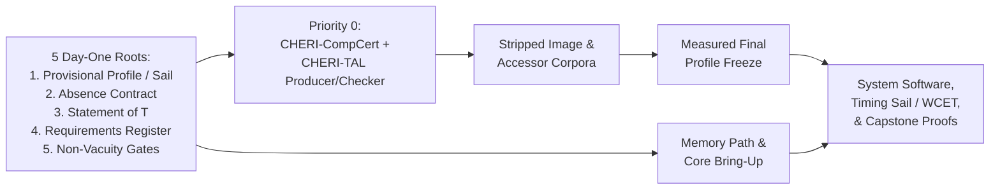

- **First-release laptop staging, 8-workload floor, and resident toolchain (`r-18-004`..`r-18-004e`):**
  - *Release staging (`r-18-004`):* <a id="r-18-004"></a> The first release is the **laptop** ([§2](#2-non-goals-deliberate)) with 802.11 (decoded on radio V-cores unless DSE admits 802.11 LDPC sets to the 5G/6G FEC units, [§15](#15-hardware-platform)) and the wired link—keeping carrier certification, cellular/eUICC/HARQ/5G-AKA/SUCI/Bluetooth (later mobile handset), the no-JIT per-origin browser port ([§17](#17-residual-risks-the-honest-ceiling)), refused messaging, and the five-artifact ensemble instantiation ([§2](#2-non-goals-deliberate)) off its critical path.
  - *Eight-member workload floor (`r-18-004a`):* <a id="r-18-004a"></a> One composed configuration must simultaneously support at absolute register thresholds: **(1)** two-way IP audio call; **(2)** 802.11 data at stated rates over host-software MAC; **(3)** one post-quantum and one classical session; **(4)** 1080p30 webcam stream via software ISP over the call session; **(5)** 1080p60 video decode within declared ceiling; **(6)** an elastic desktop domain launching/closing applications within a stated pool, derived focus dispatch bound, and measured input-to-response latency while a build runs; **(7)** a wholly resident 3B-parameter model generating output; and **(8)** every supported content format reaching a verified parser via the signed handler graph. (Pre-silicon gates do not establish physical mass, thickness, battery endurance, or sustained power.)
  - *Six-line resource pricing, early gates, and fixed demonstration set (`r-18-004b`..`r-18-004d`):* <a id="r-18-004b"></a><a id="r-18-004c"></a><a id="r-18-004d"></a> Priced in **five capacity, bandwidth, and area comparisons** (composed roster demand including island-exclusivity tax and ECC/tag metadata vs. measured single-tier planar supply before complementary-device grading; the 1 GB elastic desktop pool sits in Class 2 beside the 3B model) plus a **sixth die-yield and unit-cost ceiling line** (derived from frozen configuration and wafer cost against R-17-063b's process-stack assumption, checked on the first production lot). Each clause names its deciding gate/artifact (composition checks demand floors, roster completeness, and derived focus bounds; qualification checks macro supply, latency magnitudes at admitted OPPs, and declared mode power against battery capacity), evaluated on a **demonstration set fixed before exploration**.
  - *Resident self-hosting toolchain (`r-18-004e`):* <a id="r-18-004e"></a> Ships in the first release ([§13](#13-packaging--supply-chain), running inside the elastic desktop domain during the floor test) and must offline-build and launch a modified Wasm app bundle in one session ([§14](#14-userland)), then compose, sign, admit, and boot two native generations (one modifying a native package, one reproducibly rebuilding the base image). Every component's redistribution license is verified at incorporation ([THIRD-PARTY.md](../THIRD-PARTY.md) records the non-commercial CompCert backend grant; turnaround is owned by [the product-gate contract](implementation/contracts/product-gate.md)).

- **Workstream realization and staging (`r-18-005`..`r-18-037`):**

| Workstream | Staging Order, Deliverables, & Acceptance Discipline |
| --- | --- |
| **Hardware, Memory Path, & Open DSE Questions** <a id="r-18-005"></a><a id="r-18-006"></a><a id="r-18-007"></a><a id="r-18-008"></a><a id="r-18-008a"></a><a id="r-18-009"></a> | Starts with C-class scalar + software rendering → C+RVV under CHERI → V-class → M-class → FEC → islands/TDM NoC → capability-checked DMA and tag fabric (Ara, Gemmini, open LDPC/polar, CVA6/Ibex, OpenTitan, and TDM NoCs as references; frozen RV64IMV+CHERI purecap profile applies from the first FPGA). **Memory path leads (`r-18-007`..`r-18-008a`):** fixed-latency granule RMW, ECC, and bank/macro/tier decode with zero crypto/tree blocks; sequential-3D SRAM is a discrete manufacturing branch (single-tier 0.5–1 GB planar part must close the roster; bonded stacks/chiplets stay rejected). **Two open DSE questions (`r-18-009`):** static instruction scratchpad (excluded on slotted cores; DSE parameter on pinned single-tenant cores) and sequential consistency vs. Ztso (`fence.t` and `Zaamo` remain required either way). |
| **`RTL ⊑ Sail`, Absence Contract, & Tapeout** <a id="r-18-010"></a><a id="r-18-011"></a><a id="r-18-012"></a><a id="r-18-013"></a><a id="r-18-013a"></a><a id="r-18-013b"></a> | **Four-rung `RTL ⊑ Sail` ladder (`r-18-010`..`r-18-011`):** (1) `riscv-formal`/RVFI BMC → (2) Sail-generated SV + commercial FEV for imported cores → (3) Isla `Zkt`/`Zvkt`, Ztso, and static-fetch obligations → (4) unbounded Kami/Kôika Coq theorem for authored blocks (Bedrock2+Kami spine; 2-safety/hyperproperty timing is the hard half). **[Absence contract](hardware/absence-contract.md) (`r-18-012`..`r-18-013`):** day-one gate checking state enumeration, table-freeness, synthesis provenance, and `fence.t` completeness (in-prover for Kôika/Kami, netlist audit for imported cores; pre-close units assert [§1](#1-goals) evidence tier). **Tapeout (`r-18-013a`..`r-18-013b`):** requires (a) bit-reproducible physical flow across two hosts (pinned tools/seeds/traversal, no timestamps), (b) commercial LEC + LVS evidence, and (c) a handoff-signed mask-set digest in attested identity (uniquely irreversible if deferred). |
| **Shared Certifying Backend & Lowering Completeness** <a id="r-18-014"></a><a id="r-18-014a"></a><a id="r-18-014b"></a><a id="r-18-014c"></a><a id="r-18-014d"></a><a id="r-18-014e"></a><a id="r-18-014f"></a><a id="r-18-014g"></a><a id="r-18-014h"></a><a id="r-18-014i"></a> | Re-homes Coq-native **SECOMP2CHERI** to the [§15](#15-hardware-platform) purecap profile; both C/Gallina synthesis (Rupicola/Bedrock2, Narcissus, Vélus) and the safe-Rust MIR front end share this single **CHERI-CompCert (`Clight`/`Cminor`)** native backend. **Mandatory completeness (`r-18-014a`..`r-18-014i`):** latency-aware scheduling, RVV autovectorization/SLP, `Zicond` if-conversion (plus conditional capability move), frozen fusion-pair preservation, capability indexed loads/stores, bitfield ops, translation-validated linker relaxations, [§5](#5-languages--verification) primitives, static memory-plan lexicographic layout ([§8](#8-authority-model)), **WCET-bound-directed lowering**, and encoded-size-constrained closed-world LTO (inlining, unrolling, superblocks balanced against R-15-036p outlining). **Three vector lowering duties (`r-18-014g`..`r-18-014i`):** (1) prefer constant-time unit-stride/segment/whole-register forms over fully-conflicted gathers; (2) emit mask predication for element-varying conditions and scalar branches for uniform ones; and (3) keep VL=1 scalar-float chains in vector registers and batch independent ops via SLP. Only modulo scheduling/software pipelining (`r-18-014f`) is optional per-loop on RVV hot kernels. |
| **Rust Certifier & CHERI-TAL Integration** <a id="r-18-015"></a><a id="r-18-016"></a><a id="r-18-017"></a><a id="r-18-018"></a><a id="r-18-019"></a><a id="r-18-020"></a> | Charon/Aeneas- or RefinedRust/Radium-lineage MIR front end lowers through shared CHERI-CompCert, propagates definition-site relevance grades (`r-18-016`), and uses Foundational-VeriFast-style **hinted mirroring** (`r-18-017`) so a small Coq replayer reconstructs per-binary CHERI-TAL derivations. Deliverables (`r-18-018`): (a) lowering/derivation emission (Radium preservation backfilled for completeness), (b) pinned `cheri-rv64` TAL + Coq soundness metatheorem, (c) checker/oracle-compressed-proof integration, and (d) Verus/Prusti/Aeneas (VerusBelt) manual-proof path for HAL `unsafe`. **Soteria-rust** is a bug-finding oracle only (`r-18-019`). Cranelift/Crocus is SMT-trust reference material, never the shipped certifier, an admission path or an interim anchor (`r-18-020`, as [Arrival](https://www.contrib.andrew.cmu.edu/~bparno/papers/arrival.pdf)'s `sdiv` overflow-trap bug in [Wasmtime issue 9537](https://github.com/bytecodealliance/wasmtime/issues/9537) illustrates). |
| **Cryptography & WCET Cost Attribute** <a id="r-18-021"></a><a id="r-18-022"></a><a id="r-18-023"></a><a id="r-18-024"></a><a id="r-18-025"></a> | **Three crypto deliverables (`r-18-021`..`r-18-023`):** (1) Coq-native SSProve/FCF reductions (EasyCrypt/Why3/SMT retiring interim; Formosa ML-KEM as composition anchor), (2) implementation-to-functional-spec composition, and (3) binary-level CT via CHERI-TAL taint typing + relational Sail logic for unstructured residuals (Binsec/Rel for bring-up; CryptOpt/assembly-checker route **deleted**). **WCET (`r-18-024`..`r-18-025`):** CHERI-TAL cost attribute projected from timing-annotated Sail using Shaw max-path/tree-sum schemas (standalone verified IPET/LP estimator retired; aiT/Heptane as untrusted cross-checks). |
| **Storage, Radio, & Conditional Memory Capacity** <a id="r-18-026"></a><a id="r-18-027"></a><a id="r-18-028"></a><a id="r-18-029"></a><a id="r-18-030"></a><a id="r-18-030a"></a> | **Storage (`r-18-026`..`r-18-027`):** TCB reader + A/B transactor lead; non-TCB 4-layer Coq stack follows (L0 GoJournal over CompCert-C/VST/Iris, L1 VeriBetrFS B$^\varepsilon$-tree, L2 RefFS/MoLi linearizability/crash/liveness, L3 SFSCQ/DiskSec NI + AEAD). **Radio (`r-18-028`..`r-18-029`):** starts on off-die AD936x-class register-slave SDR behind certified analog front end (openwifi SIFS sequencer, srsRAN/aff3ct oracles); NR RRC generated via verified X.691-UPER ASN.1→Narcissus from TS 38.331, 5G NAS TS 24.501 hand-authored in Narcissus and differentially tested. **Memory capacity (`r-18-030`..`r-18-030a`):** Class 1 starts at 0.5–1 GB planar (4–16 GB awaits sequential-3D materials gate; logic tier stays frontside-powered FD-SOI for IRIS); Class 2 holds framebuffer, bounded origins, and 3B model, gated on repaired-macro qualification. |
| **Capstone Composition, Register, & Conformance** <a id="r-18-031"></a><a id="r-18-032"></a><a id="r-18-034"></a><a id="r-18-035"></a><a id="r-18-036"></a><a id="r-18-037"></a> | **Composition proof (`r-18-031`..`r-18-032`):** state $T$ and seam lemmas now in Iris-over-Sail, discharge linking incrementally, and maintain reviewed $D$ and $Ax$ ledgers (hard prerequisite for strong G3). **[Requirements register](requirements-register.md) (`r-18-034`..`r-18-035`):** release-gating workstream outputting the extraction-defect agenda. **Generated conformance campaigns (`r-18-036`..`r-18-037`):** model-checked and FPGA/replay-validated campaigns for every bounded pool/action ladder ([§8](#8-authority-model), [§16](#16-reliability)) and every SPSC ring interface ([§12](#12-system-servers-contained-outside-the-tcb)). |

Two requirements never trade: **the verified TCB and capabilities as the sole authority**. Ship date, core counts, radio bandwidth, acceleration, and everything else bend around them. <a id="r-18-033"></a>

---

## 19. Evaluated Architectural Alternatives (non-normative)

This section is **non-normative** and lives in its own document (see **[Evaluated Architectural Alternatives](background/architectural-alternatives.md)**) while remaining part of the living document.
